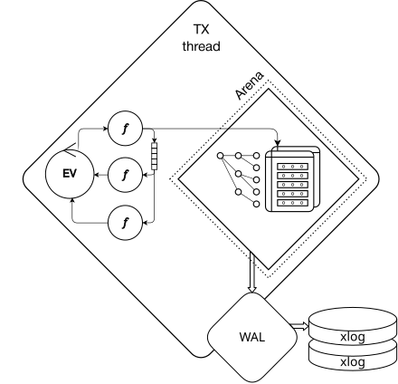
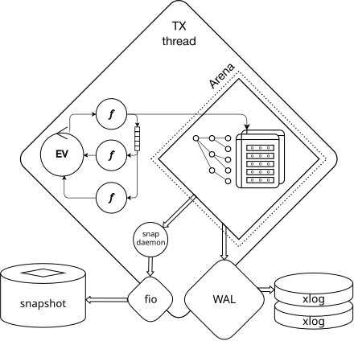
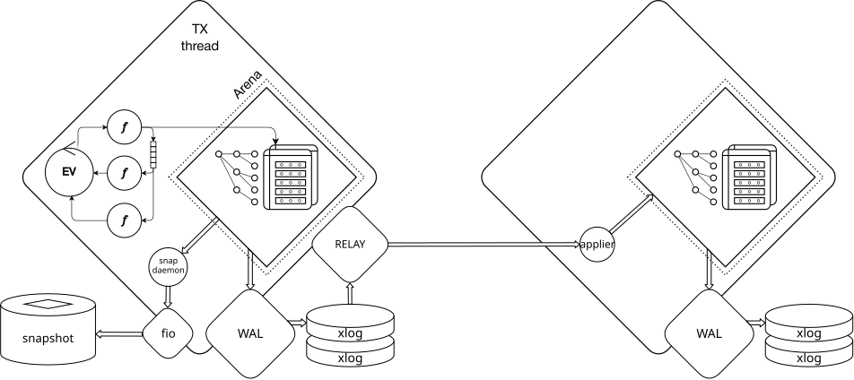

# Персистентность данных {: #data-persistence }

В данной статье рассматривается обеспечение персистентности данных в
Picodata при использовании движков хранения `memtx` и `vinyl`.

См. подробнее:

- [Движки хранения](engines.md)

## Способы обеспечения персистентности {: #persistence_means }

Основной способ обеспечения персистентности данных в Picodata
заключается в использовании [журнала упреждающей записи
(WAL)](../overview/glossary.md#wal).

После выполнения запросов на изменение журналируемых таблиц Picodata
записывает каждый такой запрос в WAL-файлы (`.xlog`), которые хранятся
на диске. Служба журналирования выполняется в отдельном **WAL-потоке** и
является общей для движков `memtx` и `vinyl`. Журнал позволяет
восстановить изменения, которые к моменту сбоя ещё не вошли в
сохранённое состояние движка на диске.

При обработке транзакций признаком её успешного завершения (фиксации в
БД) является попадание в WAL. Транзакция считается успешно применённой
только после того, как WAL-поток запишет все её изменения.

Параллельно WAL-потоку Picodata периодически делает полный [снимок базы
данных](../overview/glossary.md#snapshotting) и сохраняет его на диск.
Это нужно, чтобы ускорить перезапуск инстанса: если файлов WAL слишком
много, то восстановление только из них (без снимка `.snap` в `memtx` или файлов
`.run` в `vynil`) может занять слишком
много времени.

С точки зрения устройства памяти, служба WAL является внешним
дополнением относительно **потока процессора транзакций**
(**TX-потока**). Внутри этого потока находятся:

- область памяти для хранения данных (Arena)
- цикл событий (EV) с работающими внутри его файберами (_f_)

См. также:

- [Модель памяти](engines.md#memory-model)

## Снимки и контрольные точки {: #snapshots_and_checkpoints }

Персистентность `memtx` основана на журналировании и механизме
контрольных точек — [checkpoint]. Контрольная точка связывает
согласованное состояние данных, сохранённое на диске, с определённой
позицией в журнале. Для `memtx` таким сохранённым состоянием является
полный снимок журналируемых таблиц в файле `.snap`, который строится из
данных в оперативной памяти. Управлением снимками на уровне инстанса
занимается отдельный поток `snapshot`, использующий для работы с диском
библиотеку `fio`.

[checkpoint]: ../overview/glossary.md#checkpoint

Снимок логически заменяет префикс журнала — начальную последовательность
записей до контрольной точки. Он содержит результат применения этих
изменений, поэтому при восстановлении их не нужно выполнять заново.
Picodata загружает последний снимок в память, восстанавливает индексы и
применяет последующие записи WAL. Например, если строка до контрольной
точки обновлялась тысячу раз, снимок сохраняет её итоговое значение, что
позволяет пропустить эти тысячу обновлений при восстановлении. Такой
подход сокращает время запуска и позволяет освобождать место, занятое
старой историей изменений.

См. также:

- [Описание персистентности](../overview/glossary.md#persistence)

Замена префикса журнала снимком не означает немедленного удаления старых
файлов WAL. Их удаляет сборщик мусора, когда они больше не нужны для
восстановления из сохраняемых контрольных точек, репликации и других
потребителей журнала.

## Репликация {: #replication }

WAL также служит источником изменений для [репликации](engines.md#replication)
внутри репликасета. Поток `relay` читает записи журнала и отправляет их
репликам. На принимающем инстансе файбер `applier` применяет изменения к
соответствующему движку хранения и записывает их в локальный WAL. Этот
механизм общий для `memtx` и `vinyl`.

Даже в чрезвычайных ситуациях, например при отключении питания
или сбое инстанса Picodata, когда база данных в памяти теряется, данные
можно полностью восстановить при перезапуске инстанса (при условии, что
для параметра
[`tier.wal_mode`](../reference/config.md#cluster_tier_tier_wal_mode)
было установлено значение `fsync`).

## Особенности движка Vinyl {: #vinyl_persistence }

У движка `vinyl` основное состояние данных постоянно хранится на диске в виде
LSM-деревьев. Новые изменения накапливаются в памяти и защищаются общим
WAL, а затем сбрасываются в отсортированные файлы `.run`. Сопутствующие
файлы `.index` позволяют находить страницы данных. Фоновые слияния
объединяют файлы и удаляют устаревшие версии записей.

См. также:

- [Компактизация](../overview/glossary.md#compaction)

Отдельный журнал `.vylog` хранит метаданные структуры LSM-деревьев:
сведения о файлах, диапазонах и связях между ними. Он дополняет журнал
`.xlog`, который содержит изменения данных.

Для движка `vinyl` также создаются контрольные точки. При их формировании движок
завершает сброс относящихся к контрольной точке изменений из памяти и
сохраняет необходимые метаданные. Уже существующие файлы LSM-деревьев
используются повторно, поэтому создание контрольной точки не требует
полной перезаписи всех данных в отдельный снимок. При перезапуске `vinyl`
восстанавливает структуру дискового хранилища по метаданным и применяет
необходимые записи WAL, пропуская изменения, уже сохранённые в файлах
данных. Полностью загружать содержимое таблиц в оперативную память для
этого не требуется.

Подробнее о файлах, в которых Picodata хранит WAL, снимки и данные
движка `vinyl`, см. в разделе [Рабочие файлы
инстанса](instance_runtime_files.md).

## Восстановление при перезапуске инстанса {: #instance_restart }

Что происходит при перезапуске инстанса, который хранит данные с помощью движка `memtx`:

1. Picodata находит последний файл снимка и читает его.
2. Picodata находит все файлы WAL, созданные после этого снимка, и тоже
   читает их.
3. После чтения снимка и файлов WAL в памяти появляется полностью
   восстановленный набор данных, соответствующий состоянию на момент
   остановки инстанса Picodata.
4. Во время чтения снимка и файлов WAL Picodata строит первичные
   индексы.
5. Когда все данные снова находятся в памяти, Picodata строит вторичные
   индексы.
6. Инстанс Picodata готов к работе: входит в состав кластера, принимает запросы.

При использовании движка `vinyl` последовательность будет отличаться:

1. Picodata восстанавливает структуру LSM-дерева из файлов с метаданными (`.vylog`)
2. Picodata сравнивает сохранённые ранее данные в run-файлах с  WAL и затем считывает в
   память только то, что не попало в run-файлы
3. Инстанс Picodata готов к работе после того как в памяти появляется полностью
   восстановленный набор данных, соответствующий состоянию на момент
   остановки инстанса.
