# Движки хранения

## Общие сведения {: #intro }

Движок хранения — это внутренний компонент базы данных, который
определяет, как и где физически сохраняются данные, а также как они
индексируются и считываются. Picodata поддерживает работу
со следующими движками:

- `memtx` — движок по умолчанию, предназначенный для хранения данных и
  индексов в оперативной памяти (ОЗУ). Такой способ хранения обеспечивает
  низкую задержку чтения и записи при условии, что данные и индексы
  помещаются в доступную память. Для того чтобы данные можно было восстановить после перезапуска
  инстанса, Picodata [сохраняет изменения на диск][персистентность].
  Если при создании [таблицы] явно не указан способ хранения данных, будет
  использован `memtx`;
- `vinyl` — дисковый движок, предназначенный для наборов данных, размер
  которых может превышать объем доступной оперативной памяти. Основная
  часть данных находится на диске, а в ОЗУ доступны рабочие структуры и
  кэш часто используемых данных. Движок `vinyl` работает на основе
  журнально-структурированных деревьев со слиянием, или LSM-деревьев
  (Log Structured Merge Tree), которые показывают хорошую
  производительность при работе c твердотельными дисками (SSD).
  Последние отличаются высокими показателями чтения, особенно в
  сравнении с более медленной записью данных.

[таблицы]: ../overview/glossary.md#table
[персистентность]: ../overview/glossary.md#persistence

## Обзор движков хранения {: #engines_overview }

### memtx {: #memtx }

`memtx` хранит данные и индексы в оперативной памяти (ОЗУ). Изменения
записываются в журнал упреждающей записи
([WAL](../overview/glossary.md#wal)), а для ускорения перезапуска
Picodata периодически создает снимки данных.

Основные свойства `memtx`:

- низкая задержка чтения и записи;
- данные и индексы должны помещаться в доступную память;
- поддерживаются индексы `TREE`, `HASH`, `RTREE` и `BITSET`;

`memtx` подходит для горячих данных, частых точечных запросов, небольших
и средних наборов данных, а также для сценариев, где требуется
минимальная задержка. При расчете требуемой памяти учитывайте объем
таблиц, индексов и системного аллокатора. См. [рекомендации по
сайзингу](../admin/sizing.md#sizing_memtx) и раздел [Хранение системных
таблиц в памяти](memtx_allocator.md).

### vinyl {: #vinyl }

`vinyl` хранит основной объем данных на диске, а в памяти размещает
рабочие структуры и кэш. В основе движка лежат LSM-деревья: изменения сначала
попадают в память, затем сбрасываются на диск и в фоне объединяются.

Основные свойства `vinyl`:

- подходит для данных, которые не помещаются в ОЗУ при том, что характер
  нагрузки допускает использование дискового ввода/вывода
- обеспечивает предсказуемую работу с большими объёмами данных
- поддерживает `TREE`-индексы

`vinyl` следует выбирать для больших наборов данных, когда объем важнее
минимальной задержки, а профиль нагрузки допускает дисковый ввод-вывод.

### Сравнение возможностей {: #feature-comparison }

| Возможность                    | memtx                             | vinyl                  |
|--------------------------------|-----------------------------------|------------------------|
| Основное хранилище             | ОЗУ                               | диск и кэш в ОЗУ       |
| Движок по умолчанию            | да                                | нет                    |
| Типы индексов                  | `TREE`, `HASH`, `RTREE`, `BITSET` | `TREE`                 |
| Глобальные таблицы             | да                                | нет                    |
| Нежурналируемые таблицы        | да                                | нет                    |

### Настройка движка хранения {: #configuring-storage-engine }

Движок хранения указывается при создании таблицы с помощью предложения
`USING`. Параметры движка `vinyl` можно задавать для таблицы или индекса
в предложении `WITH`.

```sql
CREATE TABLE warehouse (
    id INTEGER PRIMARY KEY,
    item TEXT NOT NULL)
USING vinyl WITH (
    BLOOM_FPR = 0.05,
    RUN_SIZE_RATIO = 3.5,
    PAGE_SIZE = 8192,
    RANGE_SIZE = 1073741824,
    RUN_COUNT_PER_LEVEL = 2
)
DISTRIBUTED BY (id);
```

См. также:

- [CREATE TABLE](../reference/sql/create_table.md#params)
- [CREATE INDEX](../reference/sql/create_index.md#params)
- [Типы таблиц](../basics/table_types.md)
- [Параметры конфигурации движка `vinyl`](../reference/config.md#instance_vinyl_bloom_fpr)

## Репликация данных {: #replication }

Механизм репликации данных является общим как для движка `memtx`, так и
`vinyl`.

[Репликация](../overview/glossary.md#replication) позволяет нескольким
инстансам Picodata работать с копиями одного набора данных. Для
шардированных таблиц изменения распространяются внутри
[репликасета](../overview/glossary.md#replicaset). Репликация
выполняется через передачу записей журнала упреждающей записи (WAL).
Глобальные таблицы синхронизируются на уровне кластера через
[Raft-журнал](../overview/glossary.md#log_replication).

Для отправки данных Picodata запускает для каждой реплики отдельный поток
**relay**. Его задача — читать файлы WAL и отправлять их другим репликам. На
реплике запускается файбер **applier**, который получает изменения от
удаленного узла и применяет их к области Arena реплики. Все изменения
записываются в файлы WAL через WAL-поток реплики так, как если бы они
выполнялись локально.

По умолчанию [репликация](../overview/glossary.md#replication) в
Picodata асинхронная: если транзакция зафиксирована локально на
мастер-узле, это не означает, что она реплицирована на какие-либо
реплики.

[Синхронная репликация](../basics/sync_replication.md) используется для
получения более строгих гарантий. Синхронные транзакции не считаются
зафиксированными, и клиент не получает ответ, пока они не реплицированы
на заданное количество реплик.

## Внутреннее устройство Memtx {: #memtx_design }

### Модель памяти {: #memory-model }

В Picodata есть фиксированное число независимых [потоков
выполнения](fibers.md#fibers_threads). Потоки не используют общее
состояние — вместо этого они обмениваются данными через очереди
сообщений с низкими накладными расходами. Такой подход ограничивает
количество ядер, которые использует инстанс, но устраняет конкуренцию за
шину памяти и обеспечивает максимальную масштабируемость доступа к
памяти и сетевой пропускной способности.

#### Обработка транзакций на уровне инстанса {: #transactions_instance }

Доступ к базе данных производится только из одного потока — **потока
процессора транзакций** (далее **TX-поток**). У каждого инстанса
Picodata есть только один TX-поток. В этом потоке транзакции выполняются строго
последовательно. Многооператорные транзакции нужны для обеспечения
изоляции: каждая транзакция видит консистентное состояние базы данных и
атомарно фиксирует все свои изменения. Во время фиксации происходит
передача управления, а все изменения транзакции записываются в
[WAL](../overview/glossary.md#wal) одним пакетом. Если при выполнении
транзакции возникают ошибки, транзакция полностью откатывается.

Внутри потока TX есть область памяти, в которой Picodata хранит данные.
Эта область называется **Arena**.


Данные хранятся в [таблицах](../overview/glossary.md#table).
Таблицы содержат записи базы данных —
[кортежи](../overview/glossary.md#tuple). Чтобы обращаться к
данным, хранящимся в таблицах и кортежах, и изменять их, Picodata создаёт
[индексы](../overview/glossary.md#index).

Распределением памяти для таблиц, кортежей и индексов внутри области
Arena управляют специальные аллокаторы. Для хранения кортежей главным
образом используется аллокатор slab. Статистику распределения slab в
Picodata, включая общее использование памяти и её фрагментацию, можно
отслеживать с помощью метрик
[tnt_slab_*](../reference/metrics.md#tnt_slab_arena_size).

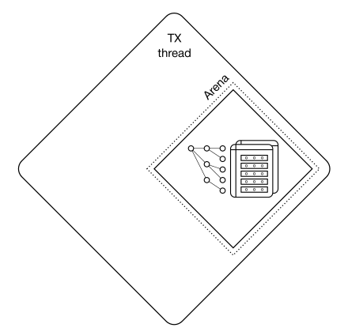

Также внутри TX-потока есть цикл событий. В цикле событий работает
несколько [файберов](../overview/glossary.md#fiber). Файберы — это
кооперативные примитивы, которые позволяют взаимодействовать с
таблицами, то есть читать и записывать данные, используя [кооперативную
многозадачность](fibers.md).

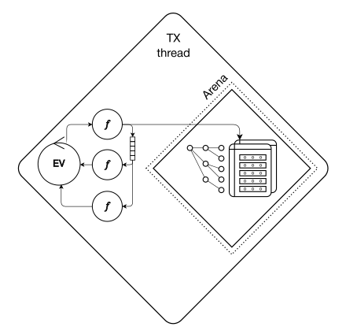

#### Обработка транзакций на уровне кластера {: #transactions_cluster }

Описанный выше механизм относится к выполнению транзакций внутри одного
инстанса. На уровне SQL-интерфейса кластера Picodata несколько операций
можно объединить в [транзакционный блок](../reference/sql/transactions.md)
вида `DO $$ BEGIN ... END $$;`. Клиент передает весь блок одним
SQL-запросом, а Picodata определяет, на каком инстансе его выполнить.

Инстанс, принявший запрос, выступает координатором. При построении
плана Picodata проверяет, что все обращения к шардированным таблицам
внутри блока затрагивают один и тот же
[бакет](../overview/glossary.md#bucket) и не требуют межузлового
перемещения данных. По ключу шардирования определяется номер бакета,
а с помощью Vshard — репликасет, которому он принадлежит. Блок,
изменяющий данные, направляется на мастер этого репликасета.

На целевом инстансе команды блока выполняются в TX-потоке в рамках одной
локальной транзакции: при успешном завершении все изменения фиксируются
вместе, а ошибка выполнения приводит к их откату. Транзакционные блоки,
направленные в разные репликасеты, могут выполняться параллельно.

Один блок может обращаться к нескольким шардированным таблицам,
если необходимые строки находятся в одном бакете. Ограничение одним
бакетом действует и тогда, когда несколько бакетов размещены
в одном репликасете. Транзакции, требующие обработки данных
на нескольких узлах, в текущей реализации не поддерживаются.

Внутри блока разрешено читать глобальные таблицы: их локальные копии
доступны на узле выполнения. Изменять глобальные таблицы в блоке
нельзя. Кроме того, все используемые таблицы должны относиться
к одному движку хранения, а читающие команды `LET` и `RETURN QUERY`
должны предшествовать первой модифицирующей команде.
Полный перечень условий приведен в разделе
[Ограничения транзакционных блоков](../reference/sql/transactions.md#limitations).

Изменения журналируемых шардированных таблиц передаются остальным
инстансам репликасета через WAL.

При асинхронной репликации успешное
завершение блока не означает, что изменения уже получены репликами.
При [синхронной репликации](../basics/sync_replication.md) успешный
ответ клиенту возвращается после подтверждения записи кворумом
репликасета.

См. также:

- [Персистентность данных](data_persistence.md)

### Доступ к данным {: #accessing-data }

Для доступа к данным в памяти и управления ими Picodata строит индексы.
Индексы также хранятся в памяти внутри области Arena.

При использовании движка `memtx` Picodata поддерживает несколько типов
[индексов](../reference/sql/create_index.md#params), предназначенных
для разных сценариев использования. Возможные типы: `TREE`, `HASH`, `BITSET` и
`RTREE`.

Запросы выборки возможны как по ключам вторичного индекса, так и по
первичным ключам. Индексы могут иметь составные ключи.

## Внутреннее устройство Vinyl {: #vinyl_design }

### Алгоритм {: #algorithm }

В основе движка `vinyl` находятся журнально-структурированные деревья со
слиянием, или LSM-деревья (Log Structured Merge Tree). В системах с
SSD-дисками, у которых в несколько раз выше производительность чтения по
сравнению с производительностью записи, LSM-деревья позволяют эффективно
обрабатывать большинство типовых нагрузок.

Перед описанием LSM-деревьев в Picodata следует рассмотреть устройство
обычного B-дерева и связанные с ним ограничения. «B» в слове B-tree
означает «Block», то есть это
сбалансированное дерево, состоящее из блоков, которые содержат
отсортированные списки пар ключ-значение. При наполнении дерева
получается отсортированный по возрастанию ключа контейнер, минимальный
элемент которого хранится в крайнем левом узле, а максимальный – в
крайнем правом. Ниже описаны поиск и вставка данных в B-дереве.

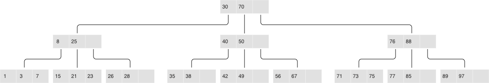

_Классическое B-дерево_

Если нужно найти элемент или проверить его наличие, поиск идёт с корня.
Если ключ найден в корневом блоке, поиск завершается. В противном случае
алгоритм переходит в самый правый блок,
содержащий наибольший элемент, не превосходящий искомый ключ (напомним,
что элементы на каждом уровне отсортированы). Если на первом уровне
результат не найден, поиск продолжается на следующем уровне. В конце
концов алгоритм попадает в один из листьев и, вероятно, находит нужный
ключ. Блоки хранятся и считываются в оперативную память по одному, то
есть за один поиск алгоритм считывает \(log_{B}(N)\) блоков, где N –
количество элементов в B-дереве. В простейшем случае запись выполняется
похожим образом: алгоритм находит блок, содержащий нужный элемент, и
обновляет (вставляет) его значение.

В качестве примера можно рассмотреть B-дерево на 100 000 000 узлов при
размере блока 4096 байтов,
а размер элемента – 100 байтов. Таким образом, в каждом блоке можно
будет разместить до 40 элементов с учетом накладных расходов, а в
B-дереве будет около 2 570 000 блоков, пять уровней, при этом первые
четыре займут по 256 МБ, а последний – до 10 ГБ. В типичной
конфигурации все уровни, кроме последнего, могут находиться в кэше
файловой системы, поэтому операция чтения обычно требует не более одной
операции ввода-вывода.

Ситуация меняется при смене точки зрения. Предположим, что необходимо
обновить один элемент дерева. Так как операции с B-деревьями работают
через чтение и запись целых блоков, приходится прочитать 1 блок в
память, изменить 100 байт из 4096, а затем записать обновленный блок на
диск. В результате объем фактически записанных данных оказывается в 40
раз больше объема измененных данных.

Принимая во внимание, что внутренний размер блока в SSD-дисках может
быть 64 КБ и больше, и не любое изменение элемента меняет его целиком,
объем избыточной нагрузки на диск может быть ещё выше.

Такое избыточное чтение называется read amplification (усиление чтения),
а избыточная запись – write amplification (усиление записи).

Коэффициент увеличения, то есть коэффициент умножения, вычисляется как
отношение размера фактически прочитанных (или записанных) данных к
реально необходимому (или измененному) размеру. В примере выше с
B-деревом коэффициент составит около 40 как для чтения, так и для
записи.

Объем избыточных операций ввода-вывода при обновлении данных является
одной из основных проблем, которую решают LSM-деревья. Ниже описан этот
механизм.

Ключевое отличие LSM-деревьев от классических B-деревьев заключается в
том, что LSM-деревья не просто хранят данные (ключи и значения), а также
операции с данными: вставки и удаления.


LSM-дерево:

- **Хранит операции, а не только значения:**

  - `REPLACE`
  - `DELETE`
  - `UPSERT`
- Каждая операция помечается [LSN](../overview/glossary.md#lsn).
- Файлы доступны только для дозаписи, устаревшие данные удаляются после
  создания контрольной точки.
- Изменения файловой системы фиксируются в журнале `vylog`.

Например, элемент для операции вставки, помимо ключа и значения,
содержит дополнительный байт с кодом операции – обозначенный выше как
`REPLACE`. Элемент для операции удаления содержит ключ элемента (хранить
значение нет необходимости) и соответствующий код операции – `DELETE`.
Также каждый элемент LSM-дерева содержит порядковый номер операции (log
sequence number – LSN), то есть значение монотонно возрастающей
последовательности, которое уникально идентифицирует каждую операцию.
Таким образом, всё дерево упорядочено сначала по возрастанию ключа, а в
пределах одного ключа – по убыванию LSN.

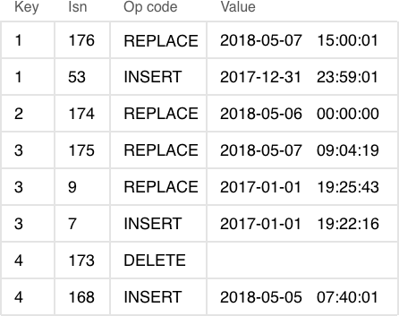

_Один уровень LSM-дерева_

#### Наполнение LSM-дерева {: #filling-an-lsm-tree }

В отличие от B-дерева, которое полностью хранится на диске и может
частично кэшироваться в оперативной памяти, в LSM-дереве разделение
между памятью и диском явно присутствует с самого начала. При этом
проблема сохранности данных, расположенных в энергозависимой памяти,
выносится за рамки алгоритма хранения: её можно решить разными
способами, например, журналированием изменений.

Часть дерева, расположенную в оперативной памяти, называют L0 (level
zero – уровень ноль). Объем оперативной памяти ограничен, поэтому для L0
отводится фиксированная область. В конфигурации Picodata, например,
размер L0 задается с помощью параметра [instance.vinyl.memory]. В начале, когда
LSM-дерево не содержит элементов, операции записываются в L0. Следует
отметить, что элементы в дереве упорядочены по возрастанию ключа, а
затем по убыванию LSN, так что в случае вставки нового значения по
данному ключу легко обнаружить и удалить предыдущее значение. L0 может
быть представлен любым контейнером, который сохраняет упорядоченность
элементов. Например, для хранения L0 Picodata использует B+*-дерево.
Операции поиска и вставки – это стандартные операции структуры данных,
используемой для представления L0.

[instance.vinyl.memory]: ../reference/config.md#instance_vinyl_memory

Рано или поздно количество элементов в дереве превысит размер L0. Тогда
L0 записывается в файл на диске (который называется прогоном – «run») и
освобождается под новые элементы. Эта операция называется «дамп» (dump).

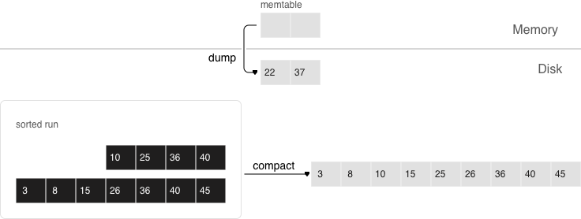

Все дампы на диске образуют последовательность, упорядоченную по LSN:
диапазоны LSN в файлах не пересекаются, а ближе к началу
последовательности находятся файлы с более новыми операциями. Эти файлы
можно представить в виде пирамиды, где новые файлы расположены вверху, а
старые внизу. По мере появления новых файлов прогонов высота пирамиды растет.
При этом более свежие файлы могут содержать операции удаления или замены
для существующих ключей. Для удаления старых данных необходимо выполнять
сборку мусора (этот процесс иногда называется «слияние» – в английском
языке «merge» или «compaction»), объединяя несколько старых файлов в
новый. Если при слиянии обнаруживаются две версии одного и того же
ключа, достаточно оставить только более новую версию. Если после вставки
ключ был удален, из результата можно исключить обе операции.

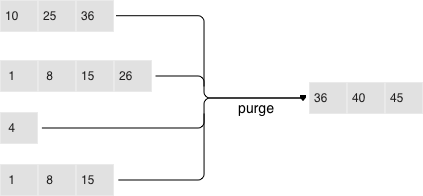

Ключевым фактором эффективности LSM-дерева является то, в какой момент и
для каких файлов делается слияние. Если LSM-дерево в качестве ключей
хранит монотонную последовательность вида 1, 2, 3 … и операций удаления
нет, слияние не дает существенного эффекта: все элементы уже
отсортированы, дерево не содержит устаревших записей и можно однозначно
определить, в каком файле находится каждый ключ. Напротив, если
LSM-дерево содержит много операций удаления, слияние позволяет
освободить место на диске. Но
даже если удалений нет, а диапазоны ключей в разных файлах сильно
пересекаются, слияние может ускорить поиск, так как сократит число
просматриваемых файлов. В этом случае имеет смысл выполнять слияние
после каждого дампа. Однако следует отметить, что такое слияние приведет
к перезаписи всех данных на диске, поэтому при небольшой доле чтений
целесообразно выполнять слияния реже.

Для оптимальной конфигурации под любой из описанных выше сценариев в
LSM-дереве все файлы организованы в пирамиду: чем новее операции с
данными, тем выше они находятся в пирамиде. При этом в слиянии участвуют
два или несколько соседних файлов в пирамиде; по возможности выбираются
файлы примерно одинакового размера.

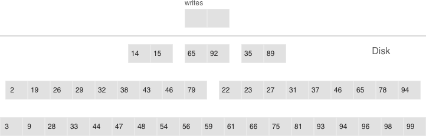

- Многоуровневое слияние может охватывать любое количество уровней
- Один уровень может содержать несколько прогонов

Все соседние файлы примерно одинакового размера составляют уровень
LSM-дерева на диске. Соотношение размеров файлов на различных уровнях
определяет пропорции пирамиды, что позволяет оптимизировать дерево под
интенсивные вставки, либо интенсивные чтения.

Например, если размер L0 составляет 100 МБ, соотношение размеров файлов
на каждом уровне (параметр [instance.vinyl.run_size_ratio]) равно 5, а
на каждом уровне может быть не более 2 файлов (параметр
[instance.vinyl.run_count_per_level]), то после первых трех дампов на
диске появятся 3 файла по 100 МБ. Эти файлы образуют уровень L1. Так как
3 > 2, запустится слияние файлов в новый файл размером 300 МБ, а старые
файлы будут удалены. После ещё 2 дампов снова запустится слияние файлов
размером 100, 100 и 300 МБ. В результате файл размером 500 МБ
переместится на уровень L2, а уровень L1 останется пустым. После ещё 10
дампов на уровне L2 появятся 3 файла по 500 МБ, в результате чего будет
создан один файл размером 1500 МБ. После следующих 10 дампов будет
дважды выполнено слияние 3 файлов по 100 МБ, а также дважды выполнено
слияние файлов размером 100, 100 и 300 МБ. Это приведет к созданию двух
файлов на уровне L2 по 500 МБ. Поскольку на уровне L2 уже есть три
файла, запустится слияние двух файлов по 500 МБ и одного файла в
1500 МБ. Полученный файл размером 2500 МБ будет перемещен на уровень L3.

[instance.vinyl.run_size_ratio]: ../reference/config.md#instance_vinyl_run_size_ratio
[instance.vinyl.run_count_per_level]: ../reference/config.md#instance_vinyl_run_count_per_level

Процесс может продолжаться неограниченно долго, а если в потоке операций с
LSM-деревом будет много удалений, образовавшийся в результате слияния
файл может переместиться не только вниз по пирамиде, но и вверх, так как
окажется меньше исходных файлов, использовавшихся при слиянии. Иными
словами, принадлежность файла к уровню достаточно отслеживать логически
на основе размера файла и минимального и максимального LSN среди всех
хранящихся в нем операций.

#### Управление формой LSM-дерева {: #controlling-the-form-of-an-lsm-tree }

Для уменьшения количества прогонов, просматриваемых при поиске, можно
увеличить соотношение их размеров и тем самым сократить количество
уровней. Для минимизации накладных расходов, связанных со слиянием,
соотношение размеров прогонов можно уменьшить: пирамида станет выше, и
хотя прогоны будут сливаться чаще, они будут меньше, что сократит общий
объем выполняемой работы. В общем случае write amplification в
LSM-дереве описывается формулой \(log_{x}(\frac {N} {L0}) × x\)
или, в другом виде, \(x × \frac {ln (\frac {N} {L0})} {ln(x)}\), где N –
суммарный размер всех элементов дерева, L0 – размер нулевого уровня, а x
– соотношение размеров уровней. При \(\frac {N} {L0}\) = 40 (отношение
размера данных на диске к размеру данных в памяти) график будет
выглядеть примерно так:

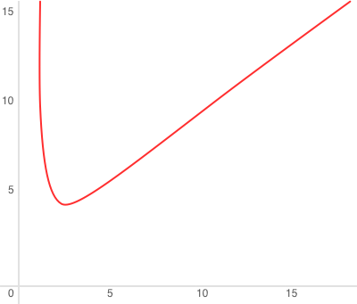

Read amplification при этом пропорционально количеству уровней.
Стоимость поиска на каждом уровне не превышает стоимости поиска в
B-дереве. Для приведенного выше примера дерева в 100 000 000 элементов
при наличии 256 МБ оперативной памяти и стандартных значений параметров
[instance.vinyl.run_size_ratio] и [instance.vinyl.run_count_per_level]
коэффициент write amplification будет равен примерно 13, а коэффициент
read amplification может доходить до 150. Причина этого описана ниже.

#### Поиск {: #search }

При поиске в LSM-дереве необходимо найти не сам элемент, а последнюю
операцию с ним. Если это операция удаления, искомый элемент отсутствует
в дереве. Если это операция вставки, то искомому элементу соответствует
самое верхнее значение в LSM-пирамиде, и поиск можно остановить при
первом совпадении ключа. В худшем случае значение в дереве изначально
отсутствовало. Тогда поиск вынужден последовательно перебрать все уровни
дерева, начиная с L0.

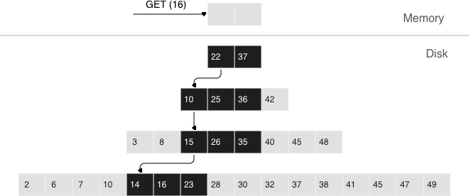

На практике этот худший случай встречается достаточно часто. Например,
при вставке в дерево необходимо убедиться в отсутствии
дубликатов для первичного или уникального ключа. Поэтому для ускорения
поиска несуществующих значений в LSM-деревьях применяется вероятностная
структура данных, которая называется «фильтр Блума».

#### Поиск по диапазону {: #range-searching }

Если при поиске по одному ключу алгоритм завершается после первого
совпадения, то для поиска всех значений в диапазоне (например, всех
пользователей с фамилией «Иванов») необходимо просматривать все уровни
дерева.

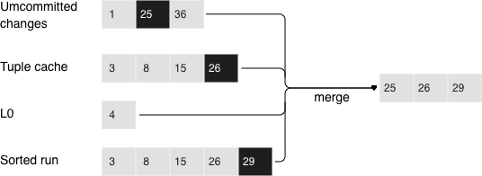

_Поиск по диапазону (24,30)_

Формирование искомого диапазона при этом происходит так же, как и при
слиянии нескольких файлов: из всех источников алгоритм выбирает ключ с
максимальным LSN, отбрасывает остальные операции по этому ключу,
сдвигает позицию поиска на следующий ключ и повторяет процедуру.

#### Удаление {: #deletion }

Операции удаления хранятся, чтобы корректно обрабатывать отсутствие
значений при поиске и очищать дерево от устаревших записей при слиянии.
При удалении записей дерево не переполняется, поскольку маркеры
удаления удаляются во время слияния.

Роль операций удаления при поиске – сообщать об отсутствии искомого
значения, а при слиянии – очищать дерево от устаревших записей с более
старыми LSN.

Пока данные хранятся только в оперативной памяти, нет необходимости
хранить операции удаления. Также нет необходимости сохранять операции
удаления после слияния, если оно затрагивает в том числе самый нижний
уровень дерева – на нем находятся данные самого старого дампа.
Действительно, отсутствие значения на последнем уровне означает, что оно
отсутствует в дереве.

- Из файлов, в которые данные только дописываются, нельзя удалять записи.
- Вместо этого в L0 вставляются маркеры удаления.

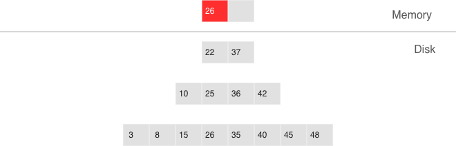

_Удаление, шаг 1: вставка удаленной записи в L0_

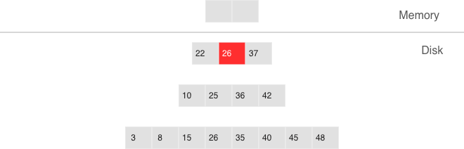

_Удаление, шаг 2: удаленная запись проходит через промежуточные уровни_


_Удаление, шаг 3: при значительном слиянии удаленная запись удаляется из
дерева_

Если известно, что удаление следует сразу за вставкой уникального
значения, например при изменении значения во вторичном индексе, операцию
удаления можно отфильтровывать уже при слиянии промежуточных уровней.
Эта оптимизация реализована в движке `vinyl`.

### Преимущества LSM-дерева {: #advantages-of-an-lsm-tree }

Помимо снижения write amplification, подход с периодическими дампами
уровня L0 и слиянием уровней L1-Lk имеет ряд преимуществ перед подходом
к записи, используемым в B-деревьях:

- Дампы и слияния записывают сравнительно крупные файлы: обычно размер
  L0 составляет 50-100 МБ, что в тысячи раз больше размера блока
  B-дерева.
- Такой размер позволяет эффективно сжимать данные перед записью.
  Picodata сжимает данные автоматически, что дополнительно снижает
  write amplification.
- Накладных расходов на фрагментацию нет, поскольку внутри прогона между
  элементами нет выравнивания и пустого места.
- Все операции создают новые прогоны, а не изменяют старые данные на
  месте. Это позволяет избежать длительных блокировок. Несколько операций
  могут выполняться параллельно, не вызывая конфликтов. Кроме того, это
  упрощает создание резервных копий и перенос данных на реплики.
- Хранение старых версий данных позволяет эффективно реализовать
  поддержку транзакций с помощью многоверсионного управления
  конкурентным доступом.

### Недостатки LSM-дерева и их устранение {: #disadvantages-of-an-lsm-tree-and-how-to-deal-with-them }

Одно из ключевых преимуществ B-дерева как структуры данных для поиска –
предсказуемость: выполнение любой операции занимает не больше
\(log_{B}(N)\). В классическом LSM-дереве, напротив, скорости чтения и
записи могут различаться на порядки. Например, добавление всего одного
элемента в L0 может привести
к переполнению уровня и запустить цепную реакцию на уровнях L1, L2 и так
далее. При поиске нужный элемент может найтись в L0, а может
потребоваться просмотр всех уровней дерева. Кроме того, чтобы получить
скорость, сопоставимую со скоростью B-дерева, необходимо оптимизировать
чтение внутри отдельного уровня. Большинство недостатков можно смягчить
или устранить с помощью дополнительных алгоритмов и структур данных.
Ниже описано, как с ними справляется Picodata.

#### Непредсказуемая скорость записи {: #unpredictable-write-speed }

Вставка данных в LSM-дерево почти всегда задействует исключительно L0.
Если область оперативной памяти, отведенная под L0, заполнена, новые
операции вставки могут ожидать освобождения L0.

Освобождение L0 подразумевает две долгих операции: запись на диск и
освобождение памяти. Чтобы избежать простоя во время записи L0 на диск,
Picodata использует упреждающую запись. Например, если размер L0 составляет
256 МБ. Скорость записи на диск составляет 10 МБ/с. Тогда для записи L0
на диск понадобится 26 секунд. Скорость вставки данных составляет 10 000
запросов в секунду, а размер одного ключа – 100 байтов. На время записи
необходимо зарезервировать около 26 МБ доступной оперативной памяти,
сократив реальный полезный размер L0 до 230 МБ.

Picodata выполняет все эти вычисления автоматически, постоянно обновляя
скользящее среднее нагрузки на СУБД и гистограмму скорости диска. Это
позволяет использовать L0 максимально эффективно и не допускает
истечения времени ожидания для запросов на запись. Однако при всплесках
нагрузки некоторое ожидание все же возможно. Поэтому также используется
тайм-аут вставки (параметр [instance.vinyl.timeout]), который по
умолчанию равен 60 секундам. Сама операция записи выполняется в
выделенных потоках. Количество этих потоков (по умолчанию 4) управляется
параметром [instance.vinyl.write_threads]. Значение по умолчанию
позволяет выполнять дампы и слияния параллельно, что также необходимо
для предсказуемости системы.

[instance.vinyl.timeout]: ../reference/config.md#instance_vinyl_timeout
[instance.vinyl.write_threads]: ../reference/config.md#instance_vinyl_write_threads

Слияния в Picodata всегда выполняются независимо от дампов, в отдельном
потоке выполнения. Это возможно благодаря природе LSM-дерева – после
записи файлы в дереве никогда не меняются, а слияние лишь создает новый
файл.

К задержкам также может приводить ротация L0 и освобождение памяти,
записанной на диск: в процессе записи памятью L0 владеют два потока
операционной системы – поток обработки транзакций и поток записи. Хотя в
L0 во время ротации элементы не добавляются, он может участвовать в
поиске. Чтобы избежать блокировок на чтение во время поиска, поток
записи не освобождает записанную память, а оставляет эту задачу потоку
обработки транзакций. Само освобождение после завершения дампа
выполняется за одну операцию: для этого в L0 используется
специализированный механизм распределения, позволяющий освободить всю
память сразу.

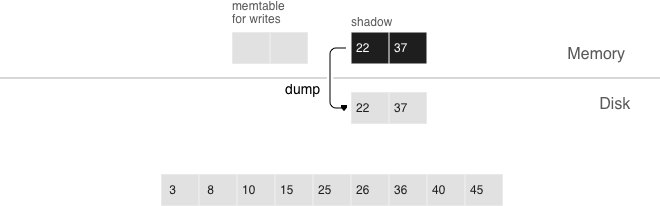

- упреждающий дамп
- регулирование нагрузки

Дамп происходит из так называемого «теневого» L0, не блокируя новые
вставки и чтения.

#### Непредсказуемая скорость чтений {: #unpredictable-read-speed }

Чтение – одна из наиболее сложных задач для оптимизации в LSM-деревьях.
Главным фактором сложности является большое количество уровней: это не
только значительно замедляет поиск, но и потенциально значительно
увеличивает требования к оперативной памяти при почти любых попытках
оптимизации. Природа LSM-деревьев, где файлы обновляются только путем
присоединения новых записей, позволяет решать эти проблемы способами,
которые не характерны для традиционных структур данных.

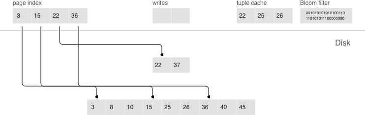

- постраничный индекс
- фильтры Блума
- кэш диапазона кортежей
- многоуровневое слияние

#### Сжатие и постраничный индекс {: #compression-and-page-index }

Сжатие данных в B-деревьях сложно реализовать эффективно из-за
обновления блоков на месте. В LSM-деревьях сжатие применяется к
последовательно записываемым файлам и работает следующим образом:

При любом дампе или слиянии Picodata разбивает все данные в одном файле на
страницы. Размер страницы в байтах задается в параметре
[instance.vinyl.page_size], который можно менять отдельно для каждого
индекса. Страница не обязана занимать строго то количество байт, которое
прописано в [instance.vinyl.page_size] – она может быть чуть больше или
чуть меньше, в зависимости от хранящихся в ней данных. Благодаря этому
страница никогда не содержит пустот.

[instance.vinyl.page_size]: ../reference/config.md#instance_vinyl_page_size

Для сжатия используется [потоковый алгоритм
ZSTD](https://github.com/facebook/zstd). Первый
ключ каждой страницы и смещение страницы в файле добавляются в так
называемый постраничный индекс (`page index`) – отдельный файл, который
позволяет быстро найти нужную страницу. После дампа или слияния
постраничный индекс созданного файла также записывается на диск.

Так как ZSTD работает в рамках одной страницы (по умолчанию 8 КБ), то
этого контекста недостаточно для построения хорошего словаря. Поэтому
дополнительно к Zstd, в Picodata используется словарная компрессия (ZSTD
dictionary compression): при дампе или слиянии движок собирает набор
образцов данных (до 2 МБ) и обучает на нём 64-килобайтный словарь через
`ZDICT_trainFromBuffer()`. Словарь хранится в
[vylog](instance_runtime_files.md) и используется при сжатии всех
последующих страниц данного LSM-дерева.

Все файлы типа `.index` кэшируются в оперативной памяти, что позволяет
найти нужную страницу за одно чтение из файла `.run` (такое расширение
имени файла используется в движке `vinyl` для файлов, полученных в результате
дампа или слияния). Поскольку данные в странице отсортированы, после
чтения и декомпрессии нужный ключ можно найти с помощью простого
бинарного поиска. За чтение и декомпрессию отвечают отдельные потоки, их
количество определяется в параметре [instance.vinyl.read_threads].

[instance.vinyl.read_threads]: ../reference/config.md#instance_vinyl_read_threads

Picodata использует единый формат файлов: например, формат данных в
файле `.run` ничем не отличается от формата файла `.xlog` (файл
журнала). Это упрощает резервное копирование и восстановление, а также
работу внешних инструментов.

#### Фильтры Блума {: #bloom-filters }

Хотя постраничный индекс позволяет уменьшить количество страниц,
просматриваемых при поиске в одном файле, он не отменяет необходимости
искать на всех уровнях дерева. Существует важный частный случай, когда
необходимо проверить отсутствие данных, и просмотр всех уровней
неизбежен: вставка в уникальный индекс. Если данные уже существуют, то
вставка в уникальный индекс должна завершиться с ошибкой. Единственный
способ вернуть ошибку до завершения транзакции в LSM-дереве – выполнить
поиск перед вставкой. Такие чтения в СУБД образуют отдельный класс
скрытых чтений.

Другая операция, приводящая к скрытым чтениям, – обновление значения, по
которому построен вторичный индекс. Вторичные ключи представляют собой
обычные LSM-деревья, в которых данные хранятся в другом порядке. Чаще
всего, чтобы не хранить все данные во всех индексах, значение,
соответствующее данному ключу, целиком сохраняется только в первичном
индексе (любой индекс, хранящий и ключ, и значение, называется
покрывающим или кластерным), а во вторичном индексе сохраняются лишь
поля, по которым построен вторичный индекс, и значения полей,
участвующих в первичном индексе. Тогда при любом изменении значения, по
которому построен вторичный ключ, приходится сначала удалять из
вторичного индекса старый ключ, и только потом вставлять новый. Старое
значение во время обновления неизвестно, поэтому его требуется прочитать
из первичного индекса.

Например:

```sql
UPDATE t1 SET city = 'Moscow' WHERE id = 1;
```

Чтобы уменьшить количество чтений с диска, особенно для несуществующих
значений, практически все LSM-деревья используют вероятностные структуры
данных, такие как фильтр Блума – набор из нескольких (обычно 3–5)
битовых массивов. При записи для каждого ключа вычисляется несколько
хеш-функций, и в каждом массиве выставляется бит, соответствующий
значению хеша. При хешировании могут возникнуть коллизии, поэтому
некоторые биты могут быть проставлены дважды. Интерес представляют биты,
которые оказались не проставлены после записи всех ключей. При поиске
также вычисляются выбранные хеш-функции. Если хотя бы в одном из битовых
массивов бит не стоит, то значение в файле отсутствует. Вероятность
ложноположительного срабатывания фильтра Блума зависит от размера
битовых массивов, количества хеш-функций и числа записанных ключей. Чем
меньше целевая вероятность ложноположительного срабатывания, тем больше
памяти требуется фильтру.

Ключевым преимуществом реализации фильтров Блума в Picodata является
простота настройки. На уровне индекса вероятность ложноположительного
срабатывания задается опцией
[`BLOOM_FPR`](../reference/sql/create_index.md#params). Значение по
умолчанию определяется параметром [instance.vinyl.bloom_fpr]. FPR
означает `false positive ratio` – коэффициент ложноположительного
срабатывания. По умолчанию используется значение 0,05, или 5%. На основе
этого параметра Picodata автоматически строит фильтры Блума оптимального
размера для поиска как по полному ключу, так и по компонентам ключа.
Сами фильтры Блума хранятся вместе с постраничным индексом в файле
`.index` и кэшируются в оперативной памяти.

[instance.vinyl.bloom_fpr]: ../reference/config.md#instance_vinyl_bloom_fpr

#### Кэширование {: #caching }

Кэширование в движке `vinyl` используется как средство снижения общей
нагрузки на диск и получения более предсказуемого времени ответа на
запросы, которые не попали в кэш. В движке `vinyl` реализован
специализированный для транзакционных систем вид кэша под названием
«кэш диапазона кортежей» (range tuple cache). В отличие от RocksDB, например,
или MySQL, этот кэш хранит не страницы, а уже готовые диапазоны значений
индекса, после их чтения с диска и слияния всех уровней. Это позволяет
использовать кэш для запросов как по одному ключу, так и по диапазону
ключей. Поскольку в кэше хранятся только горячие данные, а не, например,
страницы (в странице может быть востребована лишь часть данных),
оперативная память используется эффективнее. Размер кэша задается в
параметре [instance.vinyl.cache].

[instance.vinyl.cache]: ../reference/config.md#instance_vinyl_cache

#### Управление сборкой мусора {: #garbage-collection-control }

Одно LSM-дерево не исчерпывает устройство движка `vinyl`. Движок
создает и обслуживает несколько LSM-деревьев даже для одной таблицы – по
одному дереву на каждый индекс. При этом один индекс может состоять из
десятков LSM-деревьев.

Рассмотрим стандартный пример: 100 000 000 записей по 100 байтов
каждая. Через некоторое время на самом нижнем уровне LSM может
оказаться файл размером 10 ГБ. Во время слияния последнего уровня
создается временный файл, который также будет занимать около 10 ГБ.
Данные на промежуточных уровнях тоже занимают место: по одному и тому же
ключу дерево может хранить несколько операций. Суммарно для хранения 10
ГБ полезных данных может потребоваться до 30 ГБ свободного места: 10
ГБ на последний уровень, 10 ГБ на временный файл и 10 ГБ на всё
остальное. Если объем полезных данных измеряется терабайтами, требовать
от диска кратного запаса свободного места нецелесообразно. Кроме того,
создание файла размером 1 ТБ может занимать десятки часов. При аварии
или перезапуске системы операцию потребуется начинать заново.

Другая проблема возникает, когда первичный ключ дерева представляет
собой монотонную последовательность, например временной ряд. В этом
случае основные вставки приходятся на правую часть диапазона ключей.
Повторное слияние большого файла только для дописывания в конец
нескольких миллионов записей нецелесообразно.

Если вставки происходят в основном в одну часть диапазона ключей, а
чтения – из другой части, возникает вопрос оптимизации формы дерева:
если оно будет слишком высоким, пострадают чтения, если слишком низким –
запись.

Picodata разделяет эту задачу на несколько независимых частей, создавая
множество LSM-деревьев для каждого индекса. Примерный размер каждого
поддерева можно задать в конфигурационном параметре
[instance.vinyl.range_size]. Такие поддеревья называются диапазонами
(range).

[instance.vinyl.range_size]: ../reference/config.md#instance_vinyl_range_size

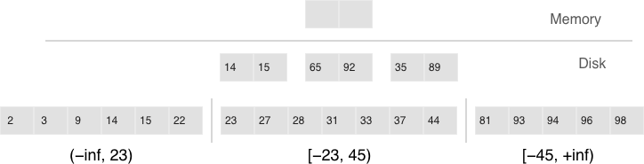

_Факторизация больших LSM-деревьев с помощью диапазонов_

- Диапазоны отражают статическое распределение отсортированных прогонов.
- Срезы связывают отсортированный прогон с диапазоном.

Изначально, пока в индексе мало элементов, он состоит из одного
диапазона. По мере добавления элементов суммарный объем может превысить
[максимальный размер
диапазона](../reference/config.md#instance_vinyl_range_size).
В таком случае выполняется операция под названием «разделение» (split),
которая делит дерево на две равные части. Разделение происходит по
срединному элементу диапазона ключей, хранящихся в дереве. Например,
если изначально дерево хранит полный диапазон `-inf…+inf`, то после
разделения по срединному ключу `X` появляются два поддерева: одно будет
хранить все ключи от `-inf` до `X`, другое – от `X` до `+inf`. Таким образом,
при вставке или чтении можно однозначно определить, к какому поддереву
нужно обратиться. Если в дереве были удаления и каждый из соседних диапазонов
уменьшился, выполняется обратная операция под названием «объединение»
(coalesce). Она объединяет два соседних дерева в одно.

Разделение и объединение не приводят к слиянию, созданию новых файлов и
прочим ресурсоемким операциям. LSM-дерево – это набор файлов. В движке
`vinyl` реализован специальный журнал метаданных, позволяющий
отслеживать, какой файл принадлежит какому поддереву или поддеревьям.
Журнал имеет расширение `.vylog`, по формату он совместим с файлом
`.xlog`. Как и файл `.xlog`, происходит автоматическая ротация файла при
каждой контрольной точке. Чтобы избежать повторного создания файлов при
разделении и объединении, используется промежуточная сущность – срез
(slice). Это ссылка на файл с указанием диапазона значений ключа,
которая хранится исключительно в журнале метаданных. Когда число ссылок
на файл становится равным нулю, файл удаляется. При необходимости
произвести разделение или объединение, Picodata создает срезы для
каждого нового дерева, старые срезы удаляет и записывает эти операции в
журнал метаданных. Журнал метаданных хранит записи вида
`<идентификатор дерева, идентификатор среза>` или
`<идентификатор среза, идентификатор файла, мин, макс>`.

Таким образом, ресурсоемкая работа по разбиению дерева на два поддерева
откладывается до слияния и выполняется автоматически.
Основное преимущество подхода с разделением всего диапазона ключей на
диапазоны состоит в возможности независимо управлять размером L0, а
также процессами создания дампов и слияния для каждого поддерева. В
результате эти процессы становятся более управляемыми и предсказуемыми.
Наличие отдельного журнала метаданных также упрощает выполнение таких
операций, как усечение и удаление: в движке `vinyl` они обрабатываются
через журнал метаданных, а удаление устаревших файлов выполняется в
фоне.

### Расширенные возможности Vinyl {: #advanced-features-of-vinyl }

В предыдущих разделах были описаны три операции, которые хранит
LSM-дерево: замена (`REPLACE`), удаление (`DELETE`) и вставка с обновлением
(`UPSERT`). Остальные операции можно представить через эти базовые
операции. Вставка может быть представлена как замена, если
предварительно подтверждено отсутствие элемента с указанным ключом. Для
выполнения обновления необходимо предварительно считать старое значение
из дерева, поэтому такую операцию также можно записать в дерево как
замену. Это ускоряет будущие чтения по данному ключу. Кроме того,
обновление должно вернуть новое значение, поэтому скрытые чтения в этом
случае остаются необходимыми.

В B-деревьях скрытые чтения не создают существенных дополнительных
накладных расходов: чтобы обновить блок, его в любом случае необходимо
прочитать с диска. Для LSM-деревьев используется специальная операция
обновления, которая снижает потребность в скрытых чтениях.

Такая операция содержит значение по умолчанию, которое нужно вставить,
если данных по ключу ещё нет, и список операций обновления, которые
нужно выполнить, если значение существует.

На этапе выполнения транзакции Picodata сохраняет всю операцию в
LSM-дереве. Фактическое применение операции выполняется позднее, во
время слияния.

На уровне SQL оптимизированный путь `UPSERT` используется в конструкции
[`INSERT ... ON CONFLICT (...) DO UPDATE`](../reference/sql/iocdu.md),
если конфликт определяется только по первичному ключу и у таблицы нет
других индексов.
