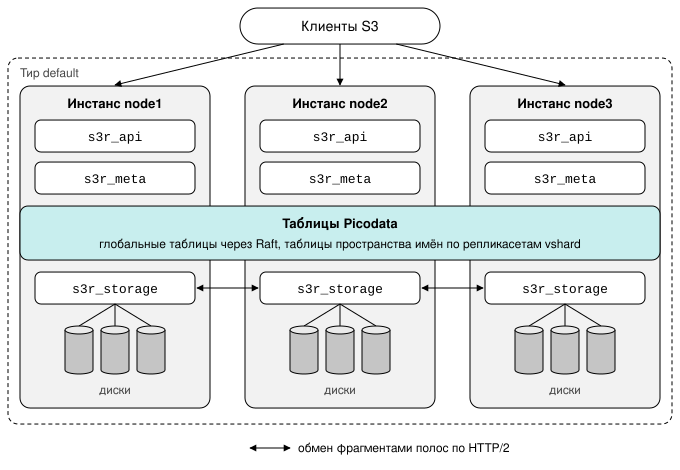
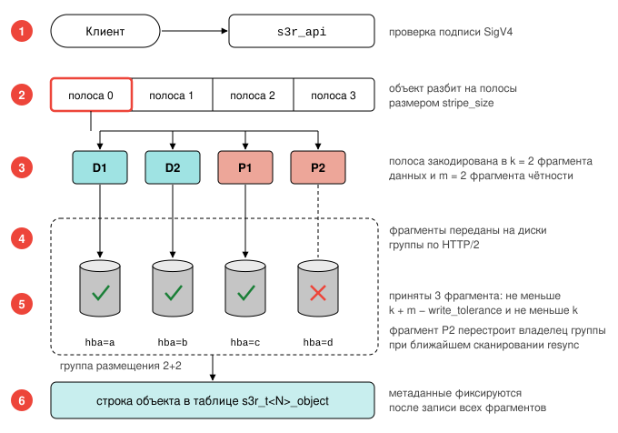
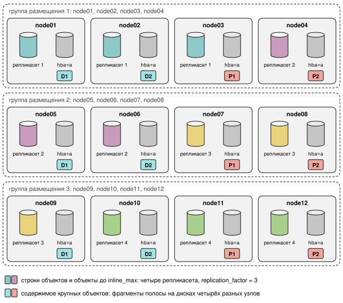
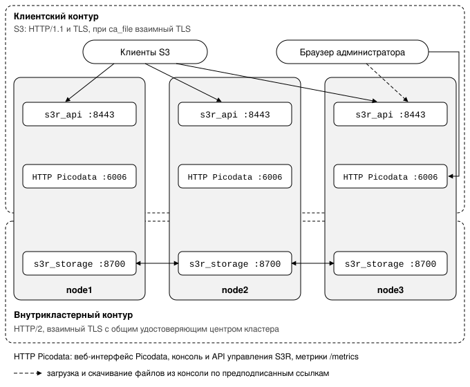
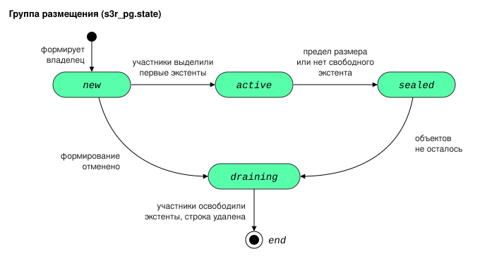
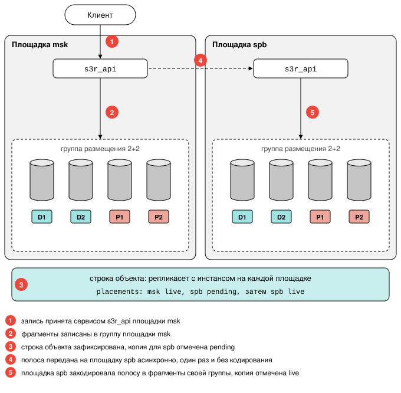
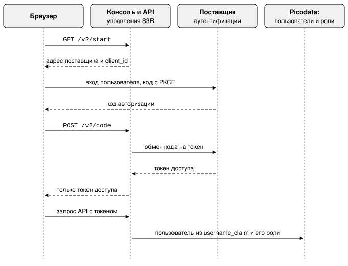

# S3R

В данном разделе приведены сведения о S3R, плагине объектного хранилища для
СУБД Picodata. Это же руководство поставляется вместе со сборкой плагина.

!!! tip "Picodata Enterprise"
    Функциональность плагина доступна только в коммерческой версии Picodata.

Документ описывает установку, настройку и эксплуатацию
[плагина](../overview/glossary.md#plugin)
S3R для администраторов, разработчиков прикладных систем и инженеров
эксплуатации.

## Назначение и устройство {: #purpose_and_design }

### Общие сведения {: #intro }

Плагин S3R реализует объектное хранилище с интерфейсом, совместимым с Amazon S3,
и работает внутри СУБД Picodata. Плагин хранит метаданные объектного хранилища
(бакеты, объекты, директории и карту размещения) как в глобальных таблицах, так и в
шардированных:

- Бакеты и карта размещения хранятся в глобальных таблицах и согласуются через
  Raft-консенсус.
- Метаданные каждого объекта размещаются на соответствующем шарде. Шардированные
  таблицы распределяются по репликасетам средствами vshard.

Содержимое объектов размещается на локальных дисках узлов в хранилище полос
и защищается репликацией либо
избыточным кодированием Рида-Соломона.

Архитектура плагина обеспечивает три свойства:

**Согласованность.** По умолчанию параметр `read_preference` равен `leader`:
метаданные читаются с мастера репликасета, операции с одним ключом линеаризуемы, и
успешно записанные данные сразу доступны для чтения. Имя параметра и значения
`leader` и `any` взяты из одноимённой опции SQL в Picodata. Отдельный слой метаданных с отложенной
согласованностью и внешние хранилища, например etcd или RocksDB, не требуются.
При значении `read_preference = any` запросы, которые только читают и
возвращают прочитанное (`GetObject`, `HeadObject`, `ListObjects`, `ListObjectsV2`,
`ListObjectVersions`, `ListMultipartUploads` и `ListParts`), может обслужить любая
реплика, на которой есть копия нужных метаданных. Результат такого чтения может быть
устаревшим. Остальные запросы читают метаданные с мастера при любом значении
параметра.

**Горизонтальная масштабируемость.** Так как метаданные распределяются по репликасетам,
то пропускная способность работы с метаданными растёт с числом
репликасетов и не ограничена возможностями одного узла.

**Скорость обработки малых объектов.** Объект размером до `inline_max` хранится
в строке своих метаданных. При движке `memtx`, который применяется по умолчанию,
чтение такого объекта не требует обращения к диску и выполняется в оперативной
памяти.

### Состав плагина {: #plugin_contents }

Плагин состоит из трёх [сервисов](../overview/glossary.md#service),
которые следует назначить на один и тот же
[тир](../overview/glossary.md#tier) Picodata.

| Сервис        | Назначение                                                                                                                           |
|---------------|--------------------------------------------------------------------------------------------------------------------------------------|
| `s3r_api`     | Приём запросов S3: разбор HTTP, проверка подписи SigV4, авторизация, разбиение объекта на полосы, кодирование и сборка полос         |
| `s3r_meta`    | Операции над таблицами пространства имён и передача обращений от среды выполнения Tokio транзакционному потоку TX                    |
| `s3r_storage` | Хранилище полос на локальных дисках, регистрация дисков в кластере, обмен фрагментами полос между узлами, ведение карты размещения |

Размещение сервисов и данных в кластере показано на схеме ниже:



Сервисы запускаются независимо друг от друга и в произвольном порядке. Плагин
становится доступным для работы после запуска сервиса `s3r_meta`.

> **Примечание.** Плагин можно включить на нескольких тирах. В этом случае на
> каждый из них назначаются все три сервиса: при запуске плагин сравнивает
> списки тиров сервисов и не включается, если списки различаются.

## Путь запроса на запись {: #query_write }

Если размер объекта превышает значение, указанное в `inline_max` (в
рамках настройки сервиса [s3r_api](#s3r_api)), то он записывается в
следующем порядке:

1. Сервис `s3r_api` принимает тело запроса и проверяет подпись.
2. Объект разбивается на полосы размером `stripe_size`, заданным для выбранной
   группы размещения.
3. В зависимости от схемы избыточности яруса каждая полоса кодируется в `k` фрагментов
   данных и `m` фрагментов чётности, а при `k = 1` копируется `m + 1` раз.
4. Фрагменты передаются на диски группы размещения по протоколу HTTP/2. Единица
   передачи совпадает с единицей записи на диск.
5. Полоса считается записанной, когда её фрагменты приняли и сохранили не менее
   `k + m − write_tolerance` дисков и не менее `k` дисков. Непринятый фрагмент
   записывается в очередь ресинхронизации, и его перестраивает владелец группы.
6. После записи всех полос в пространстве имён создаётся строка объекта.



Метаданные фиксируются только после записи данных.

#### Кворум записи {: #write_quorum }

Параметр `write_tolerance` сервиса `s3r_storage` задаёт число фрагментов,
которые запись вправе оставить недописанными. Значение по умолчанию равно 1.

Значение 1 допускает недоступность одного участника группы: отказ диска либо
отказ [инстанса](../overview/glossary.md#instance),
на котором находится один участник группы. В раскладке `spread` на одном узле
может находиться до `m` участников группы, а группа в раскладке `instance` при
отказе своего инстанса недоступна целиком (см. [«Раскладка
группы»](#group_layouts)). При
значении 0 для записи требуются все фрагменты, и недоступность одного участника
приводит к отказу каждой записи в группу.

Кворум записи не опускается ниже `k`. Полоса из `k` фрагментов доступна для
чтения, но потеря ещё одного фрагмента сделает чтение невозможным. Полоса, у
которой сохранилось от `k + 1` до `k + m` фрагментов, остаётся доступной для
чтения при ещё одном отказе, пока недостающие фрагменты восстанавливаются.
Значение `write_tolerance` больше `m` не отклоняется, и кворум в этом случае
равен `k`.

Если группа размещения, выбранная для объекта, не набирает кворума, например при
недоступности инстанса, из дисков которого она собрана, запись выполняется в
следующую группу той же площадки. За границу площадки выбор группы не выходит.

Если при записи объекта какой-то участник не принял свой фрагмент, в очередь
ресинхронизации добавляется строка: объект, группа и окно из 64 полос объекта,
в котором отмечены полосы с недостающими фрагментами и номера этих фрагментов.
Строка хранится в таблице `s3r_t<N>_resync` на том же наборе реплик, что и
строка объекта, и добавляется в той же транзакции. Процесс `resync_queue` на
мастере набора реплик передаёт такие строки владельцу группы. Владелец
перестраивает недостающие фрагменты отмеченных полос, после чего отметки
снимаются, а строка без отметок удаляется. Сколько строк осталось в очереди,
показывает поле `resync_queue` области `data` в ответе `GET /v2/repair` (см.
[«Контроль целостности»](#integrity_and_repair)).

Чтение выполняется в обратном порядке. Строка объекта содержит идентификатор
группы размещения и размер объекта. По ним вычисляется геометрия полос, после
чего запрашиваются полосы, попадающие в запрошенный диапазон.

## Установка {: #plugin_installation }

Глава описывает установку в том порядке, в котором её выполняют. Сначала
проверяются требования, выбирается поставка, рассчитываются ресурсы и
выбирается схема избыточности. Затем запускается кластер Picodata,
устанавливается и настраивается плагин, кластер проходит начальное
формирование, консоль публикуется через обратный прокси, и установка
проверяется. В конце главы описаны действия при сбое установки, расположение
данных, обновление и удаление плагина.

Плагин устанавливается вручную, как описано в разделе [«Пошаговая
установка»](#install_steps), либо ролью Ansible для Picodata, как описано в
разделе [«Установка ролью Ansible»](#install_with_ansible). В обоих случаях
выполняются одни и те же действия.

### Требования {: #requirements }

| Компонент | Требование |
| --- | --- |
| СУБД | Picodata той версии, под которую выпущена версия плагина; см. [«Соответствие версий S3R и Picodata»](#picodata_s3r_versions). При несовпадении версий плагин не загружается и выводит обе версии |
| Ядро | Linux 5.10 или новее |
| Подсистема ввода-вывода | `io_uring` и открытие файлов с флагом `O_DIRECT` (см. [подробнее](#check_fs)). Резервной реализации нет: если механизм недоступен, диск не монтируется, и событие записывается в журнал |
| Файловая система | Локальная, с поддержкой `O_DIRECT` и `posix_fallocate` |
| Тир Picodata | Все три сервиса плагина назначаются на один тир. Каждый инстанс, на котором есть диски хранилища, получает слушатель `s3r_storage` в своей конфигурации |

Окружение контейнера проверяется отдельно. Профиль seccomp в ядре Linux
может запрещать системные вызовы `io_uring`, а оверлейная файловая
система может запрещать открытие файлов с флагом `O_DIRECT`. Эти причины
независимы, и отказ одного механизма не означает отказа другого.

### Поставка {: #plugin_package }

Плагин поставляется архивом `s3r_<версия>-<ОС>.tar.gz`, например
`s3r_2.2.0-ubuntu_22.04.tar.gz`. Доступ к репозиторию предоставляется по
запросу.

Архив собирается для следующих дистрибутивов:

| Дистрибутив | Версии |
| --- | --- |
| Альт | p10, p11 |
| Astra Linux | 1.8 |
| CentOS | 8, 9 |
| Debian | 12 (bookworm), 13 (trixie) |
| Fedora | 43, 44 |
| РЕД ОС | 7.3, 8.0 |
| Ubuntu | 22.04 (jammy), 24.04 (noble), 26.04 (resolute) |

Альт p9, Astra Linux 1.7 и ROSA Chrome не поддерживаются: их ядра не обеспечивают
надёжную работу `io_uring`, а другой подсистемы ввода-вывода у хранилища нет.
Базовое ядро РЕД ОС 7.3 ниже версии 5.10, поэтому на ней устанавливается ядро
из репозиториев дистрибутива не ниже 5.10: `kernel-lt`, `kernel-ml` или
`kernel-lt` из репозитория `extras/kernels6-73`. Наличие архива для
дистрибутива не гарантирует работу с любым его ядром: если ядро не
предоставляет `io_uring`, диск не открывается, и это видно в журнале
инстанса.

Структура архива соответствует стандартной структуре плагина Picodata: директория
`s3r/2.2.0/` содержит библиотеку `libs3r.so`, файл манифеста `manifest.yaml` и
поддиректорию миграций `migrations/`.

#### Соответствие версий S3R и Picodata {: #picodata_s3r_versions }

Под каждую выпущенную версию Picodata собирается соответствующая выпущенная
версия плагина.

| S3R   | Picodata |
|-------|----------|
| 2.0.0 | 26.2.1   |
| 2.1.0 | 26.2.1   |
| 2.2.0 | 26.2.1   |

### Расчёт ресурсов {: #resources_allocation }

#### Число инстансов {: #instances_count }

Инстанс Picodata с плагином S3R размещается в пределах одного
вычислительного узла. В мультипроцессорных системах промышленного уровня
следует рассчитывать на загрузку всех [NUMA]-узлов в составе сервера.

[NUMA]: https://en.wikipedia.org/wiki/Non-uniform_memory_access

Один инстанс обслуживает в секунду до 10 000 операций с метаданными:
записей, чтений, запросов атрибутов и листингов. Необходимое число
инстансов определяется делением ожидаемой нагрузки на это значение.

Число инстансов ограничено снизу и схемой избыточности: каждый репликасет
должен быть заполнен, а группа размещения, распределённая по узлам, требует
определённого числа узлов (см. [«Схема избыточности»](#redundancy_scheme)).
Если доменов отказа ровно `k + m`, перезапуск одного инстанса останавливает
создание новых групп. Владелец, чья группа запечатана, тогда записывает только
в освободившиеся позиции этой группы. Поэтому рекомендуется планировать
`k + m + 1` доменов отказа.

#### Процессорные ядра {: #cpu_cores }

Каждому инстансу выделяется 10 логических ядер процессора. Логическим
ядром считается аппаратный поток, а не физическое ядро. Одно ядро
занимает транзакционный поток TX, восемь ядер занимает пул рабочих
потоков Tokio, в котором выполняются разбор запросов, кодирование,
сжатие и обмен фрагментами полос, и одно ядро остаётся для фоновых
операций, например для создания
[снимков](../overview/glossary.md#snapshotting).
Размер пула задаётся переменной окружения `S3R_WORKER_THREADS=8`. Без
неё пул рассчитывается по числу ядер всего сервера, и при нескольких
инстансах на сервере потоков запускается больше, чем ядер.

#### Оперативная память {: #ram }

Метаданные хранятся в памяти `memtx`. Объект, содержимое которого
размещено на дисках, занимает в памяти около 320 байт вместе с индексами
и, кроме того, столько байт, сколько занимает его ключ. Объект размером
до `inline_max` дополнительно занимает объём своего содержимого.
Например, 100 миллионов объектов с ключами длиной 80 байт требуют около
40 ГБ памяти. Этот объём необходим каждому инстансу репликасета, потому
что каждая реплика хранит полную копию данных.

Объём памяти под метаданные увеличивается двумя способами: добавлением узлов,
между которыми распределяются шарды метаданных, либо увеличением параметра
`instance.memtx.memory`.

Расход памяти каждого инстанса показывают консоль и запрос `GET /v2/memory`.
Сведения собираются в момент запроса, и возраст каждого показания не превышает
двух секунд. Если инстанс в сети, но не ответил за секунду, ответ сообщает,
сколько инстансов ответило, а запись `memory` в сводке `GET /v2/health`
получает статус предупреждения и называет этот инстанс. Отключённый инстанс
в подсчёт не входит: о нём сообщает запись `instances` той же сводки.

#### Диски {: #disks_count }

Владелец пишет в одну группу яруса за раз, поэтому на одном инстансе в ярусе
со схемой `k+m` используется не больше `2 × (k + m) − 1` дисков. Конфигурация с
большим числом дисков отклоняется (см. [«Группы размещения»](#placement_groups)).
Лишние диски размещают на дополнительных инстансах: например, при схеме 4+2
двенадцать дисков размещают на двух инстансах по шесть.

Каждой первой группе, которую план начального формирования ставит на диск,
нужно `2 × (1 + spare_extents)` свободных экстентов этого диска, то есть 4 при
значениях по умолчанию. Диск, на котором столько места нет, задерживает
формирование (см. [«Начальное формирование»](#initial_formation)). Ёмкость
диска и размер экстента выбираются по разделу [«Выбор ёмкости и размера
экстента»](#capacity_choice).

### Схема избыточности {: #redundancy_scheme }

Схема избыточности кластера выбирается до установки. На кластере с данными её
изменить нельзя: фактор репликации тира задаётся при первом запуске
кластера, а схема избыточности каждого яруса записывается при начальном формировании и
после этого не меняется.

Схема складывается из трёх решений:

1. фактор репликации тира Picodata и домены отказа инстансов;
2. схема избыточности каждого яруса дисков в параметре `s3r_storage.erasure`;
3. число площадок.

> **Внимание.** Каждый ярус, в котором есть диски, объявляет ровно одну схему
> `k+m`, где `k` и `m` не меньше 1, а `k + m` не больше 64. Схема с `k = 1`
> означает репликацию:
> содержимое хранится в `m + 1` копиях на разных дисках. Пока у яруса с дисками
> нет схемы, кластер не проходит начальное формирование и не принимает запись.
> Picodata по умолчанию создаёт тир с фактором репликации 1: тогда метаданные
> и объекты до `inline_max` хранятся в одной копии, и отказ инстанса делает
> недоступными метаданные его репликасета.

#### Уровни избыточности {: #redundancy_levels }

Каждый уровень избыточности задаётся своими параметрами и защищает свою часть
данных.

| Уровень | Параметры | Защищаемые данные | Отказ, который переживают данные |
|---------|-----------|-------------------|----------------------------------|
| Инстанс | `failure_domain` инстанса и `replication_factor` тира Picodata | строки объектов и содержимое объектов размером до `inline_max` (по умолчанию 4 КиБ) | отказ инстанса или узла |
| Диск | поддомены дисков `hba=`, домены отказа инстансов и схема избыточности яруса в `s3r_storage.erasure` | содержимое объектов крупнее `inline_max` | отказ не более `m` участников группы размещения: дисков либо, если группа распределена по узлам, одного узла |
| Площадка | компонент `dc` домена отказа инстанса | копия каждого объекта на каждой площадке | отказ площадки |

Важно понимать разницу между _доменом отказа инстанса_ и _поддоменом диска_.
Домен отказа инстанса задаётся в конфигурации Picodata. По нему Picodata
собирает репликасеты, а S3R решает, какие инстансы отказывают вместе. Поддомен
диска задаётся в списке дисков и различает диски одного инстанса. Домен отказа
диска состоит из домена инстанса без компонента `dc` и поддомена диска (см.
[«Домен отказа диска»](#disk_failure_domain)).

Picodata объединяет в репликасет только инстансы, домены отказа которых не
совпадают ни в одном компоненте, а набор компонентов у всех инстансов кластера
должен быть одинаковым. Отсюда следуют правила для площадок:

- **Одна площадка.** Компонент `dc` не задаётся, и все инстансы относятся к
  площадке `default`. Компонент с одинаковым значением у всех инстансов,
  например `dc: msk`, не позволил бы собрать репликасет больше чем из одного
  инстанса. Если инстансов больше одного, каждый задаёт домен отказа, например
  компонентом `host` или `rack`: без него S3R не может распределить группу по
  узлам и отказывает в её создании.
- **Несколько площадок.** Компонент `dc` задаётся на каждом инстансе, и фактор
  репликации равен числу площадок: в каждом репликасете по одному инстансу с
  каждой площадки. Фактор репликации больше числа площадок Picodata пока не
  может разместить (задача core/picodata#3243), и S3R такой кластер не
  формирует.

Раскладка группы размещения по дискам определяется топологией (подробно см.
[«Группы размещения»](#placement_groups)):

- **`instance`**: все участники группы находятся на дисках одного инстанса в
  различных поддоменах. Такая раскладка выбирается, если площадок несколько,
  если на площадке один инстанс с дисками яруса или если все инстансы
  площадки объявили один и тот же домен отказа. Для неё у инстанса должно быть
  не меньше `k + m` дисков яруса. Группа переживает отказ `m` дисков, но не
  отказ своего инстанса.
- **`spread`**: участники группы распределяются по узлам площадки, не больше `m`
  на один домен отказа инстанса. Такая раскладка выбирается в остальных
  случаях, то есть на одной площадке с несколькими доменами отказа. Группа
  переживает отказ любого одного узла.

#### Пример: одна площадка {: #one_place }

Кластер состоит из трёх узлов, на каждом из которых работает один инстанс с
четырьмя дисками. Метаданные и объекты до `inline_max` хранятся в трёх копиях.
Содержимое крупных объектов кодируется по схеме 2+2 и занимает на дисках вдвое
больше своего объёма.

Конфигурация инстанса на `node1`:

```yaml
cluster:
  tier:
    default:
      replication_factor: 3
      can_vote: true
instance:
  failure_domain:
    host: node1
```

Диски инстанса:

```shell
S3R_DISKS=/data/s3r/d0:hba=a,/data/s3r/d1:hba=b,/data/s3r/d2:hba=c,/data/s3r/d3:hba=d
```

В каждую директорию примера смонтирована отдельная файловая система, поэтому
ёмкость дисков не задаётся (см. раздел [«Ёмкость диска»](#disk_capacity)).

Схема избыточности яруса:

```sql
ALTER PLUGIN s3r 2.2.0 SET s3r_storage.erasure = '[{"k":2,"m":2}]';
```

Picodata собирает из трёх инстансов один репликасет. Площадка одна, а
инстансы объявили три разных узла, поэтому раскладка групп `spread`
следующая: каждая группа получает по участнику на каждом узле, а
четвёртый участник регистрируется на узле своего владельца. На одном
узле оказывается не больше двух (из четырёх) участников группы.

| Отказ                 | Метаданные и объекты до `inline_max` | Объекты крупнее `inline_max`                                                                        |
|-----------------------|--------------------------------------|-----------------------------------------------------------------------------------------------------|
| один диск             | доступны                             | доступны: недостающие фрагменты вычисляются при чтении, а участник заменяется другим диском          |
| узел                  | доступны на двух других репликах     | доступны: группа теряет не больше двух участников из четырёх                                        |

Чтение полосы и её восстановление в такой раскладке обращаются к дискам других
узлов по сети.

#### Пример: группы на дисках разных узлов {: #grouped_drives_on_different_nodes }

Кластер состоит из двенадцати узлов, на каждом из которых работает один
инстанс с одним диском. Фактор репликации тира и схема избыточности те же,
что в примере с одной площадкой. Каждый инстанс объявляет свой узел
компонентом `host`. Поддомен для единственного диска не нужен: домен отказа
диска совпадает с доменом его инстанса.

```shell
S3R_DISKS=/data/s3r/d0
```

Ёмкость диска здесь не задаётся по той же причине, что и в предыдущем примере.

Раскладка групп `spread`: каждая группа получает четыре участника на дисках
четырёх разных узлов. Picodata собирает из двенадцати инстансов четыре
репликасета по три инстанса.



| Отказ                   | Метаданные и объекты до `inline_max`                               | Объекты крупнее `inline_max`                        |
|-------------------------|--------------------------------------------------------------------|-----------------------------------------------------|
| один диск или один узел | доступны на двух других репликах                                   | доступны: группа теряет одного участника из четырёх |
| два узла одной группы   | доступны на других репликах, если узлы входят в разные репликасеты | доступны                                            |

#### Пример: несколько площадок {: #many_places }

Кластер размещён на трёх площадках `msk`, `spb` и `ekb`. На каждой площадке
находятся два узла, и на каждом узле работает один инстанс с четырьмя
дисками. Компонент `dc` домена отказа задаёт площадку, а компонент `host`
различает узлы. Значения компонентов уникальны во всём кластере, поэтому имя
узла начинается с имени площадки.

Конфигурация инстанса на первом узле площадки `msk`:

```yaml
cluster:
  tier:
    default:
      replication_factor: 3
      can_vote: true
instance:
  failure_domain:
    dc: msk
    host: msk-1
```

Диски и схема избыточности задаются так же, как в примере с одной площадкой.

Picodata собирает два репликасета, в каждом из которых по одному инстансу с
каждой площадки, и строки объектов хранятся на всех трёх площадках. Площадок
несколько, поэтому раскладка групп `instance`: группа 2+2 занимает четыре диска
одного инстанса. Каждая площадка хранит собственную закодированную копию
содержимого, а копии между площадками передаются асинхронно фоновым
процессом `siterepl`. Содержимое крупных объектов занимает на дисках в шесть
раз больше своего объёма: вдвое на каждой из трёх площадок.

| Отказ                   | Метаданные и объекты до `inline_max` | Объекты крупнее `inline_max`                                                                           |
|-------------------------|--------------------------------------|--------------------------------------------------------------------------------------------------------|
| один или два диска узла | доступны                             | доступны                                                                                               |
| узел                    | доступны на репликах других площадок | читаются с других площадок; на площадке отказавшего узла копия этих объектов утрачена и не восстанавливается |
| площадка                | доступны на двух других площадках    | доступны на тех площадках, куда их копия успела записаться                                             |

> **Внимание.** Копия площадки по копиям других площадок не восстанавливается.
> Пока узел недоступен, объекты из групп его дисков читаются с других площадок.
> Если узел выбыл безвозвратно, эти объекты остаются на его площадке без
> копии, и число их копий в кластере уменьшается на одну.

При двух площадках кворум Raft не переживает отказ площадки, на которой
находится большинство голосующих инстансов. Для этого случая предусмотрен
инстанс арбитра на третьей площадке, как описано в разделе [«Установка ролью
Ansible»](#install_with_ansible).

### Пошаговая установка {: #install_steps }

В примерах кластер состоит из трёх узлов `node1.example.net` …
`node3.example.net`, на каждом из которых работает один инстанс Picodata с
четырьмя дисками. Схема избыточности соответствует разделу [«Пример: одна
площадка»](#one_place). Версия плагина в примерах `2.2.0`, тир
`default`.

#### Шаг 1. Проверка узлов {: #check_fs }

На каждом узле проверьте, что файловая система, на которой будут размещены диски
хранилища, допускает открытие файлов с флагом `O_DIRECT`:

```shell
mkdir -p /data/s3r/d0
dd if=/dev/zero of=/data/s3r/d0/probe bs=4096 count=1 oflag=direct
rm /data/s3r/d0/probe
```

Если команда `dd` завершается ошибкой `Invalid argument`, файловая система не
поддерживает `O_DIRECT`, и эта директория диском хранилища служить не может.

Доступность `io_uring` проверяется при запуске плагина: диск, для которого
механизм недоступен, не монтируется, и событие записывается в журнал. Результат
виден на шаге 7.

#### Шаг 2. Размещение архива {: #plugin_rollout }

На каждом узле распакуйте архив в директорию плагинов Picodata, заданную параметром
`instance.share_dir`:

```shell
tar -xzf s3r_2.2.0-astra_1.8_x86-64.tar.gz -C /usr/share/picodata
```

В директории `/usr/share/picodata/s3r/2.2.0/` должны появиться `libs3r.so`,
`manifest.yaml` и `migrations/`. Имя директории должно совпадать с версией,
указанной в командах SQL на шаге 5.

#### Шаг 3. Конфигурация инстансов {: #configure_instances }

В файле конфигурации каждого инстанса Picodata укажите фактор репликации
тира, домен отказа, директорию плагинов, порт HTTP для консоли и слушатели двух
сервисов плагина. Пример для `node1`:

```yaml
cluster:
  tier:
    default:
      replication_factor: 3
      can_vote: true
instance:
  share_dir: /usr/share/picodata
  http_listen: "127.0.0.1:6006"
  failure_domain:
    host: node1
  plugin:
    s3r:
      service:
        s3r_api:
          listener:
            enabled: true
            listen: "0.0.0.0:8443"
            tls:
              enabled: true
              cert_file: /etc/s3r/server.pem
              key_file:  /etc/s3r/server.key
        s3r_storage:
          listener:
            enabled: true
            listen: "0.0.0.0:8700"
            advertise: "node1.example.net:8700"
            tls:
              enabled: true
              cert_file: /etc/s3r/node1.pem
              key_file:  /etc/s3r/node1.key
              ca_file:   /etc/s3r/cluster-ca.pem
```

Конфигурация узлов различается для следующих параметров:

- компонент `host` домена отказа;
- адрес `advertise`;
- сертификат узла для внутрикластерного контура.

Коэффициент репликации тира применяется при первом запуске кластера и в
дальнейшем не изменяется. Домен отказа не содержит компонента `dc`, потому что
площадка одна, и содержит компонент `host`, потому что инстансов несколько
(см. [«Схема избыточности»](#redundancy_scheme)). Если на одном узле работает
несколько инстансов, все они объявляют одно и то же значение `host`: S3R
доверяет объявленному домену и считает инстансы с разными доменами независимыми.

Слушатель `s3r_api` принимает запросы S3 от клиентов. Слушатель `s3r_storage`
служит для обмена фрагментами между узлами; его порт должен быть
недоступен клиентам. Для внутрикластерного контура параметр `ca_file`
обязателен. Выпуск сертификатов и назначение каждого параметра описаны в главе
[«Шифрование трафика»](#data_encryption). Порт `http_listen` обслуживает
консоль и API управления; в примере он открыт только на локальном адресе,
потому что снаружи консоль публикуется через обратный прокси (шаг 9).

Диски хранилища задаются одним из двух способов. Если пути дисков совпадают на
всех узлах, они задаются параметром плагина `s3r_storage.disks` на шаге 5. Если
пути различаются, например при нескольких инстансах на одном узле, каждому
инстансу задаётся переменная окружения `S3R_DISKS`:

```shell
S3R_DISKS=/data/s3r/d0:hba=a,/data/s3r/d1:hba=b,/data/s3r/d2:hba=c,/data/s3r/d3:hba=d
```

Список дисков инстанс читает один раз, при первом запуске сервиса
`s3r_storage`, и регистрирует диски в таблице `s3r_disk`. Дальше записи этой
таблицы служат перечнем дисков инстанса, а диски добавляются и удаляются
действиями API управления (см. [«Действия с дисками»](#adding_and_expelling_disks)).
Поэтому список проверяется до первого запуска по следующим правилам:

- каждый диск яруса на инстансе объявляет свой поддомен `hba=`, и поддомены
  дисков одного яруса на инстансе не повторяются. Единственный диск яруса на
  инстансе может поддомена не объявлять;
- в одном ярусе на инстансе либо все диски объявляют поддомен, либо ни один;
- поддомен не содержит компонента `dc`: площадку задаёт только инстанс;
- все инстансы, у которых есть диски яруса, объявляют одинаковый набор
  поддоменов этого яруса. Этот набор называется шаблоном яруса;
- тома, которые отказывают вместе, например логические тома одного
  контроллера RAID, образуют один диск, а не несколько дисков в одном
  поддомене.

Список, нарушающий одно из первых трёх правил, не регистрирует ни одного
диска, а причина записывается в журнал и в строку инстанса в таблице
`s3r_instance`. Расхождение с шаблоном выявляет начальное формирование.
Формат переменной описан в разделе [«Переменные окружения»](#shell_variables).
В каждую директорию примера смонтирована отдельная файловая система, поэтому
ёмкость дисков не задаётся (см. раздел [«Ёмкость диска»](#disk_capacity)).

Объём памяти memtx задаётся параметром `instance.memtx.memory`, а размер пула
рабочих потоков переменной окружения `S3R_WORKER_THREADS`. Значения обоих
параметров рассчитываются по разделу [«Расчёт ресурсов»](#resources_allocation).

#### Шаг 4. Запуск кластера {: #start_cluster }

Запустите инстансы Picodata с подготовленной конфигурацией и подключитесь к
административной консоли любого из них, например:

```shell
picodata admin /var/run/picodata/node1.sock
```

Команды следующих шагов выполняются в этой консоли. Проверьте, что все
инстансы в сети, а каждый репликасет содержит столько инстансов, сколько задаёт
фактор репликации:

```sql
SELECT name, replicaset_name, current_state, failure_domain
  FROM _pico_instance ORDER BY replicaset_name, name;
```

Каждый инстанс должен находиться в состоянии `Online`. Неполный репликасет
задерживает начальное формирование кластера.

#### Шаг 5. Регистрация, настройка и включение плагина {: #plugin_enable }

Выполните команды SQL в указанном порядке:

```sql
CREATE PLUGIN s3r 2.2.0;

ALTER PLUGIN s3r 2.2.0 ADD SERVICE s3r_storage TO TIER default;
ALTER PLUGIN s3r 2.2.0 ADD SERVICE s3r_meta TO TIER default;
ALTER PLUGIN s3r 2.2.0 ADD SERVICE s3r_api TO TIER default;

ALTER PLUGIN s3r 2.2.0 SET migration_context.storage_tier = 'default';
ALTER PLUGIN s3r 2.2.0 SET migration_context.extent_size = '1GiB';
ALTER PLUGIN s3r 2.2.0 SET migration_context.engine = 'memtx';
ALTER PLUGIN s3r 2.2.0 SET migration_context.unlogged = '';

ALTER PLUGIN s3r MIGRATE TO 2.2.0;

ALTER PLUGIN s3r 2.2.0 SET
  s3r_storage.disks = '[{"path":"/data/s3r/d0","failure_domain":"hba=a"},
                        {"path":"/data/s3r/d1","failure_domain":"hba=b"},
                        {"path":"/data/s3r/d2","failure_domain":"hba=c"},
                        {"path":"/data/s3r/d3","failure_domain":"hba=d"}]';
ALTER PLUGIN s3r 2.2.0 SET
  s3r_storage.erasure = '[{"k":2,"m":2}]';

ALTER PLUGIN s3r 2.2.0 ENABLE;
```

Порядок команд существенен. Назначение сервисов тирам и установка
контекста миграции выполняются до запуска самих миграций, потому что имя тира
и движок хранения подставляются в текст миграций. Диски задаются до включения
плагина, потому что инстанс читает список дисков один раз, при первом запуске
сервиса `s3r_storage`. Когда зарегистрирован первый диск, команда, изменяющая
`s3r_storage.disks`, отклоняется. Команду с `s3r_storage.disks` пропустите,
если диски заданы переменной `S3R_DISKS`.

Схема избыточности яруса тоже задаётся до включения плагина. Её можно задать и позже:
начальное формирование ждёт схемы избыточности каждого яруса, в котором есть диски. Команда
`ALTER PLUGIN ... SET` для `s3r_storage` проверяет новое значение до сохранения
и при нарушении правил отклоняется целиком, ничего не сохраняя (см. [«Сервис
s3r_storage»](#s3r_storage)).

Все три сервиса назначаются на один тир. Разделение сервисов по разным
тирам не поддерживается: сервис `s3r_meta` предоставляет эндпоинту
S3 доступ к метаданным на том же узле, фоновые процессы читают строки
своего инстанса, а вызовы между сервисами рассчитаны на соседний сервис
того же узла. Плагин проверяет совпадение списков тиров при запуске и не
включается, если списки различаются. Имя тира выбирает оператор, и то
же имя указывается в `migration_context.storage_tier`.

Схема `k=2, m=2` требует для каждой группы четыре диска в различных доменах
отказа. Схема избыточности выбирается по разделу [«Схема
избыточности»](#redundancy_scheme), а схема избыточности яруса — по разделу [«Выбор схемы
избыточности яруса»](#encoding_formats).

После команды `ENABLE` кластер проходит начальное формирование: инстансы
регистрируют диски, кластер проверяет топологию и создаёт первые группы
размещения. До его завершения запись объектов отклоняется (см. [«Начальное
формирование»](#initial_formation)).

#### Шаг 6. Проверка готовности {: #endpoint_check }

На любом узле проверьте, что эндпоинт S3 отвечает и что кластер готов к
работе:

```shell
curl --cacert /etc/s3r/ca.pem https://node1.example.net:8443/-/health
curl --cacert /etc/s3r/ca.pem https://node1.example.net:8443/-/ready
```

Ответ `/-/health` подтверждает только работу процесса. Ответ `/-/ready` с кодом
`200` и телом `{"status":"ready"}` означает, что начальное формирование
завершено, инстанс загрузил свои группы размещения и в каждом ярусе, где у него
есть группы, восстановил хотя бы одну из них. После запуска группа принимает
запись, когда инстанс восстановил по каталогу, какие блоки в ней заняты. До
этого `/-/ready` отвечает кодом `503`: тело ответа содержит поле
`has_taken_groups`, а поле `waiting` называет ярусы, в которых ни одна группа
ещё не восстановлена. Когда инстанс восстановил хотя бы одну группу в каждом
ярусе, ответ `/-/ready` остаётся `200` до следующего запуска, даже если группа
потом закрывается или теряет кворум: чтение продолжается, а отказ в записи
называет причину. Пока формирование идёт, `/-/ready` отвечает кодом `503`: поле
`status` содержит состояние кластера `new`, поле `step` содержит шаг
формирования, а поле `waiting` перечисляет, чего формирование ждёт. Если
ожидание не заканчивается, причины разбираются по разделу [«Если установка не
завершается»](#install_troubleshooting).

Пока инстанс после запуска не прочитал таблицы метаданных, запросы S3 к нему
получают ответ `503 ServiceUnavailable`, который клиенты S3 повторяют. Балансировщик
нагрузки не направляет запросы на такой инстанс, если проверяет `/-/ready`.

#### Шаг 7. Проверка дисков и групп размещения {: #disks_check }

В административной консоли выполните запросы:

```sql
SELECT name, replication_factor FROM _pico_tier;

SELECT state, step, sites, founding_members, tiers FROM s3r_cluster;

SELECT instance_name, reason FROM s3r_instance ORDER BY instance_name;

SELECT instance_name, path, failure_domain, tier, state FROM s3r_disk
 ORDER BY instance_name;

SELECT pg_id, site, tier, k, m, layout, n, state, owner FROM s3r_pg ORDER BY pg_id;
```

Коэффициент репликации тира должен совпадать с выбранной схемой
избыточности. Столбец `state` таблицы `s3r_cluster` должен иметь значение
`active`, столбец `step` пуст, столбец `sites` перечисляет площадки, а `tiers` содержит шаблон,
схему и классы блоков каждого яруса. У каждого инстанса в `s3r_instance` столбец
`reason` пуст. Каждый диск находится в состоянии `active`. У каждого инстанса
с дисками есть первая группа (`n = 0`) в каждом его ярусе, в состоянии `new`
или `active`. Диск, которого нет в `s3r_disk`, не зарегистрирован; причина
записана в журнале его инстанса и в столбце `reason`.

#### Шаг 8. Учётные данные {: #credentials }

Создайте пользователя Picodata и выдайте ему ключ доступа S3 начального
тенанта:

```sql
CREATE USER "alice" WITH PASSWORD 'Str0ngPassw0rd' USING scram-sha256;

ALTER PLUGIN s3r 2.2.0 SET s3r_api.credentials =
  '[{"access_key":"AKIAEXAMPLE000000001","secret_key":"...","pico_user":"alice"}]';
```

Ключ доступа действителен, пока существует названный им пользователь. Выдача
ключей другим тенантам и смена ключей описаны в разделе [«Учётные
данные»](#storage_credentials).

> **Внимание.** Команда `ALTER PLUGIN ... SET` не относится к командам управления
> доступом, поэтому при включённом параметре `sql_log` Picodata записывает её
> текст в журнал целиком. Секретные ключи из `s3r_api.credentials` и секрет
> клиента `s3r_api.iam.client_secret` попадают в журнал вместе с текстом
> команды. Не включайте `sql_log`, пока задаёте эти параметры. Ключи доступа
> можно выдавать через API управления: их секреты в текст команд не попадают.

#### Шаг 9. Консоль и API управления за обратным прокси {: #console_proxy }

Консоль и API управления обслуживает встроенный HTTP-сервер Picodata на порту
`instance.http_listen` по путям `/s3gateway/console/` и `/s3gateway/api/`. Они
включаются параметром `s3r_api.control_api`, а способ входа задаёт параметр
`s3r_api.iam`:

```sql
ALTER PLUGIN s3r 2.2.0 SET s3r_api.control_api = 'true';
ALTER PLUGIN s3r 2.2.0 SET s3r_api.iam = '{"auth_type": "picodata"}';
```

Вход по паролю Picodata описан в разделе [«Запуск без внешнего провайдера
идентификации»](#start_without_external_auth), вход через провайдера OpenID
Connect описан в разделе [«Первый вход в консоль
управления»](#accessing_console).

Пароль при входе в консоль передаётся по сети, поэтому консоль публикуется
по HTTPS. Обычно для этого перед портом `http_listen` ставят обратный прокси,
который принимает TLS и передаёт запросы инстансам. Требования к нему
следующие:

- наружу публикуются только пути `/s3gateway/`. На том же порту Picodata
  обслуживает собственный веб-интерфейс и метрики `/metrics`, которые снаружи
  не нужны;
- пути передаются без изменений, а заголовки `Authorization` и `Cookie` и
  ответный заголовок `Set-Cookie` передаются как есть;
- запросы можно распределять по любым инстансам с сервисом `s3r_api`: API не
  хранит сеансов, а cookie консоли проверяет любой инстанс;
- консоль публикуется на адресе (схема, узел и порт), отличном от адреса
  эндпоинта S3, по которому браузер получает объекты. Страница с адреса
  консоли может обращаться к API от имени вошедшего пользователя.

Пример для nginx:

```nginx
upstream s3r_console {
    server node1.example.net:6006;
    server node2.example.net:6006;
    server node3.example.net:6006;
}

server {
    listen 443 ssl;
    server_name console.example.net;
    ssl_certificate     /etc/nginx/console.pem;
    ssl_certificate_key /etc/nginx/console.key;

    location /s3gateway/ {
        proxy_pass http://s3r_console;
        proxy_read_timeout 400s;
    }
}
```

Таймаут ожидания ответа на прокси должен быть больше `catalog_timeout_s`:
изменяющий запрос к API управления выполняется до `catalog_timeout_s` секунд
(по умолчанию 360), а nginx по умолчанию ждёт ответа 60 секунд
(`proxy_read_timeout`). Если прокси оборвёт ожидание раньше, клиент получит
ответ `504` от прокси, а запрос продолжит выполняться и может завершиться
успешно. Остальные таймауты прокси описаны в разделе [«Медленные
клиенты»](#slow_clients).

В этом примере порт `http_listen` каждого инстанса должен быть доступен
прокси, а не только локальному адресу, как на шаге 3. Консоль загружает и
скачивает файлы напрямую через эндпоинт S3 по заранее подписанным ссылкам,
поэтому браузеру нужен и адрес эндпоинта S3, заданный параметром
`s3r_api.s3_public_url` (см. [«Сервис s3r_api»](#s3r_api)).

#### Шаг 10. Проверка работы {: #checkup }

С рабочего места клиента создайте бакет, запишите объект и прочитайте его
обратно через AWS CLI:

```shell
aws configure set aws_access_key_id AKIAEXAMPLE000000001
aws configure set aws_secret_access_key ...
aws configure set default.s3.addressing_style path

export AWS_CA_BUNDLE=/etc/s3r/ca.pem
EP=https://node1.example.net:8443
head -c 10485760 /dev/urandom > /tmp/probe
aws --endpoint-url $EP s3 mb s3://smoke-test
aws --endpoint-url $EP s3 cp /tmp/probe s3://smoke-test/probe
aws --endpoint-url $EP s3 cp s3://smoke-test/probe /tmp/probe.back
cmp /tmp/probe /tmp/probe.back && echo ok
aws --endpoint-url $EP s3 rb --force s3://smoke-test
```

Объект размером 10 МиБ больше `inline_max`, поэтому проверка проходит через
диски и группы размещения. Затем откройте консоль по адресу
`https://console.example.net/s3gateway/console/` и войдите. На странице
«Кластер» не должно быть сообщения о незавершённом формировании, а каждый
диск должен быть исправен.

Установка завершена. Дальнейшая настройка описана в главах [«Изоляция
тенантов»](#tenants_isolation), [«Квоты и ограничение
скорости»](#quotas) и [«Возможности консоли управления»](#console_features).

### Начальное формирование {: #initial_formation }

Новый кластер не создаёт группы размещения на части своей топологии. После
включения плагина он один раз за время жизни проходит начальное формирование.
Состояние кластера записано в столбце `state` таблицы `s3r_cluster`, а шаг
формирования записан в столбце `step`:

| Состояние | Шаг | Что происходит | Запись объектов |
| --- | --- | --- | --- |
| `new` | `registering` | инстансы регистрируют диски; кластер проверяет топологию и составляет план первых групп | отклоняется |
| `new` | `forming` | каждый инстанс создаёт свою первую группу в каждом ярусе, где у него есть диски | отклоняется |
| `active` | пусто | кластер сформирован: группы создаются и участники заменяются обычным порядком | принимается |

Кластер переходит с шага `registering` на шаг `forming`, когда выполнены все
условия:

- каждый инстанс, не исключённый из кластера, находится в сети и
  зарегистрировал свои диски, и каждый его диск открыт;
- у каждого яруса с дисками есть схема, и ни у одного инстанса нет в ярусе
  `2 × (k + m)` дисков или больше;
- все инстансы с дисками яруса объявляют один и тот же набор поддоменов;
- при нескольких площадках каждый инстанс объявляет `dc`;
- каждый репликасет содержит столько инстансов, сколько задаёт фактор
  репликации; при нескольких площадках в каждом репликасете поровну инстансов
  с каждой площадки, а на каждой площадке одни и те же позиции инстансов
  несут каждый ярус;
- план первых групп полон: каждый инстанс с дисками получает первую группу в
  каждом своём ярусе, и на каждом диске хватает свободных экстентов для всех
  первых групп, которые план ставит на него.

Переход записывает набор площадок, шаблон каждого яруса, его схему и классы
блоков (столбцы `sites` и `tiers` таблицы `s3r_cluster`). После этого набор
площадок не меняется, а схема и классы блоков яруса не перезаписываются.
Переход записывает и список участников начального формирования (столбец
`founding_members` таблицы `s3r_cluster`): имена всех инстансов, которые
зарегистрировались к этому моменту. Список больше не меняется. Инстанс, которого
нет в списке, участвует в размещении только после перехода кластера в состояние
`active`. Новый инстанс, запущенный на месте исключённого под его именем,
остаётся участником начального формирования.

На шаге `forming` первая группа не подменяет недоступную позицию: если диск
плана недоступен, заполнен или вышел из строя, владелец ждёт. Пока кластер
находится в состоянии `new`, участники групп не заменяются. Кластер переходит в
состояние `active`, когда у каждой позиции плана в каждом её ярусе есть первая
группа, перешедшая из состояния `new` в `active`, какой бы инстанс ею ни
владел. Группа становится активной, когда каждый её участник выделил ей первые
экстенты. Если диск отказывает первой группе в экстенте, владелец сохраняет эту
группу и повторяет запрос позже, а новую группу вместо неё не создаёт. Перехода
назад нет: полный перезапуск, добавление или потеря узла после
этого обрабатываются обычным порядком.

Владелец, диски которого не монтируются, задерживает шаг `forming`. Другой
владелец его не подменяет: в раскладке `spread` у любой первой группы плана
могут быть позиции на его дисках. Если такой инстанс исключён из кластера,
формирование по-прежнему ждёт его позицию. На его место запускают новый узел, и
Picodata даёт новому инстансу имя исключённого. Новый инстанс принимает диски
предшественника под их идентификаторами и переформатирует их (см. [«Добавление
и вывод узлов»](#adding_and_enabling_nodes)), занимает его место в
формировании и создаёт первую группу на его позиции. Формирование завершается
по тому же плану.

Пока кластер не сформирован:

- `PutObject`, `CopyObject`, `UploadPart` и `UploadPartCopy` получают ответ
  `503 ServiceUnavailable` с сообщением `the cluster is new (registering): it
  takes writes once its first placement groups are formed` (или
  `new (forming)`). Бакеты при этом создаются;
- `/-/ready` отвечает кодом `503` и перечисляет, чего ждёт формирование;
- каждый инстанс при изменении причин записывает в журнал предупреждение
  `the cluster is new (registering) and waits for: ...` (или `new (forming)`).
  Инстанс, который ведёт формирование (зарегистрированный инстанс в сети с
  наименьшим именем), записывает при переходе строку `the cluster moved to step
  forming` или `the cluster is active`;
- ответ `GET /v2/cluster/servers` содержит состояние кластера, шаг и причины в
  поле `formation`, а для каждого инстанса его регистрацию и состояния дисков;
  страница «Кластер» консоли показывает шаг и отмечает инстансы и диски,
  которых ждёт формирование;
- метрика `s3r_formation_step` равна 0 на шаге `registering`, 1 на шаге
  `forming` и 2 в состоянии `active`. Правила оповещения о том, что
  формирование не завершается, в `deploy/prometheus/s3r-alerts.yml` нет: срок
  ожидания выбирает оператор в своей системе мониторинга;
- перевод диска в обслуживание и действие «Восстановить размещение»
  отклоняются с ответом `409` и кодом `ClusterNew`.

Формирование ждёт, пока условия не выполнятся, и способа завершить его
досрочно нет: группы на части топологии и есть то, что оно предотвращает.

### Если установка не завершается {: #install_troubleshooting }

Причины ожидания перечисляет `/-/ready` любого инстанса, журнал каждого
инстанса и страница «Кластер». Типовые случаи:

- **`instance <имя> has not registered its disks`.** Инстанс ещё не прошёл
  первую регистрацию либо его список дисков отклонён. При первом запуске список
  регистрируется целиком или не регистрируется совсем: если хотя бы один диск
  не открылся (директория недоступна, нет `io_uring` или `O_DIRECT`, на пути
  находится чужой диск), отклоняется весь список. Отклоняется он и тогда, когда
  поддомен диска называет компонент, который объявляет домен отказа самого
  инстанса, например `rack`. Причину отказа содержат столбец `reason` таблицы
  `s3r_instance`, строка журнала `this instance's disk list registers nothing:
  ...` и подсказка у инстанса на странице «Кластер»; ответ `/-/ready` называет
  только инстанс. Пока список не зарегистрирован, инстанс не регистрирует ни
  одного диска. Исправьте список дисков (`S3R_DISKS` либо `s3r_storage.disks`)
  или накопитель и перезапустите инстанс: пока регистрация не удалась, каждый
  запуск считается первым.
- **`instance <имя> has disks that are neither new nor active`.** Диск
  зарегистрирован, но выводится из обслуживания, вышел из строя либо при
  монтировании оказался пустым, чужим или повреждённым. Причина записана в журнале
  инстанса.
  Если неисправен накопитель, диск признают вышедшим из строя и переформатируют на
  исправный накопитель, по прежнему пути или по новому (см. [«Действия с
  дисками»](#adding_and_expelling_disks)). Оба действия допустимы во время
  формирования.
- **`instance <имя> is not online`.** Инстанс не вернулся. Формирование ждёт
  его. Если узел не вернётся, инстанс исключают из кластера средствами
  Picodata и запускают на его месте новый инстанс с той же конфигурацией и
  тем же доменом отказа: он занимает ту же позицию, и план не меняется. При
  факторе репликации 1 Picodata исключает последний инстанс репликасета только
  принудительно и только без данных; такой кластер устанавливают заново.
- **`the initial group of <позиция> in site <площадка>, tier <ярус> to open`.** На
  шаге `forming` первая группа этой позиции ещё не создана или не открыта.
  Обычно её владелец не в сети, его диски не монтируются или диск группы
  отказывает в первом экстенте, например потому, что заполнен. Если инстанс исключён, формирование ждёт,
  пока инстанс, запущенный на его месте, не создаст группу (см. [«Начальное
  формирование»](#initial_formation)).
- **`replicaset <имя> has N of M instances`.** Репликасет не заполнен.
  Запустите недостающие инстансы. Если в сообщении упомянута задача
  core/picodata#3243, то компонент `dc` объявлен на одной площадке либо фактор
  репликации больше числа площадок: такую топологию Picodata не заполнит, и
  конфигурацию нужно исправить по разделу [«Схема
  избыточности»](#redundancy_scheme).
- **`instance <имя>'s disks in tier <ярус> differ from the others'`.** Набор
  поддоменов дисков инстанса расходится с шаблоном яруса; в сообщении названы
  недостающие и лишние поддомены. Недостающий диск добавляется действием
  «Добавить диск», лишний удаляется действием «Удалить».
- **`tier <ярус> has disks and no shape`.** Объявите схему избыточности яруса в
  `s3r_storage.erasure`.
- **`site <площадка> lacks instance positions with tier <ярус>`**,
  **`replicaset <имя> has different numbers of instances in its sites`**.
  Площадки несимметричны: добавьте недостающие инстансы.
- **`<инстанс> cannot form its initial group in tier <ярус>: {...}`.** Топология
  не позволяет разместить группу по схеме избыточности яруса. Поле `reason` объясняет причину
  (см. [«Группы размещения»](#placement_groups)): `not_enough_domains` (в поле
  `undeclared` названы инстансы без домена отказа), `no_failure_domain` или
  `not_enough_instances`.
- **`disk <id> has N free extents and the initial groups need M`.** Диск слишком
  мал для первых групп, которые ставит на него план. Увеличьте ёмкость диска
  либо уменьшите `spare_extents`.

### Где хранятся данные {: #data_location }

| Что | Где |
| --- | --- |
| Содержимое объектов крупнее `inline_max` | директории дисков хранилища: файл `superblock` с идентификаторами диска и кластера, файлы экстентов `<номер>.ext` и файл блокировки `.s3r-lock` |
| Метаданные: бакеты, строки объектов, объекты до `inline_max`, диски, группы размещения, состояние кластера | таблицы Picodata в директории данных каждого инстанса; глобальные таблицы на каждом инстансе, шардированные на инстансах своего репликасета |
| Плагин | директория `instance.share_dir`, поддиректория `s3r/<версия>/` |
| Конфигурация плагина | системная таблица Picodata `_pico_plugin_config`; переменные окружения инстанса |
| Журнал | журнал инстанса Picodata |

Содержимое объекта нельзя прочитать без его строки метаданных, а строку без
содержимого на дисках. Поэтому копия директорий дисков без таблиц Picodata и
снимок таблиц без директорий дисков не являются резервной копией (см.
[«Ограничения»](#limits_operations)).

### Обновление и откат {: #upgrade_and_rollback }

Поддерживаемой процедуры обновления кластера с данными нет. Выпуски и сборки
между выпусками меняют схему таблиц плагина в существующих файлах миграций, а
не новыми миграциями. Кластер, установленный другой версией или сборкой,
разворачивается заново. Отката к предыдущей версии
плагина на кластере с данными также нет.

### Установка ролью Ansible {: #install_with_ansible }

Роль Ansible для Picodata распаковывает архив плагина на узлы, выполняет команды
SQL шага 5, применяет файл настроек плагина и включает плагин. В инвентарный
файл добавляется блок `plugins`:

```yaml
plugins:
  s3r:
    path: '../files/s3r_2.2.0-astra_1.8_x86-64.tar.gz'
    config: '../files/s3r-config.yml'
    services:
      s3r_storage:
        tiers:
          - default:
              listener:
                enabled: true
                listen: "0.0.0.0:87<INSTANCE_NUM>"
                advertise: "<INSTANCE_ADDR>:87<INSTANCE_NUM>"
      s3r_meta:
        tiers:
          - default
      s3r_api:
        tiers:
          - default:
              listener:
                enabled: true
                listen: "0.0.0.0:84<INSTANCE_NUM>"
    migration_context:
      storage_tier: 'default'
      extent_size: '1GiB'
      engine: 'memtx'
      unlogged: ''
```

Литералы `<INSTANCE_ADDR>` и `<INSTANCE_NUM>` роль заменяет адресом узла и
двузначным номером инстанса на узле. Разделы `tls` слушателей задаются так же,
как на шаге 3; файлы сертификатов должны находиться на узлах до установки
плагина.

Диски и размер пула рабочих потоков задаются переменными окружения в параметре
`extra_vars` тира:

```yaml
tiers:
  default:
    extra_vars:
      S3R_DISKS: '/data/s3r/i<INSTANCE_NUM>d0:hba=a,/data/s3r/i<INSTANCE_NUM>d1:hba=b'
      S3R_WORKER_THREADS: '8'
```

В каждую директорию примера смонтирована отдельная файловая система, поэтому
ёмкость дисков не задаётся (см. раздел [«Ёмкость диска»](#disk_capacity)).

Файл настроек плагина `s3r-config.yml` содержит параметры сервисов, в том числе
схему избыточности каждого яруса с дисками:

```yaml
s3r_api:
  credentials:
    - access_key: AKIAEXAMPLE000000001
      secret_key: "..."
      pico_user: alice
s3r_storage:
  erasure:
    - k: 2
      m: 2
```

Пользователь, указанный в `pico_user`, должен существовать до применения
настроек. Его создание выполняется скриптом, заданным параметром роли
`sql_file_pre_plugins`.

Домены отказа инстансов роль задаёт по группам серверов инвентаря. Они должны
соответствовать правилам раздела [«Схема избыточности»](#redundancy_scheme):
компонент `dc` только при нескольких площадках, а при одной площадке с
несколькими инстансами домен, различающий узлы.

Для тира, на котором работает плагин, рекомендуется установить следующие параметры:

- **Синхронная репликация.** Параметр `replication_mode: sync` делает репликацию
  внутри репликасета синхронной: запись подтверждается только после того, как
  её принял кворум реплик.
- **Запись журнала с синхронизацией.** Вместе с синхронной репликацией
  задаётся `wal_mode: fsync`. Picodata синхронизирует записи журнала
  Raft на диске независимо от этого параметра, но он защищает данные
  репликасета. При асинхронной репликации параметр пользы не даёт,
  потому что запись на реплику всё равно выполняется асинхронно.

> **Примечание.** Отдельный тир арбитров для S3R, как правило, не нужен и
> только добавляет административную нагрузку. Он оправдан, когда данные
> размещаются в двух датацентрах, а в третьем, например во внешнем
> облаке, можно разместить инстанс арбитра: тогда кластер переживёт отказ
> любого одного датацентра.

> **Пример.** Инвентарный файл кластера из трёх серверов с плагином S3R
>
> ```yaml
> all:
>   vars:
>     ansible_user: root
>
>     repo: 'https://download.picodata.io'  # репозиторий пакетов Picodata
>     cluster_name: 'demo'
>     admin_password: '<пароль администратора>'
>
>     audit: false
>     log_level: 'info'
>     log_to: 'file'
>
>     conf_dir: '/etc/picodata'
>     data_dir: '/var/lib/picodata'
>     run_dir: '/var/run/picodata'
>     log_dir: '/var/log/picodata'
>     share_dir: '/usr/share/picodata'  # директория плагинов
>
>     listen_address: '{{ ansible_fqdn }}'
>     first_bin_port: 13301
>     first_http_port: 18001
>     first_pg_port: 15001
>
>     sql_file_pre_plugins: files/sql_start.sql   # создание пользователей до установки плагина
>     sql_file_post_plugins: files/sql_finish.sql # действия после установки плагина
>
>     tiers:
>       default:
>         replicaset_count: 2
>         replication_factor: 3
>         can_vote: true
>         replication_mode: sync
>         wal_mode: fsync
>         extra_vars:
>           S3R_API_LISTEN: '0.0.0.0:80<INSTANCE_NUM>'
>           S3R_DISKS: '/data/s3r/i<INSTANCE_NUM>'
>           S3R_WORKER_THREADS: '8'
>         config:
>           memtx:
>             memory: 16G         # по разделу «Расчёт ресурсов»
>
>     plugins:
>       s3r:
>         path: '../plugins/s3r_2.2.0-ubuntu_24.04.tar.gz'
>         config: '../files/s3r-config.yml'  # со схемой избыточности яруса
>         services:
>           s3r_storage:
>             tiers:
>               - default:
>                   listener:
>                     enabled: true
>                     listen: "0.0.0.0:17<INSTANCE_NUM>"
>                     advertise: "<INSTANCE_ADDR>:17<INSTANCE_NUM>"
>           s3r_meta:
>             tiers:
>               - default
>           s3r_api:
>             tiers:
>               - default
>         migration_context:
>           storage_tier: default
>           extent_size: 1GiB
>           engine: memtx
>           unlogged: ""
>
> GROUP1:                       # группа серверов задаёт домен отказа
>   hosts:
>     server-1-1:
>       ansible_host: 'node1.example.net'
>       host_group: 'STORAGES'
>
> GROUP2:
>   hosts:
>     server-2-1:
>       ansible_host: 'node2.example.net'
>       host_group: 'STORAGES'
>
> GROUP3:
>   hosts:
>     server-3-1:
>       ansible_host: 'node3.example.net'
>       host_group: 'STORAGES'
> ```

В примере адрес эндпоинта S3 задаётся переменной `S3R_API_LISTEN`.
Раздел `listener` сервиса `s3r_api` задаёт тот же адрес и, кроме того,
позволяет включить TLS (без TLS оба способа дают одинаковый результат).
Путь, указанный в `S3R_DISKS`, включает номер инстанса, потому что на
одном сервере работает несколько инстансов, а одна и та же директория
диска не может принадлежать двум инстансам. Если в директорию инстанса не
смонтирована отдельная файловая система, у диска задаётся ёмкость, например
`/data/s3r/i<INSTANCE_NUM>:1TiB` (см. раздел
[«Ёмкость диска»](#disk_capacity)).

После работы роли выполните проверки шагов 6, 7 и 10.

### Тестовый кластер {: #demo_cluster }

Локальный тестовый кластер разворачивается средством Pike:

```shell
cargo install picodata-pike
cargo pike run
```

Pike собирает плагин, поднимает кластер по описанию из `topology.toml`,
устанавливает плагин, применяет миграции, задаёт схему избыточности яруса и включает
сервисы. Для остановки кластера используйте команду `cargo pike stop`.

### Удаление {: #plugin_removal }

```sql
ALTER PLUGIN s3r 2.2.0 DISABLE;
DROP PLUGIN s3r 2.2.0 WITH DATA;
```

Команда `ALTER PLUGIN ... DISABLE` завершается, когда инстансы применили запись об
отключении, а сервисы плагина останавливаются после этого. Перед командой `DROP PLUGIN`
убедитесь, что в журнале каждого инстанса появились строки `s3r_api stopped`,
`s3r_meta stopped` и `s3r_storage stopped: every task of its start has ended`.
Остановка сервиса ждёт завершения всех его задач и каждые 5 секунд записывает в журнал
строку `... is stopping: N task(s) still running after ...`.

> **Внимание.** Параметр `WITH DATA` применяет миграции в обратном направлении и
> удаляет таблицы плагина вместе с метаданными объектов. Без метаданных
> содержимое объектов на дисках прочитать нельзя; сами файлы сохраняются, и
> директории дисков очищаются отдельной операцией.

## Конфигурация {: #plugin_configuration }

Конфигурация плагина едина для всего кластера. Значения по умолчанию заданы в
манифесте плагина и изменяются командой `ALTER PLUGIN ... SET`.

Параметры, которые различаются от узла к узлу, задаются в конфигурации самой
Picodata, в разделе `instance.plugin`, и переменными окружения.

Изменение, сделанное командой `ALTER PLUGIN ... SET`, каждый инстанс применяет
вместе с записью журнала Raft, которая его содержит, в том числе когда
отставший инстанс получает эту запись в составе снимка. При запуске сервиса
читаются и далее не меняются только параметры `bridge_fibers`, `bridge_queue` и
`tx_slice_warn_ms` сервиса `s3r_meta` и список дисков `s3r_storage.disks`.
Изменение параметров `listen`, `backend`, `fs_root`, `credentials` или
`inline_max` сервиса `s3r_api` перезапускает эндпоинт S3 на каждом инстансе,
остальные параметры вступают в силу без перезапуска.

### Контекст миграции {: #migration_context }

Параметры контекста миграции задаются до применения миграций и после этого не
изменяются, потому что их значения подставляются в текст миграций как фрагменты
SQL.

| Параметр       | По умолчанию | Описание                                                                            |
|----------------|--------------|-------------------------------------------------------------------------------------|
| `storage_tier` | `default`    | тир Picodata, в котором создаются шардированные таблицы и работает хранилище полос |
| `extent_size`  | нет          | размер экстента для всех дисков кластера с единицей измерения: `KiB`, `MiB` или `GiB`, например `1GiB`. Допустимы кратные 4 КиБ значения от 16 МиБ до 2 ГиБ, рекомендуемое значение `1GiB`. Число без единицы отклоняется. Параметр обязателен: без него плагин не включается. После того как отформатирован первый диск, значение изменить нельзя, команда `ALTER PLUGIN` отклоняется |
| `engine`       | `memtx`      | движок таблиц пространства имён; допустимо только `memtx`, другое значение отклоняется: проверка бакета при записи читает глобальную таблицу, а Picodata хранит глобальные таблицы только в memtx |
| `unlogged`     | пусто        | `UNLOGGED` отключает журнал упреждающей записи (WAL) для таблиц пространства имён.  Допустимо только для `memtx` и только там, где допустима потеря метаданных при перезапуске мастера репликасета  |

### Сервис s3r_api {: #s3r_api }

| Параметр | По умолчанию | Описание |
| --- | --- | --- |
| `listen` | `127.0.0.1:8000` | адрес и порт эндпоинта S3; применяется, только если в конфигурации Picodata нет раздела слушателя |
| `inline_max` | `4096` | верхняя граница размера объекта со способом хранения `inline`, не больше 262144 (256 КиБ); большее значение отклоняется с ошибкой `InlineMaxTooLarge`. От значения зависит малый блок яруса (см. раздел [«Сервис s3r_storage»](#s3r_storage)) |
| `credentials` | `[]` | начальный список ключей доступа, только для тенанта 0; пустой список не отключает аутентификацию |
| `backend` | `picodata` | источник данных; значение `fs` включает отладочный режим поверх файловой системы |
| `fs_root` | `null` | директория для режима `backend = fs` |
| `region` | `default` | значение в ответе `GetBucketLocation` и допустимое значение `LocationConstraint` при создании бакета |
| `read_timeout_s` | `30` | предельное время в секундах для запросов на чтение: `GetObject`, `HeadObject`, листинги, `HeadBucket`, чтение подресурсов бакета и объекта, а также запросы `GET` к API управления. Время отсчитывается от поступления запроса. Передача тела ответа клиенту в это время не входит. `GetObject` за это время читает первую полосу тела, а каждую следующую полосу читает не дольше `read_timeout_s` с момента, когда она понадобилась |
| `write_timeout_s` | `30` | предельное время в секундах для записи объекта: `PutObject`, копирования, составной загрузки, удаления объектов и записи подресурсов объекта. Время, в течение которого s3r ждёт от клиента тело объекта, не учитывается; чтение XML-тела запросов `CompleteMultipartUpload` и `DeleteObjects` учитывается |
| `catalog_timeout_s` | `360` | предельное время в секундах для изменения каталога: создания и удаления бакета, записи и удаления его подресурсов, а также всех запросов к API управления, кроме `GET`. Такие запросы ожидают подтверждения записи в Raft, поэтому значение по умолчанию совпадает с таймаутом DDL в Picodata. Создание тенанта ограничено собственным сроком в 120 секунд: когда он истекает, API управления отвечает `202`, а создание завершает фоновый процесс `tenant` |
| `api_memory` | `auto`, то есть четверть памяти, доступной процессу | общий предел памяти для содержимого объектов в обрабатываемых запросах. Значение `auto` выбирает предел автоматически, число задаёт его в байтах. Ноль не является значением: с нулевым пределом не был бы принят ни один запрос |
| `diagnostics` | `health` | доступная часть пространства `/-/`: `health`, `debug` или `bench` |
| `control_api` | `false` | включает консоль и API управления на HTTP-порту Picodata (`instance.http_listen`) |
| `iam` | `null` | аутентификация в консоли и API управления: внешний провайдер OpenID Connect либо проверка паролей самим кластером |
| `s3_public_url` | `null` | адрес эндпоинта S3 в том виде, в каком к нему обращается браузер; используется для заранее подписанных ссылок, если у тенанта нет собственного FQDN. Для тенанта с FQDN из этого адреса берутся схема и порт, а при незаданном адресе ссылка строится как `https://<FQDN>`. Консоль загружает объекты по этому адресу, только если он состоит из схемы `http` или `https`, имени узла из латинских букв, цифр, точек и дефисов либо адреса IPv6 в квадратных скобках и необязательного порта. Другой адрес инстанс отмечает предупреждением в журнале |
| `grafana_url` | `null` | адрес Grafana для ссылки из консоли; без значения ссылка не показывается |

Ограничения на полный размер тела запроса нет. Запись выполняется потоком:
данные кодируются и передаются на диски по мере поступления, и записываемый
объект целиком в памяти не накапливается. Параметр `api_memory` учитывает буфер
приёма и созданные из него фрагменты. Для схемы избыточности `k+m` это
приблизительно объём буфера, умноженный на `1 + (k + m) / k`. Тело запроса с
заголовком `Content-Length` принимается в первый буфер приёма такого же размера,
но не больше 2 МиБ, а тело без длины в первый буфер размером 256 КиБ. При
допуске запрос резервирует 1 МиБ. Когда приходят первые байты тела, резерв
увеличивается до учетверённого объёма первого буфера, если в `api_memory` хватает
свободной памяти. Если её не хватает, запрос не ждёт и принимает тело в первый
буфер размером 256 КиБ.

При чтении тело ответа отдаётся по мере чтения полос, и из `api_memory`
резервируется память под четыре полосы: две читаются заранее, одна отправляется
клиенту, а ещё одна ждёт отправки. Сжатый объект читается участками по 1 МиБ, и
если полоса меньше участка, резерв рассчитывается на четыре участка. Если
следующая часть составного объекта читается более крупными полосами, резерв
увеличивается без ожидания, а если памяти не хватает, тело ответа обрывается. Если
память не освобождается до истечения предельного времени запроса, запрос
завершается ответом `503 SlowDown`.

Предельное время запроса отсчитывается от его поступления и зависит от операции:
`read_timeout_s`, `write_timeout_s` или `catalog_timeout_s`. Все обращения запроса
к метаданным, другим инстансам и Raft ограничены этим общим сроком, а не каждое
своим. Исключение составляет тело ответа `GetObject`: общий срок ограничивает
чтение его первой полосы, а каждая следующая полоса читается не дольше
`read_timeout_s` с момента, когда она понадобилась. Запрос S3, срок которого
истёк, получает ответ `503 SlowDown`; если срок истёк во время ожидания Raft,
ответ будет `503 ServiceUnavailable`. API управления в обоих случаях отвечает
`503` с кодом `Internal`. В записи журнала инстанса указана проверка, которая
обнаружила истечение срока, а в тексте ответа указан её номер
(`deadline check N`):

- `1`: ожидание свободного файбера в пуле;
- `2`: ожидание ответа другого инстанса;
- `3`: ожидание подтверждения записи в Raft;
- `4`: ожидание применения записи на других инстансах;
- `5`: чтение тела запроса;
- `6`: ожидание памяти `api_memory`;
- `7`: обмен фрагментами с другим инстансом;
- `8`: начало обработки запроса.

Ноль не является значением параметров `read_timeout_s`, `write_timeout_s` и
`catalog_timeout_s`: вместо него действует одна секунда, а в журнал инстанса
записывается предупреждение `<параметр> = 0 is not a timeout`.

Параметры TLS задаются в конфигурации инстанса Picodata.

Каждый инстанс с сервисом `s3r_api` открывает собственный порт и обслуживает
запросы к любым данным кластера, поэтому балансировщик нагрузки может направить
запрос на любой узел.

### Сервис s3r_meta {: #s3r_meta }

| Параметр | По умолчанию | Описание |
| --- | --- | --- |
| `bridge_fibers` | `16` | число служебных [файберов](../overview/glossary.md#fiber) в каждом из пулов `local`, `routed` и `background`; пулы `local` и `routed` обрабатывают обращения запросов S3 к метаданным со стороны среды выполнения Tokio, пул `background` выполняет шаги фоновых процессов. Пул `catalog` имеет два файбера независимо от этого значения |
| `bridge_queue` | `256` | глубина очереди каждого файбера пулов `local` и `routed` и общей очереди каждого из пулов `catalog` и `background`; это предел для каждой очереди, а не сумма по всем пулам. При заполнении очереди приём новых заданий в этот пул приостанавливается |
| `read_preference` | `leader` | `leader`: метаданные читаются с мастера репликасета, успешно записанные данные сразу доступны для чтения; `any`: запросы на чтение объектов и списков обслуживает реплика, получившая запрос, или реплика, которую выбирает Picodata, и результат может быть устаревшим, см. [«Чтения возвращают устаревшие данные»](#ts_outdated_data). Новое значение действует для следующего запроса |
| `tx_slice_warn_ms` | не задан | время в миллисекундах, после которого файбер, работающий без передачи управления другим файберам, отмечается в журнале инстанса сообщением Tarantool `fiber has not yielded for more than ...`; работа файбера при этом продолжается. Параметр действует на все файберы инстанса, включая файберы самой Picodata. Если параметр не задан, Tarantool не отмечает такие файберы |

Параметры `bridge_fibers` и `bridge_queue` применяются при запуске сервиса
`s3r_meta`. Команда `ALTER PLUGIN ... SET` сохраняет новое значение, но
работающий сервис продолжает использовать прежнее, а в журнал инстанса
записывается строка `s3r_meta: bridge_fibers N and bridge_queue M apply when the
service starts again`. Новое значение вступает в силу после перезапуска
инстанса или после команд `ALTER PLUGIN s3r <версия> DISABLE` и затем `ENABLE`;
второй способ останавливает все сервисы плагина на всех инстансах. Действующие
значения записываются в журнал при запуске сервиса строкой
`s3r_meta started: N fibers in each of the local, routed and background pools, 2 in catalog,
queue M per fiber or shared queue`.

Параметр `tx_slice_warn_ms` также применяется только при запуске. Его изменение
записывает в журнал строку `s3r_meta: tx_slice_warn_ms ... applies when the service
starts again`, а запуск с заданным значением записывает строку `every fiber now warns
after N ms without a yield`.

Обращения к метаданным выполняются в потоке TX в одном из четырёх пулов файберов.
Пул выбирает место вызова:

- `local`: чтение и изменение метаданных, которые не выходят за пределы инстанса;
- `routed`: операции запросов S3, которые обращаются к другим инстансам, например
  чтение строки объекта из другого репликасета и листинг;
- `catalog`: изменения каталога по запросам S3, которые проходят через Raft:
  создание и удаление бакета и запись его подресурсов;
- `background`: шаги фоновых процессов.

Значение `catalog` метки `pool` обозначает этот пул, а не фоновый процесс
`catalog`. Если срок запроса истёк, пока его обращение к метаданным ждало
свободного файбера в любом пуле, обращение не выполняется, а запрос получает ответ
`503 SlowDown`. Если клиент закрыл соединение, обращение его запроса, стоящее в
очереди, не выполняется.

### Сервис s3r_storage {: #s3r_storage }

| Параметр | По умолчанию | Описание |
| --- | --- | --- |
| `disks` | `[]` | список директорий хранилища полос с необязательными поддоменом отказа, ярусом и ёмкостью. Инстанс читает его один раз, при первом запуске; после регистрации первого диска в кластере изменение отклоняется |
| `erasure` | `[]` | схема избыточности каждого яруса с дисками: `k`, `m`, `stripe_size` (размер полосы, по умолчанию 2 МиБ), `tier` (ярус, по умолчанию `standard`) и `scrub_period_s` (период проверки целостности данных яруса в секундах, по умолчанию 1209600, то есть 14 дней; см. [«Контроль целостности»](#integrity_control)). Ярус объявляет одну схему; `k` и `m` не меньше 1, `k + m` не больше 64, а `k = 1` означает репликацию в `m + 1` копиях. Период можно менять и у яруса с данными, а ярус без записи получает период по умолчанию |
| `tiers` | `[]` | карта классов хранения S3: пары `{name, class}` в порядке от наиболее частого к наиболее редкому доступу; пустая карта означает ярус `standard` с классом `STANDARD`. Необязательное поле `compress` включает сжатие объектов, записываемых в ярус операцией `PutObject` (см. [«Сжатие»](#compression)) |
| `write_tolerance` | `1` | число фрагментов, которые запись вправе оставить недописанными; см. [«Кворум записи»](#write_quorum) |
| `refill_after_s` | `2` | таймаут в секундах, после которого освободившаяся позиция группы снова выдаётся под запись |
| `dirgc_grace_s` | `auto` | таймаут перед проверкой опустевшей директории; значение `auto` означает `max(2, 2 × write_timeout_s)`, то есть 60 секунд при значениях по умолчанию, а число задаёт таймаут в секундах. Ноль значением не является: он записывается в журнал, и применяется вычисленный таймаут |
| `mpu_abort_incomplete_after_s` | `604800` | возраст в секундах, после которого незавершённая составная загрузка прерывается; значение `off` останавливает фоновый процесс |
| `pg_size_max` | `null` | наибольший объём данных объектов в одной группе размещения. Значение `null` означает 2^16 полос, то есть 128 ГиБ при полосе 2 МиБ; больше группа адресовать не может, и большее значение сводится к этому пределу. Предел записывается в строку группы при её создании, поэтому изменение касается только групп, созданных позже |
| `spare_extents` | `1` | число экстентов каждого класса, которые активная группа держит занятыми на каждом участнике впереди заполняемого. Чем их больше, тем дольше группа принимает записи при недоступном участнике; значение `0` действует как `1` |

Значения `refill_after_s` и `dirgc_grace_s` задают границы
корректности, а не периоды опроса. Каждое из них задаёт, сколько нужно
подождать, чтобы отличить незавершённую работу от несделанной. Нулевое значение
`refill_after_s` выдаёт освободившуюся позицию сразу и допустимо только в
испытательном контуре. Ноль в `dirgc_grace_s` не применяется.

Пример объявления схемы избыточности:

```sql
ALTER PLUGIN s3r 2.2.0 SET
  s3r_storage.erasure = '[{"k":8,"m":4,"stripe_size":"1MiB"}]';
```

Репликация объявляется той же схемой с `k = 1`: например, `{"k":1,"m":2}`
хранит содержимое в трёх копиях на дисках различных доменов отказа. Число
копий содержимого не зависит от параметра `replication_factor` тира Picodata.

Команда `ALTER PLUGIN ... SET`, изменяющая параметры `s3r_storage`, проверяет
новое значение до сохранения и отклоняется целиком, ничего не сохранив, если:

- ярус объявляет две схемы, либо `k` или `m` равно нулю;
- у инстанса в ярусе `2 × (k + m)` дисков или больше: владелец пишет в одну
  группу яруса за раз, и лишние диски простаивали бы;
- меняется или удаляется схема избыточности яруса, в котором уже есть группы размещения.
  Чтобы изменить схему данных, их переносят в новый ярус через карту классов;
- меняется `disks`, когда в кластере уже зарегистрирован хотя бы один диск.
  Диски добавляются и удаляются действиями API управления (см. [«Действия с
  дисками»](#adding_and_expelling_disks));
- схема называет ярус, которого нет в карте классов `tiers`;
- карта классов `tiers` называет класс, которого нет в S3, либо меняет
  записанную привязку яруса к классу или порядок ярусов (см. [«Классы
  хранения S3 и ярусы»](#storage_classes_and_tiers)).

Ярус, у которого есть диски, но нет схемы, командой не отклоняется: схему
можно объявить и
после включения плагина, а начальное формирование её дождётся. Проверку
выполняет инстанс, на котором выполняется команда, по таблицам кластера.
При включении плагина и при обновлении Picodata проверку не вызывает. Поэтому
сервис `s3r_storage` повторяет её при запуске и, если сохранённая конфигурация
нарушает правило, записывает в журнал ошибку `the stored s3r_storage
configuration breaks a rule: ...` и продолжает запуск.

Схема и классы блоков яруса записываются в столбец `tiers` таблицы
`s3r_cluster` один раз: при переходе кластера к формированию первых групп
либо, для яруса, появившегося позже, когда проверка этого яруса проходит (см.
[«Группы размещения»](#placement_groups)). Классы блоков зависят от схемы,
размера полосы и значения `s3r_api.inline_max` на момент записи. Запись не
перезаписывается: диски, владельцы групп и API управления читают её, а не
конфигурацию. Поэтому изменённое значение `inline_max` не меняет классы блоков
уже записанных ярусов и действует только на ярусы, записанные позже. Инстанс,
который ведёт формирование, выводит в журнал предупреждение `inline_max is <N>,
and tiers keep the block classes they were recorded with: <ярус> at
<значение>, ...`, в котором названы ярусы с другим записанным значением. Каждая группа, кроме того, хранит `k`, `m` и размер полосы
(столбец `stripe_bytes`) в своей строке таблицы `s3r_pg`, и чтение и запись
берут геометрию оттуда.

Адрес обмена фрагментами различается на каждом узле, поэтому он задаётся
в конфигурации Picodata.

### Конфигурация Picodata {: #picodata_config }

Часть параметров плагина задаётся в рамках конфигурации инстанса Picodata:

```yaml
instance:
  failure_domain:
    dc: msk
    rack: r3
  plugin:
    s3r:
      service:
        s3r_api:
          listener:
            enabled: true
            listen: "0.0.0.0:8000"
            tls:
              enabled: true
              cert_file: /etc/s3r/server.pem
              key_file:  /etc/s3r/server.key
              ca_file:   /etc/s3r/clients-ca.pem
        s3r_storage:
          listener:
            enabled: true
            listen: "0.0.0.0:8700"
            advertise: "node3.example.net:8700"
```

#### Домен отказа инстанса {: #failure_domain }

Домен отказа инстанса (`failure_domain`) задаётся в конфигурации Picodata.
Компонент `dc` задаёт площадку, и группа размещения не выходит за границу
площадки. Кластер с несколькими площадками объявляет `dc` на каждом
инстансе, а кластер с одной площадкой не объявляет его ни на одном. Остальные
компоненты описывают, какие инстансы отказывают вместе: S3R считает два
инстанса одним доменом отказа, только если совпадают все компоненты, кроме
`dc`. Инстансы, домены отказа которых совпадают хотя бы в одном компоненте,
Picodata не объединяет в один репликасет (см. [«Схема
избыточности»](#redundancy_scheme) и [«Домен отказа диска»](#disk_failure_domain)).

#### Слушатель `s3r_api` {: #s3r_api_listener }

Слушатель `s3r_api` задаёт адрес эндпоинта S3 и его сертификат. Параметр
`ca_file` включает двустороннюю аутентификацию TLS (mTLS): клиент без
сертификата отклоняется на этапе рукопожатия. Если раздела `listener` нет,
применяется переменная `S3R_API_LISTEN`, а при её отсутствии параметр
`s3r_api.listen`. Явное значение `listener.enabled: false` отключает эндпоинт
S3, и запасной адрес в этом случае не применяется.

#### Слушатель `s3r_storage` {: #s3r_storage_listener }

Слушатель `s3r_storage` задаёт адрес обмена фрагментами. Объявленный
адрес (`advertise`) Picodata публикует в таблице `_pico_peer_address`, и по этой
таблице узлы находят друг друга. Собственного реестра узлов плагин не ведёт.

Инстанс, на котором заданы диски и не задан слушатель `s3r_storage`, не
запускается. Иначе инстанс опубликовал бы диски, недоступные остальным узлам
кластера, и при этом выглядел бы исправным.

### Переменные окружения {: #shell_variables }

| Переменная           | Назначение                                                                                      |
|----------------------|-------------------------------------------------------------------------------------------------|
| `S3R_DISKS`          | список дисков инстанса для первого запуска; перекрывает параметр `s3r_storage.disks`           |
| `S3R_API_LISTEN`     | адрес эндпоинта S3; применяется, только если в конфигурации Picodata нет раздела слушателя      |
| `S3R_WORKER_THREADS` | верхняя граница пула рабочих потоков Tokio                                                      |

Переменная `S3R_DISKS` задаётся как список дисков через запятую. Диск
описывается полями через двоеточие:
`путь[:КЛЮЧ=ЗНАЧЕНИЕ]*[:ёмкость]`, например
`/mnt/d0:hba=a,/mnt/d1:hba=b:tier=hdd:4TiB`. Поле со знаком `=` задаёт свойство
диска. Свойство `tier=` назначает ярус (метку оператора из символов
`[a-z0-9_-]`, по умолчанию `standard`), а остальные свойства образуют поддомен
отказа. Поле без знака `=` задаёт ёмкость. Если у диска указано второе числовое
поле, диск не монтируется, и в журнал выводится ошибка. Ёмкость можно не
указывать, только если в директорию диска смонтирована отдельная файловая
система (см. раздел [«Ёмкость диска»](#disk_capacity)).

Параметр `disks` в конфигурации плагина описывает установку, в которой на всех
узлах одинаковые устройства смонтированы по одинаковым путям. Если пути
различаются, например из-за нескольких инстансов на одном узле, диски задаются
переменной окружения. Список читается один раз, при первом запуске сервиса
`s3r_storage` на инстансе, и проверяется по правилам шага 3 установки (см.
[«Конфигурация инстансов»](#configure_instances)). После регистрации дисков
переменная не читается, и её изменение ни на что не влияет. Хватает ли дисков
и доменов отказа для схемы избыточности каждого яруса, показывает `/-/ready` до
завершения начального формирования.

Переменная `S3R_WORKER_THREADS` нужна на узлах с несколькими инстансами. Без неё
каждый инстанс определяет размер пула по всей машине, и на узле с четырьмя
инстансами рабочих потоков запускается вчетверо больше, чем процессорных ядер.
Если ресурсы инстансов ограничены средствами cgroup, переменная не требуется,
потому что функция `available_parallelism()` учитывает квоту.

## Шифрование трафика {: #data_encryption }

Плагин обслуживает два независимых сетевых контура. По клиентскому контуру
приходят запросы S3, по внутрикластерному узлы обмениваются фрагментами.
Контуры настраиваются отдельно.

| Контур                                      | Транспорт | Шифрование                         |
|---------------------------------------------|-----------|------------------------------------|
| Клиентский (S3)                             | HTTP/1.1  | TLS; при заданном `ca_file` mTLS   |
| Внутрикластерный (обмен фрагментами полос) | HTTP/2    | взаимный TLS, `ca_file` обязателен |

По умолчанию оба контура работают без шифрования. Шифрование включается
разделом `tls` в конфигурации соответствующего слушателя. Контуры показаны на
схеме, номера портов на ней взяты из примеров конфигурации:



### Клиентский контур {: #userspace }

Параметры шифрования (TLS/mTLS) для эндпоинта S3 задаются в разделе
`listener` сервиса `s3r_api` в конфигурации Picodata:

```yaml
instance:
  plugin:
    s3r:
      service:
        s3r_api:
          listener:
            enabled: true
            listen: "0.0.0.0:8443"
            tls:
              enabled: true
              cert_file: /etc/s3r/server.pem
              key_file:  /etc/s3r/server.key
              ca_file:   /etc/s3r/clients-ca.pem
```

Параметр `ca_file` включает двустороннюю аутентификацию (mTLS). Клиент без
сертификата, подписанного указанным удостоверяющим центром, отклоняется на
этапе рукопожатия TLS, до разбора запроса S3.

При проверке подлинности рукопожатие выполняется в среде выполнения
Tokio средствами OpenSSL.

#### Версии протокола и наборы шифров {: #encryption_options }

Набор шифров соответствует профилю Mozilla Intermediate v5. Плагин
использует библиотеку OpenSSL, с которой собрана Picodata, и собственной
криптографии не вводит. Поэтому доступные версии протокола и наборы
шифров совпадают с доступными остальным слушателям Picodata, а TLS 1.3
поддерживается в обоих контурах.

Поддержка отечественных алгоритмов определяется сборкой OpenSSL: в
сертифицированной конфигурации с поддержкой ГОСТ они доступны без
отдельной настройки в плагине.

#### Сертификат тенанта и выбор по SNI {: #tenant_cert_and_sni }

Слушатель `s3r_api` использует сертификат кластера, заданный в конфигурации
Picodata. Тенант может отвечать по собственному FQDN
(`s3r_tenant.fqdn`, см. главу [«Изоляция
тенантов»](#tenants_isolation)) с собственным сертификатом.

Сертификат тенанта хранится в строке таблицы `s3r_tenant`, в столбцах
`cert_chain`, `cert_key` и, для взаимного TLS, `mtls_ca`. Строка реплицируется
на все узлы одной транзакцией. Если бы сертификаты хранились в файлах, их
пришлось бы распространять по узлам, а расхождение файлов привело бы к ошибкам
TLS на части узлов.

Сертификат и ключ задаются как текст PEM в кодировке Base64. Закрытый ключ в
формате PEM занимает несколько строк, а не все способы передачи значения
сохраняют переносы строк. Значение в кодировке Base64 занимает одну строку и от
способа передачи не зависит.

Во время рукопожатия сервер выбирает сертификат тенанта по имени из SNI. Если
у тенанта задан `mtls_ca`, сервер также требует клиентский сертификат. Выбор
выполняется до чтения заголовка `Host`, потому что к этому моменту рукопожатие
TLS уже завершено.

Соединение без SNI обслуживается только как соединение с тенантом по
умолчанию. Оно получает сертификат этого тенанта и его режим проверки
клиентского сертификата, а если собственного сертификата у тенанта по
умолчанию нет, получает сертификат кластера. Запрос, адресованный заголовком
`Host` любому другому тенанту, по такому соединению отклоняется. Имя из SNI
должно соответствовать тенанту запроса, поэтому клиент не может предъявить
сертификат одного тенанта и обратиться к данным другого, а требование
клиентского сертификата нельзя обойти, опустив SNI.

Сертификат тенанта заменяется командой `UPDATE` его строки. Изменение
реплицируется на все узлы и не прерывает обслуживание других тенантов.

> **Внимание.** Закрытый ключ тенанта сохраняется в журнале упреждающей
> записи и в снимках до их компактизации. При компрометации ключа недостаточно
> заменить его: старый ключ остаётся восстановимым из резервных копий за этот
> период.

Таблица `s3r_tenant` выдаётся только роли `s3r_superuser` и не входит в наборы
табличных разрешений для остальных ролей. Плагин читает столбец ключа только
для того, чтобы собрать контекст TLS, и не выводит ключ ни в журнал, ни в
диагностику. Плагин записывает ключ без SQL, поэтому ключ не попадает в журнал
аудита Picodata.

> **Внимание.** Если уровень журнала равен `debug`, Picodata записывает в журнал
> каждую применённую операцию Raft вместе со строкой таблицы. Строки длиннее
> 100 символов Picodata обрезает. Секретные ключи доступа и ключ подписи сеансов
> консоли короче этого предела и попадают в журнал целиком. Сам закрытый ключ
> тенанта в журнал не попадает: туда попадает только начало его записи в Base64,
> то есть заголовок PEM и около 35 байт служебной структуры PKCS#8. Не
> включайте уровень `debug` на рабочих узлах. Команда `UPDATE`,
> которой оператор сам меняет сертификат, содержит ключ в тексте запроса. Такой
> текст записывается в журнал при включённом параметре `sql_log` и в журнал
> аудита, если для пользователя включена политика `dml_default`.

### Обмен фрагментами внутри кластера {: #fragments_flow_in_cluster }

Обмен фрагментами между узлами шифруется, если в конфигурации слушателя
`s3r_storage` задан раздел `tls`. Без него порт обмена фрагментами принимает и
передаёт содержимое объектов в открытом виде.

> **Внимание.** Шифрование обмена фрагментами по умолчанию выключено. Без
> раздела `tls` порт `s3r_storage` размещается только в изолированной сети;
> для тестового кластера на одном узле это допустимо.

Каждый узел выступает одновременно сервером и клиентом обмена фрагментами,
поэтому применяется взаимная аутентификация через общий удостоверяющий центр
кластера. Узел предъявляет собственный сертификат и проверяет сертификат узла на
другой стороне соединения.

```yaml
instance:
  plugin:
    s3r:
      service:
        s3r_storage:
          listener:
            enabled: true
            listen: "0.0.0.0:8700"
            advertise: "node3.example.net:8700"
            tls:
              enabled: true
              cert_file: /etc/s3r/node3.pem
              key_file:  /etc/s3r/node3.key
              ca_file:   /etc/s3r/cluster-ca.pem
```

| Параметр | Роль в схеме |
| --- | --- |
| `cert_file`, `key_file` | сертификат и ключ узла; предъявляются при приёме и при установлении соединения |
| `ca_file` | удостоверяющий центр кластера; по нему проверяется сертификат другого узла |

Для внутрикластерного контура параметр `ca_file` обязателен, а для клиентского
нет: в клиентском контуре сертификат подтверждает подлинность сервера для
клиента. Запрос фрагмента не несёт подписи S3, и право на запрос
определяется принадлежностью узла к кластеру, которую подтверждает его
сертификат. Без `ca_file` проверить, что соединение установлено с доверенным
узлом, невозможно, поэтому раздел `tls` без `ca_file` останавливает загрузку
плагина с сообщением об ошибке.

При запуске узел записывает в журнал выбранный режим:

```text
chunk endpoint serving on Some(127.0.0.1:9801) over mutual TLS
```

Часть `over mutual TLS` означает, что включены шифрование и взаимная
аутентификация. Без раздела `tls` сообщение содержит фрагмент `over plaintext;
carry it over a trusted network`: данные передаются без шифрования, и порт
следует размещать в изолированной сети. Режим передачи в таблицы `s3r_pg` и
`s3r_disk` не записывается.

#### Проверка узлов {: #node_verification }

Адреса узлов берутся из таблицы `_pico_peer_address` в виде `IP:порт`,
то есть из консенсуса самого кластера, а не из службы имён. Имена узлов
не проверяются: это потребовало бы указывать IP-адрес в расширении
`subjectAltName` каждого сертификата и перевыпускать сертификат при
переносе узла, но ничего не добавило бы к адресу, полученному через
Raft. Проверяется цепочка сертификатов: сертификат узла должен быть
подписан удостоверяющим центром кластера, иначе рукопожатие не
состоится.

Эта схема не различает узлы между собой: любой владелец сертификата,
подписанного удостоверяющим центром кластера, может выступать в качестве
любого узла. Для различения узлов нужна проверка имени, а для неё нужны
устойчивые имена узлов, которых в установке пока нет.

Выпуск сертификатов узлов средствами `openssl`:

```shell
# Удостоверяющий центр кластера, один на установку.
openssl req -x509 -newkey rsa:4096 -days 3650 -nodes \
  -keyout cluster-ca.key -out cluster-ca.pem \
  -subj "/CN=s3r cluster CA"

# Сертификат узла.
openssl req -newkey rsa:2048 -nodes \
  -keyout node3.key -out node3.csr \
  -subj "/CN=node3.example.net"

openssl x509 -req -in node3.csr -days 825 \
  -CA cluster-ca.pem -CAkey cluster-ca.key -CAcreateserial \
  -extfile <(printf "subjectAltName=DNS:node3.example.net\nextendedKeyUsage=serverAuth,clientAuth") \
  -out node3.pem
```

Расширение `extendedKeyUsage` содержит оба назначения, потому что узел
использует один сертификат и как сервер, и как клиент.

Если шифрование не включено, внутрикластерный трафик изолируется сетевыми
средствами: отдельным сегментом сети или VLAN для межузлового обмена,
фильтрацией порта обмена фрагментами на границе сегмента,
туннелированием через IPsec или WireGuard при передаче между площадками.

## Диски и домены отказа {: #disks_and_failure_domains }

### Идентификация диска {: #disk_identification }

Диском S3R служит директория локальной файловой системы. При регистрации в
ней создаётся суперблок с постоянным идентификатором диска, идентификатором
кластера и номером форматирования. Записи о размещении ссылаются на
идентификатор диска, а не на путь.

Каждый диск записан строкой таблицы `s3r_disk`: инстанс (имя и UUID), путь,
ярус, поддомен, геометрия, номер форматирования и состояние. После первого
запуска инстанс монтирует диски по своим строкам этой таблицы, а не по списку
из конфигурации, и следует за их изменениями, не требуя перезапуска: монтирует
добавленный диск, форматирует переформатированный и отключает удалённый.

Накопитель никогда не форматируется случайно. Если по зарегистрированному пути
нет суперблока этого диска с номером форматирования из его строки, диск не
форматируется, а переходит в одно из состояний неисправности суперблока, которое
выбирается при монтировании:

- `blank` (пустой): по пути нет суперблока. Так выглядит и пустой накопитель, и
  файловая система, которая ещё не смонтирована;
- `foreign` (чужой): суперблок проверен и называет другой диск или другой
  кластер, например накопитель другого инстанса;
- `corrupt` (повреждённый): любой другой суперблок, то есть слишком короткий,
  не прошедший проверку контрольной суммы или с более старым номером
  форматирования этого диска.

Участники групп на таком диске не заменяются, а удерживаются, как у недоступного
узла. Состояние снимается само, когда монтирование находит по пути суперблок
этого диска с номером форматирования из его строки, либо действием
«Переформатировать» (см. [«Действия с дисками»](#adding_and_expelling_disks)).
В журнал при этом выводится ошибка `disk <id> is <состояние>: <причина>. It is
not formatted; its members are held. Mount its own drive at <путь>, reformat
it to put a new drive there, or declare it failed`.

Возможные состояния диска:

| Состояние | Значение |
| --- | --- |
| `new` | диск зарегистрирован и ещё не работает; его шаг показан ниже |
| `active` | диск работает |
| `draining` | диск переводится в обслуживание; его участники переносятся на другие диски |
| `failed` | диск признан вышедшим из строя; его участники заменяются |
| `blank`, `foreign`, `corrupt` | по пути диска нет его собственного накопителя; участники удерживаются |

Новый диск проходит шаги, которые не хранятся в таблице, а выводятся из его
строки и записи яруса. Ответ `GET /v2/disks` показывает шаг в поле `step`:

| Шаг | Значение |
| --- | --- |
| `formatting` | диск ожидает форматирования или форматируется |
| `waiting for the tier's shape` | у яруса диска ещё нет записанной схемы, и данные на нём не размещаются |
| `mounting` | диск монтируется; если монтирование не удалось, диск остаётся на этом шаге |

Если шаг не удался, поле `step_error` содержит последнюю ошибку. Её знает
только инстанс диска, поэтому ответ другого инстанса содержит в этом поле
`null`; причина всегда записана и в журнале инстанса диска.

Размер экстента одинаков для всех дисков кластера. Он задаётся один раз при
установке плагина параметром контекста миграции `extent_size`. После того как
отформатирован первый диск, команда `ALTER PLUGIN`, изменяющая этот параметр,
отклоняется. Диски с разным размером экстента не могут работать в одной группе
размещения, потому что каждый фрагмент записывается внутри одного экстента на
всех участниках группы сразу. Конфигурация диска с параметром `extent_bytes`
отклоняется. Диск, отформатированный с другим размером экстента, не
монтируется, и плагин выводит оба размера.

### Ёмкость диска {: #disk_capacity }

Ёмкость диска задаётся параметром `capacity` в YAML либо числовым полем
`S3R_DISKS`: числом байтов либо числом с двоичной единицей `KiB`, `MiB`, `GiB`
или `TiB`, например `4TiB`. Диск с ёмкостью, записанной иначе, не
монтируется. Число экстентов вычисляется из ёмкости при форматировании:

```text
extent_count = floor((capacity − 131072) / extent_size)
```

Здесь 131072 байта занимает область суперблока с двумя его копиями, а
`extent_size` равен размеру экстента кластера. Для диска с данными число
экстентов не меняется; чтобы задать другую ёмкость, нужна новая пустая
директория. Ёмкость отформатированного диска берётся из его суперблока, и
значение в конфигурации на неё не влияет.

Диск, добавленный действием «Добавить диск», переформатированный действием
«Переформатировать» или принятый инстансом на месте исключённого, форматируется
на новом накопителе. Ёмкость прежнего накопителя ему не передаётся. Она
определяется при форматировании в таком порядке:

1. значение `capacity` записи с тем же путём в локальном списке дисков инстанса;
2. значение `capacity_bytes` из запроса действия;
3. место файловой системы, измеренное при форматировании, по правилам ниже.

Ёмкость можно не задавать, только если в директорию диска смонтирована
отдельная файловая система. Тогда диск занимает всё место файловой системы,
доступное непривилегированным процессам (`f_bavail`). Метаданные файловой
системы и резерв суперпользователя в ёмкость не входят. В остальных случаях
плагин не определяет размер диска. Если директория не является точкой
монтирования отдельной файловой системы либо на одной файловой системе
находятся несколько дисков инстанса без заданной ёмкости, диск не
форматируется, и в журнал выводится ошибка, в которой указано, что нужно
задать `capacity`. Отдельной файловой системой не считаются корневая
директория `/`, подтом btrfs, смонтированный параметром `subvol`, и
поддиректория, смонтированная командой `mount --bind`. К уже
отформатированному диску эта проверка не применяется: его ёмкость берётся из
суперблока.

При первом монтировании плагин заранее выделяет в файловой системе место под
все экстенты диска, поэтому вся ёмкость занимается сразу. Файловая система
диска должна поддерживать заблаговременное выделение места вызовом
`posix_fallocate`, как ext4 и XFS. Если она его не поддерживает, диск не
монтируется, и в журнал выводится ошибка. Если места не хватает,
например, потому что заданная ёмкость превышает свободное место, свободные
экстенты без выделенного места не используются. Экстент, в котором уже есть
данные, остаётся в своей группе, но запись в его невыделенную часть завершается
ошибкой, пока в файловой системе не освободится место. Плагин выводит в журнал
предупреждение, в котором указано число таких экстентов, и повторяет выделение
при следующем монтировании. Столбец `capacity_bytes` таблицы `s3r_disk` показывает суммарный
размер всех экстентов и области суперблока, включая экстенты, под которые
место не выделено. Заданная ёмкость округляется вниз до целого числа
экстентов.

Заранее выделенное место файловая система помечает как незаписанное. Запись
фрагмента в незаписанную область заставляет файловую систему преобразовать
её в записанную. На XFS запись, которая заканчивается внутри блока, дробит
карту блоков файла, запись идёт в несколько раз медленнее, а примерно на
15 млн мелких объектов рост карты завершается ошибкой нехватки места, хотя
место на диске есть. Поэтому участник, выделяя экстент группе,
сначала заполняет экстент нулями и только затем записывает его заголовок.
Если ядро (Linux 6.17 или новее) и файловая система поддерживают вызов
`fallocate` с флагом `FALLOC_FL_WRITE_ZEROES`, нули записывает файловая
система, а устройство может выполнить эту запись само. Иначе плагин
записывает нули блоками по 4 МиБ. Экстент в 1 ГиБ заполняется примерно за
0,2 с на NVMe и примерно за 1 с на диске со скоростью записи 1 ГБ/с.

Каждый экстент заполняется один раз, когда его впервые получает группа.
Экстент, который освободила одна группа, другая группа получает без
повторного заполнения. Отметку о заполнении хранит заголовок экстента,
поэтому и после перезапуска экстент повторно не заполняется. Записи в
группу не ждут заполнения её экстентов: запасной экстент заполняется, пока
группа пишет в текущий, а экстенты новой группы заполняются, пока в текущей
группе остаётся двадцатая часть места.
Экстенты начальных групп, первые и запасные, заполняются при начальном
формировании, и кластер начинает принимать записи только после этого. На
каждом диске при этом заполняется 2 × (1 + `spare_extents`) экстентов на
каждую начальную группу с участником на этом диске, поэтому начальное
формирование длится дольше на время этих записей: например, около 20 с для
пяти групп с экстентами по 1 ГиБ на диске со скоростью записи 1 ГБ/с.

#### Выбор ёмкости и размера экстента {: #capacity_choice }

Поскольку место под экстенты выделяется при первом монтировании, команда `df`
сразу показывает ёмкость диска как занятую, даже пока объектов нет. Это ожидаемое
поведение, и объём данных по `df` не определяется. Место, занятое на дисках,
показывают поле `physical_bytes` запроса `/v2/capacity` API управления и метрики
из раздела [«Метрики»](#metrics). Объём, записанный тенантами, показывает поле
`bytes_used` того же запроса, если этот объём учитывают квоты (см. раздел
[«Квоты и ограничение скорости»](#quotas)).

Диск принимается при форматировании, если вмещает область суперблока и хотя бы
один экстент. Диск меньшего размера не форматируется, и в журнал выводится
ошибка `not enough for even one ... extent plus the superblock`. Группа
размещения выделяет на каждом своём диске по экстенту для крупных и для малых
блоков по мере записи, поэтому для работы диску нужно не меньше двух экстентов.

Размер экстента одинаков для всех дисков кластера и задаётся один раз
параметром `migration_context.extent_size`: кратное 4 КиБ значение от 16
МиБ до 2 ГиБ, рекомендуемое значение 1 ГиБ. Диск выделяет место группе,
резервируя один или несколько экстентов. Когда все блоки экстента
освобождаются, свободное место на диске становится снова доступным.
Меньший экстент освобождается раньше, но экстентов на диске больше,
а при монтировании плагин читает заголовок каждого из них. Остаток
ёмкости меньше одного экстента не используется.

Группа вмещает на каждом своём диске не более 65 536 крупных и 8 388 608 малых
блоков. Крупный блок содержит
фрагмент полосы размером `stripe_size / k` и заголовок 4 КиБ, малый блок равен
`2 × inline_max`. Поэтому одна группа использует под фрагменты крупных
объектов на одном диске не больше 65 536 × (`stripe_size / k` + 4 КиБ), а под
малые блоки не больше 64 ГиБ при `inline_max`, равном 4 КиБ. Остальную ёмкость
диска занимают другие группы, в которые он входит. При `stripe_size`, равном
2 МиБ:

| Схема | Крупный блок | Предел одной группы под крупные объекты на диске |
| --- | --- | --- |
| репликация, фрагмент равен полосе | 2 МиБ + 4 КиБ | 128,25 ГиБ |
| `k = 2` | 1 МиБ + 4 КиБ | 64,25 ГиБ |
| `k = 4` | 512 КиБ + 4 КиБ | 32,25 ГиБ |
| `k = 8` | 256 КиБ + 4 КиБ | 16,25 ГиБ |

Предел растёт вместе с `stripe_size`: например, `stripe_size`, равный 8 МиБ, при
`k = 2` даёт фрагмент 4 МиБ и около 256 ГиБ на диск. Ограничения на размер полосы
перечислены в разделе [«Выбор схемы избыточности яруса»](#encoding_formats).

### Домен отказа диска {: #disk_failure_domain }

Домен отказа диска состоит из домена отказа его инстанса без компонента `dc`
и поддомена диска:

```text
инстанс dc=msk,rack=msk-r3   диск (не задан)  ->  rack=r3
инстанс dc=msk,rack=msk-r3   диск hba=a       ->  rack=r3,hba=a
инстанс host=node1           диск hba=a       ->  host=node1,hba=a
```

Компонент `dc` задаёт площадку, а группа размещения не выходит за границу
площадки, поэтому внутри площадки он ничего не различает. В кластере с
несколькими площадками из значений остальных компонентов убирается начальный
префикс `<dc>-`, поэтому `rack=msk-r3` на площадке `msk` и `rack=spb-r3` на
площадке `spb` соответствуют друг другу. Значение без такого префикса
сравнивается как есть. Picodata требует, чтобы значения компонентов не
повторялись на разных площадках, поэтому имя площадки в них включают.

Правила сравнения:

- **Домен сравнивается целиком.** Два диска находятся в одном домене, только
  если совпадают все компоненты. Например, домены `rack=r1,host=h1` и
  `rack=r1,host=h2` различны. Единицу, которая отказывает целиком, выбирает
  оператор: компонент `rack` распределяет группу по стойкам, а компонент
  `host` внутри одной стойки распределяет её по узлам этой стойки, что нужно
  стойке с собственной внутренней сетью (InfiniBand, RDMA).
- **Домен объявляется.** Сам инстанс компонентом домена не считается. Диск, у
  инстанса которого нет компонентов кроме `dc` и который сам поддомена не
  объявил, не может быть участником группы: такая группа отклоняется с
  причиной `no_failure_domain`.
- **Объявленному верят.** Несколько инстансов на одном узле объявляют одно
  значение `host`. Инстансы с разными доменами S3R считает независимыми и не
  проверяет, соответствует ли это оборудованию.
- **Поддомен не содержит `dc` и компонентов домена инстанса.** Площадку задаёт
  только инстанс, а поддомен различает лишь то, что находится внутри
  инстанса. Список дисков, в котором поддомен называет `dc` или компонент,
  объявленный в `failure_domain` самого инстанса (например, `rack`),
  отклоняется при первом запуске. Действие «Добавить диск» с таким поддоменом
  отклоняется с ответом `400`.

Участники группы находятся в различных доменах отказа. Если различных доменов
меньше, чем участников, группа не создаётся, а при замене участника новый диск
не берётся из домена, который уже занят другим участником. Повторяющихся
доменов в группе не бывает. Поэтому, если в ярусе площадки исправных доменов
меньше, чем участников группы, её участники на вышедших из строя дисках не заменяются, пока
не добавлены домены (см. [«Группы не на своих позициях»](#asymmetric_groups)).

### Дисковая подсистема {: #disk_subsystem }

Диски рекомендуется подключать без RAID: как JBOD или через HBA в режиме
прямого доступа (passthrough), по одной записи `S3R_DISKS` на физический диск.
По сравнению с RAID этот вариант имеет следующие преимущества:

- Избыточность обеспечивает сам S3R. RAID с контролем чётности под ним
  добавляет вторую избыточность, которая защищает от тех же отказов, но
  накладные расходы при этом перемножаются.
- Надёжность групп размещения рассчитывается по поддоменам дисков, которые
  задаёт оператор. Плагин не проверяет, соответствуют ли они оборудованию.
- Каждая подтверждённая запись выполнена с флагом `RWF_DSYNC` и к моменту
  подтверждения уже находится на носителе. Контроллер или накопитель, который
  подтверждает запись, пока данные находятся в кэше записи без защиты от
  потери питания, это обещание нарушает: при
  отключении питания подтверждённые записи теряются. Такой кэш записи следует
  отключить либо использовать контроллер с батареей или конденсатором.

Если обойтись без RAID нельзя, домены отказа размечаются по
оборудованию. Логические тома одного массива при отказе контроллера выходят из
строя одновременно, поэтому они образуют один диск хранилища, а не несколько
дисков в одном поддомене: два диска яруса с одинаковым поддоменом на одном
инстансе отклоняются. То же относится и к нескольким директориям на одном
устройстве. Ёмкость такого диска задаётся явно (см. раздел [«Ёмкость
диска»](#disk_capacity)).

Разметку проверяют после развёртывания:

- `GET /-/debug/topology` показывает, какие первые группы были бы созданы из
  текущих дисков, их раскладку и поле `survives_instance_loss`, а также
  причины, по которым группы не создаются;
- `GET /s3gateway/api/v2/placement-groups` API управления показывает для
  каждой существующей группы поля `failure_domains`, `distinct_domains`,
  `survives_instance_loss`, `layout` и `intended`.

Эти поля вычисляются по объявленным доменам. Если разметка не соответствует
оборудованию, значения будут выглядеть правильными, но устойчивости к отказу
при этом не будет. Поле `survives_instance_loss` показывает, переживает ли
группа потерю любого одного домена отказа инстанса. Группа в раскладке
`instance` его потерю не переживает.

## Классы хранения и группы размещения {: #storage_classes_and_groups }

Размещение объекта определяется двумя независимыми решениями.

| Ось              | Что определяет                                                                                  | Чем задаётся                                                 |
|------------------|-------------------------------------------------------------------------------------------------|--------------------------------------------------------------|
| Внутри площадки  | способ хранения: `inline`, `erasure-coded` в ярусе с `k > 1` или `replicated` в ярусе с `k = 1` | параметром `inline_max` и схемой избыточности яруса в `s3r_storage.erasure` |
| Между площадками | на скольких площадках хранится копия объекта                                                    | составом доменов отказа: компонентом `dc` в `failure_domain` |

Кодирование не выходит за границу площадки. Внутри площадки объект кодируется
по `k+m` дискам, а между площадками объект реплицируется целиком, и каждая
площадка хранит собственную, независимо закодированную копию. Столбец
`placements` строки объекта содержит отображение площадки в группу размещения и
служит единицей межплощадочной избыточности.

Репликация между площадками дополняет кодирование, а не заменяет его. При одной
площадке применяется кодирование, при нескольких площадках применяется
кодирование внутри каждой площадки и репликация между площадками.

Причина ограничения состоит в пропускной способности канала между площадками.
При кодировании через границу площадки каждое чтение с потерей фрагментов
передавало бы по каналу `k` фрагментов, каждое восстановление передавало бы
объём в `k` раз больше утраченного, а каждая запись ожидала бы самое медленное
из `k+m` соединений.

Межплощадочная репликация асинхронна: успешный ответ на запись подтверждает
сохранение на местной площадке и не ожидает создания копий на остальных.

> **Внимание.** Пока в `placements` есть только одна запись `live`, безвозвратная
> потеря этой площадки делает содержимое объекта недоступным, даже если строка
> объекта сохранилась. Перед плановым выводом площадки дождитесь пустой очереди
> `s3r_t<N>_siterepl` каждого тенанта и проверьте наличие записей `live` на
> других площадках.

Размещение голосующих реплик Picodata и сохранение кворума Raft настраиваются
отдельно от размещения содержимого объектов.

### Способы хранения внутри площадки {: #storage_classes_inside_placements }

Способ хранения объекта записан в столбце `encoding` его строки.

| Размер объекта               | Способ хранения | Размещение                                                       |
|------------------------------|-----------------|------------------------------------------------------------------|
| до `inline_max` включительно | `inline`        | строка метаданных; избыточность обеспечивает Picodata            |
| больше `inline_max`          | `erasure-coded` | ярус со схемой `k > 1`: `k` фрагментов данных и `m` фрагментов чётности на полосу |
| больше `inline_max`          | `replicated`    | ярус со схемой `k = 1`: `m + 1` полных копий на дисках различных доменов отказа |

Размер объекта определяет только одно: хранится ли содержимое в строке
метаданных или в хранилище фрагментов. Содержимое объекта размером до
`inline_max` хранится в строке, и его избыточность обеспечивает Picodata. Всё,
что попадает в хранилище фрагментов, хранится по схеме избыточности своего яруса. Запасного
варианта нет: если схема избыточности яруса не может быть размещена, группа не создаётся, и
ничего не записывается по другой схеме.

Внутри хранилища фрагментов второй границы по размеру объекта, между
репликацией и кодированием, нет. В ярусе с `k > 1` кодируется и объект, который
помещается в один малый блок: он хранится малыми блоками группы, и чтение
собирает его из `k` фрагментов. Кроме того, каждая запись в хранилище
фрагментов выравнивается до 4 КиБ, что существенно для малых объектов.
Сравнение схемы `k=8, m=4` с тремя копиями:

| Объект | Кодирование 8+4 | 3 копии  | Меньший объём |
|--------|-----------------|----------|---------------|
| 5 КиБ  | 48 КиБ          | 24 КиБ   | копии         |
| 8 КиБ  | 48 КиБ          | 36 КиБ   | копии         |
| 16 КиБ | 48 КиБ          | 60 КиБ   | кодирование   |
| 64 КиБ | 144 КиБ         | 204 КиБ  | кодирование   |
| 1 МиБ  | 1584 КиБ        | 3084 КиБ | кодирование   |

Для объектов размером примерно от 4 до 10 КиБ, то есть немного больше
`inline_max`, репликация занимает меньше места, а чтение закодированного объекта
требует `k` обращений к дискам против одного. Если таких объектов много,
увеличивают `inline_max` до записи схемы избыточности яруса либо направляют их в отдельный
ярус со схемой `k = 1` через карту классов хранения.

### Классы хранения S3 и ярусы {: #storage_classes_and_tiers }

Класс хранения S3 (`x-amz-storage-class`) выбирает клиент, а ярус
(`tier=` на диске) назначает администратор. Соответствие между ними задаётся
параметром `s3r_storage.tiers`: каждому ярусу соответствует один класс, а каждому
классу один ярус. Список упорядочен от наиболее частого к наиболее редкому
доступу.

```yaml
s3r_storage:
  tiers:
    - { name: standard, class: STANDARD  }
    - { name: cold, class: STANDARD_IA  }
  erasure:
    - { k: 4, m: 2, stripe_size: 2MiB  }
    - { k: 8, m: 2, stripe_size: 4MiB, tier: cold  }
```

Объект создаётся в ярусе, который соответствует его классу. Операции
`PutObject`, `CopyObject` и `CreateMultipartUpload` принимают заголовок
`x-amz-storage-class`. Без заголовка назначается класс `STANDARD`, а
`CopyObject` не наследует класс источника. Части составной загрузки наследуют
класс загрузки. Класс возвращается в ответах `HeadObject`, `GetObject`,
`GetObjectAttributes` и операций перечисления.

Класс, которого нет в карте, отклоняется с ответом `400 InvalidStorageClass`.
Кластер с единственным ярусом принимает любое имя класса AWS и хранит его как
метку. Если карта не называет ни ярус `standard`, ни класс `STANDARD`, ярус
`standard` с классом `STANDARD` подразумевается.

Привязка класса к ярусу постоянна: строки объектов хранят класс, размещения
ссылаются на группы одного яруса, и изменение конфигурации данные не переносит.

Необязательное поле `compress: true` в записи яруса включает сжатие объектов,
которые записываются в этот ярус операцией `PutObject` (см. раздел
[«Сжатие»](#compression)). В постоянную привязку поле не входит: его можно
изменить в любой момент, и изменение действует на последующие записи.

> **Внимание.** Команда `ALTER PLUGIN`, которая связывает уже известный класс с
> другим ярусом или ярус с другим классом, отклоняется и ничего не сохраняет.
> Если такая карта была сохранена раньше, сервис при запуске записывает в журнал
> ошибку `s3r_storage.tiers is not applied and the recorded class map stays in
> force: ...` и продолжает использовать прежнюю карту. Та же ошибка
> записывается, когда две команды `ALTER PLUGIN ... SET` меняют карту одна за
> другой и вторая карта противоречит первой: вторую карту сверяют с записанной
> картой до того, как первая попадёт в таблицу `s3r_tier`, и отклоняют при
> записи. Действующая карта хранится в таблице `s3r_tier`.

Принятую карту записывает в таблицу `s3r_tier` тот служебный процесс сервиса
`s3r_storage`, который следит за составом кластера. Он делает это после запуска
сервиса и после каждого изменения параметра, если записанная карта отличается
от принятой. Ни команда `ALTER PLUGIN ... ENABLE`, ни команда `ALTER PLUGIN ...
SET` этой записи не ждут, поэтому запросы S3 с классом нового яруса направляются
в этот ярус после того, как строка яруса появится в таблице `s3r_tier`. До этого
кластер с единственным ярусом принимает такой класс как метку, а кластер с
несколькими ярусами отклоняет запрос.

Объекты размером до `inline_max` хранятся в строке метаданных при любом классе,
и класс для них служит только меткой. Если на площадке нет группы нужного яруса,
запись объекта этого класса отклоняется с ответом `503`, в котором названы
класс, ярус и площадка; объект не размещается на дисках яруса с более частым
доступом. Такие отказы считает метрика `s3r_class_refused_total{storage_class}`. Задание
перехода в недоступный ярус остаётся в очереди и выполняется, когда
администратор добавит диски и появится подходящая группа.

Кластер с ярусами строится по трём правилам:

1. Каждый ярус с дисками объявляет свою схему, а его диски на каждой площадке
должны позволять разместить группу этой схемы по правилам раздела [«Группы
размещения»](#placement_groups). Диски другого яруса не заимствуются.
2. Ярусы могут находиться на разных инстансах. Запись объекта выполняет
инстанс, который принял запрос, в свою группу яруса, поэтому клиент записывает
объекты бакета через инстансы, у которых есть диски яруса этого бакета.
Инстанс без группы нужного яруса отвечает на запись `503` с сообщением `this
instance owns no placement group in tier <ярус>`: пересылки записи другому
инстансу нет.
3. Если ярус представлен на меньшинстве узлов, весь его трафик и
восстановление проходят через сетевые интерфейсы этих узлов. Подробности
приведены в главе [«Администрирование»](#administration).

### Группы размещения {: #placement_groups }

Группа размещения представляет собой упорядоченный набор дисков в пределах одной
площадки и одного яруса и геометрию записи на них. Фрагмент с номером `i` каждой
полосы, размещённой в группе, хранится на `i`-м диске набора.

Группа перечисляет именно диски, а не репликасеты. Инстанс с четырьмя дисками,
потерявший один из них, остаётся в прежнем репликасете, но теряет часть данных,
и перечень репликасетов показывал бы исправное размещение неполных данных.

Группы создаются автоматически и только по запросу своего владельца. Начальные
группы создаются при начальном формировании кластера (см. [«Начальное
формирование»](#initial_formation)): каждый инстанс с дисками получает по
группе в каждом своём ярусе. Дальше инстанс получает новую группу яруса сам:
когда свободного места в его текущей группе остаётся меньше двадцатой части её
предела, когда группа приостановлена или запечатана, а также когда у инстанса
ещё нет группы. Владельцем группы становится инстанс, который её запросил, а
её участник с номером 0 находится на его диске. Один диск может входить в
несколько групп. Группа размещения постоянна: объекты записываются в её
конкретный состав.

Инстанс пишет в одну группу яруса, поэтому одновременно он пишет не больше чем
на `k + m` дисков. Если у инстанса в ярусе `2 × (k + m)` дисков или больше, при
любом `k`, конфигурация отклоняется (см. [«Сервис s3r_storage»](#s3r_storage)).
Такие диски следует разделить между несколькими инстансами: например, при
схеме 4+2 двенадцать дисков размещают на двух инстансах по шесть.

Группа хранит не больше `pg_size_max` данных объектов. Чтобы диск стал участником
новой группы, на нём должно быть 2 × (1 + `spare_extents`) свободных экстентов, то
есть 4 при значениях по умолчанию. Активная группа держит на каждом участнике
экстент каждого класса, в который идёт запись, и ещё `spare_extents` запасных.
Все эти экстенты новая группа выделяет до того, как начнёт принимать записи:
участник, у которого на них не хватило места, отказывает ей в состоянии `new`,
и владелец формирует группу заново без его диска. Поэтому группа не
запечатывается сразу после первой записи с почти пустыми экстентами.

Если запись всё же не находит места, например объект больше запаса, при котором
владелец формирует следующую группу, или запас израсходован раньше, чем
сформирована новая группа, запись ждёт, пока группа, сформированная для неё,
станет активной, и продолжается в ней. Ожидание ограничено сроком запроса.
Ответ `503` с кодом `NoRoom` запись получает, только если владелец не смог
сформировать группу, например из-за нехватки места на дисках, или если срок
запроса истёк.

Группа проходит четыре состояния, которые записаны в поле `state` её строки:

- `new`: на участниках выделяются первые и запасные экстенты, записи группа не принимает;
- `active`: группа принимает записи;
- `sealed`: группа не получает новых экстентов, записи занимают только освободившиеся
  позиции её экстентов, объекты группы читаются и удаляются;
- `draining`: в группе не осталось объектов, она освобождает свои экстенты на дисках, и её
  строка удаляется.



Активную группу запечатывает достижение предела её размера или отказ участника
выделить экстент, когда на его диске кончились свободные экстенты. Новую группу
владелец отменяет, если её участник недоступен, находится на выводимом или
вышедшем из строя диске либо не получил первый или запасной экстент. Отменённая
группа переходит в состояние `draining`. Начальные группы не отменяются:
формирование ждёт их участников.

Запечатанная группа остаётся доступной записи. Позиции, освободившиеся при
удалении её объектов, по истечении `refill_after_s` занимают новые записи, в
каком бы порядке объекты ни удалялись. Незаписанный остаток последнего экстента
каждого класса группа отдаёт под запись сразу после запечатывания. После
перезапуска владельца или передачи группы другому владельцу этот остаток
выдаётся под запись только по истечении `refill_after_s`, как любая
освободившаяся позиция. Текущей
группой запечатанная группа не становится. Её свободные позиции не учитываются,
когда инстанс решает, нужна ли ему новая группа, поэтому новая группа
создаётся, пока на дисках есть место.

#### Раскладка группы {: #group_layouts }

Раскладка группы определяется числом площадок и доменами отказа инстансов,
а не тем, какие диски свободны сейчас. Доменом отказа инстанса здесь служит
его объявленный домен без компонента `dc`; инстансы с одинаковым доменом
отказывают вместе.

- **`instance`.** Все участники находятся на дисках инстанса владельца, по
  одному на поддомен. Эта раскладка выбирается, если площадок несколько, если
  на площадке один инстанс с дисками яруса или если все инстансы площадки
  объявили один и тот же домен отказа. Копия на другой площадке либо
  отсутствие другого домена делают отказ инстанса допустимым, а чтение и
  восстановление остаются локальными. Инстансу нужно не меньше `k + m` дисков
  яруса.
- **`spread`.** Участники распределяются по доменам отказа площадки, не больше
  `m` на один домен, поэтому группа переживает отказ любого одного домена.
  Сначала каждый домен площадки получает по одному участнику, начиная с домена
  владельца. Второй круг, до `m` участников на домен, выполняется, только если
  доменов меньше `k + m`. Внутри домена участники распределяются по его
  инстансам по очереди, поэтому каждый инстанс получает равную долю. Эта
  раскладка выбирается во всех остальных случаях, то есть на одной площадке с
  несколькими доменами. Для неё каждый инстанс с дисками яруса объявляет домен
  отказа без `dc`, а доменов нужно не меньше `(k + m) / m`, округлённого
  вверх: например, два для схемы 2+2 и три для схемы 4+2.

Если раскладку разместить нельзя, группа не создаётся. Причины проверяются в
следующем порядке и в ответах API и журнале обозначаются полем `reason`:

| Причина | Значение |
| --- | --- |
| `no_failure_domain` | у дисков пустой домен: инстанс не объявил ничего, кроме `dc`, а диски не объявили поддомен; в поле `instances` названы такие инстансы. Эта причина проверяется раньше подсчёта доменов |
| `not_enough_domains` | различных доменов отказа дисков меньше `k + m`; указаны имеющееся (`have`) и нужное (`want`) число, а в поле `undeclared` названы инстансы, не объявившие домен отказа |
| `not_enough_instances` | для раскладки `spread` доменов отказа инстансов меньше `(k + m) / m`, округлённого вверх |

Площадка, в которой был один домен, при появлении второго переходит от
раскладки `instance` к `spread`, которой нужно `(k + m) / m` доменов с
округлением вверх. Пока их
меньше, владельцы площадки не получают новых групп и сообщают причину
`not_enough_instances`. Поэтому такую площадку расширяют сразу до нужного числа
доменов.

Примеры:

- одна площадка, три узла по четыре диска, схема 2+2: раскладка `spread`,
  участники распределяются по узлам как 2, 1 и 1;
- одна площадка, шесть инстансов на разных узлах, схема 4+2, фактор
  репликации 2: раскладка `spread`, по одному участнику на инстанс;
- одна площадка, два узла с двумя инстансами по три диска на каждом, оба
  инстанса узла объявляют одно значение `host`, схема 4+2: два домена из трёх
  нужных, причина `not_enough_instances`;
- одна площадка, ни один инстанс не объявил домен отказа, а диски объявили
  поддомены: причина `not_enough_domains`, в поле `undeclared` перечислены
  инстансы;
- одна площадка, ни инстансы, ни их диски не объявили домен отказа: причина
  `no_failure_domain`;
- три площадки по одному инстансу: раскладка `instance` на каждой площадке.

#### Позиции и порядок групп {: #group_positions }

Раскладка детерминирована: каждая площадка получает одни и те же раскладки на
одних и тех же позициях, если топология симметрична и ничего не вышло из строя.

Позиция диска состоит из позиции инстанса и поддомена. Позиция инстанса
сопоставима между площадками: это его репликасет, а на одной площадке с
фактором репликации больше 1 ещё и номер инстанса в репликасете (число после
последнего символа `_` в имени, которое назначает Picodata). Позиции
упорядочены по номеру репликасета (`default_2` раньше `default_10`), поддомены
по имени. Позиция исключённого инстанса остаётся в порядке свободной, пока её не
займёт новый инстанс.

Группы одного владельца в ярусе образуют цепочку и нумеруются в поле `n`
строки группы: 0, 1, 2 и далее. Каждая следующая группа сдвигает поддомены
своих участников на один, поэтому последовательные группы владельца
используют все диски его инстанса, а владельцы на разных позициях начинают с
разных дисков одного инстанса. Группа, удалённая до первой записи, номера не
занимает. Позиции, для которых группа была создана, записаны в поле
`intended` её строки.

Если позиция плана недоступна (диск вышел из строя, удалён, переводится в
обслуживание, заполнен или временно недоступен), новая группа ставит вместо
неё другую позицию, которая сохраняет раскладку, предел `m` на домен и
различие доменов. Такая группа с самого создания не на своих позициях, и в
журнал выводится строка `placement group <N> of <владелец> is asymmetric from
birth: ...`. Если подходящей позиции нет, группа не создаётся. Во время
начального формирования замены нет: владелец ждёт позицию плана.

Группа, у которой не осталось владельца, передаётся сначала инстансу на
позиции начала её цепочки, если он доступен и держит её участника, иначе
инстансу другого участника. Новый инстанс на позиции исключённого получает
группы этой позиции, оставшиеся без владельца, и продолжает цепочку
следующим номером.

#### Группы не на своих позициях {: #asymmetric_groups }

Владелец заменяет участника на выбывающем или вышедшем из строя диске так:

1. на позицию плана, если она доступна;
2. иначе на другую позицию, сохраняющую раскладку и предел `m` на домен;
3. иначе на позицию сверх этого предела, чтобы группа сохранила избыточность.

Новый участник никогда не берётся из домена, который уже занят другим
участником группы. Если такого диска нет, участник не заменяется, и группа
остаётся с пониженной избыточностью до замены инстанса или диска. Пока кластер
находится в состоянии `new`, участники не заменяются вовсе.

Если в ярусе площадки исправных доменов отказа меньше, чем участников группы,
владелец сообщает в журнале причину `not_enough_domains` с числами `have` и
`want`, и участники группы на вышедших из строя дисках не заменяются, пока не добавлены домены.
Например, если группы по схеме 4+2 размещены на трёх инстансах с двумя дисками
каждый и один инстанс потерян, исправных доменов остаётся четыре из шести
нужных.

Группа, у которой хотя бы один участник находится не на позиции плана,
называется несимметричной. Сама по себе она на место не возвращается. Её
показывают поле `asymmetric` в ответе `GET /v2/placement-groups` (там же
`off_position` с номерами фрагментов и `off_reason` с причиной: `disk_failed`,
`position_removed`, `disk_draining`, `position_full`, `held_back` либо
`reformable`, если позиция снова доступна), метрика `s3r_pg_asymmetric` с
метками `site` и `tier` и правило `S3rPlacementGroupAsymmetric`.

Участников возвращает на место действие «Восстановить размещение»:

```shell
# Одна группа
curl -u ivanov -X POST https://console.example.net/s3gateway/api/v2/placement-groups/42/reform
# Все несимметричные группы площадки и яруса
curl -u ivanov -X POST https://console.example.net/s3gateway/api/v2/placement-groups/reform \
  -H 'content-type: application/json' -d '{"site": "default", "tier": "standard"}'
```

Действие отмечает признаком `reform_requested` группы, несимметричные в этот
момент, и отвечает их списком в поле `requested`. Группа, ставшая
несимметричной позже, не отмечается. Владелец отмеченной группы переносит
участников по одному: переводит участника в состояние `draining`, заменяет его
диском на позиции плана, и группа держит на один фрагмент меньше, пока
перенесённый фрагмент не перестроен. Затем старый диск освобождает экстенты
группы, и только после этого переносится следующий участник, причём только
пока все диски группы в состоянии `active`. Перенос переживает перезапуск и
смену владельца.

Владелец переносит участника, только если на диске позиции плана есть
свободное место под все экстенты, которые занимает участник. Если места не
хватает ни на одной из позиций, позиция перестала быть доступной или отказала
в экстентах, участник остаётся на месте, признак снимается, а причина
записывается в журнал строкой
`pg <N>: the re-form ends: ...` с числом свободных экстентов диска и нужным
числом. Если диск позиции временно недоступен (открывается или его инстанс
перезапускается), решение откладывается до следующего шага процесса `group`. Признак
снимается и тогда, когда группа вернулась на свои позиции.

Место под перенос заранее не резервируется, и замена не проверяет, изменился
ли счётчик свободных экстентов диска после её решения. За наличие места на
дисках позиций плана отвечает оператор, запросивший восстановление размещения. Если
места не хватило, восстановление размещения можно запросить снова, когда оно появится.

Действие доступно также в консоли: в разделе «Контроль целостности», в карточке
«Группы» (кнопки «Восстановить размещение»). Оно отклоняется с ответом `409`:
кодом `RepairPaused`, пока фоновый контроль целостности приостановлен
(`repair_mode = paused`), и кодом `ClusterNew` до завершения начального
формирования. Восстановление размещения завершается только после
ресинхронизации, а во время приостановки она не выполняется. Запрос
проверки (`POST /v2/repair`) размещение групп не восстанавливает.

#### Площадки и ярусы после формирования {: #sites_and_tiers_after_formation }

Набор площадок записывается при начальном формировании и больше не меняется.
Инстанс, который присоединяется позже с площадкой вне этого набора,
регистрирует диски, но группы на них не размещаются.

Ярус, диски которого появились после начального формирования, получает
шаблон, схему и классы блоков, когда проходит проверка этого яруса: одинаковые
поддомены у всех его инстансов, симметрия площадок, полные репликасеты и
полный план первых групп. До этого ярус групп не создаёт. В журнал при записи
выводится строка `tiers [...] are recorded`.

#### Выбор схемы избыточности яруса {: #encoding_formats }

Схема `k+m` делит полосу на `k` фрагментов данных и добавляет `m` фрагментов
чётности. Полоса читается, пока доступны любые `k` её фрагментов, то есть
переживает потерю `m` фрагментов. Схема с `k = 1` хранит `m + 1` копий полосы.
Участники группы всегда находятся в `k + m` различных доменах отказа; если
доменов меньше, группа не создаётся (см. разделы [«Домен отказа
диска»](#disk_failure_domain) и [«Раскладка группы»](#group_layouts)).

Число фрагментов `k + m` не больше 64; более широкую схему конфигурация
отклоняет с ошибкой `ErasureShapeTooWide`. Испытаниями охвачены схемы от 2+2 до
12+4. Более широкие схемы, например 17+3, на стенде не проверялись.

Избыточность схемы `k+m` равна `(k + m) / k`, а полезная ёмкость пула равна сырой
ёмкости, делённой на эту величину. Схема 8+4 даёт 1,5, то есть треть сырой
ёмкости уходит на чётность; схема 12+3 даёт 1,25; схема 10+2 даёт 1,2. Схему
следует выбирать вместе с составом дисков, а не после его определения.

Размер полосы задаётся полем `stripe_size` схемы, по умолчанию 2 МиБ. Фрагмент
равен `stripe_size / k`, и `k` должно делить размер полосы нацело. Фрагмент не
может превышать 8 224 768 байт, а крупный блок, то есть фрагмент с заголовком
4 КиБ, должен быть больше малого блока размером `2 × inline_max`. Схема, которая
нарушает эти условия, не отклоняется командой `ALTER PLUGIN`: диск яруса с
такой схемой не монтируется, а в журнал выводится ошибка `tier <ярус> records a
geometry nothing can write`. Размер полосы определяет крупный
блок и тем самым предел ёмкости, которую группа использует на одном диске (см.
раздел [«Выбор ёмкости и размера экстента»](#capacity_choice)).

Малые объекты дороже при широких схемах. Объект крупнее `inline_max` хранится
фрагментами на всех `k + m` дисках группы, и каждый короткий фрагмент занимает
целый малый блок размером `2 × inline_max`. Поэтому объект, который помещается в
один малый блок на каждом диске, занимает `(k + m) × 2 × inline_max`, хотя
избыточность схемы при росте `k` уменьшается. При `inline_max`, равном 4 КиБ,
объект размером 6 КиБ занимает:

| Схема | Избыточность | Переживает потерю | Нужно доменов отказа дисков | Объект 6 КиБ |
| --- | --- | --- | --- | --- |
| 2+2 | 2,00 | 2 | 4 | 32 КиБ |
| 4+2 | 1,50 | 2 | 6 | 48 КиБ |
| 8+3 | 1,375 | 3 | 11 | 88 КиБ |
| 10+4 | 1,40 | 4 | 14 | 112 КиБ |

> **Внимание.** Схема избыточности яруса, в котором уже есть группы размещения, не
> изменяется: команда `ALTER PLUGIN`, которая её меняет или удаляет,
> отклоняется. Данные переносят в ярус с новой схемой через карту классов
> хранения и правила жизненного цикла.

Геометрия хранится в строке группы размещения, а не в строке объекта, и
одинакова для всех записанных в группу полос.

#### Контроль целостности {: #integrity_control }

Каждый фрагмент хранится вместе с контрольными суммами: заголовок защищён своей
суммой, массив сумм защищён суммой в заголовке, а каждый участок содержимого
защищён своей записью в массиве. Контрольные суммы проверяются при каждом
чтении, а не только фоновым процессом: фрагмент, не сошедшийся с контрольной
суммой, не отдаётся клиенту и восстанавливается по остальным фрагментам полосы.

Кроме того, целостность поддерживают фоновые процессы. Строки очереди
ресинхронизации (см. [«Кворум записи»](#write_quorum)) обрабатывает процесс
`resync_queue`. За один шаг процесс читает одну страницу строк каждого
тенанта и передаёт строки разных групп их владельцам одновременно, держа открытыми
не больше 16 запросов. Новые запросы шаг отправляет не дольше 10 с, поэтому
приостановка и остановка сервиса не ждут, пока очередь опустеет. Владелец
отвечает не позже чем через 5 с и сообщает, какие строки успел обработать;
остальные процесс отправляет снова без паузы. Ввод-вывод восстановления, то есть чтение и запись при перестроении,
чтение процессом `scrub` и проверки процесса `resync`, каждый диск выполняет по
одной операции одновременно, от кого бы они ни пришли. На запросы клиентов это
ограничение не распространяется, поэтому участник, вернувшийся после отключения,
получает пропущенные фрагменты наряду с записями клиентов. Перестроенный фрагмент участник
записывает в пустую позицию или поверх фрагмента, размещённого не позже
перестраиваемого, например фрагмента удалённого объекта. Фрагмент, размещённый
позже, то есть запись другого объекта, которая тем временем заняла позицию,
перестроение не затирает.

Если для перестроения нужен участник на инстансе, который Raft считает
недоступным (`Offline`), строки этой группы откладываются, пока не изменится
доступность инстансов или эпоха группы. Сбой при доступном инстансе за отключение
не принимается: строки группы отправляются снова с нарастающей паузой, но не
реже раза в минуту.

Процесс `resync` сравнивает ключ в позиции группы с тем, что записано в
каталоге, и перестраивает фрагмент, которого нет или который лежит под чужим
ключом. Сканирует группу он только в двух случаях. Первый случай: участнику не
хватает экстентов, в которые группа уже писала. Так бывает после замены или
переформатирования диска, а также когда монтирование освободило экстент с
повреждённым заголовком. Такие экстенты называются отстающими. Владелец
записывает их в поле `extents_behind` строки группы прежде, чем участник их
выделит, и процесс `resync`
проверяет позиции только этих экстентов и только на этом участнике. Второй
случай: оператор запросил проверку (`POST /v2/repair`), и тогда сравниваются все
участники во всех позициях каждой группы. На кластере без нагрузки процесс
`resync` ничего не сканирует. Фрагментов, на которые не ссылается ни одна строка,
при этом не остаётся: место освобождается изменением строки, а не отдельной
уборкой.

Процесс `scrub` проверяет избыточное кодирование: заново вычисляет фрагменты
чётности по `k` фрагментам данных и сравнивает результат с сохранёнными `m`
фрагментами. Фрагменты полосы он читает одновременно. Фрагмент, которого у
участника нет или который не прошёл проверку контрольных сумм, процесс
перестраивает по уже прочитанным фрагментам, не читая полосу второй раз.
Участника, которого заполняет процесс `resync`, процесс `scrub` пропускает: это
замена, ещё не выделившая экстенты, и участник с отстающими экстентами из списка
`extents_behind`.

Фрагмент или заголовок экстента, который не прошёл проверку контрольной
суммы, означает повреждение данных на диске после записи. Участник
отвечает, что такого фрагмента у него нет, поэтому любое чтение
восстанавливает его по остальным. Если повреждение нашло чтение клиента,
участник сразу просит владельца группы перестроить фрагмент и записать
его на место; такие фрагменты учитываются в метрике
`s3r_chunks_put_back_total` с меткой `worker="read"`. Фрагмент,
повреждение которого нашла проверка, записывает на место процесс
`scrub`. Каждый случай повреждения участник учитывает в метрике
`s3r_disk_crc_failures_total` своего диска один раз и один раз пишет в
журнал на уровне `warn`, сколько бы раз фрагмент ни читали до записи на
его место. Заголовок фрагмента хранит число таких восстановлений. Если
фрагмент испортился снова после трёх восстановлений, участник больше не
просит его перестроить и пишет в журнал на уровне `error`: это место
диска выходит из строя, и фрагмент записывает только процесс `scrub`.
Правило `S3rDiskBitrot` сообщает о диске, где повреждение случилось за
последний час. Обычное восстановление фрагментов, которых не оказалось
на месте после записи или отказа диска, учитывается отдельно, в метрике
`s3r_chunks_put_back_total`, и в журнал попадает только на уровне
`verbose`.

Процесс `scrub` записывает полосу, от которой осталось меньше `k` фрагментов, в
реестр повреждённых полос как утраченную, если ответили все участники. Параметр
`scrub_period_s` записи яруса в `erasure` задаёт период проверки: за этот срок процесс читает и сверяет каждую полосу яруса один раз.
Процесс распределяет чтение по периоду равномерно. Шаг читает не больше 1000
полос и не больше 64 МиБ фрагментов, а следующий шаг того же яруса ждёт ту долю
периода, какую прочитанное составляет от объёма групп яруса. Поэтому на кластере
без нагрузки процесс читает столько, сколько требует период, и не больше. Внутри
яруса первой проверяется группа, не проверявшаяся ни разу, а затем та, срок
проверки которой наступил раньше других. Если последняя проверка какой-либо
группы яруса старше его периода, процесс читает с паузой 10 мс между шагами, пока
не нагонит срок. Группа, не проверявшаяся ни разу, отставания яруса не создаёт:
после массовой загрузки при приостановленной проверке первый обход идёт в
обычном темпе.

Период по умолчанию, 14 дней, означает около 13 МБ/с чтения на заполненный
жёсткий диск объёмом 16 ТБ и около 3 МБ/с на заполненный SSD объёмом 3,75 ТБ.
Ярусу на флеш-памяти можно задать период короче.

Строки каталога, которые ссылаются на группу, оба процесса читают по одному
бакету vshard, с первого до последнего, страницами не больше 1000 строк.
Страница не выходит за границы своего бакета, поэтому последняя страница бакета
бывает короче. Каждую страницу отдаёт мастер репликасета, на котором бакет
находится в момент чтения. Процесс проверяет позиции одной страницы и только
потом запрашивает следующую, поэтому держит в памяти одну страницу группы, а не
всю группу. Полная страница занимает поток TX мастера примерно на половину
миллисекунды. Шаг процесса `resync` читает по одной странице каждой группы,
которую нужно сканировать, и следующий шаг выполняется сразу за ним, пока
сканирования не закончатся. Страница, которую не удалось прочитать, читается
снова при следующем шаге. Сканирование, которое не удалось, повторяется с
нарастающей паузой. После полной страницы процесс выжидает 10 мс, после
неполной соответственно меньше.

Сканирование отмечает группу ресинхронизированной, а проверка записывает своё
окончание, когда прочитаны все бакеты. Если бакет перешёл на другой репликасет
между двумя страницами, сканирование дочитывает его на новом мастере с того
места, где остановилось.

Пока фоновый контроль целостности приостановлен, процессы `resync`,
`resync_queue` и `scrub` не выполняются, а строки очереди ресинхронизации
накапливаются. Контрольные суммы при этом по-прежнему проверяются при каждом
чтении (см. [«Приостановка фонового контроля целостности»](#repair_pause)).

### Межплощадочная репликация {: #replication_across_placements }

Запись фиксируется на местной площадке, а остальные площадки получают копию
асинхронно. Пространство имён едино для всего кластера, поэтому объект
существует с момента фиксации своей строки. Клиент на площадке, куда копия ещё
не пришла, получает содержимое объекта, которое запрашивается по каналу с другой
площадки, а не ответ `NoSuchKey`.

Полоса передаётся в исходном виде между площадками один раз, а принимающая
площадка кодирует её в собственные `k+m` фрагментов средствами своей группы
размещения. Передача `k+m` готовых фрагментов расходовала бы канал между
площадками на тот самый объём, который кодирование должно экономить.



Столбец `placements` перечисляет группы размещения, в которых хранится
содержимое объекта, и для каждой группы указывает её площадку. Отдельного
состояния у копии на площадке нет. Копия считается недосланной, пока в
`placements` нет ни одной группы этой площадки. Записанная копия добавляет в
`placements` группы своей площадки.

Досылку копий выполняет фоновый процесс `siterepl`. Он же заново ставит в
очередь досылки недосланные копии, найденные по столбцу `placements`, когда на
площадке появляется группа яруса, которого на ней раньше не было, и когда
инстанс становится мастером своего репликасета. Немедленно это делает запрос
`/-/debug/run/siterepl?mode=requeue`.

#### Репликация как свойство кластера {: #replication_as_a_feature }

Набор площадок задаётся при развёртывании кластера и действует на весь кластер.
Включить или отключить межплощадочную репликацию для отдельного тенанта
нельзя: все тенанты используют один набор площадок, и объект любого
тенанта получает копию на каждой площадке.

Данное ограничение проистекает от того, что площадка является свойством
группы размещения, а группы размещения общие для всего кластера.
Тенант представляет собой пространство имён со своим набором таблиц,
а не собственный набор оборудования.

Если у тенантов разные требования к географии данных, то им нужны
разные кластеры.

## Изоляция тенантов {: #tenants_isolation }

Один кластер обслуживает несколько тенантов, и каждый тенант представляет
собой отдельное пространство имён. Объекты, директории, составные загрузки и
служебные очереди тенанта хранятся в его собственных таблицах:
`s3r_t<N>_object`, `s3r_t<N>_dir`, `s3r_t<N>_mpu` и других. Запрос не может
обратиться к объектам другого тенанта, потому что не может назвать его
таблицу. Бакеты и ключи доступа хранятся в глобальных таблицах `s3r_bucket` и
`s3r_credential`: идентификатор тенанта входит в ключ строки бакета и указан
в строке ключа доступа.

Тенант с номером 0 и именем `default` служит тенантом по умолчанию. Если в
кластере не создано других тенантов, кластер целиком принадлежит тенанту
по умолчанию, и всё описанное в остальных главах относится к нему.

### Создание и удаление тенанта {: #tenants_management }

Тенант создаётся запросом к API управления, который доступен для роли
`s3r_superuser` (см. [«Ролевая модель тенантов»](#tenants_role_model)),
или на экране тенантов веб-консоли:

```shell
curl -u ivanov -X POST https://mhd.example.ru:6006/s3gateway/api/v2/tenants \
  -H 'content-type: application/json' \
  -d '{"name": "acme", "fqdn": "acme.s3.example.com"}'
```

Запрос записывает строку в глобальную таблицу `s3r_tenant` в состоянии
`new`. Эта запись запускает фоновый процесс `tenant`, который создаёт таблицы
нового тенанта и переводит его в состояние `active`. Ответ `201` с
идентификатором тенанта приходит, когда тенант уже активен.

Если тенант не стал активным за две минуты, запрос завершается ответом `202`.
Это успешный ответ: поле `result` содержит тенанта в том виде, в каком его
показывает `GET /v3/tenants/{id}`, с состоянием `pending`. Тенант остаётся в
состоянии `new`, и процесс `tenant` продолжает его создание сам: повторять запрос
не нужно. Поле `message` рядом с `result` называет идентификатор тенанта и запрос
`GET /v3/tenants/{id}`, который показывает состояние `pending`, пока тенант не
станет активным. Если создание
не завершается, процесс `tenant` записывает причину в журнал инстанса строкой
`tenant <id> (new): ...` при каждой попытке.

Две минуты отсчитываются от поступления запроса и ограничивают также запись строки
тенанта через Raft. Если запись не подтверждена за это время, запрос завершается
ответом `503`. Запись может завершиться позже: тогда тенант
появится в ответе `GET /v3/tenants`, а повторный запрос с тем же именем получит
ответ `409` с кодом `NameInUse`.

Идентификатор выдаёт счётчик `tenant_id` таблицы `s3r_seq` той же
записью Raft, которая добавляет строку тенанта, поэтому идентификатор
никогда не выдаётся повторно. Не добавляйте строки в таблицу
`s3r_tenant` командой `INSERT`: такой запрос игнорирует проверку FQDN
и обходит счётчик: следующий запрос к API получит уже занятый
идентификатор и завершится ошибкой.

Запроса на удаление в API управления нет, поэтому удаление выполняется командой
SQL, которая переводит тенанта в состояние `draining`:

```sql
UPDATE s3r_tenant SET state = 'draining' WHERE tenant_id = 1;
```

Фоновый процесс `tenant` на координаторе кластера помечает удалёнными все бакеты
тенанта и ждёт, пока пометки применят мастеры всех репликасетов. Затем он
освобождает ссылки дедупликации, которые объекты тенанта держат в таблицах
других тенантов, удаляет отпечатки содержимого объектов тенанта из индекса
дедупликации `s3r_content_fingerprint`, удаляет таблицы тенанта, его строки
учёта квот и строки его бакетов и оставляет строку тенанта в состоянии
`dropped`. Блокировки объектов удаление тенанта не останавливают. Создание
бакета в тенанте, который не находится в состоянии `active`, отклоняется.
Запросы обслуживаются только для тенанта в состоянии `active`. Тенант в
состоянии `new` ещё не готов, а тенанты в состояниях `draining` и `dropped`
больше не проходят аутентификацию, поэтому перевод тенанта в удаление отзывает
его доступ той же записью Raft.

Основные столбцы таблицы `s3r_tenant`:

| Столбец | Назначение |
| --- | --- |
| `tenant_id` | малое постоянное число; входит в имена таблиц и в заголовки фрагментов, поэтому переименование тенанта эти данные не меняет |
| `name` | уникальное имя, которое задаёт оператор |
| `fqdn` | FQDN, по которому отвечает тенант (см. [«Адресация тенанта»](#tenant_addressing)), или `NULL`. Хранится только имя узла в нижнем регистре: значение со схемой, портом или путём, IP-адрес и `localhost` отклоняются с ответом `400` |
| `cert_chain`, `cert_key`, `mtls_ca` | материал TLS (см. [«Сертификат тенанта и выбор по SNI»](#tenant_cert_and_sni)) |
| `state` | одно из значений `new`, `active`, `draining`, `dropped` |
| `default_cors` | правила CORS, с которыми создаются новые бакеты тенанта, в формате JSON, или `NULL` (см. [«Правила CORS тенанта по умолчанию»](#default_cors)). Запись этого столбца командой SQL обходит проверку: если документ некорректен, бакет создаётся без правил, в журнал инстанса пишется предупреждение `s3r_tenant.default_cors is not a valid CORS configuration`, а `GET /v3/tenants/{id}` и консоль показывают, что набор не задан |

Два тенанта принадлежат самому кластеру и не удаляются. Первый из них —
тенант 0, пространство имён по умолчанию. Второй — системный тенант с
последним идентификатором 4294967295, в таблицах которого хранятся данные, не
принадлежащие ни одному пользовательскому тенанту, а именно объекты
дедупликации. У системного тенанта нет ни FQDN, ни ключей доступа; если
перевести его в состояние `draining`, фоновый процесс `tenant` вернёт его в
состояние `active`.

#### Поля описания оборудования {: #hardware_description_columns }

Столбец `appliance` хранит поля, которые описывают развёртывание тенанта на
программно-аппаратном комплексе: `ns_count`, `os_count`, `s3gw_count`,
`storage_lvl` и `failure_domain`. API управления принимает эти поля при создании
и изменении тенанта и возвращает их в том же виде, но плагин их не применяет.

Применить их нельзя: все тенанты S3R делят один кластер и один набор
инстансов, а сервисы `s3r_api`, `s3r_meta` и `s3r_storage` работают на одном
тире. Поля сохраняются, чтобы клиент, который их задал, мог прочитать их
обратно.

Поле `redundancy_lvl` составляет исключение и проверяется. Его значение задаётся
строкой `k+m`, например `2+2`, из числа уровней, которые возвращает запрос
`GET /v2/cluster/tiers-redundancy-levels`. Уровень, которого в кластере нет,
отклоняется при создании тенанта ответом `400` с перечнем доступных уровней.
Без этой проверки тенант создавался бы успешно, а ошибка возникала бы только
при первой записи. Размещение объектов к этому уровню не привязывается: объекты
по-прежнему размещаются в соответствии с классом хранения.

### Дедупликация {: #deduplication }

По умолчанию дедупликация выключена. Для её включения следует выполнить
SQL-запрос для тенанта или бакета:

```sql
UPDATE s3r_bucket SET dedup = true WHERE tenant_id = 0 AND name = 'archive';
UPDATE s3r_tenant SET dedup = true WHERE tenant_id = 0;
```

Переключатель бакета доступен также в консоли, рядом с переключателем сжатия, и
в API управления: `PUT /v2/buckets/{bucket}/deduplication` с телом
`{"dedup": true}`.

Пока дедупликация выключена, запись не оставляет никаких следов: ни записи в
очереди, ни отпечатка содержимого в индексе дедупликации. Включение действует
на записи, начатые после него, и ранее записанные объекты в индекс не
попадают. Индекс находит совпадения по сумме SHA-256, а при выключенной
дедупликации запись вычисляет её, только если клиент её запросил (см. раздел
[«Контрольные суммы S3»](#s3_checksums)). Поэтому запись, которая началась до
включения и не запрашивала SHA-256, не дедуплицируется, даже если завершилась
после него. Это относится и к частям составной загрузки, переданным до
включения. Копирование объекта в тот же ключ, например для замены метаданных,
не переписывает содержимое и не добавляет объект в индекс.

Выключение не разделяет уже объединённое содержимое: записанное при
включённом переключателе остаётся общим, но новые объекты к нему не добавляются.

### Сжатие {: #compression }

По умолчанию сжатие выключено. Объект сжимается если включён хотя бы
один из следующих трёх переключателей:

- **переключатель бакета** (задаётся в консоли на странице настроек бакета, запросом
  API управления `PUT /v2/buckets/{bucket}/compression` с телом
  `{"compress": true}` или средствами SQL);
- **переключатель тенанта** (задаётся только средствами SQL);
- **переключатель яруса** (задаётся полем `compress: true` в записи яруса параметра
  `s3r_storage.tiers` (см. раздел [«Классы хранения S3 и ярусы»](#storage_classes_and_tiers)).
  Он учитывается только при записи объекта операцией `PutObject`: части
  составной загрузки и копии объектов этот переключатель не сжимает).

```sql
UPDATE s3r_bucket SET compress = true WHERE tenant_id = 0 AND name = 'archive';
UPDATE s3r_tenant SET compress = true, compress_level = 6 WHERE tenant_id = 0;
```

Применяется алгоритм zstd. Уровень сжатия задаётся для тенанта
столбцом `s3r_tenant.compress_level` и действует для любого
задействованного переключателя. Значение `NULL` означает уровень 3, а
значение вне допустимого для zstd диапазона заменяется ближайшей
границей диапазона.

Содержимое объекта сжимается участками по 1 МиБ до разбиения на полосы, поэтому
сжимаются объекты как с избыточным кодированием, так и с репликацией. Участок,
который после сжатия занимает больше 0,9 исходного размера, хранится без сжатия.
Чтение диапазона распаковывает только затронутые участки, но каждый из них
целиком, так что запрос даже одного байта распаковывает до 1 МиБ. Объекты со
способом хранения `inline` не сжимаются.

Переключатели действуют на записи, выполненные после их включения, и уже
записанные объекты не перезаписываются. Перенос объекта в другой ярус правилом
жизненного цикла сохраняет его форму: несжатый объект не сжимается и в ярусе с
включённым сжатием. Если перенос выполняется на том же инстансе, сжатый объект
сжимается заново с уровнем 3, а не с уровнем тенанта. Общее содержимое при
дедупликации хранится в той форме, в которой была записана его первая копия.

Сжатие и распаковку выполняют рабочие потоки Tokio, которые обслуживают запрос
(см. раздел [«Процессорные ядра»](#cpu_cores)). Степень сжатия показывает метрика
`s3r_compression_bytes_total` как отношение значения с меткой
`direction="stored"` к значению с меткой `direction="logical"`. Ответ `HeadObject`
на запрос всего объекта содержит заголовки `x-s3r-codec` с алгоритмом и
`x-s3r-stored-bytes` с хранимым объёмом. Квоты учитывают объём объекта до сжатия.

### Определение тенанта запроса {: #tenant_resolution }

Запрос может указывать тенанта двумя способами, и решение принимается по
обоим:

- заголовок `Host` с FQDN тенанта из `s3r_tenant.fqdn` называет тенанта
  ещё до разбора запроса;
- ключ доступа указывает тенанта через столбец `s3r_credential.tenant_id`.

Если запрос указывает тенанта обоими способами, они должны совпадать. Ключ
одного тенанта, пришедший на FQDN другого, отклоняется с ответом `403`, а не
разрешается в пользу одного из них: молчаливый выбор открыл бы путь к чтению
данных другого тенанта. Запрос без обоих признаков относится к тенанту 0.

### Адресация тенанта {: #tenant_addressing }

Тенант с заданным `domain` отвечает по своему FQDN в обеих формах адресации:

```text
Формат пути: FQDN тенанта, бакет и ключ указаны в пути
https://acme.s3.example.com/documents/report.pdf

Виртуально-хостовая адресация: бакет указан меткой перед FQDN тенанта
https://documents.acme.s3.example.com/report.pdf
```

Точка входа по умолчанию, то есть обращение по IP-адресу или имени узла без
FQDN тенанта, обрабатывается как путь, и тенант определяется по ключу
доступа, по умолчанию это тенант 0. Хост, похожий на схему адресов
тенантов, но не принадлежащий ни одному из них, отклоняется, а не
обслуживается тенантом по умолчанию, потому что иначе запросы к
несуществующему тенанту попадали бы к данным тенанта по умолчанию.

Собственный сертификат тенанта и обязательный клиентский сертификат описаны в
разделе [«Сертификат тенанта и выбор по
SNI»](#tenant_cert_and_sni), роли `s3r_superuser` и
`s3r_tenant_admin_<id>` описаны в разделе [«Ролевая модель
тенантов»](#tenants_role_model).

## Работа с хранилищем {: #storage_operation }

### Учётные данные {: #storage_credentials }

Ключ доступа S3 сопоставляется с пользователем Picodata, и права на операции S3
проверяются средствами СУБД. Отдельной системы управления доступом плагин не
вводит. Ключ действителен, пока существует пользователь, которому он выдан.

Ключи доступа хранятся в глобальной таблице `s3r_credential`. В таблице указаны
тенант, которому принадлежит ключ, и пользователь Picodata. Ключи выдаются
тремя способами:

- через API управления или консоль: `POST /v2/credentials` с телом
  `{"username": "alice"}` создаёт ключ и возвращает секретный ключ один раз, в
  ответе на этот запрос;
- для тенанта 0 параметром `s3r_api.credentials`, как описано ниже;
- для тенантов, созданных после установки, только через API управления
  тенанта.

Параметр `s3r_api.credentials` служит начальным списком ключей тенанта 0.
При каждом запуске сервиса `s3r_api` фоновый процесс добавляет ключи из списка в
таблицу `s3r_credential`. Запуск сервиса этой записи не ждёт: пока строка ключа
не записана, подписанные им запросы отклоняются как запросы с неизвестным
ключом доступа. Когда записаны все ключи списка, в журнал инстанса записывается
строка `seeded N credential(s) into s3r_credential`. Пользователь, указанный в
`pico_user`, должен существовать заранее:

```sql
CREATE USER "alice" WITH PASSWORD '...' USING scram-sha256;

ALTER PLUGIN s3r 2.2.0 SET s3r_api.credentials =
  '[{"access_key":"AKIA...","secret_key":"...","pico_user":"alice"}]';
```

Если параметр `pico_user` не указан, пользователем считается сам ключ доступа.
Пользователя с таким именем, как правило, нет, и подписанные запросы
отклоняются с сообщением о неизвестном ключе доступа.

Список `credentials` только добавляет ключи и не удаляет ключи, созданные
администратором. Ключ из списка, который уже есть в таблице, получает
пользователя и секретный ключ из списка, а его состояние не меняется:
отключённый ключ остаётся отключённым после перезапуска сервиса. Ключ,
который уже совпадает со списком, не записывается заново. Пустой список не
переводит эндпоинт в режим без аутентификации: ключи из таблицы
`s3r_credential` продолжают действовать, а неизвестные ключи отклоняются.
Запрос без подписи выполняется, только если это разрешает список управления
доступом или политика бакета. Запросы без аутентификации при пустом списке
обслуживает только отладочный режим `backend = fs`, который таблицу Picodata не
использует.

Действующие ключи показывает запрос:

```sql
SELECT access_key, tenant_id, pico_user, state FROM s3r_credential;
```

Роли создаются миграциями плагина; см. [«Ролевая модель
тенантов»](#tenants_role_model).

#### Смена и отзыв ключей {: #storage_credentials_revoke }

Одному пользователю можно выдать несколько ключей. Смена ключа без перерыва в
обслуживании выполняется в три шага: выдать пользователю второй ключ, перевести
приложение на новый ключ и отозвать старый.

Ключ отзывается запросом `DELETE /v2/credentials/{access_key}` или в консоли.
Запрос `PUT /v2/credentials/{access_key}` выдаёт ключу новый секретный ключ, и
прежний секретный ключ после этого не действует.

> **Внимание.** Удаление ключа из списка `s3r_api.credentials` ключ не отзывает:
> строка в таблице `s3r_credential` остаётся. И наоборот, ключ, отозванный через
> API управления, но оставшийся в списке, снова добавляется в таблицу при
> следующем запуске сервиса `s3r_api`. Отзывая ключ из начального списка,
> удалите его и из списка, и через API управления.

Чтобы отозвать все ключи пользователя, удалите или заблокируйте пользователя
средствами SQL: ключ, выданный несуществующему пользователю, не действует.

Запрос API управления возвращает ответ после того, как изменение ключа начало
действовать на инстансе, принявшем запрос. Изменение, записанное в таблицу
`s3r_credential` или `_pico_user` средствами SQL, каждый инстанс применяет сразу
после фиксации записи у себя, обычно за миллисекунды, поэтому запрос S3,
отправленный сразу после такой записи, ещё может получить прежний ответ.
Срок действия для ключа доступа не задаётся.

#### Пароль для входа по SQL {: #sql_client_password }

Пользователь, созданный через консоль или API управления, получает случайный
пароль, который никому не сообщается, потому что ключ доступа S3 не даёт права
входа в СУБД. Подключиться таким пользователем через `psql` можно только после
того, как пароль задан явно.

Пароль задаётся для отдельного пользователя кнопкой «SQL password» в списке
пользователей консоли или запросом к API управления:

```http
PUT /v2/users/password?tenant_id=0
{"username": "alice", "password": "..."}
```

Пароль сохраняется методом `scram-sha256`. Только этот метод принимают
одновременно `psql`, консоль и протокол iproto. Метод `chap-sha1` принадлежит
Tarantool, и протокол PostgreSQL его отклоняет, намеренно не уточняя причину,
чтобы по ответу нельзя было подбирать имена пользователей; метод `md5` слабее.
Тот же запрос переводит на `scram-sha256` пользователя, созданного ранее с другим
методом.

> **Примечание.** Пароль задаётся только там, где пароли проверяет сам кластер
> (`auth_type: "picodata"`). Если настроен внешний провайдер идентификации,
> пароли принадлежат ему: запрос отклоняется с кодом `ProviderOwnsPasswords`, а
> консоль не показывает кнопку.

Задать пароль может только `s3r_superuser`; администратор тенанта получает
ответ 403. Пароль открывает вход от имени пользователя Picodata со всеми его
ролями и привилегиями SQL, а ключ доступа администратор тенанта может выдать
пользователю с любым именем, в том числе уже существующему. Поэтому ключ в
тенанте не означает, что пользователь принадлежит этому тенанту.

Смена пароля записывается в журнал аудита Picodata событием `change_password`.
Инициатором в этом событии указан служебный пользователь плагина, поэтому для
полной картины событие сопоставляется с журналом обращений к API управления.

Пароль пользователя, созданного средствами SQL, меняется штатной командой
Picodata:

```sql
ALTER USER "alice" WITH PASSWORD '...';
```

### Поддерживаемые операции {: #supported_operations }

Запросы подписываются по схеме AWS Signature Version 4, в заголовке или в
параметрах запроса (заранее подписанная ссылка). Поддерживается потоковая подпись
`STREAMING-AWS4-HMAC-SHA256-PAYLOAD` для передачи тела запроса частями.

Нереализованная операция, как правило, возвращает `NotImplemented`. Проверка
доступа может выполняться раньше выбора обработчика, поэтому запрос без
требуемых прав получит ответ `AccessDenied`.

| Операция | Есть | Примечание |
| --- | --- | --- |
| `AbortMultipartUpload` | да | |
| `CompleteMultipartUpload` | да | условная публикация `If-Match` и `If-None-Match` |
| `CopyObject` | да | `CopySource` с `versionId`, директивы `COPY` и `REPLACE` |
| `CreateBucket` | да | в том числе `ObjectLockEnabledForBucket` |
| `CreateMultipartUpload` | да | |
| `DeleteBucket` | да | только для пустого бакета; см. [«Удаление бакета»](#bucket_deletion) |
| `DeleteBucketCors` | да | |
| `DeleteBucketEncryption` | нет | шифрование на стороне сервера не реализовано |
| `DeleteBucketLifecycle` | да | |
| `DeleteBucketPolicy` | да | |
| `DeleteBucketReplication` | нет | межплощадочная репликация настраивается не через S3 API |
| `DeleteBucketTagging` | да | |
| `DeleteBucketWebsite` | да | удаляет конфигурацию; сайт не отдаётся, см. [«Ограничения»](#limitations) |
| `DeleteObject` | да | в том числе удаление конкретной версии |
| `DeleteObjects` | да | до 1000 ключей, результат по каждому ключу отдельно |
| `DeleteObjectTagging` | да | |
| `DeletePublicAccessBlock` | да | |
| `GetBucketAcl` | да | |
| `GetBucketCors` | да | 404, если правила не задавались |
| `GetBucketEncryption` | нет | |
| `GetBucketLifecycleConfiguration` | да | |
| `GetBucketLocation` | да | регион задаётся параметром `region` |
| `GetBucketLogging` | нет | |
| `GetBucketNotificationConfiguration` | нет | уведомлений в очереди сообщений нет |
| `GetBucketPolicy` | да | документ возвращается без изменений |
| `GetBucketPolicyStatus` | да | |
| `GetBucketReplication` | нет | |
| `GetBucketTagging` | да | |
| `GetBucketVersioning` | да | |
| `GetBucketWebsite` | да | без конфигурации отвечает `NoSuchWebsiteConfiguration` |
| `GetObject` | да | `Range`, `PartNumber`, условные заголовки, `versionId` |
| `GetObjectAcl` | да | |
| `GetObjectAttributes` | да | `Checksum`, `ObjectParts` с размерами и смещениями; `ETag` возвращается в кавычках |
| `GetObjectLegalHold` | да | |
| `GetObjectLockConfiguration` | да | |
| `GetObjectRetention` | да | режимы `GOVERNANCE` и `COMPLIANCE` |
| `GetObjectTagging` | да | |
| `GetPublicAccessBlock` | да | 404, если настройка не задавалась |
| `HeadBucket` | да | |
| `HeadObject` | да | условные заголовки, `PartNumber`, `versionId` |
| `ListBuckets` | да | в том числе `max-buckets` и `continuation-token` |
| `ListDirectoryBuckets` | нет | каталожные бакеты S3 Express не поддерживаются |
| `ListMultipartUploads` | да | |
| `ListObjects` | да | |
| `ListObjectsV2` | да | |
| `ListObjectVersions` | да | |
| `ListParts` | да | |
| `POST Object` | да | загрузка формой из браузера; см. [«Ограничения»](#limitations) |
| `PutBucketAcl` | да | |
| `PutBucketCors` | да | до 100 правил, документ проверяется при записи |
| `PutBucketEncryption` | нет | |
| `PutBucketLifecycleConfiguration` | да | |
| `PutBucketLogging` | нет | |
| `PutBucketNotificationConfiguration` | нет | |
| `PutBucketPolicy` | да | документ проверяется при записи |
| `PutBucketReplication` | нет | |
| `PutBucketTagging` | да | |
| `PutBucketVersioning` | да | `Enabled` и `Suspended` |
| `PutBucketWebsite` | да | конфигурация сохраняется целиком; сайт не отдаётся |
| `PutObject` | да | условная запись `If-Match` и `If-None-Match`, контрольные суммы SHA-256 и CRC64/NVME |
| `PutObjectAcl` | да | |
| `PutObjectLegalHold` | да | |
| `PutObjectLockConfiguration` | да | |
| `PutObjectRetention` | да | |
| `PutObjectTagging` | да | |
| `PutPublicAccessBlock` | да | четыре флага, заменяются целиком |
| `RestoreObject` | нет | архивного класса хранения нет |
| `SelectObjectContent` | нет | S3 Select не поддерживается |
| `UploadPart` | да | контрольные суммы SHA-256 и CRC64/NVME |
| `UploadPartCopy` | да | в том числе `copy-source-range` |

### Адресация {: #address_format }

По умолчанию для адресации используется путь вида `http://узел:8000/бакет/ключ`.
В клиенте она включается параметром `addressing_style: path` или флагом
`force_path_style`. На точке входа по умолчанию, то есть при обращении по IP-адресу
или имени узла, это единственная поддерживаемая форма.

Виртуально-хостовая адресация, при которой имя бакета входит в имя узла
(`бакет.FQDN`), поддерживается для тенанта с заданным FQDN. Такой тенант
отвечает и по своему FQDN, и в форме `бакет.FQDN`, для чего нужна запись DNS с
подстановочным знаком на FQDN тенанта. См. главу [«Изоляция
тенантов»](#tenants_isolation).

### Совместимость с клиентами {: #clients_compatibility }

Работает любой клиент протокола S3 с подписью версии 4, например `aws-sdk-go`,
`aws-sdk-java`, `boto3`, `aws-sdk-cpp`, `aws-cli`, `s3cmd`, `rclone` и `mc`.
Собственного протокола плагин не вводит: в настройках клиента задаются адрес
эндпоинта, ключ доступа и путь адреса.

### Ключи объектов и логическая структура {: #object_keys }

Ключ объекта представляет собой произвольную строку. Символ `/` в ключе
образует логическую структуру директорий: перечисление с разделителем `/`
возвращает объекты текущего уровня в `Contents`, а вложенные уровни в
`CommonPrefixes`.

```shell
aws s3api list-objects-v2 --bucket documents --prefix проекты/ --delimiter /
```

Строки директорий создаются при записи объекта и удаляются фоновым процессом,
когда директория становится пустой, поэтому перечисление одного уровня не требует
обхода всех ключей бакета.

Префикс служит также единицей разграничения доступа. Политика бакета с
ресурсом `arn:aws:s3:::documents/проекты/*` действует на всю вложенную
директорию, в том числе при массовом удалении, где право проверяется для
каждого ключа отдельно.

### Метаданные объекта {: #object_metadata }

Пользовательские метаданные передаются заголовками `x-amz-meta-*` и
возвращаются в ответах `GET` и `HEAD`. Сохраняются также заголовки
`Content-Type`, `Content-Encoding`, `Content-Disposition`, `Content-Language`,
`Cache-Control` и `Expires`.

```shell
aws s3api put-object --bucket documents --key report.pdf --body report.pdf \
    --content-type application/pdf \
    --metadata 'author=alice,department=finance'

aws s3api head-object --bucket documents --key report.pdf
```

При копировании метаданные по умолчанию переносятся, а параметр
`--metadata-directive REPLACE` заменяет их значениями из запроса.

### Примеры обращения {: #example_requests }

Настройка профиля и работа через AWS CLI:

```shell
aws configure set aws_access_key_id AKIA...
aws configure set aws_secret_access_key ...

aws --endpoint-url http://node1:8000 s3 mb s3://documents
aws --endpoint-url http://node1:8000 s3 cp report.pdf s3://documents/
aws --endpoint-url http://node1:8000 s3 ls s3://documents/
aws --endpoint-url http://node1:8000 s3 rm s3://documents/report.pdf
```

Обращение из Python:

```python
import boto3
from botocore.config import Config

s3 = boto3.client(
    "s3",
    endpoint_url="http://node1:8000",
    aws_access_key_id="AKIA...",
    aws_secret_access_key="...",
    config=Config(s3={"addressing_style": "path"}),
)
s3.put_object(Bucket="documents", Key="report.pdf", Body=data)
```

Далее в примерах вместо `aws --endpoint-url http://node1:8000` пишется `aws`.

### Права доступа к объектам {: #objects_access_mgmt }

Владельцем объекта становится пользователь, который его создал. Владелец бакета
прав на объект не получает; такое поведение определено спецификацией S3.

Поддерживаются предопределённые списки управления доступом (`private`, `public-read`,
`public-read-write`, `authenticated-read`, `bucket-owner-read`,
`bucket-owner-full-control`) и явные разрешения для отдельных пользователей, а
также для групп «все пользователи» и «все аутентифицированные пользователи». По
умолчанию объект доступен только владельцу и не хранит списка управления
доступом (ACL), поэтому при чтении такого объекта список не используется.

## Справочник операций {: #operations_reference }

Глава описывает операции, которые не сводятся к одному вызову. Примеры
приведены для AWS CLI; тот же порядок действий воспроизводится любым SDK,
работающим по протоколу S3.

### Удаление бакета {: #bucket_deletion }

Операция `DeleteBucket` удаляет только пустой бакет: если в нём есть объект,
версия или маркер удаления, она отвечает `BucketNotEmpty`. Пустой бакет
операция помечает удалённым одной записью Raft и после этого отвечает
успехом. Инстанс, который применил пометку, отвечает `NoSuchBucket` на любой
новый запрос к бакету, включая запросы к его настройкам, а `ListBuckets` и
консоль бакет не показывают. Повторный `DeleteBucket` отвечает `NoSuchBucket`.

Строки бакета удаляет фоновый процесс `bucketgc` на координаторе кластера. Он
ждёт, пока пометку применят мастеры всех репликасетов, затем удаляет строки
бакета на каждом мастере и последней удаляет строку самого бакета. Объекты
удаляются так же, как при удалении через S3, с возвратом позиций их данных и
учёта квот; блокировки объектов эту очистку не останавливают. Пока очистка не
закончена:

- создание бакета с тем же именем отвечает `OperationAborted` (`409`), а
  после очистки имя снова свободно;
- бакет учитывается в квотах тенанта и своего владельца на число бакетов;
- пользователя, который владел бакетом, уже можно удалить.

Запись, которая шла одновременно с удалением, либо завершается успешно, и её
объект удаляется вместе с бакетом, либо получает ответ `NoSuchBucket`.

Если мастер одного из репликасетов недоступен, очистка ждёт, пока он не
вернётся или не будет исключён из кластера, и всё это время имя бакета и
занятое им место не освобождаются. Пока процесс ждёт, он пишет в журнал
координатора строку `bucketgc: waiting for <инстанс> to apply the marks`;
закончив очистку, он пишет строку `bucket <id> of tenant <id> is
collected`.

### Чтение диапазона {: #range_read }

Поддерживаются диапазоны вида `bytes=начало-конец`, `bytes=начало-` и
`bytes=-длина`. С дисков читаются только те части полос, в которые попадает
диапазон.

```shell
aws s3api get-object --bucket documents --key big.bin \
    --range bytes=1048576-2097151 part.bin
```

Для объекта, собранного составной загрузкой, диапазон можно задать номером
части:

```shell
aws s3api get-object --bucket documents --key big.bin --part-number 3 part3.bin
```

Ответ содержит заголовок `Content-Range`, а ответ на запрос по номеру части
дополнительно содержит заголовок `x-amz-mp-parts-count`.

### Составная загрузка {: #multipart_upload }

При составной загрузке клиент передаёт объект частями, а хранилище собирает
части в единое целое. Номера частей лежат в диапазоне от 1 до 10000. Все части, кроме
последней, должны иметь размер не менее 5 МиБ, иначе завершение загрузки
возвращает ошибку `EntityTooSmall`.

Как правило, клиент выполняет составную загрузку автоматически: `aws s3 cp`
переходит на неё для файлов больше порога `multipart_threshold`. Явная
последовательность вызовов:

```shell
# 1. Начать загрузку
aws s3api create-multipart-upload --bucket documents --key big.bin
# { "UploadId": "0197f2c1..."  }

# 2. Передать части
aws s3api upload-part --bucket documents --key big.bin \
    --upload-id 0197f2c1... --part-number 1 --body part1.bin
# { "ETag": "\"9b2c...\""  }

# 3. Собрать объект
aws s3api complete-multipart-upload --bucket documents --key big.bin \
    --upload-id 0197f2c1... \
    --multipart-upload '{"Parts":[{"PartNumber":1,"ETag":"\"9b2c...\""}]}'
```

`ETag` собранного объекта имеет вид `"<md5 склеенных md5 частей>-<число
частей>"` и намеренно не совпадает с MD5 содержимого, как и в Amazon S3.

Незавершённые загрузки можно просмотреть и отменить:

```shell
aws s3api list-multipart-uploads --bucket documents
aws s3api list-parts --bucket documents --key big.bin --upload-id 0197f2c1...
aws s3api abort-multipart-upload --bucket documents --key big.bin \
    --upload-id 0197f2c1...
```

Часть можно взять из существующего объекта, не передавая её по сети:

```shell
aws s3api upload-part-copy --bucket documents --key merged.bin \
    --upload-id 0197f2c1... --part-number 2 \
    --copy-source documents/source.bin --copy-source-range bytes=0-5242879
```

Незавершённую загрузку, начатую раньше чем `mpu_abort_incomplete_after_s` секунд
назад, прерывает фоновый процесс `mpugc`, и её части освобождаются. Тот же результат даёт
правило жизненного цикла `AbortIncompleteMultipartUpload`.

`CompleteMultipartUpload`, как и `PutObject`, принимает условные заголовки
`If-Match` и `If-None-Match`. Условие проверяется в момент публикации собранного
объекта.

### Контрольные суммы S3 {: #s3_checksums }

При записи всегда вычисляется контрольная сумма CRC64/NVME. Контрольная сумма
SHA-256 вычисляется, только если клиент её запросил или для бакета включена
дедупликация (см. раздел [«Дедупликация»](#deduplication)): вычисление SHA-256
занимает заметную долю процессорного времени записи. Клиент запрашивает SHA-256
одним из способов:

- передаёт значение `ChecksumSHA256` в запросе `PutObject` или `UploadPart`, в
  заголовке или в завершающем заголовке (`x-amz-trailer`) после тела запроса;
- указывает алгоритм `SHA256` в параметре `ChecksumAlgorithm` запроса
  `PutObject`, `UploadPart`, `CreateMultipartUpload` или `CopyObject`.

Значения `ChecksumSHA256` и `ChecksumCRC64NVME` передаются в кодировке Base64.
Если значение не совпадает с принятым содержимым, запрос завершается ответом
`400 BadDigest`, и запись не публикуется.

```shell
sha256=$(openssl dgst -sha256 -binary report.pdf | base64 -w0)
aws s3api put-object --bucket documents --key report.pdf \
    --body report.pdf --checksum-sha256 "$sha256"

aws s3api head-object --bucket documents --key report.pdf \
    --checksum-mode ENABLED
aws s3api get-object-attributes --bucket documents --key report.pdf \
    --object-attributes Checksum
```

`GetObject` и `HeadObject` возвращают контрольные суммы только при
`ChecksumMode=ENABLED` и только те, которые были вычислены при записи объекта:
CRC64/NVME всегда, SHA-256 при условиях, перечисленных выше. Так же отвечает
Amazon S3. Ответ на чтение диапазона или части не содержит контрольной суммы
всего объекта, потому что содержит только часть его данных.

Составная контрольная сумма SHA-256 возвращается для объекта из нескольких
частей, если загрузка создана запросом `CreateMultipartUpload` с алгоритмом
`SHA256`. Тогда SHA-256 вычисляется для каждой части, а составная сумма равна
сумме SHA-256 от последовательности двоичных сумм SHA-256 всех частей в
кодировке Base64 с суффиксом `-<число частей>`. Для загрузки, созданной без
алгоритма, контрольная сумма объекта не возвращается. Составная сумма
CRC64/NVME сейчас не возвращается. `GetObjectAttributes` с атрибутом `Checksum`
возвращает те же суммы без чтения содержимого.

Копия всего объекта, созданная одним запросом `CopyObject` или `UploadPartCopy`,
получает контрольные суммы источника. Если копии нужна сумма SHA-256,
которой у источника нет, она вычисляется при копировании.

### Копирование объекта {: #object_copy }

Копия создаётся на стороне сервера, и содержимое объекта по сети не передаётся.

```shell
aws s3api copy-object --bucket archive --key report-2026.pdf \
    --copy-source documents/report.pdf
```

Источником может служить конкретная версия объекта:

```shell
aws s3api copy-object --bucket archive --key report-old.pdf \
    --copy-source 'documents/report.pdf?versionId=0000019874f3a1c2'
```

По умолчанию метаданные копируются (`--metadata-directive COPY`). Значение
`REPLACE` заменяет пользовательские метаданные и тип содержимого значениями из
запроса. Аналогично работает параметр `--tagging-directive` для тегов. Другие
значения этих параметров отклоняются с ошибкой `InvalidArgument`. Для условного
копирования используются заголовок `x-amz-copy-source-if-match` и родственные
ему заголовки.

Заголовок `x-amz-expected-bucket-owner` защищает операцию над бакетом, который
пересоздан другим владельцем: при несовпадении владельца сервер возвращает
`AccessDenied`. В S3R ожидаемым значением служит имя пользователя Picodata,
которому принадлежит бакет, а не идентификатор учётной записи AWS. Для
бакета-источника в `CopyObject` и `UploadPartCopy` применяется заголовок
`x-amz-source-expected-bucket-owner`.

Копирование объекта в самого себя допускается только с параметром
`--metadata-directive REPLACE`, иначе возвращается ошибка `InvalidRequest`. Та же
ошибка возвращается, если `versionId` источника в `CopyObject` или `UploadPartCopy`
указывает на маркер удаления.

### Условная запись объекта {: #object_put }

`PutObject` принимает два условных заголовка. Заголовок `If-None-Match: *`
разрешает запись, только если ключа ещё нет. Заголовок `If-Match: "<etag>"`
разрешает запись, только если текущее содержимое объекта имеет указанный `ETag`.
На этих двух проверках строятся взаимное исключение и оптимистическое
обновление без внешнего координатора.

```shell
# Создать, только если ключа нет
aws s3api put-object --bucket documents --key lock --body /dev/null \
    --if-none-match '*'
# Второй такой же вызов вернёт PreconditionFailed (412)

# Обновить, только если содержимое не менялось
aws s3api put-object --bucket documents --key state.json --body new.json \
    --if-match '"d41d8cd98f00b204e9800998ecf8427e"'
```

Запрос с `If-Match` к отсутствующему ключу возвращает `NoSuchKey` (404), а не
412.

`GetObject` и `HeadObject` поддерживают условные заголовки `If-Match`,
`If-None-Match`, `If-Modified-Since` и `If-Unmodified-Since`. Если не выполнено
условие `If-Match` или `If-Unmodified-Since`, запрос получает ответ 412
(`PreconditionFailed`). Если не выполнено условие `If-None-Match` или
`If-Modified-Since`, ответ имеет код 304 (`Not Modified`), не содержит тела и
передаёт `ETag` объекта.

Условия проверяются в порядке, который задаёт RFC 9110: сначала `If-Match`,
затем `If-Unmodified-Since`, затем `If-None-Match` и `If-Modified-Since`.
Поэтому запрос, для которого не выполнены условия `If-Unmodified-Since` и
`If-None-Match`, получает ответ 412. Условие `If-Unmodified-Since` не
проверяется, если задан `If-Match`, а `If-Modified-Since` не проверяется, если
задан `If-None-Match`.

### Версионирование объекта {: #object_versioning }

Версионирование включается для бакета. Выключить его после включения нельзя,
можно только приостановить.

```shell
aws s3api put-bucket-versioning --bucket documents \
    --versioning-configuration Status=Enabled
aws s3api get-bucket-versioning --bucket documents
```

Каждая запись создаёт новую версию с собственным `VersionId`, и чтение без
указания версии возвращает последнюю. Удаление без указания версии не удаляет
данные, а создаёт маркер удаления.

```shell
aws s3api list-object-versions --bucket documents --prefix report

# Прочитать конкретную версию
aws s3api get-object --bucket documents --key report.pdf \
    --version-id 0000019874f3a1c2 old.pdf

# Удалить конкретную версию: данные удаляются безвозвратно
aws s3api delete-object --bucket documents --key report.pdf \
    --version-id 0000019874f3a1c2
```

Ответ на удаление содержит заголовки `x-amz-delete-marker: true` и
`x-amz-version-id` созданного маркера. Если последней версией ключа служит маркер
удаления, запросы `GET`, `HEAD`, `GetObjectTagging`, `PutObjectTagging`,
`DeleteObjectTagging`, `GetObjectAcl` и `PutObjectAcl` без указания версии возвращают
`NoSuchKey` (404) с заголовком `x-amz-delete-marker: true`. Запрос, в котором
`versionId` указывает на сам маркер удаления, возвращает `MethodNotAllowed` (405) с тем
же заголовком. Если `versionId` содержит идентификатор версии правильного формата, но у
ключа нет такой версии, запрос возвращает `NoSuchVersion` (404). Запрос с
идентификатором неправильного формата возвращает `NoSuchKey` (404).

Состояние `Suspended` останавливает создание новых версий: запись заменяет
версию с идентификатором `null`, а прежние версии сохраняются и остаются
доступны по `VersionId`.

### Теги {: #tags }

Теги задаются для бакета и для объекта, не более 10 тегов в обоих случаях.

```shell
aws s3api put-object-tagging --bucket documents --key report.pdf \
    --tagging 'TagSet=[{Key=class,Value=confidential}]'
aws s3api get-object-tagging --bucket documents --key report.pdf
aws s3api delete-object-tagging --bucket documents --key report.pdf
```

Теги объекта используются в правилах жизненного цикла и в условиях политики
(`s3:ExistingObjectTag/<ключ>`, `s3:RequestObjectTag/<ключ>`).

### Списки управления доступом {: #acl }

Поддерживаются предопределённые списки управления доступом (`private`,
`public-read`, `public-read-write`, `authenticated-read`, `bucket-owner-read`,
`bucket-owner-full-control`) и явные разрешения.

```shell
aws s3api put-object-acl --bucket documents --key report.pdf --acl public-read
aws s3api get-object-acl --bucket documents --key report.pdf

# Явное разрешение отдельному пользователю
aws s3api put-object-acl --bucket documents --key report.pdf \
    --grant-read 'id=bob'
```

Идентификатором получателя разрешения служит имя пользователя Picodata. Группы
задаются идентификаторами URI `http://acs.amazonaws.com/groups/global/AllUsers` и
`http://acs.amazonaws.com/groups/global/AuthenticatedUsers`.

### Политика бакета {: #bucket_policy }

Политика служит вторым источником разрешений, независимым от списков управления
доступом. Явный запрет действует всегда; если запрета нет, разрешение даёт либо
политика, либо список управления доступом.

```shell
cat > policy.json <<'EOF'
{
  "Version": "2012-10-17",
  "Statement": [
    {
      "Effect": "Allow",
      "Principal": {"AWS": "arn:aws:iam:::user/bob"},
      "Action": ["s3:GetObject"],
      "Resource": ["arn:aws:s3:::documents/public/*"]
     },
    {
      "Effect": "Deny",
      "Principal": "*",
      "Action": "s3:*",
      "Resource": "arn:aws:s3:::documents/secret/*"
     }
  ]
 }
EOF

aws s3api put-bucket-policy --bucket documents --policy file://policy.json
aws s3api get-bucket-policy --bucket documents
aws s3api get-bucket-policy-status --bucket documents
aws s3api delete-bucket-policy --bucket documents
```

Субъект доступа задаётся именем пользователя Picodata. Распознаются имя без ARN
и ARN вида `arn:aws:iam::<учётная-запись>:user/<имя>`, в котором значима
последняя составляющая. Значение `"Principal": "*"` разрешает анонимное
обращение.

Поддерживаются элементы `Action` и `NotAction`, `Resource` и `NotResource` с
подстановочными знаками `*` и `?`, а также условия с операторами
`StringEquals`, `StringNotEquals`, `StringLike`, `StringNotLike` и суффиксом
`IfExists`. Доступны ключи условий `s3:prefix`, `s3:ExistingObjectTag/<ключ>`,
`s3:RequestObjectTag/<ключ>` и заголовки запроса, например `s3:x-amz-acl`,
`s3:x-amz-copy-source` и `s3:x-amz-metadata-directive`.

Неизвестный оператор условия трактуется в пользу отказа: инструкция `Allow` с
оператором, который плагин не реализует, доступа не даёт, а инструкция `Deny` с
таким оператором запрещает доступ.

### Совместное использование ресурсов между источниками (CORS) {: #resources_sharing }

Правила Cross-Origin Resource Sharing (CORS) определяют, каким источникам
браузер разрешит обращаться к бакету. Без правил браузер отклоняет ответ до
того, как его получит приложение.

```shell
cat > cors.json <<'EOF'
{
  "CORSRules": [
    {
      "AllowedMethods": ["GET", "PUT"],
      "AllowedOrigins": ["https://app.example.com", "https://*.example.com"],
      "AllowedHeaders": ["x-amz-*"],
      "ExposeHeaders": ["ETag", "x-amz-request-id"],
      "MaxAgeSeconds": 3000
     }
  ]
 }
EOF

aws s3api put-bucket-cors --bucket documents --cors-configuration file://cors.json
aws s3api get-bucket-cors --bucket documents
aws s3api delete-bucket-cors --bucket documents
```

Допустимы методы `GET`, `PUT`, `POST`, `DELETE` и `HEAD` и не более 100 правил.
Документ проверяется при записи: неизвестный метод или образец с несколькими
символами `*` отклоняются.

Образец источника содержит не более одного символа `*` и сопоставляется со
значением целиком. Примеры:

- `*suffix` совпадает с `foo.suffix`, но не с `foo.suffix.get`;
- `start*end` совпадает с `startend` и `start12end`, но не с `0start12end`.

Одиночный `*` разрешает любой источник, и в ответе возвращается именно `*`, а не
имя источника, поэтому браузер кэширует такой ответ для всех источников сразу.

Применяется первое правило, у которого совпали источник, метод и все заголовки
из `Access-Control-Request-Headers`. Правило, в котором запрошенный заголовок не
перечислен, не считается совпавшим, и предварительный запрос получает ответ
`403`.

Предварительный запрос обслуживается без подписи, потому что браузер её не
присылает, и не обращается к объекту: `OPTIONS` для несуществующего ключа
возвращает `200`. Запрос без заголовка `Origin` или без заголовка
`Access-Control-Request-Method` возвращает `400`.

Заголовки `Access-Control-*` добавляются и к обычным ответам, в том числе к
ответам с ошибкой: без них браузер не покажет приложению даже код ошибки.

Если у бакета нет правил или ни одно правило не совпало, предварительный запрос
получает ответ `403` без заголовков `Access-Control-*`, и браузер не отправляет
основной запрос.

#### Правила CORS тенанта по умолчанию {: #default_cors }

У тенанта можно задать набор правил CORS по умолчанию. Набор копируется в бакет
при его создании операцией `CreateBucket` или запросом `POST /v2/buckets`, и
бакет сразу отвечает на предварительные запросы для источников из набора.
Например, так всем новым бакетам тенанта разрешается загрузка из веб-консоли,
открытой на любом порту узла `s3.example.com`:

```shell
curl -u ivanov -X PUT 'https://mhd.example.ru:6006/s3gateway/api/v2/tenants?tenant_id=1' \
  -H 'content-type: application/json' \
  -d '{"default_cors": [{"id": "console-uploads", "methods": ["GET", "PUT", "HEAD"],
       "origins": ["https://s3.example.com:*"], "headers": ["*"],
       "expose": ["ETag"], "max_age": 3600}]}'
```

Правило записывается в том же формате, что и в запросе
`PUT /v2/buckets/{bucket}/cors`, и проверяется так же, как правила
`PutBucketCors`. Пустой список отклоняется ответом `400`; чтобы удалить набор,
передайте `"default_cors": null`. Запрос без поля `default_cors` набор не
меняет. Набор можно задать и при создании тенанта, тем же полем в запросе
`POST /v2/tenants`. Набор задают суперпользователь и администратор тенанта. Это
можно сделать и в консоли (см. [«Тенанты»](#console_tenants)).

Текущий набор возвращается в поле `default_cors` ответа `GET /v3/tenants/{id}`
строкой с массивом правил в формате JSON. Если набор не задан или некорректен
(некорректный набор можно записать только командой SQL), поле равно `null`.

Набор применяется только при создании бакета:

- изменение и удаление набора не затрагивают существующие бакеты, а бакетам,
  созданным до появления набора, правила не добавляются; им правила задаются
  операцией `PutBucketCors`;
- полученные правила становятся обычными правилами бакета. Владелец бакета и
  все, кому разрешена операция `GetBucketCors`, видят их, в том числе адрес
  консоли. Изменить правила можно операцией `PutBucketCors`, а удалить
  операцией `DeleteBucketCors`. После удаления правила консоли загрузка из
  консоли в этот бакет перестаёт работать;
- поле `cors` в запросе `POST /v2/buckets` заменяет набор целиком;
- без набора бакет создаётся без правил.

### Блокировка публичного доступа {: #public_access_block }

Блокировка публичного доступа состоит из четырёх флагов бакета, которые имеют
приоритет над списками управления доступом и политикой.

```shell
aws s3api put-public-access-block --bucket documents \
    --public-access-block-configuration \
    'BlockPublicAcls=true,IgnorePublicAcls=true,BlockPublicPolicy=true,RestrictPublicBuckets=true'

aws s3api get-public-access-block --bucket documents
aws s3api delete-public-access-block --bucket documents
```

| Флаг | Действие |
| --- | --- |
| `BlockPublicAcls` | отклоняет запись списка управления доступом, который даёт доступ группам «все пользователи» и «все аутентифицированные пользователи» |
| `IgnorePublicAcls` | сохраняет такие разрешения, но не учитывает их при проверке |
| `BlockPublicPolicy` | отклоняет запись политики с `"Principal": "*"` без условий |
| `RestrictPublicBuckets` | не применяет публичную политику к запросам без подписи |

Различие первых двух флагов существенно при разборе инцидента.
`BlockPublicAcls` не даёт публичному разрешению появиться. `IgnorePublicAcls`
оставляет разрешение в списке и перестаёт его учитывать, поэтому `GetBucketAcl`
и `GetObjectAcl` по-прежнему его показывают, а снятие флага возвращает
разрешение в силу.

Запрос `GetPublicAccessBlock` для бакета, где настройка не задавалась,
возвращает `NoSuchPublicAccessBlockConfiguration` (404). Настройка из четырёх
значений `false` считается заданной и читается обратно. `PutPublicAccessBlock`
заменяет настройку целиком: опущенный флаг означает `false`, а не сохранение
прежнего значения.

### Правила жизненного цикла {: #lifecycle_rules }

Правило жизненного цикла определяет, какие объекты и когда удаляются или
переносятся в другой класс хранения.

```shell
cat > lifecycle.json <<'EOF'
{
  "Rules": [
    {
      "ID": "expire-logs",
      "Status": "Enabled",
      "Filter": {"Prefix": "logs/"},
      "Expiration": {"Days": 30}
     },
    {
      "ID": "tidy-versions",
      "Status": "Enabled",
      "Filter": {},
      "NoncurrentVersionExpiration": {"NoncurrentDays": 7},
      "AbortIncompleteMultipartUpload": {"DaysAfterInitiation": 1}
     },
    {
      "ID": "large-temp",
      "Status": "Enabled",
      "Filter": {
        "And": {
          "Prefix": "tmp/",
          "ObjectSizeGreaterThan": 10485760,
          "Tags": [{"Key": "class", "Value": "scratch"}]
         }
       },
      "Expiration": {"Days": 1}
     }
  ]
 }
EOF

aws s3api put-bucket-lifecycle-configuration --bucket documents \
    --lifecycle-configuration file://lifecycle.json
aws s3api get-bucket-lifecycle-configuration --bucket documents
aws s3api delete-bucket-lifecycle --bucket documents
```

Поддерживаются следующие действия:

- `Expiration` по числу дней `Days`, по дате `Date` и с параметром
  `ExpiredObjectDeleteMarker`;
- `NoncurrentVersionExpiration`, в том числе с параметром
  `NewerNoncurrentVersions`;
- `AbortIncompleteMultipartUpload`;
- переходы между классами хранения `Transition` и `NoncurrentVersionTransition`.

Фильтр правила задаётся префиксом `Prefix`, тегом `Tag`, границами размера
`ObjectSizeGreaterThan` и `ObjectSizeLessThan` либо их сочетанием через `And`.
Конфигурация проверяется при записи, и ошибка в ней возвращает ответ
`InvalidArgument`.

Срок `Days` отсчитывается от создания объекта и округляется вверх до ближайшей
полуночи UTC, как в AWS. Дата `Date` принимается с точностью до секунды и
исполняется в указанный момент, тогда как AWS требует, чтобы дата указывала на
полночь.

Переход выполняется только в класс с более редким доступом: класс назначения
должен находиться в карте классов ниже текущего, иначе конфигурация отклоняется
с ответом `InvalidArgument`. Переходы вычисляются тем же сканированием, что и
удаление. Версия, срок перехода которой наступил, ставится в очередь
`s3r_t<N>_transition`. Фоновый процесс `transition` переписывает её данные в
группу яруса нового класса тем же путём, что и запись, обновляет строку объекта
и добавляет прежние фрагменты в очередь сборки мусора. До завершения переноса
объект читается из прежнего размещения. Для объекта, хранящегося в строке
метаданных, переход меняет только метку класса. В кластере с единственным
тиром переход также сводится к смене метки, и классом назначения может быть
любое имя класса AWS.

Если объект попадает под действующее правило удаления, ответы `GET` и `HEAD`
содержат заголовок `x-amz-expiration` с датой удаления и идентификатором
правила. Значение вычисляется по правилам при каждом запросе и после изменения
правил сразу отражает новые сроки.

Правила выполняет фоновый процесс `lifecycle`. Проверить действие правил, не
дожидаясь очередного сканирования, можно через диагностический эндпоинт,
описанный в главе [«Администрирование»](#administration). После перезапуска
инстанса или смены мастера репликасета удаление по правилам может задержаться
на время до одного интервала процесса `lifecycle`, то есть до часа. Запрос
`/-/debug/run/lifecycle`, отправленный мастеру каждого репликасета, запускает
проход сразу.

Перед каждым удалением версии и каждым прерыванием загрузки процесс
`lifecycle` проверяет очередь сообщений об удалённых фрагментах (очередь
процесса `chunkgc`). Если очередь заполнена больше чем наполовину, процесс
приостанавливается и продолжает работу, когда в очереди остаётся половина
сообщений или меньше. Вторая половина очереди остаётся для удалений по запросам
клиентов. Поэтому при массовом истечении срока объекты удаляются с той
скоростью, с какой владельцы групп размещения обрабатывают сообщения, и часть
объектов удаляется позже срока, который задаёт правило. Настройки темпа удаления и метрики
отставания от срока нет.

### Блокировка объектов {: #object_block }

Блокировка объектов включается только при создании бакета и требует
версионирования.

```shell
aws s3api create-bucket --bucket vault --object-lock-enabled-for-bucket

# Режим и срок хранения по умолчанию для новых объектов
aws s3api put-object-lock-configuration --bucket vault \
    --object-lock-configuration \
    'ObjectLockEnabled=Enabled,Rule={DefaultRetention={Mode=GOVERNANCE,Days=30}}'

# Срок хранения отдельной версии
aws s3api put-object-retention --bucket vault --key contract.pdf \
    --retention 'Mode=COMPLIANCE,RetainUntilDate=2027-01-01T00:00:00Z'

# Юридическое удержание без срока
aws s3api put-object-legal-hold --bucket vault --key contract.pdf \
    --legal-hold Status=ON
```

Блокировка защищает версии, а не ключи. Пока срок хранения версии не истёк или
на ней установлено юридическое удержание, удаление этой версии отклоняется с
ответом `AccessDenied`. Запись новой версии поверх заблокированной и создание
маркера удаления при этом разрешены.

| Действие | Без обхода | С обходом режима `GOVERNANCE` |
| --- | --- | --- |
| Удаление версии в режиме `GOVERNANCE` | отклоняется | разрешено |
| Удаление версии в режиме `COMPLIANCE` | отклоняется | отклоняется |
| Сокращение срока в режиме `GOVERNANCE` | отклоняется | разрешено |
| Продление срока в любом режиме | разрешено | разрешено |
| Смена режима `GOVERNANCE` на `COMPLIANCE` | отклоняется | разрешено |
| Смена режима `COMPLIANCE` на `GOVERNANCE` | отклоняется | отклоняется |
| Удаление версии с юридическим удержанием | отклоняется | отклоняется |

Обход режима `GOVERNANCE` запрашивается заголовком
`x-amz-bypass-governance-retention: true` и требует права
`s3:BypassGovernanceRetention`. Режим `COMPLIANCE` не обходится никем, включая
владельца бакета. Юридическое удержание снимается запросом
`PutObjectLegalHold` со значением `Status=OFF` и требует права
`s3:PutObjectLegalHold`.

```shell
aws s3api delete-object --bucket vault --key contract.pdf \
    --version-id 0000019874f3a1c2 --bypass-governance-retention
```

> **Внимание.** Срок хранения сравнивается с системными часами узлов. Если часы
> отстают или переведены назад, срок хранения в режиме `COMPLIANCE` истечёт
> раньше назначенного. На узлах хранилища требуется синхронизация времени.

### Атрибуты объекта {: #object_attributes }

`GetObjectAttributes` возвращает запрошенные сведения об объекте одним ответом,
без чтения содержимого.

```shell
aws s3api get-object-attributes --bucket documents --key big.bin \
    --object-attributes ETag ObjectSize StorageClass ObjectParts
```

Для объекта, собранного составной загрузкой, атрибут `ObjectParts` перечисляет
части с номерами и размерами и поддерживает постраничный обход с параметрами
`--max-parts` и `--part-number-marker`.

В отличие от Amazon S3, поле `ETag` в ответе этой операции сейчас возвращается в
кавычках, что связано с представлением значения в используемой библиотеке
протокола. Для проверки содержимого используйте атрибут `Checksum`.

### Массовое удаление {: #mass_deletion }

```shell
cat > delete.json <<'EOF'
{"Objects": [{"Key": "a.txt"}, {"Key": "b.txt", "VersionId": "0000019874f3a1c2"}],
 "Quiet": false}
EOF

aws s3api delete-objects --bucket documents --delete file://delete.json
```

Один запрос принимает до 1000 ключей. Права проверяются для каждого ключа
отдельно, поэтому часть ключей в ответе может оказаться в списке `Deleted`, а
часть в списке `Errors`.

### Заранее подписанные ссылки и анонимный доступ {: #presigned_links }

Ссылка, подпись которой передаётся в параметрах запроса, даёт доступ к объекту
тому, у кого нет ключа доступа:

```shell
aws s3 presign s3://documents/report.pdf --expires-in 3600
```

Анонимное обращение разрешает либо предопределённый список управления доступом
`public-read`, либо политика бакета с `"Principal": "*"`.

```shell
aws s3api put-object-acl --bucket documents --key public/logo.png --acl public-read
curl http://node1:8000/documents/public/logo.png
```

### Потоковая загрузка {: #streaming_payload }

Поддерживаются клиенты, которые подписывают тело запроса частями
(`Content-Encoding: aws-chunked`,
`x-amz-content-sha256: STREAMING-AWS4-HMAC-SHA256-PAYLOAD`). Тело запроса при
этом не накапливается в памяти целиком: фрагменты кодируются и
рассылаются по мере поступления данных, поэтому размер объекта ограничен только
свободным местом.

## Администрирование {: #administration }

Сводный перечень административных действий с запросами API управления и
командами SQL приведён в [приложении Г](#admin_actions).

### Квоты и ограничение скорости {: #quotas }

Квоты задаются в консоли или через API управления. Раздел `/v2/quotas`
охватывает все виды и области (пример приведён ниже), а квоты одного бакета
задаются также разделом `/v2/buckets/{бакет}/quota`. Разделы
`/v2/quotas/tenant_quota` и `/v2/quotas/bucket_quota` сохранены из спецификации
API и задают только число бакетов и хранимый объём: первый для всего тенанта,
второй для каждого пользователя тенанта, несмотря на название. Изменения в
обоих разделах передаются методом `POST`, а раздел `tenant_quota` изменяет только
пользователь с ролью `s3r_superuser`. В установке с включённым `control_api`
следует пользоваться API управления.

Ниже описана таблица, которая хранит данные этих запросов. Её устройство полезно
знать в двух случаях: когда API управления не включён и квоту нужно задать
средствами SQL, и когда нужно понять, что именно означает установленное
ограничение. Остальные таблицы плагина не являются его интерфейсом, и их состав
может меняться между выпусками без предупреждения.

Квоты хранятся в строках глобальной таблицы `s3r_quota`, и отсутствие строки
означает отсутствие соответствующего ограничения. Каждая строка содержит
идентификатор тенанта `tenant_id`, область `scope`, цель `target`, вид
`kind`, предел `value` и, для ограничений скорости, допустимый кратковременный
всплеск `burst`. Изменять таблицу может пользователь с ролью `s3r_superuser`.

Области действия квоты:

- `tenant`: весь тенант; значение `target` должно быть пустой строкой;
- `user`: пользователь Picodata, указанный в `target`;
- `bucket`: бакет, указанный в `target`.

К одному запросу могут одновременно относиться ограничения нескольких областей,
и запрос должен удовлетворять каждому из них. Не каждый вид действует во всех
областях:

| `kind` | Области, в которых ограничение действует |
| --- | --- |
| `read_rps`, `write_rps`, `read_bandwidth`, `write_bandwidth` | `user`, `bucket` |
| `buckets` | `tenant`, `user` |
| `bytes`, `objects` | `tenant`, `user`, `bucket` |

Строка с областью, которой нет в этой таблице, сохраняется, но ничего не
ограничивает. Например, ограничение частоты запросов с областью `tenant` на
запросы не влияет.

| `kind` | Единица и действие при достижении предела |
| --- | --- |
| `read_rps`, `write_rps` | запросы в секунду; сервер отвечает `503 SlowDown` с заголовком `Retry-After` |
| `read_bandwidth`, `write_bandwidth` | байты в секунду; передача замедляется до заданной скорости. Время передачи на этой скорости не входит в предельное время запроса ни при приёме, ни при отправке данных |
| `buckets` | число бакетов; `CreateBucket` отвечает `TooManyBuckets` |
| `bytes`, `objects` | хранимый объём и число версий объектов; отказ возвращается ответом `403 QuotaExceeded` |

Значение `burst` задаётся в запросах для видов `*_rps` и в байтах для видов
`*_bandwidth`, а для остальных видов должно быть равно `NULL`. API управления
не принимает ограничение скорости без `burst`. Строка, добавленная средствами
SQL со значением `NULL`, получает `burst`, равный пределу `value`, но не меньше
1. Предел `value`, равный 0, для видов скорости означает отсутствие
ограничения, а для остальных видов запрещает любое потребление.

Столбец `set_at` хранит момент установки ограничения; при вставке средствами
SQL в него записывается `localtimestamp`. По этому значению учёт хранимого
объёма и числа объектов отличает ограничение, снятое и заданное снова: первая
запись после повторной установки пересчитывает потребление по данным, которые
хранятся в этот момент. Изменение предела командой `UPDATE` сохраняет `set_at`,
и учёт продолжается без пересчёта.

Потребление хранимого объёма и числа объектов хранится в таблице
`s3r_quota_usage`. В строке бакета поле `target` содержит не имя, а числовой
идентификатор бакета `s3bkt_id` из таблицы `s3r_bucket`, поэтому бакет,
созданный заново под тем же именем, начинает учёт с нуля. Объём учитывается
по исходному размеру объектов, до сжатия. Доли ограничений
скорости данного инстанса и дерево их распределения показывает
`GET /-/debug/quota`.

```sql
-- Весь тенант 0: не более 100 бакетов
INSERT INTO s3r_quota
       (tenant_id, scope, target, kind, value, burst, set_at)
VALUES (0, 'tenant', '', 'buckets', 100, NULL, localtimestamp);

-- Пользователь alice: 200 запросов на чтение в секунду,
-- с кратковременным всплеском до 400 запросов
INSERT INTO s3r_quota
       (tenant_id, scope, target, kind, value, burst, set_at)
VALUES (0, 'user', 'alice', 'read_rps', 200, 400, localtimestamp);

-- Бакет archive: не более 1 ТБ
INSERT INTO s3r_quota
       (tenant_id, scope, target, kind, value, burst, set_at)
VALUES (0, 'bucket', 'archive', 'bytes', 1000000000000, NULL, localtimestamp);

-- Новый предел для archive без пересчёта потребления
UPDATE s3r_quota SET value = 2000000000000
 WHERE tenant_id = 0 AND scope = 'bucket'
   AND target = 'archive' AND kind = 'bytes';

SELECT scope, target, kind, value, burst
  FROM s3r_quota WHERE tenant_id = 0;
-- Для бакета target содержит s3bkt_id, а не имя
SELECT scope, target, kind, used
  FROM s3r_quota_usage WHERE tenant_id = 0;

-- Удаление строки снимает только это ограничение
DELETE FROM s3r_quota
 WHERE tenant_id = 0 AND scope = 'user'
   AND target = 'alice' AND kind = 'read_rps';
```

Те же ограничения всех видов, включая ограничения скорости, задаются в консоли
на экране «Quotas» и через API управления:

```http
GET /v2/quotas?tenant_id=0
PUT /v2/quotas?tenant_id=0
{"scope": "user", "target": "alice", "kind": "read_rps", "value": 200, "burst": 400}
```

Значение `null` снимает ограничение, а ответ содержит все ограничения тенанта
после изменения. Потребление сообщается для числа бакетов, хранимого объёма и
числа объектов. У ограничений скорости потребления нет, потому что они
ограничивают допуск запросов, а не накопленный объём. Число бакетов в
`buckets_usage` совпадает с тем, с которым `CreateBucket` сравнивает предел:
бакет, помеченный удалённым, учитывается до окончания его очистки процессом
`bucketgc`. Известные расхождения в отчёте о потреблении перечислены в разделе
[«Квоты»](#limits_quotas) главы «Ограничения».

Проверка хранимого объёма и числа объектов обращается к репликасету, который
ведёт учёт, и ждёт ответа не дольше 5 с. Если ответ не получен, запись
отклоняется с ошибкой `InternalError`. При замене объекта
предел сравнивается с потреблением, которое останется после записи, поэтому
замена объекта объектом того же или меньшего объёма выполняется и при
достигнутом пределе.

Изменение квоты не перекодирует и не удаляет уже записанные данные. При первом
добавлении квоты `bytes` или `objects` имеющиеся объекты учитываются
сканированием пространства имён. Сканирование выполняется в фоне и начинается
с первой записи под новой квотой. Пока оно не завершено, записи под этой квотой
учитываются, но не отклоняются. Известные границы точности учёта и его
восстановления после аварии перечислены в главе [«Ограничения»](#limitations),
в разделе [«Квоты»](#limits_quotas).

Учёт объёма и числа объектов ведётся только для тенантов, пользователей и
бакетов, у которых задана квота `bytes` или `objects`. Поэтому поле `bytes_used`
запроса `/v2/capacity`, объём данных всех тенантов, содержит число, только если
у каждого активного тенанта есть квота `bytes` с областью `tenant` и тенант
выполнил запись после её установки: эта запись запускает подсчёт уже хранимых
объектов. Иначе поле равно `null`, то есть объём неизвестен. Квоты пользователей
и бакетов весь тенант не учитывают. Поле `storage_usage` настроек бакета
(`GET /v2/buckets/{бакет}/settings`) показывает объём, учтённый по квоте `bytes`
с областью `bucket`, а поле `objects_usage` показывает число объектов, учтённое
по квоте `objects` с той же областью. Поле равно `null`, пока у бакета нет такой
квоты или в бакет ничего не записано после её установки. Квота тенанта эти поля
не заполняет.

### Состояние кластера {: #cluster_state }

Диски и группы размещения описаны глобальными таблицами, и их состояние доступно
через запросы SQL.

```sql
-- Диски, их принадлежность, домены отказа и ярусы
SELECT instance_name, path, site, failure_domain, tier, state,
       capacity_bytes, extent_count
  FROM s3r_disk
 ORDER BY instance_name;

-- Состояние кластера, шаг начального формирования, площадки и записанные ярусы
SELECT state, step, state_changed_at, sites, founding_members, tiers FROM s3r_cluster;

-- Регистрация инстансов
SELECT instance_name, replicaset_name, failure_domain, reason, updated_at
  FROM s3r_instance;

-- Группы размещения, их состояние, пределы и геометрия
SELECT pg_id, state, epoch, site, tier, k, m, stripe_bytes, owner, resynced_at_epoch,
       limit_blocks_large, limit_blocks_small, members
  FROM s3r_pg
 ORDER BY pg_id;

-- Раскладка групп: номер в цепочке, позиции плана, выбывающие диски
SELECT pg_id, layout, n, intended, leaving, reform_requested FROM s3r_pg
 ORDER BY pg_id;

-- Занятость дисков по числу экстентов
SELECT d.disk_id, d.extent_count, f.free_extents, d.state
  FROM s3r_disk d JOIN s3r_disk_free f ON f.disk_id = d.disk_id
 ORDER BY d.disk_id;

-- Распределение объектов тенанта 0 по способу хранения
SELECT encoding, count(*) FROM s3r_t0_object
 WHERE part_no = 0 GROUP BY encoding;

-- Распределение объектов тенанта 0 по классам хранения S3
SELECT storage_class, count(*) FROM s3r_t0_object
 WHERE part_no = 0 GROUP BY storage_class;
```

Состояния диска перечислены в разделе [«Идентификация
диска»](#disk_identification). Группа размещения принимает записи в состоянии `active`, пока у неё
есть владелец и владелец закончил её монтирование (см. [«Группы размещения»](#placement_groups)).
Столбцы `limit_blocks_large` и `limit_blocks_small` задают, сколько блоков каждого класса группа
выдаёт на каждом участнике. Столбец
`resynced_at_epoch` равен `epoch`, когда каждый участник сверен с владельцем и
выделил свои экстенты, а отстающие экстенты проверены (см. [«Контроль
целостности»](#integrity_control)). Смена состава группы увеличивает `epoch`, и
значения перестают совпадать; запись, которой не хватило фрагмента, столбец не
меняет. Столбец `extents_behind` перечисляет отстающие экстенты в виде
`[номер фрагмента, [[класс, номер экстента], …]]`; значение NULL означает, что
таких экстентов нет. Пока столбец не пуст,
`resynced_at_epoch` пуст. Столбец `members` содержит участников группы по порядку: номер в
массиве является номером фрагмента, а каждый элемент содержит диск, инстанс,
состояние участника и номер форматирования диска. Состояние `new` означает, что
участник ещё не выделил все экстенты группы, например после замены выбывшего диска
или после переформатирования диска: его фрагменты не учитываются в кворуме записи.
Состояние `draining` означает, что участника переносит действие «Восстановить
размещение», иначе участник находится в состоянии `active`. Столбец `leaving`
перечисляет прежние диски, которые ещё не освободили экстенты группы.

#### Замена исправного диска {: #healthy_disk_replacement }

Состояние `draining` означает перевод диска в обслуживание, а не отказ.
Диск продолжает отвечать на чтения, новые группы на нём не размещаются,
а фрагменты диска переносятся на другие диски той же площадки и того же
яруса, и записи при этом не прекращаются. Диск можно извлекать, когда
ответ `GET /v2/disks` показывает `drained: true`. Этого недостаточно
знать по составу групп: смена состава выполняется сразу, а перестроение
на новом участнике идёт после неё, поэтому признак выставляется только
после того, как группы площадки снова держат все фрагменты. Те же группы
перечисляет `GET /v2/repair/data` в списке `needs_resync`, а их число
показывает метрика `s3r_resync_outstanding{kind="needs_resync"}`.

Перевод в обслуживание выполняется запросом к API управления:

```shell
curl -u ivanov -X POST https://mhd.example.ru:6006/s3gateway/api/v2/disks/{диск}/drain
```

Прежний вызов `PUT /v2/disks/{диск}/maintenance` с телом `{"in_service": false}`
оставлен для совместимости и выполняет то же действие. Тело
`{"in_service": true}` этот вызов не поддерживает: запрос отклоняется с ответом
`400` и кодом `Unsupported`, потому что диск в работу не возвращают. Выведенный диск
возвращают удалением и добавлением, а вышедший из строя переформатированием.

Перевод доступен после начального формирования кластера; до него запрос
отклоняется с ответом `409` и кодом `ClusterNew`, а неисправный диск признают
вышедшим из строя и переформатируют.

Участника каждой группы на выводимом диске заменяет владелец группы по правилам
раздела [«Группы не на своих позициях»](#asymmetric_groups). Новым участником
становится диск той же площадки и того же яруса в домене, не занятом другими
участниками, на котором свободных экстентов хватает на всё, что группа держит
на участнике. Все группы диска
переходят на новых участников сразу, поэтому переносить по одной группе за раз
незачем. Пока перестроение идёт, группы держат на один фрагмент меньше, и
скорость ограничена перестроением у владельца. Можно ли уже извлечь конкретный
диск, показывает поле `drained` в ответе `GET /v2/disks`. Оно становится `true`,
только когда на диске не осталось групп и группы площадки снова держат все
фрагменты:

```shell
curl -s -u ivanov "https://mhd.example.ru:6006/s3gateway/api/v2/disks?limit=1000" \
  | jq '.result.disks[] | select(.disk_id == "{диск}") | {state, drained}'
```

Для оповещений подходят метрики `s3r_disks_drained` (число выведенных дисков,
которые можно извлечь), `s3r_drains_waiting` (число участников на выводимых
дисках, данные которых некуда перенести, по причинам) и `s3r_extents` (см.
[«Метрики»](#metrics)). Правила оповещения по `s3r_drains_waiting` в поставку
не входят: оператор задаёт их в своей системе мониторинга.

Пока на новом участнике не выделены экстенты группы, группа не выделяет новых позиций. Если
у владельца нет другой группы со свободным местом, запись в это время получает
ответ 503 `ServiceUnavailable`, и клиент повторяет её. Если подходящего диска нет,
участник остаётся в группе. Он по-прежнему хранит свои фрагменты и отвечает на
чтение, поэтому группа не считается деградированной. В журнал владельца
выводится предупреждение, а область `groups` ответа `GET /v2/repair` показывает
группу в состоянии `drain_waiting` с важностью `warning`. Консоль называет это
состояние не отдельной пометкой, а строкой с причиной и действием, например
«Нет места для переноса данных с диска {диск}: добавьте диск на площадке
{площадка} в ярусе {ярус}» или «Не задана схема избыточности яруса: задайте её». Ответ `GET /v2/repair/groups` называет выводимый диск (`disk_id`),
причину отказа (`cause`) и действие, которое её устраняет (`action`):

| `action` | Причина | Что сделать |
| --- | --- | --- |
| `add_disk` | нет места для переноса данных: ни на одном подходящем диске нет места, или позиция плана занята вышедшим из строя, удалённым или выводимым диском | добавить диск на площадке и в ярусе группы |
| `add_instance` | нет инстанса в нужном домене отказа: в ярусе меньше инстансов или доменов отказа, чем требует его схема | добавить инстанс |
| `set_failure_domain` | не задан домен отказа дисков или инстансов | задать его |
| `set_shape` | не задана схема избыточности яруса | задать её |
| `wait` | подходящий диск или инстанс недоступен | ничего: перенос данных продолжится, когда он вернётся |

Пока данные не перенесены, перевод в обслуживание не завершается и диск
извлекать нельзя. Замена повторяется, когда меняется состав дисков. Участники групп в
состоянии `draining` не заменяются.

Отменить перевод нельзя. Повторный перевод диска в состоянии `draining` ничего
не меняет, а перевод вышедшего из строя диска отклоняется с ответом 409 и кодом
`DiskFailed`. Выведенный диск,
которого больше нет ни в одной группе, удаляется действием «Удалить», если у
его инстанса в ярусе есть другой диск, а
накопитель можно снова использовать только как новый диск, добавленный
действием «Добавить диск» (см. раздел [«Действия с
дисками»](#adding_and_expelling_disks)).
Перезапуск инстанса перевод в обслуживание не отменяет.

Помечать исправный диск состоянием `failed` не нужно. Это состояние означает отказ:
данные восстанавливаются за счёт остальных дисков группы размещения, а не
копируются.

### Диагностические эндпоинты {: #diagnostic_endpoints }

Диагностические эндпоинты обслуживаются на порту S3 по путям, начинающимся
с `/-/`, и подписи не требуют. Набор доступных эндпоинтов задаётся параметром
`s3r_api.diagnostics`:

| Значение | Что доступно |
| --- | --- |
| `health` (по умолчанию) | только `/-/health` и `/-/ready` |
| `debug` | эндпоинты `/-/debug/*`, кроме средств внесения ошибок и повреждения данных |
| `bench` | все эндпоинты, включая `/-/bench/*` и средства внесения ошибок и повреждения данных |

Порт S3 обычно доступен клиентам, а пути `/-/` обслуживаются до проверки подписи,
чтобы проверка наличия процесса работала и при ошибках аутентификации. Уровень
`debug` раскрывает состав кластера, адреса узлов, план размещения и пути к
дискам. Обращение к эндпоинту, недоступному на текущем уровне, возвращает
`404` с командой, которая включает нужный уровень.

> **Внимание.** Уровень `bench` выполняет ресурсоёмкие операции и открывает
> средства намеренного повреждения данных. Его следует применять только в
> изолированном испытательном контуре.

| Путь | Уровень | Назначение |
| --- | --- | --- |
| `GET /-/health` | `health` | проверка наличия процесса; готовность дисков, групп размещения и фоновых процессов не проверяется |
| `GET /-/ready` | `health` | готовность: `200` и `{"status":"ready"}`, когда кластер прошёл начальное формирование, а инстанс загрузил свои группы размещения; иначе `503` с состоянием кластера в поле `status`, шагом формирования в поле `step` и причинами в поле `waiting`. После формирования состояние дисков на ответ не влияет |
| `/-/debug/cluster` | `debug` | состав кластера: инстансы, пригодные для размещения данных |
| `/-/debug/peers` | `debug` | адреса обмена фрагментами из таблицы `_pico_peer_address` |
| `/-/debug/replicasets` | `debug` | репликасеты тира Picodata, их состав и фактор репликации |
| `/-/debug/topology` | `debug` | первые группы размещения, которые были бы созданы, и причины, по которым кластер не формируется; параметры `k`, `m`, `tier` и `stripe_bytes` заменяют схему избыточности яруса |
| `/-/debug/disks` | `debug` | диски данного инстанса, их ярус, ёмкость и число свободных экстентов |
| `/-/debug/repair` | `debug` | что перестроению осталось исправить на данном инстансе |
| `/-/debug/group` | `debug` | группы размещения, которыми владеет данный инстанс: готова ли группа принимать запись, число объектов, а по каждому классу блоков курсор, свободные блоки и предел из строки группы; с параметром `object` только блоки указанного объекта в этих группах |
| `/-/debug/state` | `debug` | дерево состояния данного инстанса, то есть копия глобальных таблиц плагина и Picodata, которую инстанс обновляет после каждой применённой записи журнала Raft: признак `ready`, номер последней учтённой записи журнала (`ags_index`) и число строк каждой таблицы (`rows`). Параметр `detail` добавляет номера групп размещения с их эпохами и классы ярусов. Пока `ready` равно `false`, запросы S3 получают ответ `503` |
| `/-/debug/catalog` | `debug` | отчёт о проверке строк каталога, которыми владеет репликасет данного инстанса: найденные расхождения и то, что можно восстановить. Проверку выполняет только мастер репликасета; реплика возвращает пустой отчёт с полем `"master": false` |
| `/-/debug/quota` | `debug` | распределение долей ограничений скорости на данном инстансе |
| `/-/debug/admission` | `debug` | общий объём памяти `api_memory`, свободная и занятая части, а также действующие значения `read_timeout_s`, `write_timeout_s` и `catalog_timeout_s` |
| `/-/debug/bucket-id` | `debug` | вычисление номера шарда vshard для ключа |
| `/-/debug/frag-in` | `debug` | вычисление служебного фрагмента для заданного шарда vshard |
| `/-/debug/bucket-ref` | `debug` | проверка получения ссылки vshard для чтения или записи |
| `/-/debug/binary-sql` | `debug` | проверка представления двоичных данных в текстовых столбцах |
| `/-/debug/run/<процесс>` | `debug` | немедленное выполнение одного шага фонового процесса; параметр `mode` выбирает вариант шага, параметр `steps` задаёт число шагов подряд |
| `/-/debug/hold/<процесс>` | `debug` | приостановка фонового процесса на данном инстансе |
| `/-/debug/release/<процесс>` | `debug` | возобновление приостановленного фонового процесса |
| `/-/debug/workers` | `debug` | число запущенных и ожидающих очереди циклов каждого фонового процесса на данном инстансе; в обычном режиме у процесса один цикл запущен и ни один не ждёт |
| `/-/debug/memory` | `debug` | число запросов сведений о памяти, полученных данным инстансом от других инстансов; параметр `discard=1` сначала очищает кэш этих сведений, параметр `pin` закрепляет кэш (`1`) или снимает закрепление (`0`); для испытаний |
| `/-/debug/coverage` | `debug` | запись накопленных счётчиков покрытия кода в файл; действует только в сборке с измерением покрытия, для испытаний |
| `/-/debug/sim/progress` | `debug` | число операций, выполненных встроенным генератором нагрузки (`/-/debug/sim`), и число операций с внесённой ошибкой |
| `/-/bench/bridge` | `bench` | измерение пропускной способности взаимодействия с потоком TX; параметр `pool` выбирает пул файберов |
| `/-/debug/pool` | `bench` | имя файбера пула `pool` (`local`, `routed`, `catalog` или `background`), выполнившего задание; для испытаний разделения пулов |
| `/-/bench/access` | `bench` | измерение стоимости проверки прав |
| `/-/bench/list` | `bench` | измерение отдельных этапов перечисления объектов |
| `/-/debug/chunk` | `bench` | поиск указанного фрагмента на дисках данного инстанса |
| `/-/debug/errinj` | `bench` | включение точки внесения ошибок |
| `/-/debug/gate` | `bench` | установка барьера, который задерживает запрос в заданной точке обработки |
| `POST /-/debug/drop-chunk` | `bench` | удаление указанного фрагмента с диска |
| `POST /-/debug/corrupt` | `bench` | намеренное изменение содержимого фрагмента вместе с его контрольными суммами |
| `POST /-/debug/rot` | `bench` | намеренное изменение байта фрагмента без пересчёта контрольной суммы, как при повреждении данных на диске |
| `/-/debug/rewind` | `bench` | намеренное удаление строк директорий для проверки их восстановления |
| `POST /-/debug/move-member` | `bench` | намеренная замена диска участника группы; параметры `pg`, `chunk`, `disk` |
| `POST /-/debug/disk-action` | `bench` | действия с дисками в обход API управления, для испытаний |
| `/-/debug/extent` | `bench` | выделение (`op=alloc`) или освобождение (`op=free`, `op=leave`) экстента на локальном диске `disk` для группы `pg` в обход владельца группы; `op=leave` освобождает все экстенты группы на этом диске. Изменяет число свободных экстентов диска и предназначен для испытаний |
| `/-/debug/clock` | `bench` | сдвиг на `offset_s` секунд часов, по которым сравниваются сроки; без параметра возвращает текущий сдвиг. Хранимые значения времени не меняются, но сборщики мусора срабатывают раньше срока |
| `/-/debug/sim` | `bench` | запуск встроенного генератора нагрузки, который создаёт и удаляет бакеты, тенанты и объекты, выполняет шаги фоновых процессов и объявляет диски вышедшими из строя; параметр `bucket` обязателен, параметры `ops` и `budget_ms` ограничивают число операций и время работы |
| `/-/debug/multikey` | `bench` | создаёт составной индекс по массиву на мастере репликасета и сообщает число записей и объём; параметры `space`, `column`, `path`, `index` |

Эндпоинты `errinj`, `gate`, `clock`, `sim`, `drop-chunk`, `corrupt`, `rewind`,
`move-member`, `disk-action` и `extent` изменяют
поведение или данные и предназначены только для автоматизированных испытаний.
Эндпоинт `multikey` изменяет схему таблицы: он создаёт индекс, а его
построение прочитывает таблицу целиком. Он принимает только таблицы
тенантов (`s3r_t<цифры>_*`) и таблицы испытаний (`s3r_spike_*`), а остальные
отвергает: глобальные таблицы плагина, такие как `s3r_tenant` и `s3r_tier`, ему
недоступны.
Ответы уровней `debug` и `bench` не являются интерфейсом мониторинга со
стабильной схемой.

Эндпоинт `/-/debug/disks` сообщает только о дисках того инстанса, к
которому обращён запрос. Занятость диска считается по экстентам: столбец
`free_extents` таблицы `s3r_disk_free` содержит размер свободного пула, каким его
подсчитал сам диск, а занятое место равно `extent_count - free_extents`, умноженному на размер
экстента. Диск записывает это число не при каждом изменении, а когда с последней
записи оно сдвинулось на процент от числа экстентов диска. В последнем проценте, то
есть на почти заполненном диске, записывается каждое изменение. Поэтому столбец и
метрика `s3r_extents` точны до процента диска, а нулевое число свободных экстентов
отражается сразу.

Проверка возможности собрать группу по схеме 8+4 в текущей топологии:

```shell
curl -s "http://node1:8000/-/debug/topology?k=8&m=4&tier=standard"
```

Ответ содержит состояние кластера (`state`) и шаг формирования (`step`), признак готовности к формированию
(`can_form`) и найденные проблемы (`problems`), первые группы, которые были бы
сформированы, с их раскладкой (`would_form`), число причин отказа
(`refusals_count`) и сами причины (`reasons`, см. [«Раскладка
группы»](#group_layouts)), а также сводку по каждому ярусу (`tiers`).

### Фоновые процессы {: #background_processes }

Работу, которая не выполняется в ходе обработки запроса, ведут фоновые процессы.
Процесс запускается изменением таблицы, наступлением сохранённого срока или
резервным таймером на случай пропущенного уведомления. Если шаг процесса
завершился ошибкой, процесс повторяет его через 50 мс и удваивает паузу после
каждой следующей ошибки, пока она не достигнет интервала резервного таймера.
Пока длится пауза, изменения таблиц не запускают процесс досрочно. Первый
успешный шаг сбрасывает паузу.

| Имя для `/-/debug/run` | Назначение |
| --- | --- |
| `reconcile` | сверка вида группы с каталогом: освобождение позиций удалённых объектов и построение вида |
| `extentgc` | сборка мусора экстентов: пометка экстентов, все блоки которых свободны дольше `refill_after_s`, как пустых; процесс запускается к сроку окончания карантина первого освободившегося блока, а освобождает экстенты процесс `group` |
| `group` | работа с жизненным циклом групп этого инстанса: первые и запасные экстенты участников, запечатывание, освобождение экстентов, сверка участников, замена участника на выводимом или вышедшем из строя диске и получение новой группы |
| `group?mode=compare` | немедленный шаг процесса `group`, в том числе сверка участников после монтирования групп |
| `resync` | сканирование отстающих экстентов, записанных в `extents_behind` группы, и сканирование всех групп по запросу проверки: восстановление недостающих фрагментов по сохранившимся |
| `resync_queue` | передача строк очереди ресинхронизации владельцам групп на мастере каждого набора реплик; шаг, запущенный через `/-/debug/run`, передаёт и отложенные строки |
| `scrub` | проверка согласованности данных и фрагментов чётности в группах размещения |
| `bucketgc` | очистка удалённых бакетов на координаторе кластера: удаление строк бакетов, помеченных удалёнными, и затем самих бакетов (см. [«Удаление бакета»](#bucket_deletion)) |
| `dirgc` | сборка мусора директорий: удаление строк опустевших директорий |
| `mpugc` | сборка мусора составных загрузок: мастер каждого репликасета прерывает хранящиеся у него незавершённые составные загрузки старше `mpu_abort_incomplete_after_s`; загрузки бакета, помеченного удалённым, удаляет очистка этого бакета |
| `lifecycle` | применение правил жизненного цикла: мастер каждого репликасета проходит по объектам и загрузкам своего репликасета; версия, которая перестала быть текущей после решения о её удалении, остаётся до следующего прохода |
| `transition` | перенос объектов между ярусами по правилам жизненного цикла |
| `siterepl` | досылка объектов на площадки, где их ещё нет |
| `siterepl?mode=requeue` | повторная постановка в очередь досылки недосланных копий, найденных по столбцу `placements` |
| `tenant` | создание и удаление таблиц тенантов |
| `catalog` | сверка каталога: проверка его согласованности и восстановление производных записей, например строк директорий над существующими объектами; сведения о повреждённых полосах процесс берёт из их реестра, а не с дисков. Сканирование выполняет мастер каждого репликасета над строками своего репликасета, на реплике процесс ничего не делает |
| `dedup` | перенос сведений о совпадениях содержимого в индекс дедупликации |
| `diskstat` | повторная передача числа свободных экстентов каждого диска в таблицу `s3r_disk_free`, если прежняя передача не удалась |
| `dirgc?mode=unchecked` | удаление строк директорий без предварительной проверки на пустоту; только для испытаний |

Процесс `catalog` запускается сам с периодом, который по умолчанию
равен 336 часам (двум неделям) и меняется запросом `PUT /v2/repair/catalog` с
телом `{"every_hours": N}`. Значение `0` отключает запуск по расписанию, другие
допустимые значения лежат в пределах от 24 до 8760 часов. После события,
которое кластер не может обнаружить сам, например отказа нескольких дисков
одновременно, отключения питания или извлечения дисков вручную, внеочередное
сканирование каталога запускает запрос проверки `POST /v2/repair` (см.
[«Запрос проверки»](#repair_request)). Результат последнего сканирования
каждого репликасета возвращает `GET /v2/repair/catalog`. Мастер каждого
репликасета записывает результат своего сканирования в отдельную строку таблицы
`s3r_catalog_pass`, и результаты разных репликасетов друг друга не заменяют.

Процессы `catalog`, `resync`, `resync_queue` и `scrub` не выполняются,
пока фоновый контроль целостности приостановлен (см. [«Приостановка
фонового контроля целостности»](#repair_pause)). Шаг такого процесса,
запущенный через `/-/debug/run`, в это время тоже ничего не делает. Один
шаг процесса выполняется немедленно обращением к `/-/debug/run/<имя>`.
Шаг `scrub`, запущенный таким способом, начинает с группы, которую не
проверяли дольше остальных, даже если срок её проверки ещё не подошёл:

```shell
# Применить правила жизненного цикла сейчас
curl -s "http://node1:8000/-/debug/run/lifecycle"

# Применить их так, как если бы наступило заданное время (секунды с начала эпохи Unix)
curl -s "http://node1:8000/-/debug/run/lifecycle?as_of=1800000000"

# Вернуть в вид владельца позиции удалённых объектов
curl -s "http://node1:8000/-/debug/run/reconcile"
curl -s "http://node1:8000/-/debug/run/extentgc"
```

Параметр `as_of` процесса `lifecycle` задаёт момент в секундах с начала эпохи
Unix (unix time), на который вычисляются сроки, поэтому правило со сроком в
тридцать дней можно проверить сразу, не переводя системное время.

Приостановка и возобновление процесса на инстансе (`/-/debug/hold/<имя>` и
`/-/debug/release/<имя>`) поддерживаются для процессов `bucketgc`, `dirgc`,
`siterepl`, `resync`, `resync_queue`, `reconcile`, `group`, `scrub`, `tenant`,
`transition` и `dedup`. Приостановка действует только на этом инстансе и до его перезапуска.
Она позволяет, например, отложить ресинхронизацию на время испытаний под
клиентской нагрузкой. Фоновый контроль целостности во всём кластере
приостанавливает `repair_mode` (см. [«Приостановка фонового
контроля целостности»](#repair_pause)).

### Контроль целостности {: #integrity_and_repair }

Отказ диска обнаруживается по невозможности открыть диск, а повреждение данных — по
несовпадению контрольной суммы. Записи, не дошедшие до участника, хранит очередь
ресинхронизации, а владелец группы перестраивает по `k` сохранившимся фрагментам
тот фрагмент, которого нет или который читается под чужим ключом. Вышедший
из строя диск обрабатывается иначе, сменой состава группы: на его месте оказывается новый
участник, а группа получает новую эпоху, которая закрывает доступ старому.

```sql
-- Группы, их эпохи и владельцы: перестраивает фрагменты владелец группы
SELECT pg_id, tier, epoch, owner FROM s3r_pg ORDER BY pg_id;

-- Последняя полная проверка целостности каждой группы и итоги завершённых
-- проверок. `scrubbed_at` сдвигается, когда проверена каждая полоса группы,
-- то есть по завершении сканирования
SELECT pg_id, scrubbed_at, stripes_checked, stripes_inconsistent,
       damage_recorded FROM s3r_scrub_pg ORDER BY pg_id;

-- Идущие сканирования: место в каталоге, с которого прочитана текущая страница
-- (`live_set_cursor`), последняя проверенная на ней полоса и найденное с начала
-- сканирования. Владелец записывает строку раз в 64 шага
SELECT pg_id, owner_uuid, live_set_cursor, resume_object, resume_stripe,
       stripes_checked, stripes_inconsistent, damage_recorded
  FROM s3r_scrub_pg_cursor ORDER BY pg_id;

-- Реестр повреждённых полос тенанта 0: объект, полоса, вид записи и причина
SELECT parent, "name", stripe_no, pg_id, kind, detail, detected_at
  FROM s3r_t0_damage;
```

Счётчики в `s3r_scrub_pg` увеличиваются по завершении сканирования группы, а
найденное до этого момента хранится в строке хода сканирования в таблице
`s3r_scrub_pg_cursor`. Эта таблица шардирована по номеру группы. Перезапущенный
владелец находит строку, даже если перебалансировка перенесла её в другой
репликасет, и продолжает сканирование с записанного в ней места. Строка
обновляется раз в 64 шага, поэтому после перезапуска повторно проверяется не
больше 64 шагов, то есть не больше 64 000 полос. Поля `resume_object` и
`resume_stripe` пусты, пока на текущей странице не проверена ни одна полоса.
Строка удаляется по завершении сканирования и при удалении группы.

Перестроение фрагментов процессами `resync`, `resync_queue` и `scrub` не меняет
порядка проверки групп: группа проверяется в свой срок, и перестроенный фрагмент сверяется
с чётностью при следующей проверке группы.

Восстановление читает все сохранившиеся фрагменты, а не только первые
`k`, поэтому результат проверяется по избыточным фрагментам, и повреждённый
фрагмент среди сохранившихся обнаруживается. Полоса, которую не удалось
привести в порядок, вносится в реестр повреждённых полос `s3r_t<N>_damage`
своего тенанта вместе с объектом, которому принадлежит. Вид записи указан в
столбце `kind`:

- `lost`, утраченная полоса: запись делают процессы `resync`, `scrub` и владелец
  группы, перестраивающий фрагменты по строкам очереди ресинхронизации, когда все
  участники группы ответили, а сохранившихся фрагментов недостаточно для
  восстановления полосы. Чтение такого объекта возвращает `404 NoSuchKey`.
  `HeadObject` строит ответ только по метаданным объекта, поэтому для объекта,
  данные которого уже нельзя прочитать, он может вернуть `200`, тогда как
  `GetObject` возвращает `404`.
  Запись хранит сведения об утраченных данных и остаётся в реестре, пока
  на полосу ссылается строка объекта.
- `inconsistent`, рассогласованная полоса: запись делает процесс `scrub`.
  Все фрагменты полосы на месте, но проверка целостности нашла расхождение
  между копиями или между данными и чётностью и не смогла определить
  повреждённый фрагмент, поэтому полоса не перестраивается. Фрагмент, который
  проверка может назвать повреждённым, она перестраивает сразу и в реестр не
  вносит, поэтому записанную рассогласованную полосу никакой фоновый процесс
  не исправит, и она получает важность `error`. Оператору нужно сравнить объект
  с копией клиента или с его контрольной суммой и записать объект заново:
  перезапись исключает полосу из реестра. Если очередное сканирование
  прочитает все фрагменты полосы и они совпадут, проверка тоже исключит полосу
  из реестра.

Если запись в реестр не удалась, например мастер репликасета объекта ответил
ошибкой или не ответил вовремя, процесс `scrub` останавливает проверку группы
перед этой полосой и на следующем шаге повторяет запись. До успешной записи
`scrubbed_at` группы не сдвигается, а другие группы того же владельца не
проверяются. Утраченную полосу, запись которой не удалась, процесс `resync`
запишет при следующем сканировании группы.

Записи обоих видов исключаются из реестра в той же транзакции, в которой
строка объекта перестаёт ссылаться на свои полосы. Это происходит при удалении
объекта или одной его версии, при перезаписи объекта (ключ остаётся, а записи
о прежних данных исключаются), при очистке удалённого бакета процессом
`bucketgc`, при переходе объекта в класс хранения другого яруса, когда данные
переписываются на диски этого яруса, и при замене собственных данных объекта
ссылкой на общую копию. Переход в класс того же яруса только меняет метку
класса и записи не затрагивает. В бакете с версионированием маркер удаления
не освобождает полос, поэтому записи о версиях под ним остаются. Полосы,
общие для нескольких объектов после дедупликации, принадлежат общей копии:
их записи живут столько же, сколько сама копия, и исключаются при её удалении
вместе с последней ссылкой на неё.

Группы этого инстанса без построенного вида показывает эндпоинт
`/-/debug/repair`. Состояние всего кластера показывает `GET /v2/repair`.

#### Запрос проверки {: #repair_request }

Чтобы проверить и исправить кластер, оператору достаточно одного действия:
запроса проверки. Его отправляет запрос `POST /v2/repair` или кнопка
«Проверить и исправить» в разделе консоли «Контроль целостности». Запросить
проверку может только `s3r_superuser`.

Запрос записывается в таблицу `s3r_cluster` и получает идентификатор
запроса (`request_id`, в таблице столбец `repair_request_id`): UUID, который
записывается вместе с запросом и отличает его от других запросов. Это UUID
версии 7. Он содержит время создания, поэтому по журналам видно, какой запрос
был раньше. Идентификаторы сравниваются только на равенство, потому что часы на разных инстансах не
обязаны идти монотонно. После записи запроса:

- мастер каждого репликасета выполняет сканирование каталога (процесс
  `catalog`) по строкам своего репликасета;
- владелец каждой группы размещения выполняет сверку позиций группы с
  каталогом (процесс `reconcile`);
- владелец каждой группы сканирует её заново и сравнивает всех участников во
  всех позициях (процесс `resync`); идущее сканирование при этом прерывается.

Запрос проверки не делает следующего:

- не запускает проверку целостности данных. Процесс `scrub` идёт по периоду
  своего яруса (`scrub_period_s`), а возраст самой давней проверки каждого
  яруса показывает область `data`;
- не восстанавливает размещение групп (см. [«Группы не на своих
  позициях»](#asymmetric_groups));
- не переформатирует диски, не признаёт их вышедшими из строя и не удаляет
  их (см. [«Действия с дисками»](#adding_and_expelling_disks)).

Что из этого требуется, называют области ответа `GET /v2/repair`, а выполняют
отдельные действия API управления.

Ответы на `POST /v2/repair`:

| Код | Когда |
| --- | --- |
| `202` | запрос записан; тело содержит его в том же виде, что поле `request` ответа `GET /v2/repair`. Если предыдущий запрос ещё не завершён, ответ содержит его, а новые сканирования не начинаются |
| `403` | запрос отправлен с ролью `s3r_observer` |
| `409` | код `RepairPaused`: фоновый контроль целостности приостановлен, сначала его нужно возобновить |
| `503` | код `ClusterNew`: начальное формирование кластера не завершено |

Отменить запрос или заменить его новым нельзя.

Запрос завершён (`finished: true`), когда закончились все сканирования, которые
он запустил: сканирование каталога у мастера каждого репликасета, сверка
позиций и ресинхронизация у владельца каждой группы. Сканирование
засчитывается и тогда, когда оно не удалось. Например, ресинхронизация группы
с утраченной полосой завершает свою часть запроса, а утраченная полоса
остаётся в реестре повреждённых полос и в области `data`. Засчитываются только
сканирования, начатые после записи запроса: каждое сканирование запоминает
идентификатор запроса при начале. Время на часах инстансов для этого не
используется. Инстанс, перезапущенный во время запроса, снова читает
идентификатор запроса из `s3r_cluster` и выполняет свои сканирования заново.

Запрос ждёт только те инстансы, которые Picodata считает доступными
(`Online`). Что запрос не смог проверить, перечисляет поле `skipped`, по
одной записи на область:

- `offline`: инстанс, который Picodata считает недоступным (`Offline`), на
  момент запроса или с какого-то момента во время него;
- `orphaned`: группа, у которой нет владельца и которую не может принять ни
  один инстанс;
- `paused`: область, сканирования которой не закончились к моменту
  приостановки фонового контроля целостности.

Инстанс, который снова стал доступен, выполняет сканирования по текущему
запросу, и следующий запрос проверки его учитывает.

#### Состояние по областям {: #repair_areas }

`GET /v2/repair` доступен ролям `s3r_superuser` и `s3r_observer`. Ответ
содержит режим фонового контроля целостности (`mode`, `mode_changed_by`,
`mode_changed_at`), последний запрос (`request`, значение `null`, если
проверку ни разу не запрашивали) и состояние четырёх областей в поле
`areas`. Каждая область описывает весь кластер, а не только инстанс, который
ответил. Ход запроса ответ узнаёт у каждого доступного владельца групп.

| Область | Что учитывается | Подробности |
| --- | --- | --- |
| `catalog` | недостающие директории, которые последнее сканирование каталога нашло и не смогло перестроить (`directories_missing`), и неудачные сканирования (`failed`) | `GET /v2/repair/catalog`: расписание и последнее сканирование каждого репликасета |
| `data` | группы, ожидающие ресинхронизации (`needs_resync_groups`), строки очереди ресинхронизации (`resync_queue`), рассогласованные (`inconsistent_stripes`) и утраченные (`lost_stripes`) полосы, а также время окончания самой давней проверки целостности данных (`oldest_scrub_at`) и период `scrub_period_s` того яруса, который сильнее остальных отстал от своего периода; те же значения для каждого яруса перечислены в поле `scrub_tiers` | `GET /v2/repair/data`: группы, ожидающие ресинхронизации, и повреждённые полосы с объектами, не больше ста на тенанта |
| `disks` | диски в каждом состоянии, кроме `active`; поля `blank`, `foreign`, `corrupt`, `failed` и `draining` присутствуют всегда | `GET /v2/repair/disks`: каждый такой диск и подходящее действие: `reformat`, `remove` или `wait` |
| `groups` | группы деградированные (`degraded`), утраченные (`lost`), с переносом данных, ждущим места (`drain_waiting`), меняющие владельца (`transferring`), без владельца (`orphaned`) и не на своих позициях (`asymmetric`). Деградированной считается группа, у которой уцелевших участников меньше, чем фрагментов в полосе, но не меньше `k`, а утраченной считается группа, у которой их меньше `k`. Уцелевшим считается участник, чей диск не удалён, не вышел из строя и не переформатирован, если участник не находится в состоянии `new` и у него нет отстающих экстентов из списка `extents_behind`. Участник, поставленный на замену, держит только записи, сделанные после его постановки в группу, пока процесс `resync` не проверит его отстающие экстенты. Такого участника не заменяют, он ждёт ресинхронизации. Утраченная группа тоже может ждать замены участника на вышедшем из строя диске. Так же группы считают строка `placement` ответа `GET /v2/health` и метрики `s3r_pg_degraded` и `s3r_pg_lost` | `GET /v2/repair/groups`: каждая такая группа и её состояние; у несимметричной группы `reform: true` |

У каждого элемента, который перечисляют маршруты областей и
`GET /v2/repair/catalog`, есть важность в поле `severity`:

| Важность | В консоли | Элементы |
| --- | --- | --- |
| `error` | неисправно | вышедший из строя (`failed`) или повреждённый (`corrupt`) диск; деградированная группа, которую нечем исправить: ни один диск, отвечающий правилам размещения, не может принять её утраченного участника; утраченная группа; группа без владельца; утраченная полоса; рассогласованная полоса; неудачное сканирование каталога |
| `warning` | неоптимально | несимметричная группа; группа, участника которой на выводимом диске не может принять ни один диск; пустой (`blank`) или чужой (`foreign`) диск, ожидающий переформатирования; самая давняя проверка целостности данных яруса старше его периода `scrub_period_s`; всё, что иначе получило бы оценку `fixing`, пока фоновый контроль целостности приостановлен |
| `fixing` | исправляется | группа, ожидающая ресинхронизации; группа, меняющая владельца; деградированная группа, участника которой можно заменить или участник которой ждёт ресинхронизации; диск, который переводится в обслуживание или ещё подключается; недостающие директории, найденные сканированием каталога; строка очереди ресинхронизации. В области `data` эту оценку получают группы, ожидающие ресинхронизации, и строки очереди ресинхронизации |

Элементы с важностью `error` и `warning` требуют вмешательства оператора, а `fixing` означает,
что кластер исправит это сам. Группа, которая ещё не закончила ни одной
проверки целостности данных, предупреждения о сроке проверки не вызывает, но и
не скрывает его: ярус, в котором просрочена проверка другой группы, считается
отставшим.

Поле `status` каждой области содержит наивысшую важность её элементов: `ok`
(ничего не найдено), `fixing`, `checking` (сканирование, запущенное последним
запросом, на доступном инстансе ещё не закончилось), `warning` или `error`.
Важность `checking` выше `fixing` и ниже `warning`. Поля `errors` и `warnings`
области содержат число её элементов с важностью `error` и `warning`. Поле `checked_at` показывает, когда
закончилось самое давнее из последних сканирований области, и служит только
для отображения. Для областей `disks` и `groups` сканирования нет: они
показывают состояние на момент ответа.

Роль `s3r_observer` не видит ключ объекта в ответе `GET /v2/repair/data`:
вместо ключа возвращается `null`.

Число элементов с важностью `error` и `warning` во всех четырёх областях
возвращают поля `repair_errors` и `repair_warnings` ответа
`GET /v2/cluster/attention`. Их сумму консоль показывает значком у раздела
«Контроль целостности»: красным, если есть хотя бы одна ошибка, и жёлтым в
остальных случаях. Значения хранятся в кеше десять секунд, поэтому запросы к
инстансам при каждом обращении не отправляются.

Повреждённые полосы и объекты, ожидающие копирования на другую площадку,
подсчитываются распределённым SQL-запросом ко всем репликасетам. Если хотя бы
один репликасет не ответил, `GET /v2/repair` возвращает код `500`, как и
`GET /v2/repair/data`: нулевое значение означало бы, что повреждений нет, хотя
их никто не подсчитал. `GET /v2/cluster/attention` в этом случае тоже
возвращает `500`. Ошибка хранится в кеше те же десять секунд, а в журнал
выводится строка `the damage and replication counts could not be read from
every replicaset`. Консоль тогда показывает у раздела «Контроль целостности»
красный значок «!». Если запрос отклонён или не дошёл до сервера, значок не
показывается.

Так же обрабатывается ошибка чтения таблиц, по которым считаются области:
сканирований каталога, дисков, отметок проверки целостности данных, владельцев
групп и таблиц размещения. `GET /v2/repair`, `GET /v2/repair/data`,
`GET /v2/repair/groups` и `GET /v2/cluster/attention` тогда возвращают код
`500`, а не нулевые значения. Если несколько запросов приходят, когда значения
в кеше устарели, подсчёт выполняет только первый из них, а остальные получают
прежние значения.

#### Приостановка фонового контроля целостности {: #repair_pause }

Поле `repair_mode` строки `s3r_cluster` принимает значения `running`
(фоновый контроль целостности работает) и `paused` (приостановлен). Оно
переключается запросом `PUT /v2/repair/mode` с ролью `s3r_superuser` или
переключателем «Фоновый контроль целостности» в консоли. Приостановка
действует на всех инстансах и сохраняется после перезапуска. Она нужна
оператору, который разбирается с одновременным отказом нескольких дисков или
сохраняет состояние кластера для последующего разбора.

Пока фоновый контроль целостности приостановлен, не выполняются:

- проверка целостности данных (процесс `scrub`);
- ресинхронизация (процесс `resync`);
- сканирование каталога (процесс `catalog`).

Продолжают работать:

- запись и чтение;
- сборка мусора: процессы `chunkgc`, `extentgc`, `dirgc`, `bucketgc` и `mpugc`;
- сверка позиций (процесс `reconcile`), которая строит вид смонтированной
  группы. Без построенного вида группа не выделяет позиций, поэтому
  приостановка сверки остановила бы запись.

Состояние областей по-прежнему вычисляется, и все запросы на чтение
отвечают. Запрос проверки и запрос восстановления размещения во время
приостановки отклоняются с ответом `409`. Приостановка во время идущего
запроса проверки действует сразу и завершает запрос: каждая область,
сканирования которой не закончились, перечисляется в поле `skipped` как
`paused`.

Пока фоновый контроль целостности приостановлен, метрика `s3r_repair_paused` равна 1, а
оповещение `S3rScrubBehind` из `deploy/prometheus/s3r-alerts.yml` не
срабатывает: проверку целостности данных остановил оператор, и это не отказ.
После возобновления проверка, период которой превышен, снова вызывает оповещение.

### Занятость и освобождение места {: #free_space }

Удаление объекта состоит из одной операции: строка объекта исключается из
пространства имён. Очереди освобождения нет, фрагменты на дисках при этом не
переписываются. Позиции, которые держал объект, становятся свободными, когда об
удалении узнаёт вид группы у её владельца: сразу по подсказке, которую отправляет
удаляющий, а если подсказка потеряна, то на ближайшей сверке с каталогом. Потеря
подсказки стоит одной сверки и никогда не стоит места.

Удаление тенанта подсказок не отправляет: его таблицы удаляются целиком, и
позиции его объектов освобождает сверка. Когда сверку не запускает ни потеря
подсказки, ни новая группа, она выполняется раз в час, поэтому место удалённого
тенанта освобождается в течение часа.

Подсказки ждут отправки в очереди процесса `chunkgc`, которая вмещает 4096
сообщений. Сообщение, которое не поместилось в очередь, теряется, и позиции
освобождает сверка. Процессы `lifecycle`, `mpugc`, `transition` и `dedup`
перед каждым шагом удаления проверяют очередь своего инстанса и продолжают
работу, когда в ней остаётся половина сообщений или меньше. Вторая половина
очереди остаётся для удалений по запросам клиентов. Очистка удалённого бакета
(процесс `bucketgc`) и освобождение ссылок дедупликации при удалении тенанта
удаляют строки на мастерах всех репликасетов, а координатор видит только свою
очередь. Поэтому вызов координатора ждёт на мастере, пока очередь этого мастера
заполнена больше чем наполовину, и удаляет следующую страницу, когда в очереди
остаётся половина сообщений или меньше. Ожидание ограничено сроком вызова. Если
срок истёк, вызов ничего не удаляет, шаг процесса завершается ошибкой, и бакет
остаётся в очереди очистки. Процесс повторяет шаг по общему правилу, описанному
в разделе [«Фоновые процессы»](#background_processes), и возвращается к этому
бакету при следующем проходе по очереди.

Свободная позиция не выдаётся под запись сразу: клиент, который уже прочитал
строку объекта, может ещё читать его фрагменты. Задержку задаёт параметр
`refill_after_s`. Межплощадочная копия читает полосу из очереди, а не в ходе
запроса, поэтому эта задержка её не защищает.

Экстент, все позиции которого свободны дольше `refill_after_s`, освобождается и
возвращается в свободный пул диска, и группа больше его не использует. Процесс
`extentgc` помечает такой экстент пустым к сроку, когда заканчивается карантин
последней освободившейся в нём позиции, а процесс `group` освобождает его на
участниках.

```sql
-- Группы и их владельцы: свободные позиции считает владелец
SELECT pg_id, tier, epoch, owner FROM s3r_pg ORDER BY pg_id;
```

### Наблюдение за межплощадочной репликацией {: #monitor_placements_replication }

Устройство межплощадочной репликации описано в главе [«Классы хранения и группы
размещения»](#storage_classes_and_groups). Отдельной настройки она
не требует: площадка задаётся компонентом `dc` домена отказа инстанса.

```sql
-- Объекты тенанта 0, которые есть не на всех площадках
SELECT count(*) FROM s3r_t0_siterepl;

-- Карта размещения объекта по площадкам
SELECT name, placements FROM s3r_t0_object
 WHERE name = 'report.pdf' AND part_no = 0;
```

Пустая таблица `s3r_t<N>_siterepl` означает, что у тенанта нет ожидающих
межплощадочных копий.

### Метрики {: #metrics }

Плагин публикует метрики в формате Prometheus через эндпоинт Picodata
`/metrics`. Каждый инстанс публикует собственные ряды, а суммирование по
кластеру выполняет Prometheus. Метки метрик имеют ограниченное число значений,
поэтому имя пользователя и имя бакета меткой не служат.

В первую очередь контролируются следующие метрики:

- `s3r_resync_outstanding` с меткой `kind`: то, что ресинхронизации ещё предстоит
  исправить. Значение `needs_resync` означает число групп, в которых участник держит
  меньше, чем записано в каталоге: обычно это замена диска, за которой ещё не
  поспело перестроение. Пока это число не равно нулю, выведенный диск вынимать
  рано;
- `s3r_ec_reconstructions_total`: восстановления полос при чтении, число
  которых на исправном кластере не растёт;
- `s3r_scrub_inconsistent_total`: расхождения данных чётности, которые означают
  ошибку записи или искажение данных;
- `s3r_worker_runs_total`: шаги фоновых процессов; если очередь растёт, а
  счётчик не меняется, процесс не выполняет задания.

В репозитории плагина поставляются панель Grafana
`deploy/grafana/s3r-dashboard.json` и правила Prometheus
`deploy/prometheus/s3r-alerts.yml`. Панель состоит из четырёх рядов:
обслуживание запросов, исправность кластера, нагрузка и свободное место. Правила
задают выражения, а условия оповещения определяет служба эксплуатации.

Ниже перечислены семейства метрик по сервисам. Тип указан словом: счётчик
накапливает значение, датчик отражает текущее значение, гистограмма показывает
распределение.

Сервис `s3r_api`:

| Метрика | Метки | Значение |
| --- | --- | --- |
| `s3r_requests_total` | `op`, `status` | счётчик обслуженных запросов S3 |
| `s3r_request_duration_seconds` | `op` | гистограмма длительности запроса |
| `s3r_request_bytes_total` | `op`, `direction` | счётчик переданных байт объекта |
| `s3r_requests_in_flight` | — | датчик числа запросов в обработке |
| `s3r_admission_bytes` | — | датчик объёма памяти, занятой обрабатываемыми запросами |
| `s3r_admission_rejected_total` | — | счётчик запросов, отклонённых из-за ограничения памяти |
| `s3r_auth_failures_total` | `reason` | счётчик отказов аутентификации и авторизации |
| `s3r_quota_rejected_total` | `scope`, `limit` | отказы по квотам на число бакетов, число объектов и объём данных |
| `s3r_ratelimit_rejected_total` | `scope` | отказы по ограничениям частоты запросов и скорости передачи |
| `s3r_get_bodies_cut_total` | `cause` | счётчик ответов `GetObject`, тело которых оборвалось после отправки заголовков. Причины: `unreadable` (полосу не удалось прочитать, в том числе после удаления, перезаписи или переноса объекта на другой ярус во время медленного чтения), `deadline` (полоса не прочитана за `read_timeout_s`), `memory` (не хватило `api_memory` для частей с более крупными полосами), `short` (тело закончилось раньше `Content-Length`), `failed` (другая ошибка) |
| `s3r_class_refused_total` | `storage_class` | отказы записи из-за отсутствия группы размещения для класса на площадке |

Сервис `s3r_meta`:

| Метрика | Метки | Значение |
| --- | --- | --- |
| `s3r_cas_retries_total` | `operation` | повторы операции «сравнить и заменить» (CAS) из-за одновременного изменения данных |
| `s3r_cas_proposals_total` | `operation` | операции «сравнить и заменить» (CAS), которые плагин предложил напрямую; изменения через SQL здесь не учитываются |
| `s3r_bridge_wait_seconds` | `pool` | гистограмма ожидания задания в очереди к потоку TX, по пулу файберов (`local`, `routed`, `catalog`, `background`) |
| `s3r_meta_rpc_total` | `op` | обращения за метаданными, пересланные через Picodata, как правило на другой инстанс; вместе с `s3r_meta_rpc_in_place_total` показывает, во сколько обращений обходится запись, в частности по одному на каждую директорию в пути ключа |
| `s3r_meta_rpc_in_place_total` | `op` | обращения за метаданными, которые инстанс обслужил сам, без кодирования запроса и ответа: он мастер репликасета, где находится шард vshard этих метаданных, или его реплика при `read_preference = any` |
| `s3r_bridge_queue_depth` | `pool` | датчик числа заданий в очереди к потоку TX, по пулу файберов (`local`, `routed`, `catalog`, `background`) |
| `s3r_bridge_rejected_total` | — | задания, отклонённые при остановке сервиса |
| `s3r_namespace_attr_bytes` | — | датчик объёма документов бакетов (политик, правил жизненного цикла и CORS, настроек сайта, тегов) в дереве состояния; предел 8 МиБ, документы сверх него читаются из таблицы |
| `s3r_tenants` | — | датчик числа тенантов в кластере |
| `s3r_state_builds_total` | — | сборки дерева состояния; каждая учитывает транзакции, подтверждённые после предыдущей |
| `s3r_state_publishes_total` | — | сборки дерева состояния, после которых опубликован новый корень |
| `s3r_state_build_seconds` | — | гистограмма времени потока TX на одну сборку дерева состояния; паузы, когда сборка уступает поток другим файберам, не учитываются |
| `s3r_state_undecodable_total` | `table` | строки отслеживаемых таблиц, которые не удалось разобрать; дерево сохраняет их прежнее определение |
| `s3r_dedup_content_fingerprints` | — | датчик числа отпечатков содержимого в индексе дедупликации, которые хранит репликасет |
| `s3r_dedup_resolves_total` | `found` | чтения объектов через общую копию содержимого; метка `local` означает, что общая копия находится на том же инстансе, `routed` означает одно обращение к инстансу с копией, `no` означает, что общей копии уже нет |

Значение датчика `s3r_dedup_content_fingerprints` показывает мастер
репликасета: при каждом опросе он читает число строк в своей части таблицы
`s3r_content_fingerprint`. Реплика показывает 0, поэтому сумма значений по всем
инстансам равна числу отпечатков содержимого в кластере.

Сервис `s3r_storage`:

| Метрика | Метки | Значение |
| --- | --- | --- |
| `s3r_disks` | — | датчик числа смонтированных дисков |
| `s3r_chunk_ops_total` | `op`, `path`, `result` | операции обмена фрагментами, локально или по сети |
| `s3r_chunk_bytes_total` | `path`, `direction` | объём фрагментов по пути и направлению |
| `s3r_chunk_network_seconds` | — | гистограмма времени сетевой операции с фрагментом |
| `s3r_disk_io_seconds` | `disk`, `op` | гистограмма времени ввода-вывода на диск |
| `s3r_disk_capacity_bytes` | `disk` | датчик ёмкости диска |
| `s3r_disk_io_time_seconds_total` | `disk` | счётчик: время в секундах, когда в ядре была хотя бы одна операция ввода-вывода диска, от отправки до получения её результата. Скорость его роста (`rate`) показывает загрузку диска. Устроен как `node_disk_io_time_seconds_total` в `node_exporter` |
| `s3r_disk_io_time_weighted_seconds_total` | `disk` | счётчик: то же время, умноженное на число операций в ядре. Отношение скоростей роста этого счётчика и `s3r_disk_io_time_seconds_total` равно среднему числу операций в ядре, пока там есть хотя бы одна: значение около единицы означает, что операции не перекрываются. В это число входят и операции, которые ждут рабочий поток ядра |
| `s3r_disk_io_bytes_total` | `disk`, `op` | счётчик байтов, которые диск прочитал (`read`) или записал (`write`), включая заголовки и выравнивание. Заполнение экстента нулями учитывается как запись всего экстента, даже если нули записала файловая система. В отличие от счётчиков `node_exporter`, относится к диску s3r, даже если это раздел |
| `s3r_disk_io_retries_total` | `disk`, `cause` | счётчик операций ввода-вывода, которые драйвер диска отправил повторно после временного отказа ядра. Причины: `cancelled` (ядро не смогло запустить поток для операции), `busy` (очередь завершений ядра переполнена), `again` (ядру не хватило памяти), `interrupted` (ожидание прервано сигналом), `queue_full` (очередь отправки заполнена). Рост `cancelled` означает, что процессу не хватает потоков: проверьте `RLIMIT_NPROC` и `pids.max` его контрольной группы |
| `s3r_disk_crc_failures_total` | `disk` | счётчик фрагментов, которые диск прочитал, и заголовков экстентов, которые прочитало монтирование, не прошедших проверку контрольной суммы: повреждение данных на диске. Каждый такой фрагмент читается в обход и перестраивается, а учитывается один раз, пока на его место не записан новый. Если счётчик вырос за последний час, срабатывает правило `S3rDiskBitrot`; если он продолжает расти, проверьте счётчики ошибок самого накопителя и выведите диск |
| `s3r_disk_used_bytes` | `disk` | датчик объёма, отданного группам размещения: экстенты, которые держат группы, умноженные на размер экстента. Это не число записанных байтов: экстент принадлежит группе с момента, когда он ей выделен, и другой группе уже не достанется |
| `s3r_extents` | `disk`, `state` | датчик числа экстентов диска: `allocated` и `free`. Точен до процента от числа экстентов диска, а в последнем проценте точен полностью |
| `s3r_disks_drained` | — | датчик числа выведенных дисков, которые больше не входят ни в одну группу размещения и могут быть извлечены |
| `s3r_drains_waiting` | `cause` | датчик числа участников на выводимых дисках, данные которых некуда перенести, по причинам: `room` (нет места), `add_instance` (нет инстанса в нужном домене отказа), `set_failure_domain` (не задан домен отказа), `set_shape` (не задана схема избыточности яруса), `wait` (диск или инстанс недоступен). Те же участники перечислены в области `groups` ответа `GET /v2/repair`. Значение относится ко всему кластеру, поэтому каждый экземпляр сообщает одно и то же. Заменяет `s3r_drain_stalled` |
| `s3r_ec_reconstructions_total` | — | восстановления полосы из сохранившихся фрагментов |
| `s3r_placement_groups` | `ownership` | датчик числа групп размещения по владению: `owned`, если у группы есть владелец, `transferring`, пока группа передаётся другому |
| `s3r_pg_lost` | — | датчик числа групп размещения, в которых сохранившихся участников меньше, чем требуется для чтения. Значение относится ко всему кластеру |
| `s3r_pg_degraded` | — | датчик числа групп размещения с пониженной избыточностью: сохранившихся участников меньше, чем фрагментов в полосе, но не меньше `k`. Не сохранившимся считается участник на вышедшем из строя или переформатированном диске, а также участник, поставленный на замену, пока процесс `resync` не проверит его отстающие экстенты: участник в состоянии `new` или с записью в списке `extents_behind`. Поэтому значение больше нуля во время каждой перестройки после отказа, переформатирования или вывода диска, а число групп, ожидающих ресинхронизации, показывает область `data` ответа `GET /v2/repair`. Участник на выводимом диске считается сохранившимся, пока не покинет группу. Это же число показывает строка `placement` ответа `GET /v2/health`. Если значение больше нуля дольше 15 минут, срабатывает правило `S3rPlacementGroupDegraded`. Значение относится ко всему кластеру |
| `s3r_pg_asymmetric` | `site`, `tier` | датчик числа групп размещения, у которых хотя бы один участник стоит не на своей плановой позиции; такие группы возвращает на место только действие «Восстановить размещение» |
| `s3r_formation_step` | — | датчик шага начального формирования кластера: 0 означает регистрацию дисков, 1 означает формирование первых групп, 2 означает, что кластер в состоянии `active` и принимает запись |
| `s3r_damage_stripes` | — | датчик числа полос в реестре повреждённых полос: рассогласованных и утраченных |
| `s3r_tier_bytes_available` | `tier` | датчик объёма объектов, который ещё можно записать в ярус. Он считается по свободным экстентам дисков, доступных группам размещения, и уже учитывает избыточность. Значение относится ко всему кластеру, поэтому каждый экземпляр сообщает одно и то же |
| `s3r_resync_outstanding` | `kind` | датчик того, что ресинхронизации ещё предстоит исправить |
| `s3r_worker_runs_total` | `worker`, `result` | шаги фоновых процессов |
| `s3r_worker_duration_seconds` | `worker` | гистограмма длительности шага фонового процесса |
| `s3r_scrub_stripes_checked_total` | — | полосы контрольных сумм, проверенные по данным чётности |
| `s3r_scrub_inconsistent_total` | — | полосы с расхождением данных чётности |
| `s3r_chunks_put_back_total` | `worker` | счётчик фрагментов, перестроенных и записанных туда, где их не оказалось, по процессам: `scrub`, `resync`, `resync_queue`, а также `read`, когда повреждение нашло чтение клиента. Повреждение данных на диске не включает, её учитывает `s3r_disk_crc_failures_total` |
| `s3r_scrub_groups` | `tier` | датчик числа групп размещения яруса, проверку которых ведёт этот инстанс |
| `s3r_scrub_oldest_pass_timestamp_seconds` | `tier` | время завершения последнего полного сканирования самой давно проверявшейся группы, в секундах с начала эпохи Unix. Учитываются только группы, закончившие хотя бы одну проверку: группа, не проверявшаяся ни разу, отставания яруса не создаёт. Если в ярусе ни одна группа ещё не закончила проверку, метрика для него не выводится, и оповещение `S3rScrubBehind` не срабатывает, пока процесс `scrub` не проверит ярус |
| `s3r_scrub_period_seconds` | `tier` | период проверки целостности данных яруса, `scrub_period_s` его записи в `erasure` |
| `s3r_repair_paused` | — | датчик режима `repair_mode`: 1, пока процессы `scrub`, `resync`, `resync_queue` и `catalog` остановлены оператором, иначе 0. Пока он равен 1, оповещение `S3rScrubBehind` не срабатывает |
| `s3r_compression_bytes_total` | `direction` | объём данных до и после сжатия: `logical` и `stored` |
| `s3r_transition_total` | `result` | завершённые попытки перехода между классами хранения по результату |
| `s3r_transition_bytes_total` | — | объём данных, переписанных при переходах между классами |

### Журнал {: #logging }

Плагин записывает сообщения в журнал инстанса Picodata и наследует уровень
подробности от настройки Picodata. Уровни соответствуют уровням самой Picodata:
отладочные сообщения плагина, например о решениях фоновых процессов и о каждом
перестроенном фрагменте, выводятся при уровне журнала `verbose`, а сообщения о
каждом соединении и запросе только при уровне `debug`.

Сообщения, которые подтверждают штатный запуск:

| Сообщение | Значение |
| --- | --- |
| `s3r_storage started, configured with N disk(s), listening on ..., advertised as ...` | сервис принял конфигурацию; число дисков указано по конфигурации, до их монтирования |
| `disk <uuid> at <path> registered: tier ..., domain ...` | при первом запуске диск зарегистрирован в `s3r_disk`; указаны ярус и полный домен отказа |
| `disk <uuid> at <path> mounted: N bytes, M extents of E bytes, tier ...` | диск смонтирован для данных |
| `chunk endpoint serving on ... over mutual TLS` | узел принимает запросы обмена фрагментами; в конце указан режим шифрования |
| `the cluster moved to step forming`, `the cluster is active` | кластер перешёл на следующий шаг начального формирования или завершил его |

Сообщения, которые требуют внимания:

| Сообщение | Значение |
| --- | --- |
| `the cluster is new (registering) and waits for: ...` (или `new (forming)`) | начальное формирование ждёт; причины перечислены через точку с запятой (см. [«Если установка не завершается»](#install_troubleshooting)) |
| `this instance's disk list registers nothing: ...` | список дисков инстанса отклонён при первом запуске |
| `this instance's disk list [...] differs from its registered disks [...]` | локальный список дисков после первой регистрации отличается от зарегистрированных дисков; инстанс работает с зарегистрированными дисками |
| `disk <id> is blank: ...`, `disk <id> is foreign: ...`, `disk <id> is corrupt: ...` | по пути диска нет его собственного накопителя; диск в названном состоянии |
| `the stored s3r_storage configuration breaks a rule: ...` | сохранённая конфигурация нарушает правило проверки (см. [«Сервис s3r_storage»](#s3r_storage)) |
| `placement group N of <владелец> is asymmetric from birth: ...` | группа создана с заменой недоступной позиции плана (см. [«Позиции и порядок групп»](#group_positions)) |
| `pg N: the re-form ends: ...` | действие «Восстановить размещение» для группы завершено, причина указана |
| `s3r_storage started with no disks and no listener; this instance stores nothing` | на инстансе нет дисков и слушателя `s3r_storage` |

### Балансировка нагрузки {: #load_balancing }

Каждый инстанс с сервисом `s3r_api` открывает собственный порт и обслуживает
обращения к любым данным кластера: строка объекта и его фрагменты находятся по
кластерной карте размещения, а не по узлу, на который пришёл запрос. Поэтому
балансировщик может направлять запросы на любой узел, и привязка клиента к узлу
не нужна.

Запись выполняет инстанс, принявший запрос, в свою группу яруса. Если ярусы
находятся на разных инстансах, запись в ярус направляют на инстансы с его
дисками (см. [«Классы хранения S3 и ярусы»](#storage_classes_and_tiers)).

Для проверки балансировщик использует эндпоинт `/-/ready`, который не требует
подписи. Ответ `200` означает, что кластер прошёл начальное формирование, а
инстанс загрузил свои группы размещения. Состояние отдельных дисков на ответ
не влияет: вышедший из строя диск не выводит из балансировки инстанс, который ещё
обслуживает запросы, а за дисками следят метрики и оповещения. Эндпоинт
`/-/health` подтверждает только работу слушателя S3.

```shell
curl -sf http://node1:8000/-/ready && echo ready
```

Узел, который не отвечает на проверку, балансировщик выводит из обслуживания, а
данные остаются доступны через остальные узлы.

### Медленные клиенты {: #slow_clients }

s3r не ограничивает клиента, который медленно передаёт или принимает данные.
Предельное время запроса (`read_timeout_s`, `write_timeout_s`,
`catalog_timeout_s`) не учитывает время, пока s3r ждёт клиента: приём тела объекта
и отправку тела ответа. Клиент, который передаёт или читает хотя бы один байт за
каждый интервал простоя, не простаивает и удерживает соединение сколь угодно
долго. Запрос `GetObject` отдаёт тело по мере чтения полос и резервирует память
`api_memory` под четыре полосы: две читаются заранее, одна уходит клиенту, а ещё
одна ждёт отправки. Для сжатого объекта с полосой меньше 1 МиБ резерв
рассчитывается на четыре участка по 1 МиБ, а для следующей части с более
крупными полосами резерв увеличивается. Резерв освобождается, когда клиент принял
тело ответа.
Несколько медленных читателей занимают эту память, и остальные запросы получают
ответ `503 SlowDown` по истечении своего предельного времени.

Если полосу не удалось прочитать после того, как заголовки ответа отправлены,
s3r закрывает соединение, и клиент получает меньше байт, чем указано в
`Content-Length`. Клиент должен сверять длину полученного тела с `Content-Length`,
как это делают AWS SDK. Такой обрыв учитывается в метрике
`s3r_get_bodies_cut_total`, а журнал инстанса получает запись `GetObject cut short`
с идентификатором запроса. Медленное чтение обрывается так же, если во время
чтения объект удалили, перезаписали или перенесли на другой ярус: блоки,
освобождённые объектом, по истечении `refill_after_s` занимают новые записи, и s3r
не отдаёт чужие данные.

Медленных клиентов ограничивает обратный прокси перед s3r. Если клиентам нельзя
доверять, прокси обязателен: s3r сам завершает TLS и может принимать запросы
напрямую, но защиты от медленных клиентов не имеет. В прокси задают:

- таймаут получения заголовков запроса (в nginx `client_header_timeout`);
- таймаут между двумя частями тела запроса (`client_body_timeout`);
- таймаут между двумя частями ответа, отправляемыми клиенту (`send_timeout`);
- буферизацию ответа, в том числе на диске прокси (`proxy_buffering on`,
  `proxy_max_temp_file_size`): тогда s3r передаёт тело ответа прокси со своей
  скоростью и освобождает память, не дожидаясь медленного клиента;
- таймаут простоя соединения между запросами (`keepalive_timeout`).

### Отказы и восстановление {: #failures_and_fixes }

#### Отказ диска {: #disk_failure }

Группа размещения, потерявшая не более `m` участников,
продолжает обслуживать чтение, и недостающие фрагменты вычисляются во время
чтения. Диск, который не открывается, сам вышедшим из строя не становится: его
участники удерживаются, как у недоступного узла. Вышедшим из строя диск признаёт
оператор действием «Признать вышедшим из строя», а также кластер, когда инстанс диска
исключён. После этого владелец каждой группы заменяет участника на этом диске
так же, как при выводе диска (см. [«Замена исправного
диска»](#healthy_disk_replacement)), группа получает новую эпоху, и владелец
перестраивает на новом участнике те фрагменты, которых там нет. Если
неисправный накопитель заменён новым, диск можно вместо этого
переформатировать: группы сохраняют его участником на прежнем месте и
перестраивают его содержимое (см. [«Действия с
дисками»](#adding_and_expelling_disks)). Запись в группу
продолжается, пока в ней остаётся не менее `k + m − write_tolerance` доступных
участников и не менее `k`. Если участников, чей диск не удалён, не вышел из строя
и не переформатирован, меньше `k`, владелец не заменяет участника группы. В
метрике `s3r_pg_lost` группа остаётся, пока сохранившихся участников меньше `k`,
в том числе пока участники, поставленные на замену, ждут ресинхронизации.

#### Отказ узла хранения {: #storage_node_failure }

Отказ узла лишает группу раскладки `spread` не более `m` участников, поэтому
её фрагменты остаются доступными. Группа раскладки `instance` при отказе своего
узла недоступна на его площадке целиком, и чтение обращается к копии объекта
на другой площадке.
Группа с участником на недоступном узле принимает записи, пока не заполнит уже
занятые экстенты, а затем приостанавливается, и её владелец получает новую группу.
Вернувшийся участник сначала начинает отклонять записи с эпохой ниже текущей,
затем сверяется с владельцем, и только после этого группа снова пишет на него
фрагменты. При
обычном перезапуске хранилище фрагментов восстанавливает индекс из снимка и журнала
на диске, а фрагменты, пропущенные за время отключения, владелец группы
перестраивает по строкам очереди ресинхронизации (процесс `resync_queue`).
Инстанс, исключённый из кластера, к обмену фрагментами не допускается.

#### Отказ площадки {: #placement_failure }

Объект читается с другой площадки только после того, как
запись этой площадки в `placements` перешла в состояние `live`. Если
межплощадочная копия ещё находилась в состоянии `pending`, потеря единственной
площадки с данными делает содержимое объекта недоступным. Доступность метаданных
зависит от сохранения кворума Raft для глобальных таблиц и от доступности реплик
репликасетов для таблиц пространства имён.

#### Сетевой сбой {: #network_failure }

Отдельных действий не требуется. Фрагменты, не принятые в
момент записи, записаны в очередь ресинхронизации, и после восстановления
связности их перестраивает владелец группы (процесс `resync_queue`). Объекты, ещё не переданные на другую
площадку, перечислены в `s3r_t<N>_siterepl` и досылаются процессом `siterepl`.

Проверка завершения работы:

```sql
SELECT count(*) FROM s3r_t0_damage; -- 0: сдаться не пришлось нигде
SELECT count(*) FROM s3r_t0_siterepl; -- 0: у тенанта 0 нет ожидающих копий
SELECT count(*) FROM s3r_t0_resync; -- 0: у тенанта 0 нет недостающих фрагментов
```

#### Ответы клиенту при отказе хранилища {: #storage_errors }

Запрос, который хранилище не может обслужить, получает один из трёх ответов:

| Ситуация | Ответ | Повтор |
| --- | --- | --- |
| хранилище временно не может обслужить запрос: недоступно или не принимает запись слишком много участников группы, для чтения доступно меньше `k` фрагментов, у инстанса нет подходящей группы или места, кластер ещё не сформирован | `503 ServiceUnavailable` | клиент повторяет запрос |
| полоса объекта признана утраченной и внесена в реестр повреждённых полос `s3r_t<N>_damage` | `404 NoSuchKey`: объект читается как отсутствующий | повтор не поможет |
| внутренняя ошибка | `500 InternalError` | |

Сообщение называет ситуацию, но не место отказа: адреса инстансов, номера
фрагментов, блоков и групп в ответ не попадают. В конце сообщения в квадратных
скобках стоят имя и номер кода ошибки s3r, а за ними следует идентификатор
запроса. Подробности записываются в журнал инстанса вместе с этим
идентификатором.
Например, запись при двух недоступных участниках группы 2+2 получает ответ
`503` с сообщением

```text
no placement group has enough reachable members to take the write [NoQuorum/20029] request 3F2A9C0D5B7E1186
```

У ошибки Picodata или Tarantool нет кода s3r: сообщение называет её номер и
тип и заканчивается идентификатором запроса, а её текст в ответ не попадает.

### Действия с дисками {: #adding_and_expelling_disks }

После первого запуска инстанса список дисков из конфигурации не читается:
перечнем дисков служат строки таблицы `s3r_disk`. Диски добавляют, удаляют,
признают вышедшими из строя и переформатируют действиями API управления либо
кнопками на странице «Кластер» консоли. Каждое действие требует роли
`s3r_superuser`, записывается одной операцией «сравнить и заменить» и вступает
в силу на работающем инстансе без перезапуска.

| Действие | Запрос | Когда допустимо | Что происходит |
| --- | --- | --- | --- |
| Добавить диск | `POST /v2/disks` с телом `{"instance", "path", "tier", "failure_domain", "capacity_bytes"}`; поле `capacity_bytes` необязательно | поддомен из шаблона яруса свободен на инстансе; поддомен не называет `dc` и компоненты домена отказа инстанса; путь не занят другим диском инстанса; у инстанса задан слушатель `s3r_storage`; дисков в ярусе не станет больше `2 × (k + m) − 1`, где схема берётся из записанной схемы избыточности яруса, а для яруса без записи из `s3r_storage.erasure`. Допустимо и во время начального формирования | диск получает новый идентификатор; инстанс форматирует его, монтирует и переводит в состояние `active` |
| Удалить | `DELETE /v2/disks/{disk_id}` | ни одна группа не числит диск участником: диск выведен, признан вышедшим из строя и заменён либо не входил в группы; у инстанса есть другой диск в этом ярусе | инстанс отключает диск и освобождает его директорию; строка удаляется, а поддомен остаётся свободным до добавления нового диска |
| Признать вышедшим из строя | `POST /v2/disks/{disk_id}/failed` | диск ещё не признан вышедшим из строя | диск переходит в состояние `failed`; владельцы его групп заменяют его участников, после начального формирования |
| Переформатировать | `POST /v2/disks/{disk_id}/reformat`, необязательное тело `{"path", "capacity_bytes"}` | диск в состоянии `failed`, `blank`, `foreign` или `corrupt`, его инстанс в кластере; новый путь не занят другим диском инстанса | диск сохраняет идентификатор и получает следующий номер форматирования; инстанс удаляет старые файлы экстентов, форматирует накопитель и монтирует его; группы сохраняют диск на прежнем месте и перестраивают его содержимое |
| Перевести в обслуживание | `POST /v2/disks/{disk_id}/drain` | после начального формирования; диск не вышел из строя | см. [«Замена исправного диска»](#healthy_disk_replacement) |

Поле `capacity_bytes` задаёт ёмкость нового накопителя положительным числом
байтов. Запрос, в котором оно задано иначе, отклоняется с ответом `400`.
Порядок, в котором определяется ёмкость нового накопителя, описан в разделе
[«Ёмкость диска»](#disk_capacity).

Успешное действие отвечает строкой диска: идентификатор, инстанс, путь, ярус,
поддомен, состояние, номер форматирования и признак ожидающего форматирования.
Отказ отвечает кодом `404`, если нет такого диска или инстанса, `409` с
причиной, если действие недопустимо, и `400` при неверном запросе.

Последний диск инстанса в ярусе действие «Удалить» не удаляет: без него
инстанс выпал бы из раскладки яруса, и все следующие позиции сместились бы.
Накопитель такого диска заменяют действием «Переформатировать». Действие
допустимо для диска в состоянии `failed`, `blank`, `foreign` или `corrupt`,
поэтому исправный диск сначала признают вышедшим из строя.

Переформатирование проверяет новый накопитель до того, как что-либо на нём
удалить. Если на накопителе помещается меньше экстентов, чем группы занимали
на заменяемом накопителе, он не форматируется, файлы на нём остаются, а диск
остаётся в состоянии `new` на шаге `formatting`. В журнал инстанса выводится ошибка `disk <id>
at <путь> was not mounted: <путь> has room for N extents, and the groups that
list disk <id> held M on the drive it replaces`. Каждая следующая попытка монтирования повторяет
форматирование, поэтому накопитель большего размера, поставленный по тому же
пути, форматируется без новых действий. Чтобы задать другой путь или другое
значение `capacity_bytes`, диск признают вышедшим из строя и переформатируют снова.

Пример добавления диска в свободный поддомен `hba=c`:

```shell
curl -u ivanov -X POST https://console.example.net/s3gateway/api/v2/disks \
  -H 'content-type: application/json' \
  -d '{"instance": "default_1_1", "path": "/data/s3r/d2", "tier": "standard", "failure_domain": "hba=c"}'
```

Новый поддомен действие «Добавить диск» не создаёт: диск занимает только
поддомен из шаблона яруса, свободный на этом инстансе, потому что площадки
должны оставаться симметричными. Ёмкость нового диска берётся из локального
списка дисков инстанса, если там есть запись с тем же путём, иначе из поля
`capacity_bytes`; если не задано ни то, ни другое, в директорию диска должна
быть смонтирована отдельная файловая система (см. [«Ёмкость
диска»](#disk_capacity)). Диск, добавленный перед сбоем инстанса, монтируется
при его следующем запуске.

Типовые случаи:

- **Накопитель вышел из строя.** Признайте диск вышедшим из строя, чтобы владельцы
  заменили его участников другими дисками. Когда накопитель заменён,
  переформатируйте диск, чтобы вернуть ёмкость.
- **Накопитель заменили по тому же пути без действий в кластере.** Диск
  переходит в состояние `blank` (новый накопитель без суперблока) или `foreign`
  (накопитель другого диска), а его участники удерживаются.
  Переформатируйте диск: группы перестроят его содержимое на месте, без
  смены состава. Прежний накопитель, вставленный после переформатирования,
  не принимается, потому что его номер форматирования устарел.
- **Файловая система диска не смонтировалась при запуске.** Диск переходит в
  состояние `blank`. Смонтируйте файловую систему: следующая попытка
  монтирования найдёт суперблок диска и вернёт его в работу.
- **Исправный диск выводится из эксплуатации.** Переведите его в обслуживание,
  дождитесь `drained: true` и удалите. Если это последний диск инстанса в
  ярусе, удаление отклоняется: такой диск признают вышедшим из строя и
  переформатируют на новый накопитель.

Удаляемый или вышедший из строя диск оставляет свою позицию в порядке позиций
площадки: новые группы ставят вместо неё другую позицию, и такие группы
несимметричны (см. [«Группы не на своих позициях»](#asymmetric_groups)).

Диски разной ёмкости и разных типов используются одновременно. Тип носителя
(NVMe, SSD или HDD) автоматически не определяется: оператор назначает диску ярус
свойством `tier=`, а карта классов хранения направляет объекты в группы
соответствующего яруса.

Новые диски используются для новых групп. Состав существующих групп при
добавлении диска не меняется, и фрагменты между группами не переносятся (см.
главу [«Ограничения»](#limitations)). Это не относится к штатной
перебалансировке шардов vshard: Picodata переносит строки метаданных между
репликасетами, а обращение к метаданным повторяется при устаревшем маршруте.

### Добавление и вывод узлов {: #adding_and_enabling_nodes }

Узел добавляется в кластер средствами Picodata. Диски нового инстанса
регистрируются при первом запуске сервиса `s3r_storage`, и его набор
поддоменов в каждом ярусе должен совпадать с шаблоном яруса. Если шаблон
яруса уже записан (столбец `tiers` таблицы `s3r_cluster`), список с другим
набором поддоменов в этом ярусе отклоняется целиком, а причина записывается в
столбец `reason` таблицы `s3r_instance`. Поэтому список дисков нового инстанса
сверяют с шаблоном заранее. В
кластере с несколькими площадками узлы добавляются на каждую площадку
симметрично, а площадка вне записанного набора групп не получает. Если
площадка до этого состояла из одного домена отказа, её расширяют сразу до
нужного для раскладки `spread` числа доменов (см. [«Раскладка
группы»](#group_layouts)).

Узел выводится исключением из кластера средствами Picodata. Диски исключённого
инстанса признаются вышедшими из строя, а группы, в которые они входили, получают
новых участников, и их фрагменты перестраиваются на оставшихся дисках. До
завершения перестроения избыточность понижена, поэтому узлы выводятся по
одному. Перед выводом следующего узла нужно дождаться, пока в ответе
`GET /v2/repair` область `data` покажет `needs_resync_groups: 0`, а область
`groups` покажет `degraded: 0`.

Узел, который не вернётся, заменяют новым инстансом на той же позиции: в том
же репликасете, а на одной площадке с фактором репликации больше 1 с тем же
номером инстанса. Picodata даёт новому инстансу имя исключённого.
При первом запуске такой инстанс принимает строки дисков
исключённого инстанса на своей позиции: каждый диск сохраняет идентификатор,
получает путь того же яруса и поддомена из локального списка и
переформатируется. Ёмкость прежнего накопителя не переносится (см. [«Ёмкость
диска»](#disk_capacity)). Группы сохраняют участников и перестраивают их
содержимое на месте, а в журнал выводится строка `disk <id> of an expelled
instance at this position is inherited at <путь>`. Если предшественник
зарегистрировался до перехода кластера на шаг `forming`, новый инстанс
занимает его место и в начальном формировании. Если в локальном списке нет диска для яруса и поддомена
предшественника, регистрация отклоняется с указанием позиции.

### Перезапуск {: #restart_nodes }

Перезапуск инстанса не требует дополнительных действий. При запуске хранилище
полос восстанавливает индекс из снимка и хвоста журнала на диске, после чего
дочитывает открытый экстент. Номер открытого экстента и порядковый номер записи,
начиная с которого его содержимому можно доверять, хранятся в кластере.

Инстанс возвращается с прежними адресами: Picodata отклоняет перезапуск инстанса
с изменённым объявленным адресом iproto.

## Ограничения {: #limitations }

В разделе перечислены ограничения версии 2.2.0 плагина S3R: возможности, которые
не поддерживаются, и параметры, которые не входят в проверенные сценарии
применения. Ограничения сгруппированы по областям. В примечании к ограничению
указан способ получить нужный результат другими средствами либо раздел
руководства, в котором описана соответствующая функциональность.

### Интерфейс S3 {: #limits_s3 }

| Ограничение | Описание | Примечание |
| --- | --- | --- |
| Удаление с многофакторным подтверждением (MFA Delete) | Не поддерживается. Поле `MFADelete` в настройке версионирования и заголовок `x-amz-mfa` защиты не обеспечивают. | Неизменяемость данных обеспечивается блокировкой объектов. |
| Шифрование на стороне сервера | Операции `PutBucketEncryption`, `GetBucketEncryption` и `DeleteBucketEncryption`, заголовки `x-amz-server-side-encryption` и схема SSE-C не поддерживаются. Данные на дисках не шифруются. | Данные на дисках шифруются средствами носителя или файловой системы. Шифрование трафика описано в главе [«Шифрование трафика»](#data_encryption). |
| Загрузка формой из браузера (`POST Object`) | Подстановка `${filename}`, перенаправление по `success_action_redirect` и теги в поле формы не поддерживаются. Невыполненное условие политики возвращает ответ `400` вместо `403`. | Подпись, срок действия политики и условия `eq`, `starts-with` и `content-length-range` проверяются. |
| Уведомления о событиях | Не поддерживаются. | Изменения отслеживаются перечислением объектов либо запросом SQL к таблице `s3r_t<N>_object`. |
| Статический веб-сайт | Конфигурация сайта сохраняется, но сайт не обслуживается: индексный документ, страница ошибки и правила перенаправления не применяются. | |
| Журналирование обращений к бакету (`PutBucketLogging`) | Не поддерживается. | Запросы записываются в журнал инстанса. |
| Выборка внутри объекта (`SelectObjectContent`) | Не поддерживается. | |
| Каталожные бакеты S3 Express (`ListDirectoryBuckets`) | Не поддерживаются. | |
| Настройка репликации (`PutBucketReplication`) | Не поддерживается. | Межплощадочная репликация определяется топологией кластера, см. [«Межплощадочная репликация»](#replication_across_placements). |
| Восстановление архивных объектов (`RestoreObject`) | Не поддерживается. Объект в классе `GLACIER` или `DEEP_ARCHIVE` доступен для чтения сразу. | См. [«Классы хранения S3 и ярусы»](#storage_classes_and_tiers). |
| Перенос в класс с более частым доступом | Правила жизненного цикла переносят объекты только в классы с более редким доступом. | |
| Условия `IpAddress` и `NotIpAddress` | Не поддерживаются в политике бакета. Инструкция с таким условием трактуется в пользу отказа. | |
| Применение настроек бакета на других инстансах | Ответ на изменение политики, ACL, CORS, версионирования и других настроек бакета, кроме конфигурации веб-сайта, отправляется после того, как изменение применили все инстансы в состоянии `Online`. Ожидание ограничено 500 мс на инстанс и 2 с в целом: об инстансе, который не подтвердил применение, появляется запись в журнале, и следующий запрос к нему ещё может быть обработан по прежним настройкам. | |
| Временные учётные данные (STS) и Bearer-токены | Не поддерживаются. Срок действия ключа доступа не задаётся. | Ключ действует, пока существуют запись о нём и пользователь, которому он выдан. |
| Интеграции | Отправка событий в Kafka, вызов функций, интеграция с системами биллинга, драйвер CSI, векторный поиск и RDMA не поддерживаются. | |

### Дедупликация и сжатие {: #limits_dedup }

| Ограничение | Описание | Примечание |
| --- | --- | --- |
| Объекты со способом хранения `inline` | Не дедуплицируются и не сжимаются. | Содержимое таких объектов хранится в строке метаданных. |
| Ранее записанные объекты | Включение сжатия не сжимает записанные объекты. Копия, записанная до того, как содержимое стало общим, сохраняет собственные данные до перезаписи, и процесс согласования её не объединяет. | |
| Выключение дедупликации | Уже объединённое содержимое остаётся общим. | |
| Граница дедупликации | Дедупликация не выходит за пределы яруса. | |
| Дедупликация без передачи содержимого | Проверка совпадения по контрольной сумме до передачи тела и `CopyObject` без копирования данных не поддерживаются. | |
| Выбор алгоритма сжатия | Не поддерживается. Применяется алгоритм zstd. | См. [«Сжатие»](#compression). |
| Сжатие в ярусе | Переключатель яруса не сжимает части составной загрузки, копии объектов и объекты, перенесённые в ярус правилом жизненного цикла. | Переключатели бакета и тенанта действуют и на части, и на копии. |

### Адресация и тенанты {: #limits_tenants }

| Ограничение | Описание | Примечание |
| --- | --- | --- |
| Виртуально-хостовая адресация | На точке входа по умолчанию поддерживается только адресация в виде указания пути. | Виртуально-хостовая адресация доступна для тенанта с заданным FQDN, см. [«Адресация тенанта»](#tenant_addressing). |
| Пул дисков тенанта | Не поддерживается. | Данные всех тенантов размещаются на общих дисках кластера. |
| Межплощадочная репликация тенанта | Репликацию нельзя включить или отключить для отдельного тенанта. | См. [«Репликация как свойство кластера»](#replication_as_a_feature). |

### Квоты {: #limits_quotas }

| Ограничение | Описание | Примечание |
| --- | --- | --- |
| Точность ограничения частоты и скорости | Инстанс, у которого нет действующей доли общего предела, пропускает запросы без ограничения и запрашивает долю. Доля истекает через 4 с после потери связи с узлом, который её выдал, и суммарная частота превышает заданную, пока координатор Picodata не признает этот узел отключённым. Локальное ограничение применяется, только пока дерево распределения долей не построено. | Доли инстанса показывает `GET /-/debug/quota`. См. [«Квоты и ограничение скорости»](#quotas). |
| Учёт потребления | Таблица `s3r_quota_usage` не сверяется с хранимыми объектами. Если инстанс аварийно завершился между учётом объекта и его записью, объём и число объектов остаются учтёнными за объект, которого нет. | Процедуры ручной сверки нет. |
| Подсчёт имеющихся объектов при новой квоте | Пока фоновый подсчёт объектов под новой квотой `bytes` или `objects` не завершён, записи под ней не отклоняются, а `/v2/quotas` показывает потребление без ещё не подсчитанных объектов. Если с начала подсчёта удалено больше, чем записано, потребление показывается равным 0. После подсчёта потребление может отличаться от хранимого в пяти случаях: запись принята до того, как квота дошла до репликасета, который ведёт учёт, а сохранена после начала подсчёта; удалён объект, до которого подсчёт ещё не дошёл; во время подсчёта шард vshard перенесён на другой репликасет; часы инстанса, сохранившего объект, отстают от часов репликасета, который ведёт учёт; часы инстанса, сохранившего неучтённый объект до начала подсчёта, спешат относительно часов репликасета, который ведёт учёт. | Подсчёт не завершён, пока в строке `s3r_quota_usage` задан `seed_hlc`. |
| Потребление до первой записи под квотой | Поле `storage_usage` в ответах `/v2/quotas/tenant_quota` и `/v2/quotas/bucket_quota` равно 0, пока после установки квоты не выполнена первая запись, которую эта квота учитывает. Эта запись запускает подсчёт уже хранимых объектов. В ответе `/v2/quotas` также равно 0 поле `usage` у квот `bytes` и `objects`. Значение 0 здесь не означает, что данных нет. | Поле `bytes_used` запроса `/v2/capacity` и поля `storage_usage` и `objects_usage` настроек бакета в этом случае равны `null`, см. [«Квоты и ограничение скорости»](#quotas). |

### Хранение {: #limits_storage }

| Ограничение | Описание | Примечание |
| --- | --- | --- |
| Тип носителя | Тип носителя автоматически не определяется, кэширование на твердотельных накопителях не выполняется. | Носители разделяются по ярусам свойством `tier=`, см. [«Классы хранения S3 и ярусы»](#storage_classes_and_tiers). |
| Перебалансировка фрагментов | Расширение кластера не переносит фрагменты между группами размещения. | Новые диски используются для новых групп. Перебалансировка метаданных средствами vshard выполняется. |
| Запись при `write_tolerance = 0` | Недоступность одного участника группы делает запись в группу невозможной. | См. [«Кворум записи»](#write_quorum). |
| Восстановление копии площадки | Копия объекта на площадке не восстанавливается по копиям других площадок. В раскладке `instance` безвозвратный отказ узла оставляет объекты из его групп без копии на его площадке. | Такие объекты читаются с других площадок, см. [«Пример: несколько площадок»](#many_places). |
| Фактор репликации больше числа площадок | Не поддерживается: Picodata не заполняет такие репликасеты (core/picodata#3243), и кластер не проходит начальное формирование. | На нескольких площадках фактор репликации равен их числу. |
| Возврат групп на позиции | Несимметричные группы сами на свои позиции не возвращаются. | Действие «Восстановить размещение», см. [«Группы не на своих позициях»](#asymmetric_groups). |
| Изменение локального списка дисков | После первой регистрации изменение `S3R_DISKS` не действует. Инстанс один раз пишет в журнал предупреждение и называет оба списка. | Диски меняют действиями API управления, см. [«Действия с дисками»](#adding_and_expelling_disks). |
| Зависший накопитель при первом запуске | Если накопитель перестаёт отвечать во время разметки при первом запуске инстанса, разметка не завершается. Инстанс не регистрирует диски и не записывает причину, а начальное формирование ждёт его. Срок ожидания не ограничен. | Последняя запись журнала о таком диске: `formatting <путь> for this instance's first start`. Замените накопитель или уберите его из `S3R_DISKS` и перезапустите инстанс. |
| Досрочное завершение формирования | Не поддерживается: кластер не принимает запись, пока не пройдёт начальное формирование. | См. [«Если установка не завершается»](#install_troubleshooting). |
| Ёмкость диска в группе | Одна группа размещения использует на диске не больше 65 536 крупных и 8 388 608 малых блоков. | Остальную ёмкость диска занимают другие группы. Предел зависит от `stripe_size` и `k`, см. [«Выбор ёмкости и размера экстента»](#capacity_choice). |

### Управление и эксплуатация {: #limits_operations }

| Ограничение | Описание | Примечание |
| --- | --- | --- |
| Журнал действий пользователей S3 | Не ведётся. Выгрузка событий по протоколу syslog и в формате CEF не поддерживается. | Административные действия попадают в журнал аудита Picodata. |
| Набор ролей | Роли фиксированы: `s3r_superuser`, `s3r_observer` и `s3r_tenant_admin_<идентификатор>`. Конструктора ролей и роли аудитора нет. | См. [«Роли»](#roles). |
| Учётные записи из LDAP и двухфакторная аутентификация | Средствами плагина не поддерживаются. | Обе возможности настраиваются у внешнего провайдера идентификации, см. [«Первый вход в консоль управления»](#accessing_console). |
| Статистика обращений по бакетам | В метриках не публикуется. | Метрики перечислены в разделе [«Метрики»](#metrics). |
| Конфигурация через API управления | API управления не изменяет конфигурацию плагина и состав кластера. | Конфигурация изменяется командой `ALTER PLUGIN`, состав кластера изменяется средствами Picodata. |
| Распределение чтений по репликам | При `read_preference = any` чтение, которое инстанс не может обслужить сам, Picodata направляет ближайшей реплике репликасета. Без настроенных зон это одна и та же реплика для всех инстансов, и она может оказаться мастером. | Чтение обслуживает сам инстанс, получивший запрос, если у него есть копия нужных метаданных. Запросы клиентов распределяются по всем инстансам кластера. |
| Резервное копирование | Процедура согласованного резервного копирования и восстановления кластера не определена. | Снимок таблиц Picodata не содержит данных объектов, а копия директорий дисков не содержит метаданных. |
| Обновление между версиями | Процедуры обновления и отката кластера с данными нет. Выпуски меняют схему таблиц в существующих миграциях. | Кластер разворачивается заново, см. [«Обновление и откат»](#upgrade_and_rollback). |

### Проверенные границы {: #limits_tested }

| Ограничение | Описание | Примечание |
| --- | --- | --- |
| Объём хранилища свыше 64 ПБ | Установки такого объёма не испытывались. | Программного ограничения нет. |
| Схемы избыточности с числом фрагментов больше двадцати | Не проверялись и целевым сценарием не являются. | Например, схема 61+3. |

## Запуск без внешнего провайдера идентификации {: #start_without_external_auth }

Провайдера OpenID Connect может не быть: изолированный контур, испытательный
стенд, установка, куда Keycloak придёт позже. В таком кластере вход в консоль
проверяет сама Picodata.

Для этого в настройке `s3r_api.iam` указывается `auth_type` со значением
`picodata`. Консоль в этом случае запрашивает имя пользователя и пароль
Picodata, с которыми администратор подключается к кластеру командой `picodata
connect`. Ни провайдера, ни клиента, ни области (realm) не требуется.

Консоль и API управления работают полностью. Субъектом доступа остаётся пользователь
Picodata, а полномочия определяют те же роли: способ входа на них не влияет.

### 1. Кластер с установленным плагином {: #cluster_with_installed_plugin }

Порядок установки описан в разделе [«Установка»](#plugin_installation) и от способа входа
не зависит: плагин ставится, миграции применяются, сервисы включаются. Для
локального стенда достаточно `cargo pike run`, а при установке вручную
выполняются команды от `CREATE PLUGIN` до `ENABLE` из того же раздела.

Настройка `iam` для запуска не нужна. Инстанс поднимается и эндпоинт S3
работает без неё: без `iam` недоступен только вход в консоль. Задать её можно
когда угодно, на работающем кластере и без перезапуска.

Дополнительно задаётся параметр `instance.http_listen` в конфигурации
Picodata. На этом порте Picodata отдаёт консоль и API управления.

```yaml
instance:
  http_listen: "0.0.0.0:6006"
```

Проверка того, что плагин установлен и включён:

```sql
SELECT name, version, enabled FROM _pico_plugin;
```

### 2. Настройка плагина {: #plugin_configure }

Выполняется через `ALTER PLUGIN`, перезапуск не требуется.

```sql
ALTER PLUGIN s3r 2.2.0 SET s3r_api.control_api = 'true';
ALTER PLUGIN s3r 2.2.0 SET s3r_api.iam = '{"auth_type": "picodata"}';
```

Весь раздел `iam` состоит из одной настройки: `issuer`, `audience`, `client_id`
и адреса провайдера не указываются, потому что провайдера нет.

`control_api` по умолчанию выключен: существующая установка не должна получать
пространство управления просто оттого, что её обновили. Консоль и API управления
обслуживаются встроенным HTTP-сервером Picodata на том же порте, на котором
работает её собственный веб-интерфейс (шаг 1).

Значение `picodata` указывается явно. Кластер, в котором раздел `iam` не задан,
во входе отказывает: умолчание со значением «пускать всех» оставило бы установку
открытой по недосмотру.

### 3. Первый администратор {: #admin_setup }

Выполняется через административную консоль узла:

```sql
CREATE USER "ivanov" WITH PASSWORD 'Sup3rSecret...' USING scram-sha256;
GRANT "s3r_superuser" TO "ivanov";
```

Оба идентификатора записываются в двойных кавычках. Без кавычек Picodata
приводит их к верхнему регистру, а роли создаются в нижнем, и выдача завершится
ошибкой «нет такой роли».

Пароль в этой команде служит паролем для входа в консоль. В установке с
провайдером он задаётся лишь потому, что Picodata требует указать способ
аутентификации при создании пользователя, и при входе не спрашивается.

Роли те же, что и при работе с провайдером: `s3r_superuser`,
`s3r_tenant_admin_<идентификатор>` и `s3r_observer`; они перечислены в таблице
раздела [«Первый вход в консоль
управления»](#accessing_console).

### 4. Вход {: #plugin_connect }

Консоль доступна по адресу `https://<адрес>:<порт>/s3gateway/console/`. Вместо
кнопки перенаправления к провайдеру страница показывает форму с именем
пользователя и паролем.

API управления в этом режиме принимает те же учётные данные в виде HTTP Basic:

```shell
curl -u ivanov -k https://mhd.example.ru:6006/s3gateway/api/v2/rights
```

Ответ содержит имя субъекта доступа и его роли, поэтому таким запросом проверяется,
что вход настроен и роль выдана.

### Отличия от работы с провайдером идентификации {: #difference_from_external_auth }

Консоль передаёт пароль один раз, при входе, и получает в ответ cookie
`s3r_session`, который браузер затем отправляет вместо пароля. Поэтому после
перезагрузки страницы консоль остаётся на том же экране. Cookie действует восемь
часов и не продлевается, недоступен сценариям страницы и отправляется только с
запросами самой консоли. Таблицы сеансов нет: cookie подписан общим ключом
кластера, и его проверяет любой инстанс. Другие клиенты API, например curl,
передают пароль в каждом запросе. Пользователю, чей пароль проверяет каталог
LDAP, cookie не выдаётся: он не заметил бы смены пароля или блокировки в
каталоге. Консоль хранит пароль такого пользователя до закрытия или
перезагрузки страницы и после перезагрузки снова просит войти. Пароль при входе всё равно пересекает сеть,
поэтому консоль публикуется по протоколу HTTPS. На незащищённом соединении
консоль предупреждает об этом на странице входа.

Доступ закрывается средствами SQL немедленно. `ALTER USER` с новым паролем или
`DROP USER` закрывают доступ со следующего запроса, в том числе по уже выданным
консоли cookie. Запись в списке отзыва (см. [«Отзыв доступа»](#api_revocation))
завершает сеансы консоли, начатые до неё, но вход по паролю не запрещает.

Выход из консоли удаляет cookie только из браузера: сервер не хранит сеансов и
отзывать ему нечего. Копия cookie, например из журнала прокси-сервера, действует
до истечения срока. Чтобы прекратить её действие раньше, смените пароль
пользователя или добавьте запись в список отзыва. Ключ, которым подписываются cookie, хранится в таблице
`s3r_console_key`. Чтобы сменить его, администратор удаляет строку из этой
таблицы: новый ключ создаётся при следующем входе, и все сеансы консоли
завершаются.

Не публикуйте объекты бакетов по тому же адресу (схема, узел и порт), что и
консоль. Страница, полученная с этого адреса, может обращаться к API от имени
вошедшего пользователя, и атрибут `SameSite` этого не предотвращает.

Ключи доступа S3 от режима входа не зависят. Подпись SigV4 проверяется по
таблице учётных данных кластера и при любом `auth_type` работает одинаково.

Провайдер добавляется позже без перенастройки хранилища. Ключи доступа,
бакеты и объекты от него не зависят: достаточно заменить раздел `iam` на
настройки провайдера и продолжить с раздела [«Первый вход в консоль
управления»](#accessing_console). Пользователи Picodata при этом
сохраняются, и совпасть должно только имя, которое придёт в заявке на
предпочитаемое имя в токене.

## Первый вход в консоль управления {: #accessing_console }

Этот раздел описывает путь от пустой установки до работающего входа в консоль
через внешнего провайдера идентификации. Шаги выполняются один раз и в
указанном порядке.

> **Совет.** Если провайдера идентификации нет, пароль проверяет сам кластер,
> как описано в разделе [«Запуск без внешнего провайдера идентификации»](#start_without_external_auth).
> Разворачивать Keycloak только ради входа в консоль не требуется.

Первый администратор создаётся средствами SQL: создать его через консоль нельзя,
потому что для входа в консоль администратор уже нужен. Дальше всё делается
через API управления.

### 1. Провайдер идентификации {: #auth_provider }

S3R доверяет ровно одному издателю токенов (`issuer`). Обычно это Keycloak. Если
пользователи приходят из Google или другого внешнего источника, Keycloak
выступает посредником, и для S3R это ничего не меняет.

В области (realm) провайдера нужно создать клиента для консоли:

* тип клиента: **публичный** (public), без секрета. Консоль выполняется в
  браузере, и любой секрет, попавший в сборку, попадает к пользователю. Вместо
  секрета применяется PKCE;
* разрешённый способ получения токена: **код авторизации** (authorization
  code) с PKCE (метод `S256`);
* разрешённый адрес возврата (redirect URI): адрес консоли со слешем на конце,
  например `https://mhd.example.ru:6006/s3gateway/console/`;
* аудитория (`aud`) токена: значение, которое указано в настройке `audience`
  плагина. Токен без нужной аудитории отклоняется.

### 2. Заявка на предпочитаемое имя пользователя {: #claim_preferred_username }

Субъектом доступа S3R служит пользователь Picodata, имя которого берётся из
заявки (claim) токена. По умолчанию это поле `preferred_username`.

Форму имени стоит выбрать заранее. При посредничестве Keycloak имя локальной
учётной записи часто заполняется из адреса электронной почты, и тогда
`preferred_username` приходит в виде `ivanov@example.ru`. Для Picodata это
допустимое имя, и работать будет всё. Но это же имя попадёт в каждую запись
ACL, в каждую строку квоты и в каждую запись аудита. Если такая форма
нежелательна, на стороне Keycloak настраивается отображение (claim mapper),
выдающее короткое имя. Через год после первого входа сменить его гораздо
дороже.

Поменять имя пользователя в заявке можно с помощью настройки `username_claim`.

## 3. Первый пользователь Picodata {: #initial_user }

Выполняется через административную консоль узла:

```sql
CREATE USER "ivanov" WITH PASSWORD 'Sup3rSecret...' USING scram-sha256;
GRANT "s3r_superuser" TO "ivanov";
```

Оба идентификатора записываются в двойных кавычках. Без кавычек Picodata
приводит их к верхнему регистру, а роли создаются в нижнем, и выдача завершится
ошибкой «нет такой роли».

Имя пользователя должно совпадать с тем, что придёт в заявке токена
(см. шаг 2). Если имена приходят в виде адресов почты, то и пользователь
создаётся с таким именем: `CREATE USER "ivanov@example.ru" ...`.

В установке, где пользователей заводит `argus` из каталога LDAP, пользователь
уже существует, и нужна только выдача роли.

Пароль в этой команде консолью не используется: вход выполняется по токену
провайдера, и пароля консоль не спрашивает. Задать его приходится потому, что
Picodata требует указать способ аутентификации при создании пользователя. Самая
частая ошибка на этом шаге состоит в том, что его принимают за пароль от
консоли.

#### Роли {: #roles }

| Роль                               | Полномочия                                                                                |
|------------------------------------|-------------------------------------------------------------------------------------------|
| `s3r_superuser`                    | Весь кластер: тенанты и их сертификаты, ярусы, обслуживание, все экраны и все операции |
| `s3r_tenant_admin_<идентификатор>` | Пользователи, ключи и бакеты **одного** тенанта, чей идентификатор указан в имени роли |
| `s3r_observer`                     | Только чтение: состояние кластера, ёмкость, группы размещения, восстановление             |

Роль администратора тенанта создаётся вместе с тенантом. Для тенанта
по умолчанию это `s3r_tenant_admin_0`.

> **Внимание.** При обновлении с версии, где роль называлась
> `s3r_tenant_admin`, выдачу нужно повторить с новым именем: `GRANT "s3r_tenant_admin_0" TO "ivanov"`.
> Старой роли больше нет, и администратор тенанта без новой выдачи получит
> «не найдено» на свой собственный тенант.

## 4. Настройка плагина {: #setup_plugin_auth }

Выполняется через `ALTER PLUGIN`, перезапуск не требуется.

```sql
ALTER PLUGIN s3r 2.2.0 SET s3r_api.control_api = 'true';

ALTER PLUGIN s3r 2.2.0 SET s3r_api.iam = '{
  "auth_type": "keycloak",
  "auth_path": "https://keycloak.example.ru/realms/mhd/protocol/openid-connect/auth",
  "token_path": "https://keycloak.example.ru/realms/mhd/protocol/openid-connect/token",
  "issuer": "https://keycloak.example.ru/realms/mhd",
  "audience": "s3gateway",
  "client_id": "console",
  "username_claim": "preferred_username"
 }';
```

`control_api` по умолчанию выключен: существующая установка не должна получать
пространство управления просто оттого, что её обновили.

`auth_path` и `token_path` указываются целиком, потому что их вид различается у
разных провайдеров. Если они не заданы, адреса берутся из документа
`/.well-known/openid-configuration` издателя.

Консоль и API управления обслуживаются встроенным HTTP-сервером Picodata, на
котором работает и её собственный веб-интерфейс. Порт задаётся параметром
`instance.http_listen` в конфигурации Picodata и в программе испытаний равен
6006.

## 5. Вход в консоль {: #console_address }

Консоль доступна по адресу `https://<адрес>:<порт>/s3gateway/console/`.

Дальше происходит следующее. Консоль запрашивает у API адрес провайдера,
отправляет туда браузер, получает обратно код авторизации и передаёт его
серверу, а сервер меняет код на токен. Обмен выполняется на сервере намеренно:
браузер не получает токен обновления, а секретов клиента в нём нет.



## Решение проблем со входом {: #troubleshooting_console_access }

| Что видно | Что это значит |
| --- | --- |
| Страница сообщает, что кластер не может никого аутентифицировать | Настройка `s3r_api.iam` не задана. Шаг 4 |
| Вход проходит, но консоль отвечает «нет такого субъекта доступа (403)» | Токен подлинный, но пользователя Picodata с таким именем нет. Сравните запрошенное имя в токене с именем из шага 3: чаще всего расходится форма имени |
| Вход проходит, экранов нет, операции запрещены (403) | Пользователь есть, роль не выдана. Шаг 3 |
| Тенант отвечает «не найдено» (404) | Нет роли `s3r_tenant_admin_<идентификатор>` этого тенанта. Ответ «не найдено», а не «запрещено», намеренно: ответ «запрещено» подтвердил бы, что такой тенант существует |
| Ответ 503 с указанием, что провайдер недоступен | Провайдер не отвечает. Это не выход из системы: уже выданные токены продолжают работать до истечения срока, а операции с данными по ключам S3 от провайдера не зависят вовсе. Заголовок `Retry-After` в ответе указывает, через сколько секунд инстанс сможет снова обратиться к провайдеру |
| Страница сообщает, что консоль не собрана | Сборка плагина выполнена без консоли. Соберите её и пересоберите плагин |

### Субъекты доступа и тенанты {: #principals_and_tenants }

Субъект доступа, вошедший в консоль, относится к системному тенанту,
а не к какому-либо из пользовательских. Обычно каждый субъект доступа
принадлежит своему тенанту, и вход в консоль является исключением из
этого правила. Набор ролей, имеющийся у субъекта доступа, определяет,
каким тенантом он может управлять.

Системный тенант не перечисляется в списке тенантов и недоступен по
номеру: он хранит то, что не принадлежит ни одному пользовательскому тенанту,
и администрировать его нельзя.

## Возможности консоли управления {: #console_features }

Консоль представляет собой веб-интерфейс, собранный в двоичный файл плагина и
доступный по адресу `https://<адрес>:<порт>/s3gateway/console/`. Отдельного
развёртывания она не требует, обновляется вместе с плагином и работает поверх
того же API управления, что описано в следующей главе: всё перечисленное здесь
можно выполнить и запросом.

Снимков экранов в руководстве нет намеренно: расположение элементов меняется от
выпуска к выпуску, а перечень возможностей остаётся прежним. Ниже перечислено,
что доступно и в каком разделе консоли это находится.

### Разделы кластера {: #console_cluster_sections }

Эти разделы доступны обладателям ролей `s3r_superuser` и `s3r_observer`, причём
наблюдателю доступно только чтение.

#### Обзор {: #console_general }

Объём, который тенанты ещё могут записать (`bytes_available`), по каждому
ярусу и в сумме. Он указан в байтах объектов: место под избыточность в него не
входит. Свободные экстенты тех дисков, которые может использовать группа
размещения, умножаются на долю `k / (k + m)` схемы избыточности яруса, а для реплицированного
яруса делятся на число копий. Группа занимает экстент сразу на всех своих
участниках, поэтому свободное место диска учитывается лишь в той мере, в какой
его хватает и на остальных дисках, с которыми он входит в группы. Небольшие
объекты в расчёт не входят. Здесь же расход памяти под метаданные с долей от
квоты инстанса и указанием худшего инстанса, время работы, версии Picodata и
плагина, ссылка на метрики и счётчик того, что требует внимания.

Заполнение дисков, экстенты и занятость групп размещения консоль не показывает.
Заполнение дисков и экстенты выводятся в метрики (`s3r_extents`,
`s3r_disk_used_bytes`) и на панели Grafana, а состояние дисков и групп отдаёт
API управления (`GET /v2/disks`, `GET /v2/placement-groups`). Сколько блоков
занято в группе, показывает отладочный отчёт `GET /-/debug/group` её владельца.

Сводка по подсистемам приходит из `GET /v2/health`: каждая запись несёт числа,
по которым вынесена оценка, и то, что следует сделать. Отдельно отмечается
ненастроенный публичный адрес S3 (`s3r_api.s3_public_url` либо FQDN
тенанта): без него консоль не загружает файлы и не выдаёт заранее подписанные
ссылки, поскольку подпись покрывает имя узла. На новой установке это первое, обо
что спотыкается загрузка, поэтому состояние сообщает об этом заранее. Если адрес
S3 не задан, запрос подписанной ссылки получает ответ `409` с кодом
`S3PublicUrlUnset`.

При открытии страница консоли получает список адресов, к которым ей разрешено
подключаться (директива `connect-src` политики безопасности содержимого,
Content-Security-Policy). Если адрес S3 задать или изменить после этого, браузер
остановит загрузку ещё до отправки, и до инстанса запрос не дойдёт, поэтому в
журнале инстанса записи об этом нет. Консоль в этом случае запрашивает свою
страницу повторно и сравнивает свежую политику с адресом загрузки. Если новый
адрес в политике уже есть, консоль предлагает перезагрузить страницу. Если его
нет и в свежей политике, консоль сообщает, что политика, которую получает
браузер, не совпадает с адресом, для которого подписана ссылка; обычно так
бывает, когда прокси перед консолью задаёт собственный заголовок
`Content-Security-Policy`.

Запись `free_space` предупреждает о свободном месте, которое не может
использовать ни одна группа размещения яруса. Так бывает, когда в ярусе меньше
инстансов, доменов отказа или дисков, чем требует его схема, когда свободных
экстентов на диске
меньше, чем занимает новая группа при открытии, или когда на диске свободно
больше, чем на дисках, с которыми он делил бы группу. Это место не входит в
`bytes_available`.

Запись `integrity` показывает в поле `damaged` число повреждённых полос во всём
кластере, какой бы инстанс ни ответил. Число берётся из того же кеша, что и
ответ `GET /v2/cluster/attention`, и обновляется не чаще раза в десять секунд.
Если хотя бы один репликасет не ответил на подсчёт, запись получает оценку
`warn`, а поле `damaged` равно `null`.

Запись `repair` показывает в поле `members_waiting` число участников на
выводимых дисках, данные которых некуда перенести, и в этом случае получает
оценку `warn`. Если таблицы размещения прочитать не удалось, запись получает
оценку `warn`, а поле `members_waiting` равно `null`.

#### Кластер {: #console_cluster }

Инстансы с их состоянием, числом дисков и ёмкостью. Ниже перечислены диски:
инстанс, ярус, поддомен отказа, путь, состояние и исправность. Исправен диск в
состоянии `active`. Состояния `failed`, `blank`, `foreign` и `corrupt` консоль
показывает как отказ. Состояние `failed` снимает только переформатирование, а
`blank`, `foreign` и `corrupt` снимаются и сами, когда по пути диска снова
монтируется его накопитель. Для нового диска рядом с состоянием показан его
шаг; шаг, который не удался, выделен красным, а подсказка содержит ошибку.

У каждого диска есть кнопки «Перевести в обслуживание», «Признать вышедшим из строя»,
«Переформатировать» и «Удалить». Кнопка «Признать вышедшим из строя» доступна для
любого диска, кроме уже вышедшего из строя, в том числе для диска в состоянии
`blank`, `foreign` или `corrupt`. Кнопка «Удалить» доступна для любого диска, а
недопустимое удаление отклоняет сервер. При переформатировании можно указать новый путь
к накопителю и его ёмкость в ГиБ; ёмкость нужна, если в директорию не смонтирована
собственная файловая система. Кнопка «Добавить диск» добавляет диск на работающий инстанс:
нужно выбрать инстанс и указать путь, ярус, поддомен отказа и, если в
директорию не смонтирована собственная файловая система, ёмкость в ГиБ. Консоль просит
подтвердить каждое действие и показывает отказ сервера в том же окне. Кнопки
вызывают действия API управления над дисками (`POST /v2/disks`,
`DELETE /v2/disks/{disk_id}`, `POST /v2/disks/{disk_id}/failed`,
`POST /v2/disks/{disk_id}/reformat` и `POST /v2/disks/{disk_id}/drain`).
Перевод в обслуживание доступен только после начального формирования кластера
(см. [«Замена исправного диска»](#healthy_disk_replacement)).

Пока начальное формирование не завершено, страница называет его шаг и
перечисляет, чего оно ждёт. Инстансы и диски, которых ждёт формирование,
отмечены. Диск, который не открылся, признают вышедшим из строя и переформатируют на
исправный накопитель.

Группы размещения, у которых нет владельца или владелец сменяется, считает
запись `placement` в сводке состояния на экране «Обзор».

#### Контроль целостности {: #console_restore }

Вверху страницы общий итог: всё в порядке, сколько всего требует внимания,
с какого времени идёт проверка и кто её запустил, или что кластер исправляет
найденное сам. Значок у названия раздела в меню показывает сумму полей
`repair_errors` и `repair_warnings` ответа `GET /v2/cluster/attention`:
красным, если есть хотя бы одна ошибка, и жёлтым в остальных случаях (см.
[«Состояние по областям»](#repair_areas)).

Кнопка «Проверить и исправить» отправляет запрос проверки (см.
[«Запрос проверки»](#repair_request)). Она недоступна, пока предыдущий
запрос не завершён и пока фоновый контроль целостности приостановлен: в
этом случае страница предлагает сначала его возобновить. Рядом показана
последняя проверка: кто и когда её запустил, завершена она или выполняется,
какие области ещё проверяются и что осталось непроверенным (`offline`,
`orphaned` или `paused`).

Переключатель «Фоновый контроль целостности: работает / приостановлен»
меняет `repair_mode` после подтверждения и показывает, кто и когда его менял
(см. [«Приостановка фонового контроля целостности»](#repair_pause)).

Ниже по карточке на каждую область. На карточке указано состояние области
(«Состояние: в порядке», «проверяется», «исправляется», «неоптимально» или
«неисправно») и время последней проверки. У каждого элемента в таблице
указана его важность в соответствующем цвете. Пока фоновый контроль целостности
приостановлен, элемент, который кластер исправил бы сам, помечен «исправится
после возобновления».

- «Каталог»: число ошибок и неудачных сканирований, таблица репликасетов,
  сканирование которых нашло ошибки или не удалось, и выбор расписания
  сканирования каталога: никогда, ежедневно, еженедельно, раз в две недели или
  ежемесячно;
- «Данные»: группы, ожидающие ресинхронизации, и реестр повреждённых полос с
  тенантом, бакетом, ключом объекта и номером полосы. Об утраченных полосах
  страница сообщает отдельно и отсылает к реестру. Здесь же время окончания самой давней проверки
  целостности данных и допустимый срок;
- «Диски»: каждый диск не в состоянии `active` и подходящее действие:
  «Переформатировать» для пустого, чужого или повреждённого диска, «Удалить»
  для вышедшего из строя. Эти кнопки ведут в раздел «Кластер», где действие
  нужно подтвердить. Про диск, который переводится в обслуживание, страница
  так и пишет;
- «Группы»: деградированные и утраченные группы, группы, перенос данных
  которых ждёт места, группы без владельца или меняющие владельца и группы
  не на своих позициях. Для ждущего переноса данных страница называет причину и
  действие из таблицы в разделе [«Замена исправного диска»](#healthy_disk_replacement). Кнопка «Восстановить размещение»
  запускает это действие для одной группы, а кнопка для площадки и яруса
  запускает его для всех их несимметричных групп (см. [«Группы не на своих
  позициях»](#asymmetric_groups)). Пока фоновый контроль целостности
  приостановлен, эти кнопки недоступны. Для деградированной группы, которую
  нечем исправить, страница предлагает добавить диск на её площадке в её
  ярусе, а для группы без владельца предлагает добавить инстанс.

#### Репликация {: #console_replication }

Состояние межплощадочной репликации: что скопировано, что находится в
очереди на копирование, где накапливается отставание.

### Разделы тенанта {: #console_tenants_area }

#### Тенанты {: #console_tenants }

Создание и удаление тенанта, его FQDN, сертификат TLS и
материал mTLS, включая передачу сертификата и режим обязательного mTLS, срок
действия и замену. Создание тенанта выполняется не мгновенно, и консоль
показывает ожидание явно.

В окне настроек тенанта показаны его правила CORS для новых бакетов (см.
[«Правила CORS тенанта по умолчанию»](#default_cors)) той же таблицей, что
правила бакета. Кнопка «Изменить» открывает их в редакторе JSON, кнопка
«Убрать все» удаляет набор. Существующие бакеты эти действия не затрагивают.

Окно создания тенанта перечисляет ярусы кластера с числом дисков, доменов
отказа и схемами избыточности. Если группа по схеме сейчас не может быть
создана, подсказка у схемы называет причину отказа.

#### Пользователи и ключи {: #console_users_and_keys }

Создание пользователя тенанта, блокировка и разблокировка; выдача ключа
доступа, замена секрета с сохранением ключа и удаление ключа. Секретный ключ
показывается один раз, в момент выдачи. В режиме входа `picodata` здесь же
задаётся пароль для входа по SQL, как описано в разделе [«Пароль для входа по
SQL»](#sql_client_password); при работе с внешним провайдером
идентификации пароль принадлежит провайдеру, и консоль такой операции не
предлагает.

#### Бакеты {: #console_buckets }

Список бакетов с владельцем и признаком версионирования, создание и удаление,
передача бакета другому владельцу, включение блокировки объектов. Настройки
бакета: версионирование, CORS, политика, публичный доступ, сжатие, дедупликация
и квота. Правила жизненного цикла редактируются отдельным разделом: срок жизни,
переход в другой класс хранения, обращение со старыми версиями и обрыв
незавершённых загрузок. Они доступны также в виде JSON. Права на бакет задаются
матрицей выдач.

Правила CORS бакета в настройках показаны таблицей, по строке на правило. В
строке указаны источники, методы и заголовки запроса. Под ней показаны
идентификатор, заголовки ответа и время кеширования ответа на предварительный
запрос, если они заданы.
Правила пронумерованы в том порядке, в котором сервер их проверяет. Консоль
отмечает первое правило, которое разрешает загрузку из неё, и показывает его
номер. Если такого правила нет, но есть правило, которому не хватает только
заголовка `Content-Type`, консоль называет его номер. Изменяются правила
по-прежнему в редакторе JSON.

Окно создания бакета по умолчанию добавляет правило CORS, которое разрешает
загрузку из этой консоли. Если у тенанта задан набор правил по умолчанию (см.
[«Правила CORS тенанта по умолчанию»](#default_cors)), окно показывает его
такой же таблицей. Если набор уже разрешает загрузку из консоли (см.
[«Объекты»](#console_objects)), окно своё правило не добавляет, и бакет
получает набор тенанта. Если набор загрузку из консоли не разрешает, правило
консоли добавляется к набору, а не заменяет его: правила набора, в том числе
правило с идентификатором `s3r-console` для другого адреса, сохраняются. Пока
набор тенанта не прочитан, создать бакет в этом окне нельзя.

#### Квоты {: #console_quotas }

Ограничения тенанта, пользователя и бакета одним списком: хранимый
объём, число версий объектов и бакетов, а также скоростные: запросы и байты в
секунду на чтение и на запись, с величиной всплеска. Для накапливаемых видов
рядом показано потребление.

#### Объекты {: #console_objects }

Обзор бакета по папкам, загрузка файла, скачивание и получение
ссылки, которой можно поделиться. Загрузка и скачивание идут напрямую между
браузером и эндпоинтом S3 по подписанной ссылке, минуя плоскость
управления; если бакет не разрешает обращение из браузера, консоль объясняет это
и предлагает добавить нужное правило CORS. Консоль считает, что правило
разрешает загрузку, если оно разрешает источник консоли, в том числе по образцу
вроде `https://s3.example.com:*`, метод `PUT` и заголовок `Content-Type`:
браузер называет этот заголовок в предварительном запросе для большинства
типов файлов. Правило, заголовки которого не охватывают `Content-Type`, консоль
не учитывает и добавляет своё.

По умолчанию список папки идёт в порядке ключей, страница за страницей. Щелчок
по заголовку «Изменён» упорядочивает папку по дате изменения, сначала новые;
повторный щелчок меняет направление, щелчок по заголовку «Имя» возвращает порядок
ключей, который задаёт сервер и который идёт только по возрастанию.
Индекса по времени нет, поэтому консоль читает папку целиком и упорядочивает её у
себя; она берёт не больше 5000 записей, а если в папке их больше, предупреждает,
что упорядочены только первые записи в порядке ключей. Такую папку сужают полем
«Имя начинается с»: оно показывает только ключи папки, начинающиеся с введённого
текста, с учётом регистра, как параметр `prefix` в S3; если текст содержит `/`,
поиск идёт внутри подпапки. После загрузки консоль сообщает над таблицей, что и
куда загружено, и отмечает загруженные объекты в списке; порядок, фильтр и
страница при этом не меняются, а найти объект помогают сортировка по дате и
фильтр. Крестик закрывает только сообщение, отметки остаются. Сообщение и отметки
исчезают при смене бакета или папки и при следующей загрузке.

### Ограничения консоли {: #console_limitations }

Установка плагина, его конфигурация командой `ALTER PLUGIN` и выдача ролей
выполняются средствами SQL: это операции уровня СУБД, и консоль их не подменяет.
Пользователя тенанта консоль создаёт, а роль ему выдаёт администратор
запросом `GRANT`. Состав кластера изменяется средствами Picodata, как описано в
разделе [«Добавление и вывод узлов»](#adding_and_enabling_nodes).

## API управления {: #api }

Консоль не делает ничего, чего нельзя сделать запросом: она целиком построена на
этом API. Поэтому всё, что описано в главах про тенантов, пользователей,
квоты и обслуживание, доступно и из скрипта — для автоматизации, разовой
операции на сотне бакетов или интеграции с чужой системой управления.

Точное описание запросов и ответов — в файле `doc/api/openapi.yaml` репозитория
плагина. Это спецификация OpenAPI: из неё генерируется клиент консоли, и она
описывает каждое поле каждого ответа. Настоящая глава объясняет устройство и
правила, спецификация определяет формат.

### Адрес и включение {: #api_control_address }

API использует встроенный HTTP-сервер Picodata — тот же, на котором работает её
собственный веб-интерфейс. Порт определяется параметром `instance.http_listen`,
базовый путь — `/s3gateway/api`. Доступность API включается настройкой
`s3r_api.control_api = 'true'` (по умолчанию выключена).

На запросы API отвечает любой инстанс, на котором включён сервис
`s3r_api`. Сеансов нет, так что балансировщику не нужны «липкие»
соединения: два последовательных запроса могут прийти на разные
инстансы.

### Аутентификация {: #api_auth }

Способ тот же, что и у консоли, и определяется настройкой `s3r_api.iam`.

При работе с провайдером OpenID Connect запрос несёт маркер доступа:

```shell
curl -H "Authorization: Bearer $TOKEN" \
  https://mhd.example.ru:6006/s3gateway/api/v2/capacity
```

При `auth_type: "picodata"` — имя и пароль пользователя Picodata в виде
HTTP Basic:

```shell
curl -u ivanov https://mhd.example.ru:6006/s3gateway/api/v2/capacity
```

Полномочия в обоих случаях определяют роли Picodata: `s3r_superuser`,
`s3r_tenant_admin_<идентификатор>`, `s3r_observer`. Что даёт каждая, описано в
разделе [«Ролевая модель тенантов»](#tenants_role_model) приложения
А. Запрос к тенанту, роли которого у субъекта доступа нет, получает ответ «не
найдено», а не «запрещено».

Начать удобно с `GET /v2/rights`: он отвечает именем субъекта доступа и списком его
ролей, то есть сразу показывает, что учётные данные приняты и что этому
субъекту доступа разрешено.

### Отзыв доступа {: #api_revocation }

Токен проверяется локально по ключам провайдера, и провайдер при этом не
опрашивается. Поэтому токен, отозванный только у провайдера, действует до
истечения своего срока. Чтобы прекратить его действие сразу, суперпользователь
(роль `s3r_superuser`) добавляет запись в список отзыва. Список хранится в самом
кластере, поэтому отзыв работает и тогда, когда провайдер недоступен.

Запись называет субъекта доступа или один токен:

* `subject` отзывает всё, что выдано субъекту доступа. Значение записи равно
  заявке `sub` токена, а при `auth_type: "picodata"` имени пользователя Picodata;
* `token` отзывает один токен по его идентификатору, заявке `jti`.

Запись отклоняет токены и cookie консоли, выданные в момент `issued_before` или
раньше. Выданные позже принимаются, поэтому после отзыва пользователь может
войти снова. Токен без заявки `iat` (время выдачи) отклоняется любой записью,
которая его называет.

```shell
curl -X POST -H "Authorization: Bearer $TOKEN" \
  -H 'Content-Type: application/json' \
  -d '{"kind": "subject", "value": "00000000-0000-0000-0000-000000000001", "reason": "увольнение"}' \
  https://mhd.example.ru:6006/s3gateway/api/v2/revocations
```

| Поле | Обязательное | Значение |
| --- | --- | --- |
| `kind` | да | `subject` или `token` |
| `value` | да | значение заявки `sub` или `jti` |
| `issued_before` | нет | время в секундах Unix; по умолчанию момент запроса |
| `expires_at` | нет | время в секундах Unix, позже `issued_before`, после которого запись больше не нужна; по умолчанию `issued_before` плюс восемь часов, срок действия cookie консоли |
| `reason` | нет | причина отзыва |

Поле `added_by` записи заполняется именем вызывающего. Повторный запрос с теми
же `kind` и `value` заменяет запись. Одновременные запросы, которые пишут одну и
ту же запись, завершаются успешно. Ответ приходит, когда запись применили все
работающие инстансы.

`GET /v2/revocations` перечисляет записи. `DELETE /v2/revocations/{kind}/{value}`
удаляет запись, и отклонённые ею токены снова принимаются, если их срок не
истёк. Значение, содержащее знак `/`, в пути указать нельзя.

При `auth_type: "picodata"` пароль проверяется заново в каждом запросе, поэтому
временем выдачи для входа по паролю считается момент запроса. Запись завершает сеансы
консоли, начатые до неё, и не запрещает вход по паролю. Запретить вход можно
командами `ALTER USER` или `DROP USER`.

Ограничения:

* срок жизни токенов провайдера плагину неизвестен. Если токены провайдера
  действуют дольше восьми часов, задайте `expires_at` явно;
* запись с прошедшим `expires_at` сама не удаляется и продолжает отклонять
  токены. Ненужную запись удаляет оператор.

## Формат ответа {: #reply_format }

Успех и отказ имеют одну оболочку:

```json
{"errors": [], "result": {"...": "..."}}
```

При отказе `errors` содержит человекочитаемые сообщения на английском языке, а рядом
приходит `error_details` (массив описаний отказа). В описании есть поля:

* `code`: устойчивый идентификатор для программы. Это `Unauthenticated`,
  `Forbidden`, `NotFound`, `NameInUse`, `Invalid`, `Internal`,
  `PayloadTooLarge`, `RouteNotImplemented`, `ProviderUnavailable` и коды, для
  которых консоль предлагает следующее действие, например `OwnsBuckets`,
  `BucketNotEmpty`, `RepairPaused`, `NoClientCa` и `S3PublicUrlUnset`. Код
  `ProviderUnavailable` означает, что провайдер идентификации не настроен или
  недоступен;
* `resource`: то, к чему относится отказ, или `null`;
* `message`: то же сообщение, что в `errors`;
* `error`: код ошибки s3r, вызвавшей отказ. В нём есть номер `number`, имя
  `name`, сообщение `message` и объект `fields` со значениями полей кода в виде
  строк. Клиент, который переводит сообщение, подставляет в свой шаблон значения
  из `fields`. Для кода Picodata или Tarantool приходят только номер и тип
  ошибки `type`: текст такой ошибки записывается в журнал инстанса и в ответ не
  попадает;
* `traceback`: путь ошибки начиная с места её возникновения. Для каждого шага
  указаны файл исходного кода `file`, строка `line` (оба `null`, если место
  неизвестно) и пояснение `note`. Адресов и имён инстансов в пути нет.

Поля `error` и `traceback` есть только у отказа, вызванного ошибкой s3r.
Разбирать текст сообщений не нужно и не следует: тексты меняются, а коды
остаются.

```json
{
  "errors": ["the specified S3 bucket does not exist"],
  "result": null,
  "error_details": [{
    "code": "NotFound",
    "resource": "photos",
    "message": "the specified S3 bucket does not exist",
    "error": {"number": 20010, "name": "NoSuchBucket",
              "message": "the specified S3 bucket does not exist", "fields": {}},
    "traceback": [
      {"file": "crates/s3r-meta/src/namespace.rs", "line": 2140, "note": null}
    ]
  }]
}
```

Каждый ответ содержит заголовок `x-request-id` с идентификатором запроса.
Сервер возвращает идентификатор, присланный клиентом в этом заголовке, если в
нём не больше 64 символов из набора `A-Z`, `a-z`, `0-9`, `-`, `_`, `.` и `:`.
Иначе сервер назначает свой идентификатор. Под ним отказ записан в журнал
инстанса. Внутренняя ошибка (`500`) записывается на уровне `error` каждый раз.
Временный отказ (`503`) записывается на уровне `warn`, когда начинается сбой, а
пока сбой продолжается, на уровне `debug`; окончание сбоя записывается на уровне
`info`. Отказ провайдера идентификации (`502` или `503` с кодом
`ProviderUnavailable`) записывается так же: предупреждение в журнале появляется
один раз, когда начинается сбой провайдера. Отказ из-за ошибки в самом запросе
(коды `4xx`) записывается только на уровне `debug`.

Коды состояния HTTP обычные, но два из них стоит знать заранее. Ответ `206`
приходит на пакетную операцию, часть элементов которой не выполнена.
Выполненное перечислено в `result`. По каждому отклонённому элементу `errors`
содержит сообщение вида `элемент: сообщение`, а `error_details` на той же
позиции содержит описание отказа, в поле `item` которого назван элемент. Если
не выполнен ни один элемент, ответ `400` устроен так же. Ответ `409` с кодом
`NameInUse` означает, что объект с таким именем уже есть.

## Особенности работы {: #useful_tips }

Создание не идемпотентно. Повторный `POST` с тем же именем — это `409`, а не
повторная выдача уже созданного: два администратора, создающих одного тенанта,
должны узнать об этом, а не получить по успешному ответу. Клиент, потерявший
ответ, выполняет `GET`.

Постраничный вывод устроен по курсору, а не по номеру страницы. Ответ содержит
курсор — непрозрачную метку последней выданной записи; следующая страница
запрашивается с ней. Номеров страниц и общего числа записей нет: SQL Picodata не
имеет `OFFSET`, и выдача по курсору вдобавок не пропускает и не повторяет записи
при одновременном изменении данных.

Секретный ключ доступа возвращается один раз — в ответе на его выдачу или замену.
Больше его не отдаёт ни один запрос: в таблице он хранится в виде, из которого
исходный ключ не восстанавливается.

Одновременные изменения одного объекта не согласуются: сохраняется изменение,
записанное последним.

### Состав пространства {: #space_components }

Полный перечень — в спецификации; здесь разделы, чтобы понимать, где искать.

| Раздел | Маршруты | О чём |
| --- | --- | --- |
| Сеанс | `/v2/start`, `/v2/code`, `/v2/rights`, `/v2/health` | способ входа, обмен кода на маркер, кто я и что мне можно, живость |
| Тенанты | `/v2/tenants`, `/v2/tenants/extra_rights`, `/v2/tenants/{id}/mtls`, `/v2/tenants/{id}/set_mtls`, `/v2/tenants/{id}/load_mtls_cert` | создание и удаление тенантов, их домены, клиентские сертификаты и правила CORS по умолчанию для новых бакетов |
| Пользователи и ключи | `/v2/users`, `/v2/credentials`, `/v2/credentials/{ключ}` | учётные записи тенанта, выдача, замена и удаление ключей доступа, блокировка |
| Бакеты | `/v2/buckets`, `/v2/buckets/{бакет}/settings`, `/versioning`, `/cors`, `/policy`, `/lifecycle`, `/compression`, `/quota` | список бакетов, передача бакета другому владельцу (`PUT /v2/buckets`), настройки, те же, что задаются средствами S3 |
| Доступ и квоты | `/v2/acl`, `/v2/quotas`, `/v2/quotas/tenant_quota`, `/v2/quotas/bucket_quota` | права на бакеты; ограничения всех видов, а в разделах `tenant_quota` и `bucket_quota` число бакетов и объём тенанта и его пользователей |
| Объекты | `/v2/objects`, `/v2/objects/presign` | обзор содержимого бакета и подписанная ссылка на объект |
| Ёмкость и кластер | `/v2/capacity`, `/v2/cluster/servers`, `/v2/cluster/attention` | сколько занято и сколько осталось, состав кластера с состоянием и шагом начального формирования и регистрацией инстансов, что требует внимания |
| Диски | `/v2/disks`, `/v2/disks/{диск}`, `/v2/disks/{диск}/failed`, `/v2/disks/{диск}/reformat`, `/v2/disks/{диск}/drain`, а также прежний вызов `/v2/disks/{диск}/maintenance`, оставленный для совместимости | список дисков, добавление, удаление, признание вышедшим из строя, переформатирование и перевод в обслуживание; изменения только для `s3r_superuser` |
| Группы размещения | `/v2/placement-groups`, `/v2/placement-groups/{группа}/reform`, `/v2/placement-groups/reform` | состав, раскладка и позиции групп; действие «Восстановить размещение» |
| Схемы избыточности ярусов | `/v2/cluster/tiers-redundancy-levels` | схема избыточности каждого яруса, выполнимость её размещения и, в поле `refused`, причина, по которой группа сейчас не создаётся |
| Контроль целостности | `/v2/repair`, `/v2/repair/catalog`, `/v2/repair/data`, `/v2/repair/disks`, `/v2/repair/groups`, `/v2/repair/mode` | запрос проверки и состояние по областям, расписание сканирования каталога, приостановка фонового контроля целостности; запрос, расписание и режим меняет только `s3r_superuser` |
| Репликация и память | `/v2/replication`, `/v2/memory` | межплощадочная репликация, расход памяти под метаданные |
| Отзыв доступа | `/v2/revocations`, `/v2/revocations/{вид}/{значение}` | список отзыва токенов и сеансов консоли; только для `s3r_superuser` |

Ввод и вывод узла кластера в этот перечень не входят, хотя маршруты для этих операций
предусмотрены спецификацией: `add_server_to_storage`, `del_server_from_storage`
и их аналоги для S3 отвечают `501` и называют команду, которой это делается.
Состав кластера меняет Picodata, а не плагин, — см. [«Добавление и вывод
узлов»](#adding_and_enabling_nodes).

Обзорные запросы `GET` (`/v2/capacity`, `/v2/cluster/*`, `/v2/disks`,
`/v2/placement-groups`, `/v2/repair` и маршруты под ним, `/v2/replication`)
доступны и наблюдателю: они ничего не меняют.
Всё, что меняет состояние кластера, требует `s3r_superuser`, а операции в
пределах тенанта — его роли администратора.

### Управление контролем целостности {: #recovery_mgmt }

Утраченный фрагмент перестраивается сам: владелец группы размещения сравнивает
её участников с каталогом и перестраивает недостающее. Обычно вмешиваться не
нужно. После события, которое кластер не может обнаружить сам, оператор
отправляет запрос проверки, а затем читает состояние по областям (см.
[«Запрос проверки»](#repair_request) и [«Состояние по
областям»](#repair_areas)):

```shell
# Запросить проверку
curl -u ivanov -X POST https://mhd.example.ru:6006/s3gateway/api/v2/repair

# Состояние запроса и областей
curl -u ivanov https://mhd.example.ru:6006/s3gateway/api/v2/repair

# Подробности по области данных
curl -u ivanov https://mhd.example.ru:6006/s3gateway/api/v2/repair/data
```

| Маршрут | Роль | Ответ |
| --- | --- | --- |
| `GET /v2/repair` | `s3r_observer` | режим, последний запрос и состояние по областям |
| `POST /v2/repair` | `s3r_superuser` | `202` с запросом; `409` во время приостановки; `503` до завершения начального формирования |
| `PUT /v2/repair/mode` | `s3r_superuser` | режим, кто и когда его установил |
| `GET /v2/repair/catalog` | `s3r_observer` | расписание и последнее сканирование каталога каждого репликасета |
| `PUT /v2/repair/catalog` | `s3r_superuser` | расписание: `every_hours`, 0 или от 24 до 8760 |
| `GET /v2/repair/data` | `s3r_observer` | группы, ожидающие ресинхронизации, и повреждённые полосы с объектами, не больше ста на тенанта |
| `GET /v2/repair/disks` | `s3r_observer` | диски, требующие внимания, и подходящее действие |
| `GET /v2/repair/groups` | `s3r_observer` | группы, требующие внимания; у несимметричной группы `reform: true` |

Фоновый контроль целостности приостанавливается и возобновляется запросом на
`/v2/repair/mode` (см. [«Приостановка фонового
контроля целостности»](#repair_pause)):

```shell
curl -u ivanov -X PUT https://mhd.example.ru:6006/s3gateway/api/v2/repair/mode \
  -H 'content-type: application/json' -d '{"mode": "paused"}'
```

Значение `running` возобновляет его, другие значения отклоняются
с ответом `400`. Ответ и таблица `s3r_cluster` содержат имя того, кто
переключил режим, и время переключения: вопрос «почему ничего не
восстанавливается» задают через несколько часов, и обычно его задаёт не тот,
кто переключал.

### Отличия от спецификации {: #differences_from_spec }

Описание API управления, принятое в программе испытаний, в трёх местах
намеренно расходится с тем, что здесь реализовано:

- постраничный вывод по курсору вместо номеров страниц;
- набор кодов состояния шире табличного;
- базовый путь `/s3gateway/api`.

Перечень с обоснованием этих расхождений находится в `doc/dev/CONTROL-API.md`.

## Решение типовых проблем {: #troubleshooting }

### Плагин не включается, в сообщении приведены две версии {: #ts_versions_mismatch }

Несовпадение версии
Picodata и версии библиотеки `picodata-plugin`, с которой собран плагин.
Проверка установки:

```sql
SELECT name, version, enabled FROM _pico_plugin;
SELECT plugin, name, tiers FROM _pico_service WHERE plugin = 's3r';
```

### Инстанс не запускается, сообщение `has N disks but no listener` {: #ts_no_listener }

На
инстансе заданы диски и не задан слушатель `s3r_storage` в конфигурации
Picodata. Отказ предусмотрен: без слушателя диски недоступны остальным узлам.

### Диски не монтируются {: #ts_no_disk_mounts }

Проверить наличие записи `disk ... mounted` в журнале инстанса, состояние диска
в `s3r_disk` и шаг нового диска в ответе `GET /v2/disks`. Диск в состоянии `new`
на шаге `mounting` или `formatting` не открылся: директория недоступна либо в
окружении нет `io_uring` или `O_DIRECT`, либо новый накопитель слишком мал для
того, что группы занимали на заменяемом; причина записана в журнале и в поле
`step_error`. Состояния `blank`, `foreign` и `corrupt` означают, что по пути
диска нет его суперблока: файловая система не смонтирована, накопитель заменён
или суперблок повреждён (см. [«Действия с
дисками»](#adding_and_expelling_disks)). Шаг `waiting for the tier's shape`
означает, что у яруса диска ещё нет записанной схемы. Диска нет в `s3r_disk`,
если список дисков инстанса отклонён при первом запуске: список регистрируется
только целиком, и один неоткрывшийся диск отклоняет его весь. Причина записана в
столбце `reason` таблицы `s3r_instance`.

### Группы размещения не создаются {: #ts_no_placement_groups }

Проверить ответ `/-/ready` и, если кластер ещё не сформирован, разобрать
причины по разделу [«Если установка не завершается»](#install_troubleshooting).
После формирования причины показывает `/-/debug/topology` в поле `reasons`:

- `no_disks` — в ярусе нет дисков;
- `no_shape` — у яруса нет схемы;
- `not_enough_domains`, `no_failure_domain` и `not_enough_instances` — описаны в разделе [«Раскладка группы»](#group_layouts);
- `no_position` — для участника нет позиции, сохраняющей правила;
- `wait` — позиция плана временно недоступна.

### Запись возвращает `ServiceUnavailable` {: #ts_service_unavailable }

Ответ `503` означает ситуацию, которая может пройти, и клиент повторяет
запрос (см. [«Ответы клиенту при отказе хранилища»](#storage_errors)).
Возможные причины:

- сообщение `the cluster is new (registering)` либо `the cluster is new (forming)`: кластер
  не прошёл начальное формирование (см. [«Начальное
  формирование»](#initial_formation));
- сообщение `this instance owns no placement group in tier ...`: у инстанса,
  принявшего запрос, нет дисков яруса этого объекта;
- группа только что создана, монтируется после перезапуска инстанса или ждёт, пока
  новый участник возьмёт её экстенты. Такой отказ длится недолго, и клиент
  повторяет запрос;
- группы инстанса приостановлены из-за недоступного участника или заполнены, а
  новую группу получить не удаётся. В журнале инстанса выводится строка
  `tier <ярус> needs a group and none can be formed: <причина>` с причиной из
  раздела [«Раскладка группы»](#group_layouts), и запись отклоняется, даже если
  на других инстансах место есть.

### Команда `ALTER PLUGIN ... SET` для `s3r_storage` отклоняется {: #ts_alter_refused }

Новое значение нарушает правило проверки конфигурации; сообщение
называет нарушенное правило и объясняет, что сделать. Правила
перечислены в разделе [«Сервис s3r_storage»](#s3r_storage). Чаще всего
отклоняются изменение `s3r_storage.disks` после регистрации дисков
(диски меняют действиями API управления) и изменение схемы избыточности
яруса, в котором уже есть группы.

### Настроен TLS на слушателе `s3r_storage`, плагин не загружается {: #ts_plugin_does_not_start }

Раздел `tls` задан без `ca_file`. Сертификат подтверждает право узла
запрашивать фрагменты, поэтому цепочка без удостоверяющего центра не
принимается; см. главу [«Шифрование трафика»](#data_encryption).

### Неясно, шифруется ли обмен фрагментами {: #ts_unclear_tls }

Найдите в журнале инстанса строку
`chunk endpoint serving on ...`: она заканчивается либо `over mutual TLS`, либо
`over plaintext; carry it over a trusted network`.

### Растёт время ответа на малых объектах {: #ts_long_response }

Смотреть метрики `s3r_bridge_wait_seconds` и `s3r_bridge_queue_depth` с метками
`pool="local"` и `pool="routed"`. Время ожидания в этих пулах зависит от параметров
`bridge_queue` и `bridge_fibers` сервиса `s3r_meta`. Их изменение
вступает в силу только при следующем запуске сервиса (см.
[«Сервис s3r_meta»](#s3r_meta)). Заполнение очереди
означает, что поток TX достиг предела пропускной способности, и видно это как рост
глубины очереди раньше, чем как рост задержки запросов.

Ожидание в пулах `catalog` и `background` измеряется секундами и зависит прежде
всего от скорости Raft; число файберов пула `background` задаёт параметр
`bridge_fibers`. Очередь к пулу `catalog` при пустых очередях
пулов `local` и `routed` означает задержку Raft. В сформированном кластере она не
задерживает запросы `GetObject` и `PutObject`. Во время первоначального формирования
кластера запись, которой нужен новый экстент, ждёт, пока участник группы запишет число
свободных экстентов через пул `catalog`, поэтому очередь к этому пулу задерживает и
`PutObject`.

### Чтения возвращают устаревшие данные {: #ts_outdated_data }

Проверить параметр `read_preference`. Значение `any` разрешает репликам
обслуживать запросы `GetObject`, `HeadObject`, `ListObjects`, `ListObjectsV2`,
`ListObjectVersions`, `ListMultipartUploads` и `ListParts`, и для этих запросов
гарантии «чтение видит запись» нет. Реплика, которая ещё не применила изменение
с мастера, отвечает по своей копии метаданных:

- объект, записанный после последнего применённого изменения, не находится и не
  показывается в списке, а удалённый объект ещё находится;
- список собирается по страницам, и каждая страница отражает копию, которая её
  обслужила. Ключи идут по порядку и не повторяются, но ключ из списка может
  вернуть `NoSuchKey` на запрос `GetObject`, который обслужила другая копия;
- изменения ACL объекта, его тегов и условий политики по тегам начинают действовать
  на реплике только после того, как реплика их применит. До этого отозванное
  разрешение продолжает открывать доступ на чтение;
- запрос `GetObject` объекта, удалённого на мастере, после повторного использования
  его места на дисках (через `refill_after_s` после удаления) возвращает внутреннюю
  ошибку или ответ `200` с укороченным телом. Данные другого объекта такой запрос
  не возвращает.

Задержка реплики не ограничена: реплика, у которой остановилась репликация,
продолжает отвечать по всё более устаревшей копии. Состояние репликации показывает
`box.info.replication` на реплике: у каждого источника поле `upstream.status` должно
иметь значение `follow`, а поле `upstream.lag` показывает задержку в секундах.

Запросы на изменение данных и чтения, по которым принимается решение о записи,
всегда обслуживает мастер. К таким чтениям относятся чтение источника в
`CopyObject` и `UploadPartCopy`, проверка пустоты бакета перед `DeleteBucket` и
чтение частей при завершении составной загрузки.

## Приложение А. Таблицы плагина {: #appendix_a }

Глобальные таблицы имеют постоянные имена. Таблицы пространства имён создаются
отдельно для каждого тенанта и физически называются
`s3r_t<tenant_id>_<суффикс>`: например, `s3r_t0_object` для тенанта 0 и
`s3r_t7_dir` для тенанта 7. Обозначение `<N>` ниже — числовой
`tenant_id`, а не часть имени таблицы.

| Таблица | Размещение | Содержимое |
| --- | --- | --- |
| `s3r_tenant` | глобальная | тенанты, их FQDN, состояние, сертификаты и параметры сжатия |
| `s3r_seq` | глобальная | счётчики выдаваемых идентификаторов |
| `s3r_bucket` | глобальная | бакеты: владельцы, права, политика, версионирование, правила жизненного цикла, блокировка объектов, теги |
| `s3r_bucket_gc` | глобальная | бакеты, помеченные удалёнными, которые ещё очищает процесс `bucketgc`; пометка хранится в столбце `deleted_at` таблицы `s3r_bucket` |
| `s3r_credential` | глобальная | ключи доступа и сопоставление с пользователями |
| `s3r_quota` | глобальная | ограничения ресурсов |
| `s3r_quota_usage` | шардированная по тенанту | учтённое потребление хранимого объёма и числа объектов |
| `s3r_content_fingerprint` | шардированная по SHA-256 | индекс дедупликации: отпечатки содержимого частей объектов, по одной строке на часть |
| `s3r_dedup_ref` | шардированная по размещению общего объекта | ссылки на общие объекты: по одной строке на каждый объект, который читает через общую копию |
| `s3r_disk` | глобальная | диски кластера: инстанс (имя и UUID), путь, ярус, поддомен, ёмкость, состояние, номер форматирования и признак ожидающего форматирования |
| `s3r_instance` | глобальная | регистрация инстансов при начальном формировании: репликасет и домен отказа инстанса, причина отказа в регистрации, признак регистрации до перехода к формированию |
| `s3r_pg` | глобальная | группы размещения: состав, геометрия, эпоха, раскладка, номер в цепочке, позиции плана, выбывающие диски, признак запрошенного восстановления размещения |
| `s3r_tier` | глобальная | действующая карта классов: ярус хранения, его класс хранения S3 и место в порядке ярусов |
| `s3r_cluster` | глобальная | одна строка с состоянием и настройками кластера: состояние кластера и шаг начального формирования, набор площадок, шаблон, схема и классы блоков каждого яруса, режим фонового контроля целостности (`running` или `paused`), последний запрос проверки, период сканирования каталога; для режима указаны автор и время изменения, для периода указан автор изменения |
| `s3r_token_denylist` | глобальная | отзыв токенов API управления: отдельный токен либо все токены субъекта, выпущенные до заданного момента |
| `s3r_scrub_pg` | глобальная | время последней полной проверки данных и чётности каждой группы размещения и итоги завершённых проверок |
| `s3r_scrub_pg_cursor` | шардированная по номеру группы | ход идущих сканирований проверки целостности: последняя проверенная полоса и найденное с начала сканирования |
| `s3r_t<N>_object` | шардированная | версии объектов: метаданные, теги, блокировка, внутренний способ размещения, класс хранения и карта размещения; `part_no = 0` означает строку целого объекта |
| `s3r_t<N>_dir` | шардированная | директории для перечисления с разделителем |
| `s3r_t<N>_mpu` | шардированная | начатые составные загрузки |
| `s3r_t<N>_mpu_part` | шардированная | принятые части составных загрузок |
| `s3r_t<N>_dir_gc` | шардированная | очередь проверки опустевших директорий |
| `s3r_t<N>_siterepl` | шардированная | объекты, которые есть не на всех площадках |
| `s3r_t<N>_damage` | шардированная | реестр повреждённых полос: полосы, которые не удалось восстановить или согласовать, по объектам |
| `s3r_t<N>_transition` | шардированная | очередь переходов между классами хранения |
| `s3r_t<N>_dedup_queue` | шардированная | очередь дедупликации: записи для обновления индекса дедупликации |

Таблицы пространства имён распределены по производным от бакета, директории и
фрагмента ключам; таблицы блокового хранилища — по диску. Они размещаются в тире
Picodata, указанном параметром `storage_tier`. Строки видны запросу SQL,
выполненному на инстансе этого тира.

Доступ к перечисленным таблицам дают связки табличных разрешений
`s3r_table_reader` и `s3r_table_writer`. Их не выдают человеку: они входят в
роли `s3r_observer` и `s3r_superuser` (см. [«Ролевая модель
тенантов»](#tenants_role_model)).

### Ролевая модель тенантов {: #tenants_role_model }

Миграции создают три роли. Субъект доступа S3 соответствует пользователю SQL
Picodata, поэтому ролевая модель использует роли Picodata, а не отдельную
таблицу плагина.

Роль выдаётся обычным оператором SQL; оба имени берутся в кавычки, иначе они
приводятся к нижнему регистру:

```sql
GRANT "s3r_superuser" TO "kosipov";
```

#### `s3r_superuser`  {: #s3r_superuser }

Роль `s3r_superuser` даёт полные полномочия над плагином в кластере: тиры и уровни
избыточности, режим обслуживания, тенанты и их сертификаты, а также доступ
SQL ко всем таблицам плагина. Роль получает доступ к `s3r_tenant`: её обладатель
создаёт тенантов и их сертификаты, а также получает список тенантов и
сведения об их ёмкости с помощью SQL. Это единственная роль с правом чтения
`s3r_tenant`, поскольку она же записывает в таблицу сертификаты.

#### `s3r_observer` {: #s3r_observer }

Роль `s3r_observer` даёт только чтение: ёмкость, состояние кластера и дисков,
группы размещения, восстановление, проверка целостности. Роль для того, кто наблюдает за
кластером и ничего в нём не меняет; без неё такому человеку пришлось бы выдать
полномочия администратора. Секреты наблюдателю недоступны: `s3r_credential`
хранит секретные ключи, `s3r_tenant` хранит закрытые ключи TLS, и обе таблицы выданы
только `s3r_superuser`.

#### `s3r_tenant_admin_<идентификатор>` {: #s3r_tenant_admin }

Роль `s3r_tenant_admin_<идентификатор>` даёт управление пользователями,
ключами и бакетами одного тенанта, идентификатор которого указан в имени
роли. Такая
роль создаётся для каждого тенанта: само полномочие нельзя выразить табличным
разрешением, потому что `s3r_credential` является глобальной таблицей, а разрешение SQL
нельзя сузить до строк одного тенанта. Область действия задаёт выдача роли.

Операции предоставляет API управления. Он принимает маркер доступа OIDC и
тенанта в самом запросе, поэтому именно выданная роль определяет, к какому
тенанту обращение допустимо. Тенант, роли которого нет, отвечает
«не найдено», а не «запрещено»: ответ «запрещено» подтвердил бы, что такой
тенант существует.

Пароль для входа по SQL администратор тенанта не задаёт: это может только
`s3r_superuser` (см. [«Пароль для входа по SQL»](#sql_client_password)).

Роли не наследуют друг друга: если пользователю нужны полномочия двух видов, ему
выдают две роли. Имя роли администратора содержит идентификатор тенанта, а не
его имя: идентификатор не переиспользуется после удаления тенанта, поэтому
выданная роль никогда не станет означать другого тенанта, и переименование
тенанта её не ломает.

Ответ на создание или замену ключа содержит секретный ключ доступа только один
раз — больше его не возвращает ни один запрос:

| Запрос                                         | Действие                                                       |
|------------------------------------------------|----------------------------------------------------------------|
| `GET /v2/users?tenant_id=<id>`                 | перечислить пользователей тенанта и их ключи (без секретов) |
| `POST /v2/users`                               | зарегистрировать пользователя                                  |
| `PUT /v2/users?tenant_id=<id>`                 | заблокировать или разблокировать пользователей (`state`)       |
| `DELETE /v2/users?tenant_id=<id>`              | удалить пользователей                                          |
| `POST /v2/credentials?tenant_id=<id>`          | выдать ключ доступа                                            |
| `PUT /v2/credentials/<ключ>?tenant_id=<id>`    | заменить секрет, сохранив ключ                                 |
| `DELETE /v2/credentials/<ключ>?tenant_id=<id>` | удалить ключ                                                   |

Бакет можно передать другому владельцу: `PUT /v2/buckets` с именем бакета и
именем нового владельца, он же — действие «передать» в консоли. Новый владелец
должен быть субъектом доступа того же тенанта. Прежний владелец не сохраняет ничего:
передача, оставляющая ему полный доступ, передачей не является. В ответе назван
тот, кто владение потерял, — больше нигде прежний владелец не записан.

Блокировка действует на пользователя, а не на отдельный ключ: все ключи
пользователя переходят в состояние «отключён» вместе. Операция обратима — ключи
остаются, и разблокировка возвращает то, что было.

`CREATE USER` — полномочие уровня кластера, которое нельзя сузить до тенанта.
Поэтому администратор тенанта не получает это полномочие напрямую:
пользователя Picodata создаёт плагин.

# Приложение Б. Сетевые порты

| Назначение                                                               | Источник значения                                                    |
|--------------------------------------------------------------------------|----------------------------------------------------------------------|
| Эндпоинт S3                                                              | `instance.plugin.s3r.service.s3r_api.listener` либо `S3R_API_LISTEN` |
| Обмен фрагментами полос между узлами                                     | `instance.plugin.s3r.service.s3r_storage.listener`                   |
| Диагностика плагина                                                      | порт эндпоинта S3, пути `/-/`                                        |
| Веб-интерфейс Picodata, консоль и API управления S3R, метрики `/metrics` | `instance.http_listen`                                               |

Консоль загружает и скачивает файлы по заранее подписанным ссылкам напрямую через
эндпоинт S3, поэтому браузеру администратора нужен доступ к двум портам:
HTTP-порту Picodata и порту эндпоинта S3 по адресу из
`s3r_api.s3_public_url` либо FQDN тенанта.

Обмен фрагментами ведётся по протоколу HTTP/2 между узлами кластера.
Соответствующий порт предназначен для внутрикластерного трафика и должен быть
недоступен клиентам.

# Приложение В. Глоссарий

В названиях операций, параметров, заголовков и состояний сохранены обозначения
из API Amazon S3 и интерфейсов Picodata. В пояснительном тексте используются
русские термины, принятые в документации S3-совместимых хранилищ.

В русскоязычных руководствах для термина *bucket* встречаются варианты
«бакет», «корзина» и «сегмент». В этом документе используется наиболее
распространённый среди S3-совместимых российских сервисов термин **бакет**.

| Термин | Обозначение в API или коде | Определение |
| --- | --- | --- |
| Тенант | tenant, `s3r_tenant` | Изолированное пространство имён S3 в одном кластере. В именах таблиц, параметров и ролей используется английское обозначение `tenant`. |
| Бакет | bucket | Контейнер объектов S3. Бакет имеет уникальное имя в пределах тенанта и собственные настройки доступа, версионирования и жизненного цикла. |
| Полоса | stripe | Единица разбиения содержимого крупного объекта перед избыточным кодированием. Размер задаётся параметром `stripe_size`. |
| Версионирование | versioning | Режим, в котором бакет хранит несколько версий объекта с одним ключом. |
| Контроль целостности | repair | Действие оператора «Проверить и исправить»: запрос проверки `POST /v2/repair` запускает сканирование каталога, сверку позиций и ресинхронизацию во всём кластере. Утраченный фрагмент по сохранившимся данным и фрагментам чётности перестраивает владелец группы: по строке очереди ресинхронизации (процесс `resync_queue`), по списку отстающих экстентов `extents_behind` (процесс `resync`, ресинхронизация) или при проверке целостности данных (процесс `scrub`). |
| Очередь ресинхронизации | resync queue, `s3r_t<N>_resync` | Строки о недостающих после записи фрагментах, по одной на объект, группу и окно из 64 полос объекта (см. [«Кворум записи»](#write_quorum)). |
| Фоновый контроль целостности | repair workers, `repair_mode` | Фоновые процессы `scrub`, `resync`, `resync_queue` и `catalog`. Режим `repair_mode` указывает, работают они (`running`) или приостановлены (`paused`). |
| Группа размещения | placement group, PG | Упорядоченный набор дисков одной площадки с фиксированной схемой репликации или избыточного кодирования. |
| Домен отказа | failure domain | Группа компонентов, которые могут отказать одновременно, например узел, стойка или площадка. Фрагменты одной полосы размещаются в разных доменах отказа. |
| Доступность для чтения | readability | Возможность восстановить содержимое полосы из имеющихся фрагментов. Для чтения требуется не менее `k` фрагментов. |
| Заранее подписанная ссылка | presigned URL | URL с подписью SigV4 и сроком действия, который предоставляет ограниченный доступ без передачи секретного ключа. |
| Избыточное кодирование | erasure coding, EC | Разделение полосы на `k` фрагментов данных и `m` фрагментов чётности. Позволяет восстановить полосу при потере не более `m` фрагментов. |
| Идентификатор ключа доступа | Access Key ID, `access_key` | Открытая часть учётных данных S3, которая указывает, каким ключом подписан запрос. |
| Инстанс | instance | Экземпляр процесса Picodata. На одном физическом узле может работать несколько инстансов. |
| Кворум записи | write quorum | Минимальное число дисков, которые должны подтвердить запись полосы. |
| Класс хранения | storage class, `x-amz-storage-class` | Атрибут S3, который клиент выбирает при записи объекта. В S3R класс хранения сопоставляется с ярусом хранения. |
| Способ хранения | encoding | Как хранится содержимое объекта: `inline` в строке метаданных, `replicated` полными копиями, `erasure-coded` с избыточным кодированием или `shared` через общую копию при дедупликации. Записан в столбце `encoding` строки объекта. Не следует смешивать с классом хранения S3. |
| Ключ объекта | object key | Имя объекта внутри бакета. Символ `/` в ключе может использоваться для логического представления директорий. |
| Кэш | cache | Данные в оперативной памяти, повторное получение которых из основного источника не требуется до их изменения. |
| Квота | quota | Изменяемое администратором ограничение для тенанта, пользователя или бакета. Не следует смешивать с техническим пределом реализации. |
| Маркер удаления | delete marker | Специальная версия, которую S3 создаёт при удалении объекта из бакета с включённым версионированием. |
| Межплощадочная репликация | site replication | Асинхронное копирование объекта между площадками одного кластера. |
| Метаданные | metadata | Сведения об объекте или бакете, не являющиеся содержимым объекта: ключ, размер, тип содержимого, теги и другие атрибуты. |
| Ограничение частоты запросов | rate limiting | Ограничение числа запросов за единицу времени. Для ограничения объёма передаваемых данных используется термин «ограничение скорости передачи». |
| Пространство имён | namespace | Совокупность бакетов, ключей, версий и связанных метаданных, доступных тенанту. |
| Репликация | replication | Хранение нескольких полных копий данных. Не следует смешивать с избыточным кодированием. |
| Секретный ключ доступа | Secret Access Key, `secret_key` | Закрытая часть учётных данных S3, используемая для вычисления подписи SigV4. |
| Составная загрузка | multipart upload, MPU | Загрузка объекта отдельными частями с последующей операцией завершения. Названия операций `CreateMultipartUpload`, `UploadPart` и `CompleteMultipartUpload` не переводятся. |
| Сохранность данных | durability | Вероятность того, что записанные данные не будут безвозвратно утрачены. Не следует смешивать с доступностью сервиса. |
| Субъект доступа | principal | Пользователь или группа, которым правило доступа разрешает или запрещает действие. |
| Тир Picodata | Picodata tier | Группа инстансов Picodata, на которой размещаются сервисы и таблицы. Тир Picodata и ярус хранения S3R — разные понятия. |
| Фоновая проверка целостности | scrub | Сопоставление данных и фрагментов чётности в группах избыточного кодирования, выполняемое независимо от клиентских чтений. Контрольные суммы страниц проверяет сам участник при каждом чтении. |
| Фрагмент полосы | shard | Часть полосы после репликации или избыточного кодирования. Не следует смешивать с шардом vshard. В именах протокола и метрик сохранено слово `shard`. |
| Шард vshard | vshard shard | Единица распределения строк шардированных таблиц Picodata. |
| Экстент | extent | Файл фиксированного размера в хранилище фрагментов, содержащий множество записей с фрагментами. |
| Эндпоинт S3 | S3 endpoint | Адрес HTTP(S), на который клиент отправляет запросы S3. |
| Ярус хранения | storage tier, `tier` | Группа дисков с одинаковыми эксплуатационными характеристиками. Ярус сопоставляется с одним классом хранения S3. |

## Приложение Г. Справочник административных действий {: #admin_actions }

Таблицы перечисляют административные действия и способы их выполнения. Для
большинства действий рекомендуется API управления: запросы проверяют права по
ролям Picodata, записывают в журнал, кто выполнил изменение, и отклоняют
недопустимые значения до их сохранения. Команды SQL и параметры плагина
применяются там, где API управления такого действия не предоставляет, а также в
установке, где API управления не включён.

Пути API управления указаны относительно базового пути `/s3gateway/api`, а
запросы к данным тенанта принимают параметр `tenant_id`. Порядок включения
API описан в разделе [«Адрес и включение»](#api_control_address), состав ролей
описан в разделе [«Ролевая модель тенантов»](#tenants_role_model).

### Установка и конфигурация {: #admin_actions_install }

| Действие | API управления | SQL и другие способы | Раздел |
| --- | --- | --- | --- |
| Установить и включить плагин | нет | `CREATE PLUGIN`, `ALTER PLUGIN ... MIGRATE TO`, `ALTER PLUGIN ... ENABLE` | [Пошаговая установка](#install_steps) |
| Изменить параметр плагина | нет | `ALTER PLUGIN s3r 2.2.0 SET <сервис>.<параметр> = '...'` | [Конфигурация](#plugin_configuration) |
| Включить консоль и API управления | нет | `ALTER PLUGIN s3r 2.2.0 SET s3r_api.control_api = 'true'` | [Адрес и включение](#api_control_address) |
| Выбрать схему избыточности | нет | `cluster.tier.<тир>.replication_factor` и `instance.failure_domain` в конфигурации Picodata, `s3r_storage.erasure`, поддомены дисков `hba=` | [Схема избыточности](#redundancy_scheme) |
| Проверить начальное формирование | `GET /v2/cluster/servers` | `/-/ready`, `SELECT state, step FROM s3r_cluster` | [Начальное формирование](#initial_formation) |
| Удалить плагин | нет | `ALTER PLUGIN ... DISABLE`, `DROP PLUGIN ... WITH DATA` | [Удаление](#plugin_removal) |

### Тенанты {: #admin_actions_tenants }

| Действие | API управления | SQL и другие способы | Раздел |
| --- | --- | --- | --- |
| Создать тенанта | `POST /v2/tenants` | `INSERT INTO s3r_tenant` со `state = 'new'` | [Создание и удаление тенанта](#tenants_management) |
| Просмотреть тенантов | `GET /v3/tenants`, `GET /v3/tenants/{id}` | `SELECT ... FROM s3r_tenant` | [Создание и удаление тенанта](#tenants_management) |
| Изменить FQDN и сертификат тенанта | `PUT /v2/tenants` | `UPDATE s3r_tenant` | [Сертификат тенанта и выбор по SNI](#tenant_cert_and_sni) |
| Задать правила CORS по умолчанию для новых бакетов | `PUT /v2/tenants` с полем `default_cors` | `UPDATE s3r_tenant SET default_cors = ...` (без проверки) | [Правила CORS тенанта по умолчанию](#default_cors) |
| Загрузить цепочку для проверки клиентских сертификатов | `PUT /v2/tenants/{id}/load_mtls_cert` | `UPDATE s3r_tenant SET mtls_ca = ...` | [Сертификат тенанта и выбор по SNI](#tenant_cert_and_sni) |
| Включить или выключить требование клиентского сертификата | `PUT /v2/tenants/{id}/set_mtls` | нет | [Сертификат тенанта и выбор по SNI](#tenant_cert_and_sni) |
| Разрешить администратору тенанта менять материал TLS | `PUT /v2/tenants/extra_rights` | нет | [Состав пространства](#space_components) |
| Удалить тенанта | нет | `UPDATE s3r_tenant SET state = 'draining'` | [Создание и удаление тенанта](#tenants_management) |

### Пользователи и ключи доступа {: #admin_actions_users }

| Действие | API управления | SQL и другие способы | Раздел |
| --- | --- | --- | --- |
| Создать пользователя | `POST /v2/users` | `CREATE USER` | [Учётные данные](#storage_credentials) |
| Просмотреть пользователей и их ключи | `GET /v2/users` | `SELECT ... FROM s3r_credential` | [Учётные данные](#storage_credentials) |
| Заблокировать или разблокировать пользователя | `PUT /v2/users` | средства SQL Picodata | [Учётные данные](#storage_credentials) |
| Удалить пользователя | `DELETE /v2/users` | `DROP USER` | [Учётные данные](#storage_credentials) |
| Задать пароль для входа по SQL | `PUT /v2/users/password` | `ALTER USER ... WITH PASSWORD` | [Пароль для входа по SQL](#sql_client_password) |
| Выдать ключ доступа | `POST /v2/credentials` | параметр `s3r_api.credentials`, только для тенанта 0 | [Учётные данные](#storage_credentials) |
| Заменить секретный ключ | `PUT /v2/credentials/{access_key}` | нет | [Смена и отзыв ключей](#storage_credentials_revoke) |
| Отозвать ключ доступа | `DELETE /v2/credentials/{access_key}` | нет | [Смена и отзыв ключей](#storage_credentials_revoke) |
| Отозвать токены и сеансы консоли пользователя | `POST /v2/revocations` | `INSERT INTO s3r_token_denylist` | [Отзыв доступа](#api_revocation) |
| Просмотреть список отзыва | `GET /v2/revocations` | `SELECT ... FROM s3r_token_denylist` | [Отзыв доступа](#api_revocation) |
| Снять отзыв | `DELETE /v2/revocations/{kind}/{value}` | `DELETE FROM s3r_token_denylist` | [Отзыв доступа](#api_revocation) |

### Бакеты, объекты и права доступа {: #admin_actions_buckets }

| Действие | API управления | SQL и другие способы | Раздел |
| --- | --- | --- | --- |
| Создать бакет для пользователя | `POST /v2/buckets` | S3: `CreateBucket` от имени пользователя | [Поддерживаемые операции](#supported_operations) |
| Просмотреть бакеты | `GET /v2/buckets` | S3: `ListBuckets` | [Поддерживаемые операции](#supported_operations) |
| Передать бакет другому владельцу | `PUT /v2/buckets` | нет | [Состав пространства](#space_components) |
| Удалить пустой бакет | `DELETE /v2/buckets` | S3: `DeleteBucket` | [Поддерживаемые операции](#supported_operations) |
| Просмотреть настройки бакета | `GET /v2/buckets/{bucket}/settings` | S3: операции `Get...` бакета | [Поддерживаемые операции](#supported_operations) |
| Включить или приостановить версионирование | `PUT /v2/buckets/{bucket}/versioning` | S3: `PutBucketVersioning` | [Версионирование](#object_versioning) |
| Задать правила CORS | `PUT /v2/buckets/{bucket}/cors` | S3: `PutBucketCors` | [Совместное использование ресурсов между источниками (CORS)](#resources_sharing) |
| Задать политику бакета | `PUT /v2/buckets/{bucket}/policy` | S3: `PutBucketPolicy` | [Политика бакета](#bucket_policy) |
| Задать правила жизненного цикла | `PUT /v2/buckets/{bucket}/lifecycle` | S3: `PutBucketLifecycleConfiguration` | [Правила жизненного цикла](#lifecycle_rules) |
| Настроить блокировку публичного доступа | `PUT /v2/buckets/{bucket}/public-access` | S3: `PutPublicAccessBlock` | [Блокировка публичного доступа](#public_access_block) |
| Включить сжатие | `PUT /v2/buckets/{bucket}/compression` | `UPDATE s3r_bucket SET compress = true`, `UPDATE s3r_tenant SET compress = true` | [Сжатие](#compression) |
| Включить дедупликацию | `PUT /v2/buckets/{bucket}/deduplication` | `UPDATE s3r_bucket SET dedup = true` | [Дедупликация](#deduplication) |
| Выдать пользователю права на бакет | `PUT /v2/acl` | S3: `PutBucketAcl` | [Списки управления доступом](#acl) |
| Просмотреть классы хранения кластера | `GET /v2/storage-classes` | `SELECT ... FROM s3r_tier` | [Классы хранения S3 и ярусы](#storage_classes_and_tiers) |
| Просмотреть объекты бакета | `GET /v2/objects` | S3: `ListObjectsV2` | [Поддерживаемые операции](#supported_operations) |
| Удалить объекты | `DELETE /v2/objects`, `POST /v2/objects/delete` | S3: `DeleteObject`, `DeleteObjects` | [Массовое удаление](#mass_deletion) |
| Получить заранее подписанную ссылку | `POST /v2/objects/presign` | `aws s3 presign` | [Заранее подписанные ссылки и анонимный доступ](#presigned_links) |

### Квоты {: #admin_actions_quotas }

| Действие | API управления | SQL и другие способы | Раздел |
| --- | --- | --- | --- |
| Просмотреть квоты и потребление | `GET /v2/quotas` | `SELECT ... FROM s3r_quota`, `s3r_quota_usage` | [Квоты и ограничение скорости](#quotas) |
| Задать или снять квоту тенанта, пользователя или бакета | `PUT /v2/quotas` | `INSERT INTO s3r_quota`, `DELETE FROM s3r_quota` | [Квоты и ограничение скорости](#quotas) |
| Задать квоты бакета | `PUT /v2/buckets/{bucket}/quota` | `INSERT INTO s3r_quota` с областью `bucket` | [Квоты и ограничение скорости](#quotas) |

### Диски, контроль целостности и сверка {: #admin_actions_storage }

| Действие | API управления | SQL и другие способы | Раздел |
| --- | --- | --- | --- |
| Просмотреть диски | `GET /v2/disks` | `SELECT ... FROM s3r_disk` | [Состояние кластера](#cluster_state) |
| Просмотреть группы размещения | `GET /v2/placement-groups` | `SELECT ... FROM s3r_pg` | [Состояние кластера](#cluster_state) |
| Перевести диск в обслуживание | `POST /v2/disks/{disk_id}/drain` | нет | [Замена исправного диска](#healthy_disk_replacement) |
| Добавить диск на работающий инстанс | `POST /v2/disks` | `S3R_DISKS` или `s3r_storage.disks` только при первом запуске инстанса | [Действия с дисками](#adding_and_expelling_disks) |
| Удалить диск | `DELETE /v2/disks/{disk_id}` | нет | [Действия с дисками](#adding_and_expelling_disks) |
| Признать диск вышедшим из строя | `POST /v2/disks/{disk_id}/failed` | нет | [Действия с дисками](#adding_and_expelling_disks) |
| Переформатировать диск | `POST /v2/disks/{disk_id}/reformat` | нет | [Действия с дисками](#adding_and_expelling_disks) |
| Вернуть группы на позиции плана | `POST /v2/placement-groups/{pg_id}/reform`, `POST /v2/placement-groups/reform` | нет | [Группы не на своих позициях](#asymmetric_groups) |
| Запросить проверку | `POST /v2/repair` | нет | [Запрос проверки](#repair_request) |
| Узнать состояние контроля целостности по областям | `GET /v2/repair` | нет | [Состояние по областям](#repair_areas) |
| Просмотреть группы, ожидающие ресинхронизации, и повреждённые полосы | `GET /v2/repair/data` | `SELECT ... FROM s3r_scrub_pg`, `s3r_t<N>_damage` | [Контроль целостности](#integrity_and_repair) |
| Просмотреть диски и группы, требующие внимания | `GET /v2/repair/disks`, `GET /v2/repair/groups` | `SELECT ... FROM s3r_disk`, `s3r_pg` | [Состояние по областям](#repair_areas) |
| Приостановить или возобновить фоновый контроль целостности | `PUT /v2/repair/mode` | нет | [Приостановка фонового контроля целостности](#repair_pause) |
| Просмотреть результаты сканирования каталога и изменить его расписание | `GET /v2/repair/catalog`, `PUT /v2/repair/catalog` | `SELECT ... FROM s3r_catalog_pass` | [Фоновые процессы](#background_processes) |
| Просмотреть межплощадочную репликацию | `GET /v2/replication` | `SELECT count(*) FROM s3r_t<N>_siterepl` | [Наблюдение за межплощадочной репликацией](#monitor_placements_replication) |

### Кластер и наблюдение {: #admin_actions_cluster }

| Действие | API управления | SQL и другие способы | Раздел |
| --- | --- | --- | --- |
| Проверить учётные данные и роли | `GET /v2/rights` | нет | [Состав пространства](#space_components) |
| Просмотреть ёмкость | `GET /v2/capacity` | `SELECT ... FROM s3r_disk` | [Состояние кластера](#cluster_state) |
| Просмотреть расход памяти под метаданные | `GET /v2/memory` | нет | [Состав пространства](#space_components) |
| Проверить состояние подсистем | `GET /v2/health` | `/-/health` проверяет только работу процесса | [Диагностические эндпоинты](#diagnostic_endpoints) |
| Просмотреть состав кластера | `GET /v2/cluster/servers` | `/-/debug/cluster` | [Диагностические эндпоинты](#diagnostic_endpoints) |
| Добавить или вывести узел | нет | средства Picodata | [Добавление и вывод узлов](#adding_and_enabling_nodes) |
| Выполнить шаг фонового процесса | нет | `/-/debug/run/<процесс>` | [Фоновые процессы](#background_processes) |

