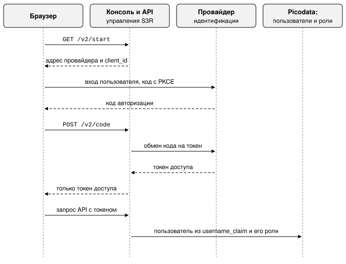

# Первый вход в консоль управления

Страница описывает, как впервые открыть доступ к
[консоли управления](../reference/glossary.md#console) S3R: какие роли нужны,
как настроить вход без внешнего провайдера идентификации и через него и что
делать, если войти не удаётся. Она нужна администратору кластера сразу после
установки. Что доступно в консоли после входа, описано на странице
[Консоль управления](console.md).

## Перед началом {: #console_before_start }

Консоль доступна по адресу `https://<адрес>:<порт>/s3gateway/console/`. Её и [API управления](../reference/glossary.md#management_api)
обслуживает встроенный HTTP-сервер Picodata на том же порте, что и собственный веб-интерфейс
Picodata. Порт задаётся параметром `instance.http_listen` в конфигурации Picodata; в примерах
руководства это 6006. Перед этим портом обычно стоит обратный прокси, и в примерах консоль
опубликована по адресу `https://console.example.net/s3gateway/console/` (см.
[Шаг 9 установки](../install/manual.md#console_proxy)).

Кто проверяет пользователя при входе, задаёт настройка `s3r_api.iam`. Способов два:

| Способ входа | Когда выбирать | Процедура |
|---|---|---|
| По имени и паролю пользователя Picodata (`auth_type: picodata`) | [провайдера идентификации](../reference/glossary.md#identity_provider) нет: изолированный контур, испытательный стенд, установка, куда Keycloak придёт позже | [Вход без внешнего провайдера идентификации](#start_without_external_auth) |
| Через внешнего провайдера идентификации по протоколу OpenID Connect, обычно Keycloak (`auth_type: keycloak`) | в организации есть провайдер, и пользователи должны входить через него | [Вход через провайдера идентификации](#accessing_console) |

Разворачивать Keycloak только ради входа в консоль не требуется. Перейти с первого способа на
второй можно позже, без перенастройки хранилища.

При любом способе [субъектом доступа](../reference/glossary.md#principal) остаётся пользователь
Picodata, а полномочия определяют одни и те же роли. Первый администратор создаётся средствами
SQL: создать его через консоль нельзя, потому что для входа в консоль администратор уже нужен.

!!! warning "Раздел `iam` задаётся явно"
    Кластер, в котором раздел `iam` не задан, во входе отказывает. Значения по умолчанию
    «пускать всех» нет: оно оставило бы установку открытой по недосмотру.

### Роли {: #roles }

| Роль                               | Полномочия                                                                                |
|------------------------------------|-------------------------------------------------------------------------------------------|
| `s3r_superuser`                    | Весь кластер: тенанты и их сертификаты, [ярусы](../reference/glossary.md#storage_tier), обслуживание, все экраны и все операции |
| `s3r_tenant_admin_<идентификатор>` | Пользователи, ключи и [бакеты](../reference/glossary.md#bucket) **одного** тенанта, чей идентификатор указан в имени роли |
| `s3r_observer`                     | Только чтение: состояние кластера, ёмкость, [группы размещения](../reference/glossary.md#placement_group), восстановление             |
| `s3r_user`                         | Полномочий не даёт. Отмечает пользователя S3R: такому пользователю `s3r_superuser` задаёт пароль для входа по SQL |

Роль администратора [тенанта](../reference/glossary.md#tenant) создаётся вместе с тенантом. Для
тенанта по умолчанию это `s3r_tenant_admin_0`.

### Субъекты доступа и тенанты {: #principals_and_tenants }

Обычно каждый субъект доступа принадлежит своему тенанту. Вход в консоль составляет исключение: субъект
доступа, вошедший в консоль, относится к системному тенанту, а не к какому-либо из
пользовательских. Каким тенантом он может управлять, определяет набор его ролей.

Системный тенант не перечисляется в списке тенантов и недоступен по номеру: он хранит то, что не
принадлежит ни одному пользовательскому тенанту, и администрировать его нельзя.

## Вход без внешнего провайдера идентификации {: #start_without_external_auth }

**Когда применять.** Провайдера OpenID Connect нет. Вход в консоль проверяет сама Picodata:
консоль запрашивает имя пользователя и пароль Picodata, с которыми администратор подключается к
кластеру командой `picodata connect`. Ни провайдера, ни клиента, ни области (realm) не требуется.
Консоль и API управления работают полностью.

**Результат.** Администратор входит в консоль по имени и паролю, а запрос `GET /v2/rights`
возвращает его роли.

### Шаг 1. Кластер с установленным плагином {: #cluster_with_installed_plugin }

1. Установите плагин. Порядок описан в разделе [Установка](../install/requirements.md) и от
   способа входа не зависит: плагин ставится, миграции применяются, сервисы включаются. При
   установке вручную выполняются команды от `CREATE PLUGIN` до `ENABLE` из того же раздела.

2. Задайте параметр `instance.http_listen` в конфигурации Picodata. На этом порте Picodata отдаёт
   консоль и API управления.

    ```yaml
    instance:
      http_listen: "0.0.0.0:6006"
    ```

3. Проверьте, что плагин установлен и включён:

    ```sql
    SELECT name, version, enabled FROM _pico_plugin;
    ```

!!! note "Настройка `iam` для запуска не нужна"
    [Инстанс](../reference/glossary.md#instance) запускается, и эндпоинт S3 работает без неё:
    без `iam` недоступен только вход в консоль. Задать её можно когда угодно, на работающем
    кластере и без перезапуска.

### Шаг 2. Настройка плагина {: #plugin_configure }

Выполните команды `ALTER PLUGIN`; перезапуск не требуется.

```sql
ALTER PLUGIN s3r 2.2.0 SET s3r_api.control_api = 'true';
ALTER PLUGIN s3r 2.2.0 SET s3r_api.iam = '{"auth_type": "picodata"}';
```

- `control_api` включает консоль и API управления. По умолчанию параметр выключен: существующая
  установка не должна получать пространство управления только оттого, что её обновили.
- Весь раздел `iam` состоит из одной настройки. `issuer`, `audience`, `client_id` и адреса
  провайдера не указываются, потому что провайдера нет. Значение `picodata` указывается явно.

### Шаг 3. Первый администратор {: #admin_setup }

Выполните в административной консоли [узла](../reference/glossary.md#node):

```sql
CREATE USER "ivanov" WITH PASSWORD 'Sup3rSecret...' USING scram-sha256;
GRANT "s3r_superuser" TO "ivanov";
```

!!! warning "Двойные кавычки обязательны"
    Оба идентификатора записываются в двойных кавычках. Без кавычек Picodata приводит их к
    верхнему регистру, а роли создаются в нижнем, и выдача завершится ошибкой «нет такой роли».

Пароль в этой команде служит паролем для входа в консоль. Роли те же, что и при работе с
провайдером (см. [Роли](#roles)).

### Шаг 4. Вход {: #plugin_connect }

1. Откройте `https://<адрес>:<порт>/s3gateway/console/`. Вместо кнопки перенаправления к
   провайдеру страница показывает форму с именем пользователя и паролем.

2. Проверьте, что вход настроен и роль выдана. API управления в этом режиме принимает те же
   учётные данные в виде HTTP Basic:

    ```shell
    curl -u ivanov https://console.example.net/s3gateway/api/v2/rights
    ```

    Ответ содержит имя субъекта доступа и его роли.

### Отличия от работы с провайдером идентификации {: #difference_from_external_auth }

!!! warning "Публикуйте консоль по HTTPS и отдельно от объектов"
    - Пароль при входе пересекает сеть, поэтому консоль публикуется по протоколу HTTPS. На
      незащищённом соединении консоль предупреждает об этом на странице входа.
    - Не публикуйте объекты бакетов по тому же адресу (схема, узел и порт), что и консоль.
      Страница, полученная с этого адреса, может обращаться к API от имени вошедшего пользователя,
      и атрибут `SameSite` этого не предотвращает.

**Сеанс консоли.** Консоль передаёт пароль один раз, при входе, и получает в ответ cookie
`s3r_session`, который браузер затем отправляет вместо пароля. Поэтому после перезагрузки страницы
консоль остаётся на том же экране.

- Cookie действует восемь часов и не продлевается.
- Cookie недоступен сценариям страницы и отправляется только с запросами самой консоли.
- Таблицы сеансов нет: cookie подписан общим ключом кластера, и его проверяет любой инстанс.
- Другие клиенты API, например curl, передают пароль в каждом запросе.

**Пользователи из каталога LDAP.** Пользователю, чей пароль проверяет каталог LDAP, cookie не
выдаётся: он не заметил бы смены пароля или блокировки в каталоге. Консоль хранит пароль такого
пользователя до закрытия или перезагрузки страницы и после перезагрузки снова просит войти.

**Как закрыть доступ.** Доступ закрывается средствами SQL немедленно.

| Действие | Что закрывает |
|---|---|
| `ALTER USER` с новым паролем или `DROP USER` | доступ со следующего запроса, в том числе по уже выданным консоли cookie |
| запись в списке отзыва (см. [Отзыв доступа](../reference/management_api.md#api_revocation)) | сеансы консоли, начатые до неё; вход по паролю не запрещает |
| выход из консоли | ничего на сервере: cookie удаляется только из браузера, потому что сервер не хранит сеансов. Копия cookie, например из журнала прокси-сервера, действует до истечения срока |
| удаление строки из таблицы `s3r_console_key` | все сеансы консоли: в таблице хранится ключ, которым подписываются cookie, и новый ключ создаётся при следующем входе |

Чтобы прекратить действие копии cookie до истечения срока, смените пароль пользователя или
добавьте запись в список отзыва.

**Ключи доступа S3** от режима входа не зависят. Подпись SigV4 проверяется по таблице учётных
данных кластера и при любом `auth_type` работает одинаково.

**Переход на провайдера.** Провайдер добавляется позже без перенастройки хранилища: ключи доступа,
бакеты и объекты от него не зависят. Замените раздел `iam` на настройки провайдера и выполните
процедуру [Вход через провайдера идентификации](#accessing_console). Пользователи Picodata при
этом сохраняются; совпасть должно только имя, которое придёт в заявке на предпочитаемое имя в
токене.

## Вход через провайдера идентификации {: #accessing_console }

**Когда применять.** Пользователи входят в консоль через внешнего провайдера идентификации,
который выдаёт токены по протоколу OpenID Connect. Процедура ведёт от пустой установки до
работающего входа. Шаги выполняются один раз и в указанном порядке.

**Что должно быть выполнено заранее.**

- Плагин установлен и включён, параметр `instance.http_listen` задан (см.
  [шаг 1 предыдущей процедуры](#cluster_with_installed_plugin)).

**Результат.** Пользователь открывает консоль, проходит аутентификацию у провайдера и видит экраны
согласно своей роли.

!!! tip "Если провайдера нет"
    При отсутствии провайдера идентификации пароль проверяет сам кластер: выполните процедуру
    [Вход без внешнего провайдера идентификации](#start_without_external_auth).

### Шаг 1. Провайдер идентификации {: #auth_provider }

S3R доверяет ровно одному издателю токенов (`issuer`). Обычно это Keycloak. Если пользователи
приходят из Google или другого внешнего источника, Keycloak выступает посредником, и для S3R это
ничего не меняет.

Создайте в области (realm) провайдера клиента для консоли:

| Свойство клиента | Значение |
|---|---|
| Тип клиента | **публичный** (public), без секрета. Консоль выполняется в браузере, и любой секрет, попавший в сборку, попадает к пользователю. Вместо секрета применяется PKCE |
| Разрешённый способ получения токена | **код авторизации** (authorization code) с PKCE (метод `S256`) |
| Разрешённый адрес возврата (redirect URI) | адрес консоли со слешем на конце, например `https://console.example.net/s3gateway/console/` |
| Аудитория (`aud`) токена | значение, которое указано в настройке `audience` плагина. Токен без нужной аудитории отклоняется |

### Шаг 2. Заявка на предпочитаемое имя пользователя {: #claim_preferred_username }

Субъектом доступа S3R служит пользователь Picodata, имя которого берётся из заявки (claim) —
поля токена. По умолчанию это поле `preferred_username`; другое поле задаёт настройка
`username_claim`.

!!! warning "Выберите форму имени заранее"
    Имя из заявки попадёт в каждую запись ACL, в каждую строку квоты и в каждую запись аудита.
    Сменить его после начала работы гораздо дороже, чем выбрать сразу.

При посредничестве Keycloak имя локальной учётной записи часто заполняется из адреса электронной
почты, и тогда `preferred_username` приходит в виде `ivanov@example.net`. Для Picodata это
допустимое имя, и работать будет всё. Если такая форма нежелательна, настройте на стороне Keycloak
отображение (claim mapper), выдающее короткое имя.

### Шаг 3. Первый пользователь Picodata {: #initial_user }

Выполните в административной консоли узла:

```sql
CREATE USER "ivanov" WITH PASSWORD 'Sup3rSecret...' USING scram-sha256;
GRANT "s3r_superuser" TO "ivanov";
```

!!! warning "Пароль из этой команды не служит паролем от консоли"
    Вход выполняется по токену провайдера, и пароля консоль не спрашивает. Задать его приходится
    потому, что Picodata требует указать способ аутентификации при создании пользователя. Принять
    его за пароль от консоли является самой частой ошибкой на этом шаге.

- Оба идентификатора записываются в двойных кавычках. Без кавычек Picodata приводит их к верхнему
  регистру, а роли создаются в нижнем, и выдача завершится ошибкой «нет такой роли».
- Имя пользователя должно совпадать с тем, что придёт в заявке токена (см.
  [шаг 2](#claim_preferred_username)). Если имена приходят в виде адресов почты, то и пользователь
  создаётся с таким именем: `CREATE USER "ivanov@example.net" ...`.
- В установке, где пользователей заводит `argus` из каталога LDAP, пользователь уже существует, и
  нужна только выдача роли.

Какую роль выдать, показывает таблица в разделе [Роли](#roles).

### Шаг 4. Настройка плагина {: #setup_plugin_auth }

Выполните команды `ALTER PLUGIN`; перезапуск не требуется.

```sql
ALTER PLUGIN s3r 2.2.0 SET s3r_api.control_api = 'true';

ALTER PLUGIN s3r 2.2.0 SET s3r_api.iam = '{
  "auth_type": "keycloak",
  "auth_path": "https://keycloak.example.net/realms/s3r/protocol/openid-connect/auth",
  "token_path": "https://keycloak.example.net/realms/s3r/protocol/openid-connect/token",
  "issuer": "https://keycloak.example.net/realms/s3r",
  "audience": "s3gateway",
  "client_id": "console",
  "username_claim": "preferred_username"
 }';
```

- `control_api` включает консоль и API управления. По умолчанию параметр выключен: существующая
  установка не должна получать пространство управления только оттого, что её обновили.
- `auth_path` и `token_path` указываются целиком, потому что их вид различается у разных
  провайдеров. Если они не заданы, адреса берутся из документа
  `/.well-known/openid-configuration` издателя.

### Шаг 5. Вход в консоль {: #console_address }

Откройте `https://<адрес>:<порт>/s3gateway/console/` и войдите через провайдера.

При входе происходит следующее:

1. Консоль запрашивает у API адрес провайдера и отправляет туда браузер.
2. Провайдер возвращает браузеру код авторизации, и консоль передаёт его серверу.
3. Сервер меняет код на токен. Обмен выполняется на сервере намеренно: браузер не получает токен
   обновления, а секретов клиента в нём нет.



Если вход не удался, см. [Решение проблем со входом](#troubleshooting_console_access).

## Решение проблем со входом {: #troubleshooting_console_access }

| Признак | Причина | Что делать |
| --- | --- | --- |
| Страница сообщает, что кластер не может никого аутентифицировать | Настройка `s3r_api.iam` не задана | Задайте её: [с провайдером](#setup_plugin_auth) или [без провайдера](#plugin_configure) |
| Вход проходит, но консоль отвечает «нет такого субъекта доступа (403)» | Токен подлинный, но пользователя Picodata с таким именем нет | Сравните запрошенное имя в токене с именем из [шага 3](#initial_user): чаще всего расходится форма имени |
| Вход проходит, экранов нет, операции запрещены (403) | Пользователь есть, роль не выдана | Выдайте роль ([шаг 3](#initial_user)) |
| Тенант отвечает «не найдено» (404) | Нет роли `s3r_tenant_admin_<идентификатор>` этого тенанта. Ответ «не найдено», а не «запрещено», намеренно: ответ «запрещено» подтвердил бы, что такой тенант существует | Выдайте роль этого тенанта (см. [Роли](#roles)) |
| Ответ 503 с указанием, что провайдер недоступен | Провайдер не отвечает. Это не выход из системы: уже выданные токены продолжают работать до истечения срока, а операции с данными по ключам S3 от провайдера не зависят вовсе | Восстановите доступность провайдера. Заголовок `Retry-After` в ответе указывает, через сколько секунд инстанс сможет снова обратиться к провайдеру |
| Страница сообщает, что консоль не собрана | Сборка плагина выполнена без консоли | Соберите консоль и пересоберите плагин |
