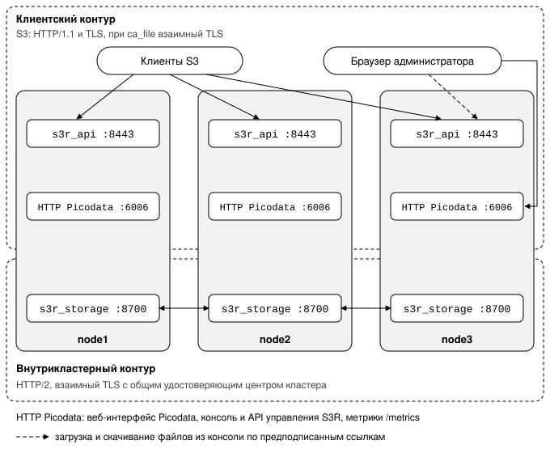

# Шифрование трафика

Страница для инженера эксплуатации: как включить TLS для запросов клиентов S3 и для обмена
фрагментами между [узлами](../reference/glossary.md#node), какие нужны сертификаты, что перестанет работать при ошибке в
настройке и как убедиться, что шифрование действует.

Плагин обслуживает два независимых сетевых [контура](../reference/glossary.md#network_plane). По клиентскому контуру приходят запросы S3,
по внутрикластерному узлы обмениваются [фрагментами](../reference/glossary.md#chunk)
[полос](../reference/glossary.md#stripe), то есть содержимым объектов. Контуры настраиваются
отдельно: шифрование включается разделом `tls` в конфигурации соответствующего [слушателя](../reference/glossary.md#listener).

| Контур | Слушатель | Транспорт | Шифрование |
| --- | --- | --- | --- |
| Клиентский (S3) | `s3r_api` | HTTP/1.1 | TLS; при заданном `ca_file` взаимный TLS (mTLS) |
| Внутрикластерный (обмен фрагментами полос) | `s3r_storage` | HTTP/2 | взаимный TLS, `ca_file` обязателен |

!!! danger "По умолчанию оба контура работают без шифрования"
    Без раздела `tls` порт обмена фрагментами `s3r_storage` принимает и передаёт содержимое
    объектов в открытом виде. Такой порт размещается только в изолированной сети (см.
    [«Если шифрование не включено»](#without_tls)); для тестового кластера на одном узле это
    допустимо.

Контуры показаны на схеме, номера портов на ней взяты из примеров конфигурации:



## Клиентский контур {: #userspace }

Параметры шифрования для эндпоинта S3 задаются в разделе
`listener` сервиса `s3r_api` в конфигурации Picodata.

1. Подготовьте на узле сертификат эндпоинта S3 и его ключ. Если клиенты должны предъявлять
   собственный сертификат, подготовьте сертификат удостоверяющего центра, который их подписывает.

2. Задайте раздел `tls` слушателя:

    ```yaml
    instance:
      plugin:
        s3r:
          service:
            s3r_api:
              listener:
                enabled: true
                listen: "0.0.0.0:8443"
                tls:
                  enabled: true
                  cert_file: /etc/s3r/server.pem
                  key_file:  /etc/s3r/server.key
                  ca_file:   /etc/s3r/clients-ca.pem
    ```

    | Параметр | Что задаёт |
    | --- | --- |
    | `cert_file`, `key_file` | сертификат эндпоинта S3 и его ключ: сертификат подтверждает клиенту подлинность сервера |
    | `ca_file` | необязателен; включает двустороннюю аутентификацию (mTLS) |

3. Проверьте, что эндпоинт отвечает по HTTPS (см.
   [«Шаг 6. Проверка готовности»](../install/manual.md#endpoint_check)):

    ```shell
        curl --cacert /etc/s3r/ca.pem https://node1.example.net:8443/-/health
    ```

    Если задан параметр `ca_file`, добавьте к команде сертификат клиента и его ключ:
    `--cert <файл> --key <файл>`.


!!! warning "С параметром `ca_file` клиент без сертификата не подключится"
    Клиент без сертификата, подписанного указанным удостоверяющим центром, отклоняется на этапе
    рукопожатия TLS, до разбора запроса S3.

### Версии протокола и наборы шифров {: #encryption_options }

- Набор шифров соответствует профилю Mozilla Intermediate v5.
- Плагин использует библиотеку OpenSSL, с которой собрана Picodata, и собственной криптографии
  не вводит. Поэтому доступные версии протокола и наборы шифров совпадают с доступными остальным
  слушателям Picodata.
- TLS 1.3 поддерживается в обоих контурах.
- Поддержка отечественных алгоритмов определяется сборкой OpenSSL: в сертифицированной
  конфигурации с поддержкой ГОСТ они доступны без отдельной настройки в плагине.
- При проверке подлинности рукопожатие выполняется в
  [среде выполнения Tokio](../reference/glossary.md#tokio) средствами OpenSSL.

### Сертификат тенанта и выбор по SNI {: #tenant_cert_and_sni }

Слушатель `s3r_api` использует сертификат кластера, заданный в конфигурации Picodata.
[Тенант](../reference/glossary.md#tenant) может отвечать по собственному FQDN (`s3r_tenant.fqdn`,
см. [Тенанты](../concepts/tenants.md)) с собственным сертификатом.

!!! danger "Закрытый ключ тенанта остаётся в журнале упреждающей записи и в снимках"
    Ключ сохраняется в [журнале упреждающей записи](../../../overview/glossary.md#wal) и в [снимках](../../../overview/glossary.md#snapshot) до их компактизации. При
    компрометации ключа недостаточно заменить его: старый ключ остаётся восстановимым из
    резервных копий за этот период.

!!! warning "Не включайте уровень журнала `debug` на рабочих узлах"
    При уровне `debug` Picodata записывает в журнал каждую применённую операцию [Raft](../../../overview/glossary.md#raft) вместе со
    строкой таблицы. Строки длиннее 100 символов Picodata обрезает.

    - Секретные ключи доступа и ключ подписи сеансов консоли короче этого предела и попадают в
      журнал целиком.
    - Сам закрытый ключ тенанта в журнал не попадает: туда попадает только начало его записи в
      Base64, то есть заголовок PEM и около 35 байт служебной структуры PKCS#8.

    Команда `UPDATE`, которой администратор сам меняет сертификат, содержит ключ в тексте запроса.
    Такой текст записывается в журнал при включённом параметре `sql_log` и в журнал аудита, если
    для пользователя включена политика `dml_default`.

#### Где хранится сертификат {: #tenant_cert_storage }

Сертификат тенанта хранится в строке таблицы `s3r_tenant`:

| Столбец | Что содержит |
| --- | --- |
| `cert_chain` | сертификат |
| `cert_key` | закрытый ключ |
| `mtls_ca` | заполняется для взаимного TLS |

Строка реплицируется на все узлы одной транзакцией. Если бы сертификаты хранились в файлах, их
пришлось бы распространять по узлам, а расхождение файлов привело бы к ошибкам TLS на части
узлов.

Сертификат и ключ задаются как текст PEM в кодировке Base64. Закрытый ключ в формате PEM занимает
несколько строк, а не все способы передачи значения сохраняют переносы строк. Значение в
кодировке Base64 занимает одну строку и от способа передачи не зависит.

Сертификат тенанта заменяется командой `UPDATE` его строки. Изменение реплицируется на все узлы
и не прерывает обслуживание других тенантов.

Кто видит ключ:

- таблица `s3r_tenant` выдаётся только роли `s3r_superuser` и не входит в наборы табличных
  разрешений для остальных ролей;
- плагин читает столбец ключа только для того, чтобы собрать контекст TLS, и не выводит ключ ни
  в журнал, ни в диагностику;
- плагин записывает ключ без SQL, поэтому ключ не попадает в журнал аудита Picodata.

#### Как сервер выбирает сертификат {: #tenant_cert_selection }

Во время рукопожатия сервер выбирает сертификат тенанта по имени из SNI. Если у тенанта задан
`mtls_ca`, сервер также требует клиентский сертификат. Выбор выполняется до чтения заголовка
`Host`, потому что к этому моменту рукопожатие TLS уже завершено.

| Соединение | Какой сертификат получает | Какие запросы обслуживаются |
| --- | --- | --- |
| с SNI | сертификат тенанта, названного в SNI | только запросы к этому тенанту: имя из SNI должно соответствовать тенанту запроса |
| без SNI | сертификат тенанта по умолчанию и его режим проверки клиентского сертификата; если собственного сертификата у тенанта по умолчанию нет, сертификат кластера | только запросы к тенанту по умолчанию. Запрос, адресованный заголовком `Host` любому другому тенанту, отклоняется |

Поэтому клиент не может предъявить сертификат одного тенанта и обратиться к данным другого, а
требование клиентского сертификата нельзя обойти, опустив SNI.

## Обмен фрагментами внутри кластера {: #fragments_flow_in_cluster }

Обмен фрагментами между узлами шифруется, если в конфигурации слушателя `s3r_storage` задан
раздел `tls`. Без него порт обмена фрагментами принимает и передаёт содержимое объектов в
открытом виде.

!!! warning "Внимание"
    - Шифрование обмена фрагментами по умолчанию выключено. Без раздела `tls` порт `s3r_storage`
      размещается только в изолированной сети; для тестового кластера на одном узле это
      допустимо.
    - Раздел `tls` без `ca_file` останавливает загрузку плагина с сообщением об ошибке (см.
      [Решение типовых проблем](troubleshooting.md#ts_plugin_does_not_start)).
    - Сертификат узла должен быть подписан удостоверяющим центром кластера, иначе рукопожатие с
      другими узлами не состоится.

Каждый узел выступает одновременно сервером и клиентом обмена фрагментами, поэтому применяется
взаимная аутентификация через общий удостоверяющий центр кластера. Узел предъявляет собственный
сертификат и проверяет сертификат узла на другой стороне соединения.

1. Выпустите удостоверяющий центр кластера, один на установку, и сертификат каждого узла.
   Средствами `openssl`:

    ```shell
    # Удостоверяющий центр кластера, один на установку.
    openssl req -x509 -newkey rsa:4096 -days 3650 -nodes \
      -keyout cluster-ca.key -out cluster-ca.pem \
      -subj "/CN=s3r cluster CA"

    # Сертификат узла.
    openssl req -newkey rsa:2048 -nodes \
      -keyout node3.key -out node3.csr \
      -subj "/CN=node3.example.net"

    openssl x509 -req -in node3.csr -days 825 \
      -CA cluster-ca.pem -CAkey cluster-ca.key -CAcreateserial \
      -extfile <(printf "subjectAltName=DNS:node3.example.net\nextendedKeyUsage=serverAuth,clientAuth") \
      -out node3.pem
    ```

    Расширение `extendedKeyUsage` содержит оба назначения, потому что узел использует один
    сертификат и как сервер, и как клиент.

2. Задайте раздел `tls` слушателя `s3r_storage` в конфигурации Picodata:

    ```yaml
    instance:
      plugin:
        s3r:
          service:
            s3r_storage:
              listener:
                enabled: true
                listen: "0.0.0.0:8700"
                advertise: "node3.example.net:8700"
                tls:
                  enabled: true
                  cert_file: /etc/s3r/node3.pem
                  key_file:  /etc/s3r/node3.key
                  ca_file:   /etc/s3r/cluster-ca.pem
    ```

    | Параметр | Роль в схеме |
    | --- | --- |
    | `cert_file`, `key_file` | сертификат и ключ узла; предъявляются при приёме и при установлении соединения |
    | `ca_file` | удостоверяющий центр кластера; по нему проверяется сертификат другого узла |

3. Проверьте режим, который узел записывает в журнал при запуске:

    ```text
    chunk endpoint serving on Some(127.0.0.1:9801) over mutual TLS
    ```

    | Окончание сообщения | Что означает |
    | --- | --- |
    | `over mutual TLS` | включены шифрование и взаимная аутентификация |
    | `over plaintext; carry it over a trusted network` | раздела `tls` нет: данные передаются без шифрования, и порт следует размещать в изолированной сети |

    Режим передачи в таблицы `s3r_pg` и `s3r_disk` не записывается.

### Почему `ca_file` обязателен {: #cluster_ca_required }

В клиентском контуре параметр `ca_file` необязателен: там сертификат подтверждает подлинность
сервера для клиента. Во внутрикластерном контуре запрос фрагмента не несёт подписи S3, и право
на запрос определяется принадлежностью узла к кластеру, которую подтверждает его сертификат. Без
`ca_file` проверить, что соединение установлено с доверенным узлом, невозможно.

### Проверка узлов {: #node_verification }

!!! warning "Узлы между собой не различаются"
    Любой владелец сертификата, подписанного удостоверяющим центром кластера, может выступать в
    качестве любого узла. Для различения узлов нужна проверка имени, а для неё нужны устойчивые
    имена узлов, которых в установке пока нет.

Проверяется цепочка сертификатов: сертификат узла должен быть подписан удостоверяющим центром
кластера, иначе рукопожатие не состоится.

Имена узлов не проверяются. Адреса узлов берутся из таблицы `_pico_peer_address` в виде
`IP:порт`, то есть из консенсуса самого кластера, а не из службы имён. Проверка имён потребовала
бы указывать IP-адрес в расширении `subjectAltName` каждого сертификата и перевыпускать
сертификат при переносе узла, но ничего не добавила бы к адресу, полученному через Raft.

### Если шифрование не включено {: #without_tls }

Внутрикластерный трафик изолируется сетевыми средствами:

- отдельным сегментом сети или VLAN для межузлового обмена;
- фильтрацией порта обмена фрагментами на границе сегмента;
- туннелированием через IPsec или WireGuard при передаче между [площадками](../reference/glossary.md#site).
