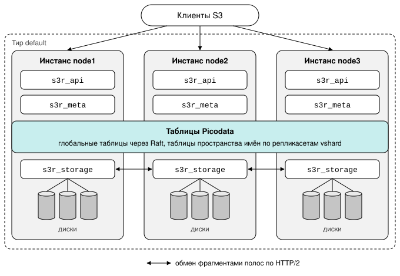
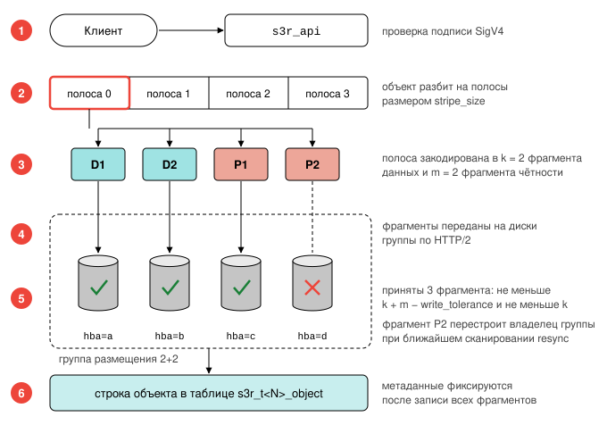

# Устройство плагина

Страница объясняет, какие данные хранит S3R и где, какой из трёх сервисов
плагина за что отвечает и как проходят запросы на запись и чтение объекта.
Её стоит прочитать до установки: от устройства зависят требования к [узлам](../reference/glossary.md#node),
сети и памяти.

!!! abstract "Коротко"
    - Метаданные хранятся в таблицах Picodata, содержимое крупных объектов —
      на локальных дисках узлов.
    - На каждом [инстансе](../reference/glossary.md#instance) работают три сервиса: один принимает запросы S3,
      второй обращается к таблицам, третий к дискам.
    - При записи сначала сохраняется содержимое, затем создаётся строка
      объекта. Пока строки нет, объекта для клиентов не существует.

## Что и где хранится {: #what_is_stored_where }

S3R работает внутри СУБД Picodata и отдельного хранилища метаданных не
требует. Данные делятся на три вида, и у каждого своё место и свой способ
защиты от отказов.

| Что хранится | Где | Чем защищено |
|---|---|---|
| [Бакеты](../reference/glossary.md#bucket) и их настройки, [тенанты](../reference/glossary.md#tenant), ключи доступа, квоты, диски, группы размещения | Глобальные таблицы Picodata: полная копия на каждом инстансе | Изменения согласуются через [Raft](../../../overview/glossary.md#raft) |
| Строка каждого объекта: ключ, размер, атрибуты, группа размещения. Содержимое объектов размером до `inline_max` (по умолчанию 4 КиБ) | Шардированные таблицы Picodata: строки распределены по [репликасетам](../reference/glossary.md#replicaset) | Репликация внутри репликасета |
| Содержимое объектов крупнее `inline_max` | Локальные диски узлов | [Схема избыточности](../reference/glossary.md#erasure_shape) [яруса](../reference/glossary.md#storage_tier) в [группе размещения](../reference/glossary.md#placement_group): [избыточное кодирование](../reference/glossary.md#erasure_coding) `k+m`, а при `k = 1` репликация в `m + 1` копиях |

Что это значит на практике:

- **Запрос можно отправить на любой инстанс.** Список бакетов, дисков и групп
  размещения есть у каждого инстанса, поэтому он сам проверяет права и сам
  находит нужные диски. Исключение составляет кластер с несколькими
  ярусами: запись в ярус принимает только инстанс, у которого есть диски этого яруса (см.
  [Правила построения кластера с ярусами](storage_classes.md#tier_rules)).
- **Бакеты создаются редко и заранее.** Создание и удаление бакета согласует
  весь кластер, и это заметно дольше записи объекта. Приложение не должно
  создавать новый бакет для каждого файла или каждого запроса: заведите
  несколько бакетов заранее и различайте данные по ключам объектов.
- **Чем больше объектов и запросов, тем больше нужно репликасетов.** Строки объектов
  распределены между репликасетами. Объекты одного бакета находятся во всех
  репликасетах, поэтому размер бакета не ограничен одним узлом.
- **Содержимое крупного объекта в таблицах не хранится.** В строке объекта
  записаны только группа размещения и размер. По ним вычисляется, на каких
  дисках находятся [фрагменты](../reference/glossary.md#chunk).

Как защищён каждый вид данных и что это требует от топологии, описано на
странице [Избыточность и домены отказа](redundancy.md).

### Где хранятся данные {: #data_location }

!!! warning "Диски без таблиц и таблицы без дисков не являются резервной копией"
    Содержимое объекта нельзя прочитать без его строки метаданных, а строку —
    без содержимого на дисках. Поэтому копия директорий дисков без таблиц
    Picodata и [снимок](../../../overview/glossary.md#snapshot) таблиц без директорий дисков не являются резервной копией
    (см. [Ограничения](../reference/limits.md#limits_operations)).

| Что | Где |
| --- | --- |
| Содержимое объектов крупнее `inline_max` | директории дисков хранилища: файл `superblock` с идентификаторами диска и кластера, файлы [экстентов](../reference/glossary.md#extent) `<номер>.ext` и файл блокировки `.s3r-lock` |
| Метаданные: бакеты, строки объектов, объекты до `inline_max`, диски, группы размещения, состояние кластера | таблицы Picodata в директории данных каждого инстанса; глобальные таблицы на каждом инстансе, шардированные на инстансах своего репликасета |
| Плагин | директория `instance.share_dir`, поддиректория `s3r/<версия>/` |
| Конфигурация плагина | системная таблица Picodata `_pico_plugin_config`; переменные окружения инстанса |
| Журнал | журнал инстанса Picodata |

## Три сервиса {: #services }

Плагин состоит из трёх [сервисов](../../../overview/glossary.md#service).
Все три назначаются на один и тот же
[тир](../../../overview/glossary.md#tier) Picodata и работают на каждом его
инстансе.

| Сервис | За что отвечает | С чем работает | Что требует от узла |
|---|---|---|---|
| `s3r_api` | Принимает запрос S3: проверяет подпись и права, делит объект на полосы, кодирует их, собирает ответ | Клиенты S3 | Порт, доступный клиентам |
| `s3r_meta` | Выполняет обращения сервисов `s3r_api` и `s3r_storage` к таблицам Picodata | Таблицы Picodata | Оперативную память под метаданные |
| `s3r_storage` | Хранит фрагменты на локальных дисках, регистрирует диски в кластере, передаёт фрагменты между узлами, создаёт группы размещения | Диски своего узла и сервисы `s3r_storage` других узлов | Диски, `io_uring` и `O_DIRECT`, порт для обмена между узлами |

Клиент может обратиться к любому инстансу: запрос обслужит `s3r_api` этого
инстанса. К таблицам он обращается через `s3r_meta` того же инстанса, а не по
сети, поэтому сервисы нельзя разнести по разным тирам.

Сервисы запускаются независимо и в произвольном порядке. Плагин готов к
работе после запуска `s3r_meta`.

!!! note "Несколько тиров"
    Плагин можно включить на нескольких тирах. На каждый из них назначаются
    все три сервиса: при запуске плагин сравнивает списки тиров сервисов и не
    включается, если они различаются.

### Зачем нужен отдельный сервис для таблиц {: #tx_and_workers }

В инстансе Picodata с плагином работают потоки двух видов:

- **[Транзакционный поток](../reference/glossary.md#tx)** у инстанса один. Только в нём выполняются
  операции с таблицами.
- **Рабочие потоки плагина** образуют пул, размер которого задаёт переменная
  окружения `S3R_WORKER_THREADS`. В них выполняется всё, что нагружает
  процессор и сеть: разбор запросов, проверка подписи, кодирование, сжатие,
  обмен фрагментами.

Запрос S3 обрабатывают рабочие потоки, а метаданные доступны только из
транзакционного. Сервис `s3r_meta` принимает обращения к таблицам от рабочих
потоков, выполняет их в транзакционном потоке и возвращает результат.

Из этого следуют два ограничения:

- Транзакционный поток один, поэтому инстанс обслуживает до 10 000 операций
  с метаданными в секунду. Больше даёт только увеличение числа репликасетов
  (см. [Число инстансов](../install/requirements.md#instances_count)).
- При перегрузке обращения ждут в очередях `s3r_meta`. Запрос, который не
  дождался своей очереди, получает ответ `503 SlowDown`. Очереди показывают
  метрики `s3r_bridge_wait_seconds` и `s3r_bridge_queue_depth` (см.
  [Сервис s3r_meta](../reference/configuration.md#s3r_meta)).

## Путь запроса на запись {: #write_path }

Объект размером до `inline_max` записывается одной операцией: `s3r_api`
проверяет запрос, и содержимое сохраняется в строке объекта. Диски в записи
не участвуют.

Объект крупнее `inline_max` записывается в
[группу размещения](../reference/glossary.md#placement_group). Группа представляет собой
набор из `k + m` дисков, на которые раскладываются фрагменты; диск в составе
группы называется [участником](../reference/glossary.md#member). Групп в
кластере много, и объект целиком попадает в одну из них.

Запись выполняется в шесть шагов:

1. `s3r_api` принимает тело запроса, проверяет подпись и права.
2. Объект делится на [полосы](../reference/glossary.md#stripe) размером
   `stripe_size`.
3. Каждая полоса кодируется по схеме избыточности яруса: в `k` фрагментов
   данных и `m` фрагментов чётности. При `k = 1` полоса не делится и не кодируется:
   она записывается целиком в `m + 1` одинаковых копиях. Схема 1+2 означает
   три копии.
4. `s3r_storage` передаёт фрагменты на диски группы размещения: фрагмент с
   номером `i` уходит участнику группы с номером `i`. На диски других узлов
   фрагменты передаются по протоколу HTTP/2.
5. Полоса считается записанной, когда фрагменты сохранило достаточное число
   дисков (см. [Кворум записи](#write_quorum)).
6. После записи всех полос `s3r_meta` создаёт строку объекта.

Строка объекта создаётся только после записи содержимого. Объект без строки
клиентам не виден, поэтому прерванная запись не оставляет частично
записанного объекта.

### Кворум записи {: #write_quorum }

Полоса считается записанной, когда её фрагменты сохранили не менее
`k + m − write_tolerance` дисков и не менее `k` дисков. Параметр
`write_tolerance` сервиса `s3r_storage` задаёт, сколько фрагментов запись
вправе оставить недописанными; по умолчанию он равен 1.

| Схема | `write_tolerance` | Запись требует | Чтение требует |
|---|---|---|---|
| 4+2 | 1 | 5 дисков из 6 | 4 |
| 2+2 | 1 | 3 диска из 4 | 2 |
| 4+2 | 0 | 6 дисков из 6 | 4 |

Для записи группе нужно больше участников, чем для чтения. Группа, которая
после отказа ещё читается, может уже не принимать запись.

- **Значение 1** допускает недоступность одного участника группы: диска либо
  инстанса, на котором находится один участник. Если узел содержит
  нескольких участников группы, при его отказе кворума у группы нет.
- **Значение 0** требует все фрагменты: недоступность одного участника
  приводит к отказу каждой записи в группу.
- **Значение больше `m`** не отклоняется. Кворум в этом случае равен `k`, и у
  только что записанной полосы нет запаса: потеря ещё одного фрагмента делает
  её чтение невозможным.

Группу для записи инстанс выбирает среди своих групп по свободному месту; есть ли у группы
кворум, при выборе не учитывается. Если у выбранной группы кворума нет, запись получает ответ
`503 ServiceUnavailable` с кодом `NoQuorum`. Повторный запрос, попавший на другой инстанс,
записывается в группу этого инстанса. Новую группу инстанс получает, когда в текущей кончается
место, а также когда её участник недоступен и уже выделенные экстенты заполнены. Группа всегда
находится в пределах одной [площадки](../reference/glossary.md#site).

Фрагмент, который участник не принял, записывается в
[очередь ресинхронизации](../reference/glossary.md#resync_queue). Его перестраивает
[владелец группы](../reference/glossary.md#owner) в фоновом режиме, без
участия администратора. Сколько строк осталось в очереди, показывает поле
`resync_queue` в ответе `GET /v2/repair` (см.
[Состояние по областям](../admin/integrity.md#repair_areas)).

## Путь запроса на чтение {: #read_path }

1. `s3r_api` проверяет подпись и права.
2. `s3r_meta` находит строку объекта в репликасете, которому принадлежит
   ключ.
3. Если объект хранится в строке, содержимое возвращается сразу.
4. Иначе по номеру группы размещения и размеру объекта из строки вычисляется,
   какие полосы попадают в запрошенный диапазон. `s3r_storage` запрашивает их
   фрагменты у дисков группы. Для чтения полосы достаточно любых `k`
   фрагментов из `k + m`.

## Что даёт такое устройство {: #properties }

**Согласованность.** Метаданные читаются с [мастера репликасета](../reference/glossary.md#master): операции с
одним ключом линеаризуемы, успешно записанный объект сразу доступен для
чтения.

**Масштабирование метаданных.** Пропускная способность работы с метаданными
растёт с числом репликасетов.

**Быстрые малые объекты.** Объект размером до `inline_max` (по умолчанию
4 КиБ) хранится в строке своих метаданных. При движке `memtx`, который
применяется по умолчанию, такой объект читается из оперативной памяти без
обращения к диску.

!!! warning "Большое значение `inline_max` замедляет чтение"
    Объект, хранимый в строке, отдаёт транзакционный поток мастера
    репликасета, а он у инстанса один. Чем крупнее такие объекты, тем раньше
    чтение упирается в этот поток, хотя остальные ядра сервера свободны.

    На испытаниях (60 инстансов, схема 3+2) объекты по 64 КиБ читались из
    строки с той же скоростью, что и с дисков, при вдвое меньшей загрузке
    процессора. Объекты по 256 КиБ читались из строки вдвое медленнее: 65
    тысяч запросов в секунду против 139 тысяч. Значение `inline_max` больше
    64 КиБ задавать не рекомендуется.

У этих свойств есть цена: строки всех объектов находятся в оперативной памяти
каждого инстанса репликасета. Сколько памяти нужно, описано в разделе
[Оперативная память](../install/requirements.md#ram).

См. также:

- [Избыточность и домены отказа](redundancy.md): как данные переживают отказ
  диска, узла и площадки.
- [Группы размещения](placement_groups.md#placement_groups): состояния группы,
  владелец, замена участников.
- [Конфигурация](../reference/configuration.md): параметры трёх сервисов.
- [Глоссарий](../reference/glossary.md).
