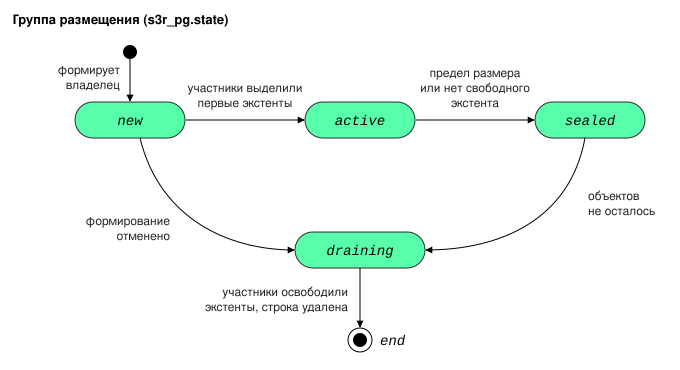

# Группы размещения

Страница объясняет, что такое группа размещения, то есть набор дисков, на которые
записываются [фрагменты](../reference/glossary.md#chunk): кто ею владеет,
какие состояния она проходит, что происходит, когда в ней кончается место или
не набирается кворум, и что значит «группа не на своей позиции». Она нужна
тому, кто читает состояние групп в консоли и
[API управления](../reference/glossary.md#management_api) или разбирает отказ
записи.

Перед этой страницей стоит прочитать две другие: раскладки групп и
[домены отказа](../reference/glossary.md#failure_domain) объяснены на странице
[Избыточность и домены отказа](redundancy.md), а связь [классов хранения](../reference/glossary.md#storage_class) с
[ярусами](../reference/glossary.md#storage_tier) описана на странице [Способы хранения, классы и ярусы](storage_classes.md).

!!! abstract "Коротко"
    - Содержимое объекта крупнее `inline_max` записывается в группу
      размещения: `k + m` дисков одной [площадки](../reference/glossary.md#site) и одного яруса. Ярус
      определяется классом хранения объекта.
    - У группы есть владелец: [инстанс](../reference/glossary.md#instance), который её запросил. Он записывает в
      группу, заменяет её участников и получает следующую группу, когда
      текущая заполняется.
    - Группа проходит состояния `new`, `active`, `sealed` и `draining`.
      Заполненная группа запечатывается, а не расширяется.
    - Группы создаются по плану, одинаковому на всех площадках. После отказа
      диска участник может оказаться не на своей позиции; на место его
      возвращает только администратор.

## Группы размещения {: #placement_groups }

[Группа размещения](../reference/glossary.md#placement_group) представляет собой упорядоченный
набор дисков в пределах одной площадки и одного яруса и геометрия записи на
них. Диск в составе группы называется
[участником](../reference/glossary.md#member). Фрагмент с номером `i` каждой
[полосы](../reference/glossary.md#stripe), размещённой в группе, хранится на `i`-м диске набора.

Свойства группы:

- **Группа перечисляет диски, а не [репликасеты](../reference/glossary.md#replicaset).** Инстанс с четырьмя дисками,
  потерявший один из них, остаётся в прежнем репликасете, но теряет часть
  данных. Перечень репликасетов показывал бы исправное размещение неполных
  данных.
- **Группа постоянна.** Объекты записываются в её конкретный состав.
- **Один диск может входить в несколько групп.**
- **Размер группы ограничен.** Группа хранит не больше `pg_size_max` данных
  объектов.

### Владелец группы {: #group_owner }

[Владельцем группы](../reference/glossary.md#owner) становится инстанс,
который её запросил. Участник группы с номером 0 находится на его диске.
Владелец записывает в группу, заменяет её участников и перестраивает
недостающие фрагменты.

Инстанс пишет в одну группу яруса, текущую. Поэтому одновременно он пишет не
больше чем на `k + m` дисков.

!!! warning "Не больше `2 × (k + m) − 1` дисков яруса на инстанс"
    Если у инстанса в ярусе `2 × (k + m)` дисков или больше, при любом `k`,
    конфигурация отклоняется (см.
    [Сервис s3r_storage](../reference/configuration.md#s3r_storage)). Такие
    диски следует разделить между несколькими инстансами: например, при схеме
    4+2 двенадцать дисков размещают на двух инстансах по шесть.

Что происходит с группой, владелец которой исключён из кластера, описано в
разделе [Позиции и порядок групп](#group_positions).

### Как создаются группы {: #group_creation }

Группы создаются автоматически и только по запросу своего владельца.

- **Начальные группы** создаются при
  [начальном формировании](../reference/glossary.md#formation) кластера (см.
  [Начальное формирование](formation.md#initial_formation)): каждый
  инстанс с дисками получает по группе в каждом своём ярусе.
- **Следующие группы** инстанс получает сам, в любом из случаев:
    - свободного места в его текущей группе остаётся меньше двадцатой части
      её предела;
    - группа приостановлена или запечатана;
    - у инстанса ещё нет группы яруса.

Группа заранее занимает место на дисках участников. Активная группа держит на
каждом участнике [экстент](../reference/glossary.md#extent) каждого класса
блоков, в который идёт запись, и ещё `spare_extents` запасных ([классы блоков](../reference/glossary.md#block), крупные и малые, описаны в разделе
[Выбор ёмкости и размера экстента](disks.md#capacity_choice)). Отсюда
требование к диску: чтобы стать участником новой группы, он должен иметь
2 × (1 + `spare_extents`) свободных экстентов, то есть 4 при значениях по
умолчанию.

Все эти экстенты новая группа выделяет до того, как начнёт принимать записи.
Участник, у которого на них не хватило места, отказывает ей в состоянии `new`,
и владелец формирует группу заново без его диска. Поэтому группа не
запечатывается сразу после первой записи с почти пустыми экстентами.

### Состояния группы {: #group_states }

Состояние записано в поле `state` строки группы.

| Состояние | Что группа делает | Запись | Чтение и удаление |
| --- | --- | --- | --- |
| `new` | на участниках выделяются первые и запасные экстенты | нет | — |
| `active` | принимает записи | да | да |
| `sealed` | запечатана: новых экстентов не получает | только на освободившееся место в её экстентах | да |
| `draining` | объектов не осталось; группа освобождает свои экстенты на дисках, и её строка удаляется | нет | — |

Переходы между состояниями:

| Переход | Что его вызывает |
| --- | --- |
| из `new` в `active` | все участники выделили первые и запасные экстенты |
| из `new` в `draining` | владелец отменяет новую группу: её участник недоступен, находится на выводимом или вышедшем из строя диске либо не получил первый или запасной экстент. Начальные группы не отменяются: формирование ждёт их участников |
| из `active` в `sealed` | достигнут предел размера группы, либо участник отказался выделить экстент, потому что на его диске кончились свободные экстенты |
| из `sealed` в `draining` | в группе не осталось объектов |

#### Отмена новой группы {: #group_given_up }

Если владелец отменил новую группу, в журнал инстанса записывается
предупреждение
`tier <ярус>: new group pg N is given up before it became active, K in a row: ...`
с номером участника, его диском и причиной отмены. Ошибка вызова участника
записывается в журнал на уровне `info`.

Следующую группу того же яруса владелец запрашивает после паузы:

- после первой отмены пауза равна 10 миллисекундам;
- после каждой следующей отмены подряд она удваивается, но не превышает
  60 секунд;
- пауза прекращается, если изменились диски кластера или доступность инстансов;
- счётчик отмен сбрасывается, когда группа яруса становится активной, и
  начинается заново после перезапуска инстанса.

Так участник, который не может выделить экстенты, не вызывает непрерывного
формирования и отмены групп. Число отмен подряд и оставшуюся паузу в
миллисекундах показывают поля `given_up_in_a_row` и `ask_wait_ms` в
`owner.needs` ответа `/-/debug/topology`.

**[Запечатанная группа](../reference/glossary.md#sealed_group) остаётся доступной записи**, но текущей группой
инстанса не становится:

- Место, освободившееся при удалении её объектов, по истечении
  `refill_after_s` занимают новые записи, в каком бы порядке объекты ни
  удалялись.
- Незаписанный остаток последнего экстента каждого класса группа отдаёт под
  запись сразу после запечатывания. После перезапуска владельца или передачи
  группы другому владельцу этот остаток выдаётся под запись только по
  истечении `refill_after_s`, как любое освободившееся место.
- Свободное место запечатанной группы не учитывается, когда инстанс решает,
  нужна ли ему новая группа. Поэтому новая группа создаётся, пока на дисках
  есть место.

**[Приостановленная группа](../reference/glossary.md#paused_group)** не составляет отдельного состояния. Это активная группа,
которой негде выделить следующий экстент: инстанс её участника недоступен, а
уже выделенные экстенты заполнены. Группа остаётся в состоянии `active` и не
запечатывается, а владелец получает новую группу.

### Когда в группе нет места {: #group_full }

Обычно запись места не ждёт: следующую группу владелец получает заранее, когда
в текущей остаётся меньше двадцатой части предела (эта доля задана константой и не
настраивается). Запись всё же может не
найти места в двух случаях:

- объект больше запаса, при котором владелец формирует следующую группу;
- запас израсходован раньше, чем сформирована новая группа.

Тогда запись ждёт, пока группа, сформированная для неё, станет активной, и
продолжается в ней. Ожидание ограничено
сроком запроса: по умолчанию это 30 секунд (см.
[Предельное время запроса](../reference/configuration.md#request_deadlines)).

Ответ `503` с кодом `NoRoom` запись получает, только если:

- владелец не смог сформировать группу, например из-за нехватки места на
  дисках;
- срок запроса истёк.

Если после отмены новых групп следующая группа яруса будет запрошена позже, чем
истекает срок запроса, запись получает этот ответ сразу и не ждёт (см.
[Отмена новой группы](#group_given_up)).

### Когда группа не набирает кворум {: #group_no_quorum }

Для записи полосы группе нужен
[кворум записи](../reference/glossary.md#write_quorum), по умолчанию все
участники, кроме одного. Если выбранная группа его не набирает, запись
отклоняется: в другую группу она сама не переходит. Фрагмент, который участник не принял, позже перестраивает владелец
группы. Правило кворума и примеры приведены в разделе
[Кворум записи](architecture.md#write_quorum), восстановление фрагментов описано в
разделе [Контроль целостности](background.md#integrity_control).

Группа, которая не набирает кворум записи, может по-прежнему читаться: для
чтения полосы достаточно `k` участников. Если записать полосу некуда, клиент получает ответ
`503` с кодом `NoQuorum` в сообщении (см.
[Ответы при отказе хранилища](../usage/errors.md#storage_errors)).

### Раскладка группы {: #group_layouts }

[Раскладка](../reference/glossary.md#layout) задаёт способ выбора дисков группы:
на одном инстансе (`instance`) или на разных [узлах](../reference/glossary.md#node) площадки (`spread`). Какая
раскладка выбирается и что для неё нужно, объяснено в разделе
[Раскладка группы размещения](redundancy.md#layout). Здесь описано то, что
относится к составу отдельной группы.

Раскладка определяется числом площадок и [доменами отказа инстансов](../reference/glossary.md#instance_failure_domain), а не тем,
какие диски свободны сейчас. Доменом отказа инстанса здесь служит его
объявленный домен без компонента `dc`; инстансы с одинаковым доменом
отказывают вместе.

**`instance`.** Все участники находятся на дисках инстанса владельца, по
одному на [поддомен](../reference/glossary.md#sub_domain). Инстансу нужно не
меньше `k + m` дисков яруса. Отказ инстанса допустим, потому что есть копия на
другой площадке либо другого домена на площадке нет; чтение и восстановление
остаются локальными.

**`spread`.** Участники распределяются по доменам отказа площадки, не больше
`m` на один домен, поэтому группа переживает отказ любого одного домена.
Порядок распределения:

1. Каждый домен площадки получает по одному участнику, начиная с домена
   владельца.
2. Второй круг, до `m` участников на домен, выполняется, только если доменов
   меньше `k + m`.
3. Внутри домена участники распределяются по его инстансам по очереди,
   поэтому каждый инстанс получает равную долю.

Для раскладки `spread` каждый инстанс с дисками яруса объявляет домен отказа
без `dc`, а доменов нужно не меньше `(k + m) / m`, округлённого вверх:
например, два для схемы 2+2 и три для схемы 4+2.

!!! warning "Второй домен на площадке меняет раскладку"
    Площадка, в которой был один домен, при появлении второго переходит от
    раскладки `instance` к `spread`, которой нужно `(k + m) / m` доменов с
    округлением вверх. Пока их меньше, владельцы площадки не получают новых
    групп и сообщают причину `not_enough_instances`. Поэтому такую площадку
    расширяют сразу до нужного числа доменов.

Если раскладку разместить нельзя, группа не создаётся. Причины проверяются в
следующем порядке и в ответах API и журнале обозначаются полем `reason`:

| Причина | Значение |
| --- | --- |
| `no_failure_domain` | у дисков пустой домен: инстанс не объявил ничего, кроме `dc`, а диски не объявили поддомен. В поле `instances` названы такие инстансы. Эта причина проверяется раньше подсчёта доменов |
| `not_enough_domains` | различных [доменов отказа дисков](../reference/glossary.md#disk_failure_domain) меньше `k + m`. Указаны имеющееся (`have`) и нужное (`want`) число, а в поле `undeclared` названы инстансы, не объявившие домен отказа |
| `not_enough_instances` | для раскладки `spread` доменов отказа инстансов меньше `(k + m) / m`, округлённого вверх |

Примеры:

| Топология | Результат |
| --- | --- |
| одна площадка, три узла по четыре диска, схема 2+2 | раскладка `spread`, участники распределяются по узлам как 2, 1 и 1 |
| одна площадка, шесть инстансов на разных узлах, схема 4+2, [фактор репликации](../../../overview/glossary.md#replication_factor) 2 | раскладка `spread`, по одному участнику на инстанс |
| одна площадка, два узла с двумя инстансами по три диска на каждом, оба инстанса узла объявляют одно значение `host`, схема 4+2 | два домена из трёх нужных, причина `not_enough_instances` |
| одна площадка, ни один инстанс не объявил домен отказа, а диски объявили поддомены | причина `not_enough_domains`, в поле `undeclared` перечислены инстансы |
| одна площадка, ни инстансы, ни их диски не объявили домен отказа | причина `no_failure_domain` |
| три площадки по одному инстансу | раскладка `instance` на каждой площадке |

### Позиции и порядок групп {: #group_positions }

Состав каждой группы определяется планом, а не случайным выбором. План
детерминирован: каждая площадка получает одни и те же раскладки на одних и тех
же позициях, если топология симметрична и ничего не вышло из строя.

**Позиция.** [Позиция](../reference/glossary.md#position) означает место инстанса
или диска в топологии, сопоставимое между площадками.

- Позиция инстанса задаётся его репликасетом, а на одной площадке с фактором
  репликации больше 1 ещё и номером инстанса в репликасете. Номер равен числу после
  последнего символа `_` в имени, которое назначает Picodata.
- Позиция диска состоит из позиции инстанса и поддомена.
- Позиции упорядочены по номеру репликасета (`default_2` стоит перед `default_10`),
  поддомены упорядочены по имени.
- Позиция исключённого инстанса остаётся в порядке свободной, пока её не
  займёт новый инстанс.

**[Цепочка групп](../reference/glossary.md#group_chain).** Группы одного владельца в ярусе образуют цепочку и
нумеруются в поле `n` строки группы: 0, 1, 2 и далее.

- Каждая следующая группа сдвигает поддомены своих участников на один. Поэтому
  последовательные группы владельца используют все диски его инстанса, а
  владельцы на разных позициях начинают с разных дисков одного инстанса.
- Группа, удалённая до первой записи, номера не занимает.
- Позиции, для которых группа была создана, записаны в поле `intended` её
  строки. Далее они называются **позициями плана**.

**Позиция плана недоступна.** Так бывает, когда диск вышел из строя, удалён,
переводится в обслуживание, заполнен или временно недоступен. Новая группа
ставит вместо неё другую позицию, которая сохраняет раскладку, предел `m` на
домен и различие доменов.

- Такая группа с самого создания не на своих позициях, и в журнал выводится
  строка `placement group <N> of <владелец> is asymmetric from birth: ...`.
- Если подходящей позиции нет, группа не создаётся.
- Во время начального формирования замены нет: владелец ждёт позицию плана.

**Группа без владельца.** Группа, у которой не осталось владельца, передаётся:

1. инстансу на позиции начала её цепочки, если он доступен и держит её
   участника;
2. иначе инстансу другого участника.

Новый инстанс на позиции исключённого получает группы этой позиции, оставшиеся
без владельца, и продолжает цепочку следующим номером.

### Группы не на своих позициях {: #asymmetric_groups }

Группа, у которой хотя бы один участник находится не на позиции плана,
называется **несимметричной**.

!!! warning "Несимметричная группа сама на место не возвращается"
    Участников на позиции плана возвращает только действие администратора «Восстановить
    размещение» (см. [Восстановление размещения групп](../admin/disks.md#reform)). Запрос проверки (`POST /v2/repair`) размещение
    групп не восстанавливает.

#### Как группа становится несимметричной {: #how_groups_become_asymmetric }

Группа может быть несимметричной с создания (см.
[Позиции и порядок групп](#group_positions)) или стать ею при замене
участника. Владелец заменяет участника на выбывающем или вышедшем из строя
диске так:

1. на позицию плана, если она доступна;
2. иначе на другую позицию, сохраняющую раскладку и предел `m` на домен;
3. иначе на позицию сверх этого предела, чтобы группа сохранила избыточность.

Новый участник никогда не берётся из домена, который уже занят другим
участником группы. Если такого диска нет, участник не заменяется и группа
остаётся с пониженной избыточностью до замены инстанса или диска. Пока кластер
находится в состоянии `new`, участники не заменяются вовсе.

!!! warning "Нехватка доменов останавливает замену"
    Если в ярусе площадки исправных доменов отказа меньше, чем участников
    группы, владелец сообщает в журнале причину `not_enough_domains` с числами
    `have` и `want`. Участники группы на вышедших из строя дисках не
    заменяются, пока не добавлены домены. Например, если группы по схеме 4+2
    размещены на трёх инстансах с двумя дисками каждый и один инстанс потерян,
    исправных доменов остаётся четыре из шести нужных.

#### Как найти несимметричные группы {: #find_asymmetric_groups }

- Ответ `GET /v2/placement-groups`: поле `asymmetric`, поле `off_position` с
  номерами фрагментов и поле `off_reason` с причиной.
- Метрика `s3r_pg_asymmetric` с метками `site` и `tier`.
- Правило `S3rPlacementGroupAsymmetric`.

Значения `off_reason`:

| Значение | Что произошло с позицией плана |
| --- | --- |
| `disk_failed` | диск позиции признан вышедшим из строя |
| `disk_draining` | диск позиции выводится |
| `position_removed` | позиции больше нет: её диск удалён |
| `position_full` | на диске позиции нет места под экстенты участника |
| `held_back` | диск или его инстанс временно недоступен: диск новый, ждёт схемы яруса или имеет неисправность [суперблока](../reference/glossary.md#superblock), либо инстанс не работает или исключён |
| `reformable` | позиция снова доступна, участника можно вернуть действием «Восстановить размещение» |

### Площадки и ярусы после формирования {: #sites_and_tiers_after_formation }

!!! warning "Набор площадок не меняется"
    Набор площадок записывается при начальном формировании и больше не
    меняется. Инстанс, который присоединяется позже с площадкой вне этого
    набора, регистрирует диски, но группы на них не размещаются.

Ярус, диски которого появились после начального формирования, получает
шаблон, схему и классы блоков, когда проходит проверка этого яруса:

- одинаковые поддомены у всех его инстансов;
- симметрия площадок;
- полные репликасеты;
- полный план первых групп.

До этого ярус групп не создаёт. В журнал при записи выводится строка
`tiers [...] are recorded`.

См. также:

- [Избыточность и домены отказа](redundancy.md): раскладки, домены отказа,
  одна и несколько площадок.
- [Диски](disks.md): экстенты, ёмкость и блоки.
- [Фоновые процессы](background.md): процесс `group` и контроль целостности.
- [Планирование топологии](../install/planning.md): выбор `k` и `m`, расчёт
  ёмкости.
