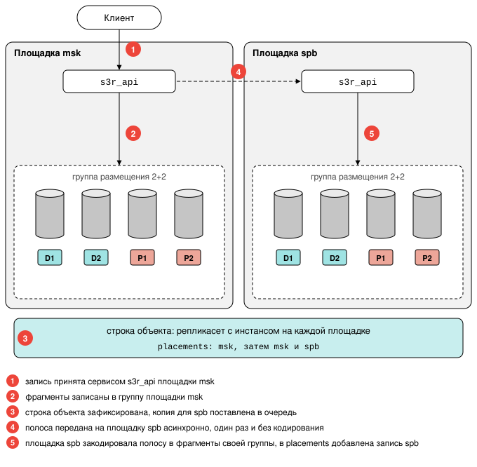

# Избыточность и домены отказа

Страница объясняет, как S3R защищает данные от отказа диска, [узла](../reference/glossary.md#node) и [площадки](../reference/glossary.md#site) и что для этого
должен задать администратор кластера. Её стоит прочитать до установки: [фактор репликации](../../../overview/glossary.md#replication_factor),
[схема избыточности](../reference/glossary.md#erasure_shape) и число площадок выбираются один раз и на кластере с данными не меняются.

Команды и порядок действий приведены в разделе [Планирование топологии](../install/planning.md),
значения параметров в [Справочнике конфигурации](../reference/configuration.md).

!!! abstract "Коротко"
    - Одна площадка: [фрагменты](../reference/glossary.md#chunk) объекта раскладываются по узлам, кластер переживает отказ диска и
      узла, отказ площадки не переживает.
    - Несколько площадок: каждая хранит полную копию объекта. Копии создаются асинхронно, поэтому
      успешный ответ на запись не гарантирует сохранность объекта при потере площадки.
    - Что с чем отказывает вместе, кластеру сообщает администратор. Ошибка в разметке не видна, пока
      не откажет оборудование.

## Три механизма защиты {: #three_mechanisms }

Объект состоит из строки метаданных (ключ, размер, расположение содержимого) и содержимого. Они
хранятся в разных местах и защищаются разными механизмами. Третий механизм защищает содержимое от
потери площадки.

| Что защищается | Механизм | Кто выполняет | Чем задаётся | Какой отказ переживает |
|---|---|---|---|---|
| Строки объектов и содержимое объектов размером до `inline_max` (по умолчанию 4 КиБ) | репликация в [репликасете](../reference/glossary.md#replicaset) | Picodata | `replication_factor` тира | отказ [инстанса](../reference/glossary.md#instance) или узла, пока в репликасете остаётся реплика |
| Содержимое объектов крупнее `inline_max` | кодирование `k+m` в [группе размещения](../reference/glossary.md#placement_group) | S3R | `s3r_storage.erasure` | потерю любых `m` [участников группы](../reference/glossary.md#member) |
| То же содержимое на случай потери площадки | отдельная закодированная копия на каждой площадке | S3R, фоновый процесс `siterepl` | компонент `dc` [домена отказа](../reference/glossary.md#failure_domain) | отказ площадки |

Механизмы независимы. Отказ узла затрагивает первые два: метаданные должны остаться на другой
реплике, а группа размещения должна сохранить не меньше `k` участников. Между площадками
метаданные переносит первый механизм (в каждом репликасете есть инстанс каждой площадки), а
содержимое переносит третий.

## Домен отказа {: #failure_domain }

**Домен отказа** представляет собой метку, которой администратор сообщает кластеру, какое оборудование отказывает
вместе. Кластер размещает копии и фрагменты так, чтобы отказ одного домена не лишил данные
избыточности.

!!! warning "Внимание"
    Объявленным доменам кластер верит и с оборудованием их не сверяет. Если два инстанса одного
    узла объявят разные значения `host`, кластер сочтёт их независимыми и отказ узла лишит группу
    большего числа участников, чем допускает схема.

Меток три, и задаются они в двух местах.

| Метка | Где задаётся | Пример | Что означает |
|---|---|---|---|
| **[Домен отказа инстанса](../reference/glossary.md#instance_failure_domain)** | конфигурация инстанса, `instance.failure_domain` | `host: node1` | инстанс отказывает вместе с инстансами, объявившими то же значение |
| Площадка | там же, компонент `dc` | `dc: msk` | инстанс относится к площадке `msk` |
| **[Поддомен отказа](../reference/glossary.md#sub_domain)** диска | список дисков инстанса | `/data/s3r/d0:hba=a` | диск отказывает вместе с дисками того же инстанса, объявившими `hba=a`; в примерах поддомен назван по контроллеру дисков |

Из них складывается **[домен отказа диска](../reference/glossary.md#disk_failure_domain)**: домен его инстанса без компонента `dc` и поддомен
диска.

```
инстанс host=node1           диск hba=a   =>  host=node1,hba=a
инстанс dc=msk,rack=msk-r3   диск hba=a   =>  rack=r3,hba=a
```

Во втором примере `msk-r3` превратилось в `r3`. При нескольких площадках значения компонентов
пишут с именем площадки (`msk-r3`, `spb-r3`): Picodata не допускает одинаковых значений на разных
площадках. S3R этот префикс отбрасывает.

### Два правила сравнения {: #two_rules }

Метки инстансов читают и Picodata, и S3R, но сравнивают их по-разному.

| Кто | Что строит | Правило |
|---|---|---|
| Picodata | репликасет | объединяет только инстансы, домены которых не совпадают **ни в одном** компоненте |
| S3R | группу размещения | считает два домена одним, только если совпадают **все** компоненты |

Пример: инстанс А объявил `rack: r1, host: h1`, инстанс Б объявил `rack: r1, host: h2`. В один
репликасет Picodata их не объединит, потому что совпадает `rack`. Для S3R это два разных домена,
потому что различается `host`, и диски обоих могут войти в одну группу.

Набор компонентов одинаков у всех инстансов кластера: `host` объявляют либо все, либо никто.

Если на узле работает несколько инстансов, все они объявляют одно и то же значение `host`: для S3R
это один домен отказа.

## Раскладка группы размещения {: #layout }

Диски для группы размещения S3R выбирает сам. Способ выбора называется **[раскладкой](../reference/glossary.md#layout)** и
определяется топологией, а не настройкой.

| Раскладка | Где находятся диски группы | Что переживает группа |
|---|---|---|
| `spread` | на разных узлах площадки, не больше `m` на один домен отказа инстанса | отказ `m` дисков или одного узла |
| `instance` | на одном инстансе, в разных поддоменах | отказ `m` дисков; отказ своего инстанса не переживает |

Раскладку определяют три вопроса по порядку:

1. Площадок несколько? Раскладка `instance`.
2. На площадке один инстанс с дисками [яруса](../reference/glossary.md#storage_tier) либо все её инстансы объявили одно и то же значение
   домена? Раскладка `instance`.
3. Иначе раскладка `spread`.

Случай «инстансов несколько, и домен не объявил никто» под второй вопрос не подпадает: раскладка
`spread`, и создать группу нельзя (см. [Если условия не выполнены](#not_enough)).

!!! warning "Внимание"
    Во втором случае кластер из нескольких узлов работает без защиты от отказа узла, и ошибкой это
    не считается. Проверьте поле `layout` после развёртывания (см. [Проверка](#verify)).

### Что нужно для каждой раскладки {: #requirements }

В любой раскладке участники группы находятся в разных доменах отказа **дисков**. Два диска одного
инстанса могут войти в одну группу, только если у них разные поддомены.

| Раскладка | Условия |
|---|---|
| `instance` | у инстанса не меньше `k + m` дисков яруса, каждый в своём поддомене |
| `spread` | каждый инстанс объявил домен отказа; доменов отказа инстансов не меньше `(k + m) / m` с округлением вверх (два для 2+2, три для 4+2); дисков на них хватает на `k + m` участников при пределе `m` на домен |

**Сколько узлов планировать.** Минимум из таблицы позволяет создать группу. Планируйте
`k + m + 1` узлов с дисками яруса: тогда, пока один узел недоступен или обслуживается, остальных
хватает и для записи в имеющиеся группы, и для создания новых.

### Если условия не выполнены {: #not_enough }

Если условия раскладки не выполнены, кластер не переходит на другую раскладку: группа не
создаётся, и запись объектов отклоняется.

Причину можно узнать в трёх местах:

- в журнале инстанса;
- в ответе на запрос `GET /-/ready`;
- в ответе на запрос `GET /-/debug/topology`.

Возможные причины:

| Причина | Что произошло |
|---|---|
| `no_failure_domain` | ни инстансы, ни диски ничего не объявили |
| `not_enough_domains` | различных доменов отказа дисков меньше `k + m`. Сюда же относится случай, когда инстансов несколько и хотя бы один не объявил домен отказа, даже если диски объявили поддомены: такие инстансы названы в поле `undeclared` |
| `not_enough_instances` | для раскладки `spread` доменов отказа инстансов меньше `(k + m) / m` |

## Одна площадка {: #single_site }

Компонент `dc` не задаётся ни на одном инстансе. Каждый инстанс объявляет домен отказа, например
`host`. Если у инстанса больше одного диска яруса, каждый диск объявляет свой поддомен.

Пример: три узла, на каждом один инстанс с четырьмя дисками, `replication_factor: 3`, схема 2+2.
На схеме D обозначает фрагмент данных, P обозначает фрагмент чётности.

```
               node1               node2               node3
            host=node1          host=node2          host=node3
          ┌─────────────┐     ┌─────────────┐     ┌─────────────┐
метаданные│  реплика 1  │     │  реплика 2  │     │  реплика 3  │  один репликасет
          ├─────────────┤     ├─────────────┤     ├─────────────┤
группа    │ [D1]  [D2]  │     │ [P1]        │     │ [P2]        │  spread, 2+2:
          │ hba=a hba=b │     │ hba=a       │     │ hba=a       │  участники 2 / 1 / 1
          └─────────────┘     └─────────────┘     └─────────────┘
   домены дисков:  node1,hba=a   node1,hba=b   node2,hba=a   node3,hba=a  (все разные)
```

| Отказ | Метаданные и объекты до `inline_max` | Объекты крупнее `inline_max` |
|---|---|---|
| диск | читаются | читаются: недостающий фрагмент вычисляется, участник заменяется другим диском |
| узел | читаются с двух других реплик | читаются: группа теряет не больше двух участников из четырёх. Запаса у неё не остаётся, пока узел не вернётся или не будет заменён |

Таблица относится к чтению. Для записи [полосы](../reference/glossary.md#stripe) группе нужно больше участников, чем для чтения:
`k + m − write_tolerance`, по умолчанию все, кроме одного. Если группа их не набирает, запись в неё
отклоняется (см. [Кворум записи](architecture.md#write_quorum)).

Содержимое занимает на дисках `(k + m) / k` своего объёма, в этом примере вдвое больше. Метаданные
и объекты до `inline_max` занимают оперативную память инстансов, умноженную на фактор репликации.

## Несколько площадок {: #multiple_sites }

Компонент `dc` задаётся на каждом инстансе. Фактор репликации равен числу площадок: в каждом
репликасете по одному инстансу с каждой площадки.

Кодирование не пересекает границу площадки: фрагменты одной полосы никогда не лежат на разных
площадках. Иначе каждое чтение с потерей фрагмента и каждое восстановление передавали бы данные по
каналу между площадками. Вместо этого каждая площадка хранит собственную, независимо
закодированную копию объекта.

Отсюда три отличия от одной площадки.

**Группа целиком находится на дисках одного инстанса.** Раскладка всегда `instance`, даже если
узлов на площадке несколько. Чтение и восстановление фрагментов не выходят за пределы узла, а от
отказа узла защищает копия на другой площадке.

**Копии на другие площадки создаются асинхронно.** Успешный ответ на запись подтверждает
сохранение на местной площадке. Копии создаёт фоновый процесс `siterepl`; сколько объектов ждёт
копии, показывает очередь `s3r_t<N>_siterepl` (см.
[Наблюдение за репликацией между площадками](../admin/monitoring.md#monitor_placements_replication)). Объект виден на всех
площадках сразу: если копия ещё не пришла, содержимое запрашивается с площадки, где оно есть.



**Утраченная копия площадки не восстанавливается.** Подробности приведены в следующем разделе.

### Отказ узла при нескольких площадках {: #node_loss_multisite }

!!! danger "Важно"
    Узел, выбывший безвозвратно, уносит копию своих объектов на этой площадке навсегда. По копиям
    других площадок она не восстанавливается ни сама, ни после замены узла.

- Пока узел недоступен, объекты из групп его дисков читаются с других площадок. Клиент этого не
  замечает.
- Если узел вернулся, его группы снова обслуживают чтение.
- Если узел не вернётся, у его объектов остаётся на одну копию меньше, чем площадок. Новый узел на
  его месте принимает новые записи, но прежние объекты на этой площадке копии не получают.
- Объекты, записанные на этот узел и ещё не получившие копий на других площадках, утрачены:
  единственная копия содержимого была в его группах. Строка метаданных сохраняется, но прочитать
  содержимое нельзя (ответы клиенту описаны в разделе
  [Ответы при отказе хранилища](../usage/errors.md#storage_errors)).

### Пример {: #multisite_example }

Площадки `msk`, `spb` и `ekb`, на каждой два узла, на узле один инстанс с четырьмя дисками,
`replication_factor: 3`, схема 2+2.

```
      площадка msk              площадка spb              площадка ekb
 ┌────────────────────┐    ┌────────────────────┐    ┌────────────────────┐
 │  msk-1      msk-2  │    │  spb-1      spb-2  │    │  ekb-1      ekb-2  │
 │  реплика    реплика│    │  реплика    реплика│    │  реплика    реплика│
 │  РС 1       РС 2   │    │  РС 1       РС 2   │    │  РС 1       РС 2   │
 │                    │    │                    │    │                    │
 │ [D1 D2 P1 P2]      │    │ [D1 D2 P1 P2]      │    │ [D1 D2 P1 P2]      │
 │ группа на дисках   │    │ своя группа,       │    │ своя группа,       │
 │ инстанса msk-1     │    │ своя копия         │    │ своя копия         │
 └─────────┬──────────┘    └─────────▲──────────┘    └─────────▲──────────┘
           └─────────────────────────┴─────────────────────────┘
   РС означает репликасет: РС 1 состоит из msk-1, spb-1 и ekb-1.
   Объект записан на msk; копии на spb и ekb создаёт siterepl, асинхронно.
   У второго инстанса каждой площадки свои группы на своих дисках.
```

| Отказ | Метаданные и объекты до `inline_max` | Объекты крупнее `inline_max` |
|---|---|---|
| один или два диска узла | читаются | читаются |
| узел | читаются с реплик других площадок | читаются с других площадок; копия на площадке узла утрачена |
| площадка | читаются с двух других площадок | читаются с площадок, куда копия успела записаться; остальные утрачены |

Содержимое занимает `(k + m) / k` своего объёма на каждой площадке, в этом примере в шесть раз
больше: вдвое на каждой из трёх площадок.

### Две площадки {: #two_sites }

[Бакеты](../reference/glossary.md#bucket), группы размещения и диски записаны в таблицах, общих для всего кластера. Изменить их можно,
только пока доступно большинство голосующих инстансов (кворум [Raft](../../../overview/glossary.md#raft)). При двух площадках отказ той,
где это большинство находится, останавливает такие изменения на уцелевшей. Чтобы этого избежать, на
третьей площадке размещают [инстанс-арбитр](../reference/glossary.md#arbiter): он голосует, но данных S3R не хранит (см.
[Установка ролью Ansible](../install/ansible.md)).

## Сравнение {: #comparison }

| | Одна площадка | Несколько площадок |
|---|---|---|
| Компонент `dc` | не задаётся | на каждом инстансе |
| Фактор репликации | по выбору, обычно 3 | равен числу площадок |
| Раскладка групп | `spread`; `instance`, если узел один | `instance` |
| Защита от отказа узла | не больше `m` участников группы на узел | копия на другой площадке |
| Защита от отказа площадки | нет | копия на другой площадке, создаётся асинхронно |
| Запись содержимого подтверждается | после записи в группу | после записи в группу местной площадки, без ожидания других |
| Место на дисках | `(k + m) / k` | `(k + m) / k` × число площадок |
| Дисков яруса на инстанс | при `spread` не меньше одного, при `instance` не меньше `k + m` | не меньше `k + m` |

## Что нельзя изменить после установки {: #immutable }

- Фактор репликации тира задаётся при первом запуске кластера.
- Схема избыточности яруса и набор площадок записываются, когда новый кластер впервые переходит в
  рабочее состояние ([начальное формирование](../reference/glossary.md#formation)).

Чтобы изменить любое из этих решений, кластер устанавливают заново. Схему избыточности можно
сменить и иначе: завести новый ярус с другой схемой и перенести в него данные правилами жизненного
цикла (см. [Выбор схемы избыточности яруса](../install/planning.md#encoding_formats)).

На других страницах описаны ещё четыре решения, которые не меняются:

- размер [экстента](../reference/glossary.md#extent), после форматирования первого диска (см.
  [Размер экстента](disks.md#extent_size));
- ёмкость диска, на котором есть данные (см. [Как задаётся ёмкость](disks.md#capacity_setting));
- привязка [класса хранения](../reference/glossary.md#storage_class) к ярусу (см.
  [Классы хранения S3 и ярусы](storage_classes.md#storage_classes_and_tiers));
- набор поддоменов дисков яруса и размер [малого блока](../reference/glossary.md#block) (см.
  [Что записывает переход](formation.md#formation_record)). Узлы и диски добавляются без
переустановки (см. [Добавление и вывод узлов](../admin/nodes.md#adding_and_enabling_nodes)).

## Проверка после развёртывания {: #verify }

`GET /s3gateway/api/v2/placement-groups` показывает для каждой группы раскладку (`layout`) и то,
переживает ли она отказ узла (`survives_instance_loss`). `GET /-/debug/topology` показывает то же
для групп, которые были бы созданы из текущих дисков, и причины, по которым группы не создаются.
Этот путь обслуживает эндпоинт S3-узла, и по умолчанию он выключен: его открывает уровень
диагностики `debug` (см. [Диагностические эндпоинты](../reference/endpoints.md#diagnostic_endpoints)).

Значения вычисляются по объявленным доменам. Если разметка не соответствует оборудованию, они
выглядят правильными, а устойчивости к отказу нет.

См. также:

- [Планирование топологии](../install/planning.md): конфигурация для каждого из примеров, выбор
  `k` и `m`, расчёт ёмкости, число инстансов на узел.
- [Группы размещения](placement_groups.md#placement_groups): состояния группы, замена участников.
- [Отказы и восстановление](../admin/failures.md): действия администратора при отказе диска, узла и
  площадки.
