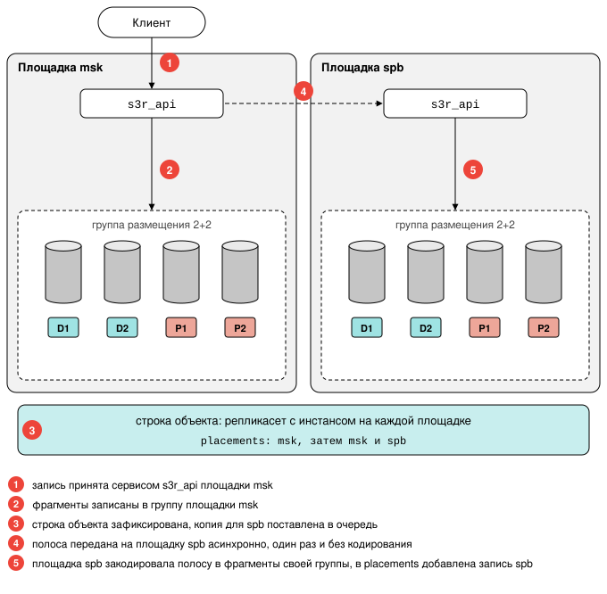

# Репликация между площадками

Страница объясняет, как объект, записанный на одной
[площадке](../reference/glossary.md#site), получает копии на остальных: что
передаётся по каналу между площадками, как кластер узнаёт, что копии ещё нет,
и почему репликацию нельзя настроить для отдельного тенанта. Она нужна тому,
кто планирует или обслуживает кластер из нескольких площадок. Что такой
кластер переживает и чего он требует от топологии, описано в разделе
[Несколько площадок](redundancy.md#multiple_sites).

!!! abstract "Коротко"
    - Запись подтверждается после сохранения на местной площадке. Копии на
      остальных площадках создаёт фоновый процесс `siterepl`.
    - Объект виден на всех площадках сразу: пока копии нет, его содержимое
      запрашивается с площадки, где оно есть.
    - Набор площадок общий для всего кластера. Включить или отключить
      репликацию для отдельного тенанта нельзя.

## Как объект попадает на другие площадки {: #how_it_works }

Запись фиксируется на местной площадке, а остальные площадки получают копию
асинхронно.

!!! warning "Пока копии нет, объект хранит одна площадка"
    Успешный ответ на запись не означает, что копии на других площадках уже
    созданы. К чему это приводит при потере площадки или [узла](../reference/glossary.md#node), описано в разделе
    [Отказ узла при нескольких площадках](redundancy.md#node_loss_multisite).

[Пространство имён](../reference/glossary.md#namespace) едино для всего
кластера, поэтому объект существует с момента фиксации своей строки. Клиент на
площадке, куда копия ещё не пришла, получает содержимое объекта, а не ответ
`NoSuchKey`: содержимое запрашивается по каналу с другой площадки.

## Что передаётся между площадками {: #what_is_transferred }

[Полоса](../reference/glossary.md#stripe) передаётся между площадками один раз
и в исходном виде. Принимающая площадка сама кодирует её в собственные `k+m`
[фрагментов](../reference/glossary.md#chunk) средствами своей
[группы размещения](../reference/glossary.md#placement_group).

Передача `k+m` готовых фрагментов расходовала бы канал между площадками на тот
самый объём, который кодирование должно экономить.

## Как кластер узнаёт о недосланной копии {: #pending_copies }

Столбец `placements` строки объекта
([карта размещения](../reference/glossary.md#placements)) перечисляет группы
размещения, в которых хранится содержимое объекта, и для каждой группы
указывает её площадку.

Отдельного состояния у копии на площадке нет:

- копия считается недосланной, пока в `placements` нет ни одной группы этой
  площадки;
- записанная копия добавляет в `placements` группы своей площадки.

Досылку копий выполняет фоновый процесс `siterepl`. Он же заново ставит в
очередь досылки недосланные копии, найденные по столбцу `placements`, в двух
случаях:

- на площадке появляется группа [яруса](../reference/glossary.md#storage_tier),
  которого на ней раньше не было;
- [инстанс](../reference/glossary.md#instance) становится [мастером](../reference/glossary.md#master) своего
  [репликасета](../reference/glossary.md#replicaset).

Немедленно это делает запрос `/-/debug/run/siterepl?mode=requeue` (см.
[Фоновые процессы](background.md#background_processes)).

## Как выполняется досылка {: #delivery }

Клиент получает ответ на запись, как только объект записан на его площадке. На
другие площадки сама запись ничего не передаёт.

Порядок досылки:

1. При фиксации строки объекта запись очереди досылки создаётся для каждой
   площадки, где есть группа размещения яруса этого объекта. Так же ставят
   копии в очередь завершение составной загрузки и переход объекта между
   классами по правилу жизненного цикла.
2. Спустя 3 секунды процесс `siterepl` читает объект на площадке, где он
   хранится, и передаёт копию на площадку назначения.
3. Когда копия записана, процесс добавляет площадку в строку объекта и удаляет
   запись очереди в одной транзакции.

Площадка, на которой группы этого яруса ещё нет, получит копии позже: когда
группа там появится, процесс `siterepl` заново ставит в очередь копии объектов,
записанных до этого.

**Доступность площадки назначения.** Копия отправляется на площадку, только
когда в Raft хотя бы один владелец групп нужного яруса на этой площадке
находится в состоянии `Online`. Если такого владельца нет, например когда все
инстансы площадки недоступны, копии для неё остаются в очереди без попыток
отправки и не переписываются, а копии для других площадок досылаются как
обычно. Как только владелец снова становится `Online` или на площадке
появляется новый владелец, процесс `siterepl` досылает накопленные копии.
Копия, которая не записалась при доступном владельце, повторяется через
5 секунд, и после каждой следующей неудачи интервал удваивается, но не
превышает 5 минут.

**Сколько копий передаётся одновременно.** Каждую площадку и ярус процесс
обслуживает отдельно и передаёт на них до 4 копий одновременно, поэтому
медленная площадка и долгая передача большого объекта не задерживают остальные
копии. Каждый инстанс одновременно принимает столько копий с других площадок,
сколько могут прислать ему мастера репликасетов этих площадок, и учитывает их в
`api_memory` (см. [Память запросов](../reference/configuration.md#api_memory)).
Копию сверх этого числа или ту, для которой сейчас не хватает памяти, он сразу
отклоняет с кодом `IncomingCopiesFull`. Такая копия досылается через несколько
секунд, и отказ не считается неудачной попыткой.

**Сколько длится передача.** Время передачи копии не ограничено. Её прерывает
только отсутствие движения в течение 30 секунд: принимающий инстанс не
принимает данные или не отвечает после их окончания либо не получает данных от
отправителя. Отправитель передаёт данные по мере того, как принимающая сторона
готова их принять, поэтому медленная площадка замедляет чтение копии и не
накапливает её в памяти. Отправитель читает копию полосами и должен прочитать
каждую полосу не более чем за 30 секунд: при полосе 128 МиБ скорость чтения
должна быть не меньше 4,3 МиБ/с. Тот же предел действует при переносе объекта в
другой ярус по правилу жизненного цикла: полоса, которую не удалось прочитать
за 30 секунд, прерывает перенос, и он повторяется позже.

При выполнении `ALTER PLUGIN ... DISABLE` идущие передачи прерываются, их
записи очереди остаются, и после повторного включения копии досылаются заново.

## Репликация как свойство кластера {: #replication_as_a_feature }

Набор площадок задаётся при развёртывании кластера и действует на весь
кластер. Включить или отключить [репликацию между площадками](../reference/glossary.md#site_replication) для отдельного
[тенанта](../reference/glossary.md#tenant) нельзя: все тенанты используют один
набор площадок, и объект любого тенанта получает копию на каждой площадке.

Причина в том, что площадка является свойством группы размещения, а группы размещения
общие для всего кластера. Тенант представляет собой пространство имён со своим
набором таблиц, а не собственный набор оборудования.

Если у тенантов разные требования к географии данных, им нужны разные
кластеры.

См. также:

- [Избыточность и домены отказа](redundancy.md#multiple_sites): что переживает
  кластер из нескольких площадок.
- [Наблюдение за репликацией между площадками](../admin/monitoring.md#monitor_placements_replication):
  как следить за очередью досылки.
