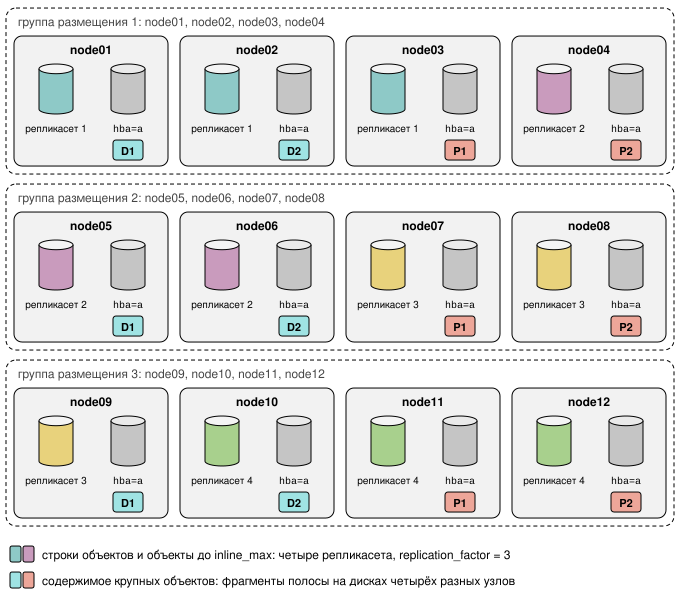

# Планирование топологии

Страница помогает выбрать топологию кластера до установки: какие решения
принять, что объявить в конфигурации и какие отказы переживёт кластер в каждом
из трёх типовых примеров. Она нужна тому, кто готовит конфигурацию [инстансов](../reference/glossary.md#instance) и
плагина. Как устроена защита данных и почему действуют описанные здесь правила,
объясняет страница [Избыточность и домены отказа](../concepts/redundancy.md).

!!! danger "Эти решения не меняются на кластере с данными"
    Фактор репликации тира задаётся при первом запуске кластера.
    [Схема избыточности](../reference/glossary.md#erasure_shape) каждого яруса
    и набор площадок записываются при
    [начальном формировании](../reference/glossary.md#formation) и после этого
    не меняются. Чтобы изменить любое из этих решений, кластер устанавливают
    заново.

## Что решить до установки {: #decisions }

Схема избыточности кластера складывается из трёх решений:

| № | Решение | Где задаётся |
|---|---------|--------------|
| 1 | Фактор репликации [тира](../../../overview/glossary.md#tier) Picodata и [домены отказа инстансов](../reference/glossary.md#instance_failure_domain) | конфигурация Picodata: `replication_factor` тира и `instance.failure_domain` |
| 2 | Схема избыточности каждого [яруса](../reference/glossary.md#storage_tier) дисков | параметр плагина `s3r_storage.erasure` |
| 3 | Число [площадок](../reference/glossary.md#site) | компонент `dc` [домена отказа](../reference/glossary.md#failure_domain) инстанса |

!!! warning "Фактор репликации по умолчанию равен 1"
    Picodata по умолчанию создаёт тир с [фактором репликации](../../../overview/glossary.md#replication_factor) 1. Тогда метаданные
    и объекты до `inline_max` хранятся в одной копии, и отказ инстанса делает
    недоступными метаданные его
    [репликасета](../reference/glossary.md#replicaset).

!!! warning "Ярус без схемы не принимает запись"
    Пока у яруса с дисками нет схемы, кластер не проходит начальное
    формирование и не принимает запись.

Правила для схемы яруса:

- каждый ярус, в котором есть диски, объявляет ровно одну схему `k+m`;
- `k` и `m` не меньше 1, а `k + m` не больше 64;
- схема с `k = 1` означает репликацию: содержимое хранится в `m + 1` копиях на
  разных дисках.

Значения `k` и `m` выбираются по разделу
[Выбор схемы избыточности яруса](#encoding_formats).

## Уровни избыточности {: #redundancy_levels }

Каждый уровень избыточности задаётся своими параметрами и защищает свою часть
данных.

| Уровень | Параметры | Защищаемые данные | Отказ, который переживают данные |
|---------|-----------|-------------------|----------------------------------|
| Инстанс | `failure_domain` инстанса и `replication_factor` [тира Picodata](../reference/glossary.md#picodata_tier) | строки объектов и содержимое объектов размером до `inline_max` (по умолчанию 4 КиБ) | отказ инстанса или [узла](../reference/glossary.md#node) |
| Диск | поддомены дисков `hba=`, домены отказа инстансов и схема избыточности яруса в `s3r_storage.erasure` | содержимое объектов крупнее `inline_max` | отказ не более `m` [участников](../reference/glossary.md#member) [группы размещения](../reference/glossary.md#placement_group): дисков либо, если группа распределена по узлам, одного узла |
| Площадка | компонент `dc` домена отказа инстанса | копия каждого объекта на каждой площадке | отказ площадки |

Домен отказа инстанса и [поддомен диска](../reference/glossary.md#sub_domain)
задаются в разных местах:

| Метка | Где задаётся | Для чего |
|---|---|---|
| Домен отказа инстанса | конфигурация Picodata, `instance.failure_domain` | по нему Picodata собирает репликасеты, а S3R решает, какие инстансы отказывают вместе |
| Поддомен диска | список дисков инстанса, например `hba=a` | различает диски одного инстанса |

[Домен отказа диска](../reference/glossary.md#disk_failure_domain) состоит из
домена инстанса без компонента `dc` и поддомена диска (см.
[Домен отказа диска](../concepts/disks.md#disk_failure_domain)). Как Picodata и
S3R сравнивают домены, объясняет раздел
[Домен отказа](../concepts/redundancy.md#failure_domain).

## Что объявить для одной и для нескольких площадок {: #site_rules }

Picodata объединяет в репликасет только инстансы, домены отказа которых не
совпадают ни в одном компоненте. Набор компонентов у всех инстансов кластера
должен быть одинаковым. Отсюда следуют правила:

| | Одна площадка | Несколько площадок |
|---|---|---|
| Компонент `dc` | не задаётся; все инстансы относятся к площадке `default` | задаётся на каждом инстансе |
| Домен отказа инстанса | если инстансов больше одного, каждый задаёт домен отказа, например компонентом `host` или `rack` | содержит компонент `dc`; в [примере](#many_places) узлы площадки различает компонент `host` |
| Фактор репликации | по выбору | равен числу площадок: в каждом репликасете по одному инстансу с каждой площадки |

!!! warning "Одна площадка: не задавайте `dc`"
    Компонент с одинаковым значением у всех инстансов, например `dc: msk`, не
    позволил бы собрать репликасет больше чем из одного инстанса.

!!! warning "Одна площадка: объявите домен отказа на каждом инстансе"
    Без домена отказа S3R не может распределить группу по узлам и отказывает в
    её создании.

!!! warning "Несколько площадок: фактор репликации не больше числа площадок"
    Фактор репликации больше числа площадок Picodata пока не может разместить,
    и S3R такой кластер не формирует.

### Раскладка группы размещения {: #layout_choice }

[Раскладку группы](../reference/glossary.md#layout) по дискам определяет
топология, а не настройка (подробно см.
[Раскладка группы размещения](../concepts/redundancy.md#layout) и
[Группы размещения](../concepts/placement_groups.md#placement_groups)).

| Раскладка | Когда выбирается | Где находятся участники группы | Что требуется | Что переживает группа |
|---|---|---|---|---|
| `instance` | площадок несколько; либо на площадке один инстанс с дисками яруса; либо все инстансы площадки объявили один и тот же домен отказа | на дисках одного инстанса в различных поддоменах | у инстанса не меньше `k + m` дисков яруса | отказ `m` дисков, но не отказ своего инстанса |
| `spread` | в остальных случаях, то есть на одной площадке с несколькими доменами отказа | на узлах площадки, не больше `m` на один домен отказа инстанса | каждый инстанс объявил домен отказа; доменов отказа инстансов не меньше `(k + m) / m` с округлением вверх | отказ любого одного узла |

## Выбор схемы избыточности яруса {: #encoding_formats }

Схема `k+m` делит полосу на `k` фрагментов данных и добавляет `m` фрагментов
чётности. Полоса читается, пока доступны любые `k` её фрагментов, то есть
переживает потерю `m` фрагментов. Схема с `k = 1` хранит `m + 1` копий полосы.

!!! warning "Схема яруса с группами не меняется"
    Схема избыточности яруса, в котором уже есть группы размещения, не
    изменяется: команда `ALTER PLUGIN`, которая её меняет или удаляет,
    отклоняется. Данные переносят в ярус с новой схемой через [карту классов](../reference/glossary.md#class_map)
    хранения и правила жизненного цикла.

Геометрия хранится в строке группы размещения, а не в строке объекта, и
одинакова для всех записанных в группу полос.

### Ограничения схемы {: #shape_limits }

Участники группы всегда находятся в `k + m` различных доменах отказа. Если
доменов меньше, группа не создаётся (см.
[Домен отказа диска](../concepts/disks.md#disk_failure_domain) и
[Раскладка группы](../concepts/placement_groups.md#group_layouts)).

Число фрагментов `k + m` не больше 64: это предел формата, а не настройка.
Более широкую схему конфигурация отклоняет с ошибкой `ErasureShapeTooWide`.

Размер полосы задаётся полем `stripe_size` схемы, по умолчанию 2 МиБ. Фрагмент
равен `stripe_size / k`. Геометрия должна удовлетворять трём условиям:

- `k` делит размер полосы нацело;
- фрагмент не превышает 8 224 768 байт;
- [крупный блок](../reference/glossary.md#block), то есть фрагмент с заголовком 4 КиБ, больше малого блока
  размером `2 × inline_max`.

!!! danger "Неверная геометрия обнаруживается только при монтировании"
    Схема, которая нарушает эти условия, не отклоняется командой
    `ALTER PLUGIN`. Диск яруса с такой схемой не монтируется, а в журнал
    выводится ошибка `tier <ярус> records a geometry nothing can write`.

Испытаниями охвачены схемы от 2+2 до 12+4. Более широкие схемы, например 17+3,
на стенде не проверялись.

### Избыточность и ёмкость {: #shape_overhead }

Избыточность схемы `k+m` равна `(k + m) / k`, а полезная ёмкость пула равна
сырой ёмкости, делённой на эту величину:

- схема 8+4 даёт 1,5, то есть треть сырой ёмкости уходит на чётность;
- схема 12+3 даёт 1,25;
- схема 10+2 даёт 1,2.

Схему следует выбирать вместе с составом дисков, а не после его определения.

Размер полосы определяет крупный блок и тем самым предел ёмкости, которую
группа использует на одном диске (см.
[Выбор ёмкости и размера экстента](../concepts/disks.md#capacity_choice)).

### Малые объекты при широких схемах {: #small_objects_wide_shapes }

Малые объекты дороже при широких схемах. Объект крупнее `inline_max` хранится
фрагментами на всех `k + m` дисках группы, и каждый короткий фрагмент занимает
целый малый блок размером `2 × inline_max`. Поэтому объект, который помещается
в один малый блок на каждом диске, занимает `(k + m) × 2 × inline_max`, хотя
избыточность схемы при росте `k` уменьшается.

При `inline_max`, равном 4 КиБ, объект размером 6 КиБ занимает:

| Схема | Избыточность | Переживает потерю | Нужно доменов отказа дисков | Объект 6 КиБ |
| --- | --- | --- | --- | --- |
| 2+2 | 2,00 | 2 | 4 | 32 КиБ |
| 4+2 | 1,50 | 2 | 6 | 48 КиБ |
| 8+3 | 1,375 | 3 | 11 | 88 КиБ |
| 10+4 | 1,40 | 4 | 14 | 112 КиБ |

## Пример: одна площадка {: #one_place }

Три узла, на каждом один инстанс с четырьмя дисками.

| Что получится | Значение |
|---|---|
| Метаданные и объекты до `inline_max` | три копии |
| Содержимое крупных объектов | схема 2+2, на дисках занимает вдвое больше своего объёма |
| Репликасеты | один, из трёх инстансов |
| Раскладка групп | `spread` |

### Что объявить {: #one_place_config }

1. В конфигурации каждого инстанса задайте фактор репликации тира и домен отказа.
   Пример для `node1`:

    ```yaml
    cluster:
      tier:
        default:
          replication_factor: 3
          can_vote: true
    instance:
      failure_domain:
        host: node1
    ```

2. Диски инстанса, каждый в своём поддомене:

    ```shell
    S3R_DISKS=/data/s3r/d0:hba=a,/data/s3r/d1:hba=b,/data/s3r/d2:hba=c,/data/s3r/d3:hba=d
    ```

    В каждую директорию примера смонтирована отдельная файловая система,
    поэтому ёмкость дисков не задаётся (см.
    [Ёмкость диска](../concepts/disks.md#disk_capacity)).

3. Схему избыточности яруса:

    ```sql
    ALTER PLUGIN s3r 2.2.0 SET s3r_storage.erasure = '[{"k":2,"m":2}]';
    ```

### Что получится {: #one_place_result }

Picodata собирает из трёх инстансов один репликасет. Площадка одна, а инстансы
объявили три разных узла, поэтому раскладка групп `spread`. Каждая группа
получает по участнику на каждом узле, а четвёртый участник регистрируется на
узле своего [владельца](../reference/glossary.md#owner). На одном узле
оказывается не больше двух участников группы из четырёх.

Чтение [полосы](../reference/glossary.md#stripe) и её восстановление в такой
раскладке обращаются к дискам других узлов по сети.

### Что переживает кластер {: #one_place_failures }

| Отказ                 | Метаданные и объекты до `inline_max` | Объекты крупнее `inline_max`                                                                        |
|-----------------------|--------------------------------------|-----------------------------------------------------------------------------------------------------|
| один диск             | доступны                             | доступны: недостающие [фрагменты](../reference/glossary.md#chunk) вычисляются при чтении, а участник заменяется другим диском          |
| узел                  | доступны на двух других репликах     | доступны: группа теряет не больше двух участников из четырёх                                        |

!!! note "Таблица относится к чтению"
    Для записи действует
    [кворум записи](../concepts/architecture.md#write_quorum): группе нужно
    больше участников, чем для чтения. Группа, которая после отказа ещё
    читается, может уже не принимать запись.

## Пример: группы на дисках разных узлов {: #grouped_drives_on_different_nodes }

Двенадцать узлов, на каждом один инстанс с одним диском.

| Что получится | Значение |
|---|---|
| Метаданные и объекты до `inline_max` | три копии |
| Содержимое крупных объектов | схема 2+2 |
| Репликасеты | четыре, по три инстанса |
| Раскладка групп | `spread` |

### Что объявить {: #grouped_drives_config }

1. Фактор репликации тира и схему избыточности задайте те же, что в примере
   [с одной площадкой](#one_place_config).
2. В конфигурации каждого инстанса укажите свой узел компонентом `host`.
3. Единственный диск инстанса, без поддомена:

    ```shell
    S3R_DISKS=/data/s3r/d0
    ```

    Поддомен для единственного диска не нужен: домен отказа диска совпадает с
    доменом его инстанса. Ёмкость диска не задаётся по той же причине, что и в
    предыдущем примере.

### Что получится {: #grouped_drives_result }

Picodata собирает из двенадцати инстансов четыре репликасета по три инстанса.
Раскладка групп `spread`: каждая группа получает четыре участника на дисках
четырёх разных узлов.



### Что переживает кластер {: #grouped_drives_failures }

| Отказ                   | Метаданные и объекты до `inline_max`                               | Объекты крупнее `inline_max`                        |
|-------------------------|--------------------------------------------------------------------|-----------------------------------------------------|
| один диск или один узел | доступны на двух других репликах                                   | доступны: группа теряет одного участника из четырёх |
| два узла одной группы   | доступны на других репликах, если узлы входят в разные репликасеты | доступны                                            |

!!! note "Таблица относится к чтению"
    Для записи действует
    [кворум записи](../concepts/architecture.md#write_quorum): группе нужно
    больше участников, чем для чтения.

## Пример: несколько площадок {: #many_places }

Три площадки `msk`, `spb` и `ekb`. На каждой два узла, на каждом узле один
инстанс с четырьмя дисками.

!!! danger "Копия площадки по копиям других площадок не восстанавливается"
    Пока узел недоступен, объекты из групп его дисков читаются с других
    площадок. Если узел выбыл безвозвратно, эти объекты остаются на его
    площадке без копии и число их копий в кластере уменьшается на одну.

!!! warning "Копии между площадками передаются асинхронно"
    Копии создаёт фоновый процесс `siterepl`. При отказе площадки объекты
    доступны только на тех площадках, куда их копия успела записаться.

| Что получится | Значение |
|---|---|
| Строки объектов | на всех трёх площадках |
| Содержимое крупных объектов | схема 2+2 на каждой площадке; на дисках занимает в шесть раз больше своего объёма: вдвое на каждой из трёх площадок |
| Репликасеты | два, в каждом по одному инстансу с каждой площадки |
| Раскладка групп | `instance` |

### Что объявить {: #many_places_config }

1. В конфигурации каждого инстанса задайте фактор репликации, равный числу площадок,
   площадку компонентом `dc` и узел компонентом `host`. Значения компонентов
   уникальны во всём кластере, поэтому имя узла начинается с имени площадки.
   Пример для первого узла площадки `msk`:

    ```yaml
    cluster:
      tier:
        default:
          replication_factor: 3
          can_vote: true
    instance:
      failure_domain:
        dc: msk
        host: msk-1
    ```

2. Диски и схему избыточности задайте так же, как в примере
   [с одной площадкой](#one_place_config).

### Что получится {: #many_places_result }

Picodata собирает два репликасета, в каждом из которых по одному инстансу с
каждой площадки, и строки объектов хранятся на всех трёх площадках. Площадок
несколько, поэтому раскладка групп `instance`: группа 2+2 занимает четыре диска
одного инстанса. Каждая площадка хранит собственную закодированную копию
содержимого.

### Что переживает кластер {: #many_places_failures }

| Отказ                   | Метаданные и объекты до `inline_max` | Объекты крупнее `inline_max`                                                                           |
|-------------------------|--------------------------------------|--------------------------------------------------------------------------------------------------------|
| один или два диска узла | доступны                             | доступны                                                                                               |
| узел                    | доступны на репликах других площадок | читаются с других площадок; на площадке отказавшего узла копия этих объектов утрачена и не восстанавливается |
| площадка                | доступны на двух других площадках    | доступны на тех площадках, куда их копия успела записаться                                             |

!!! note "Таблица относится к чтению"
    Для записи действует
    [кворум записи](../concepts/architecture.md#write_quorum): группе нужно
    больше участников, чем для чтения.

### Две площадки {: #two_places }

При двух площадках кворум [Raft](../../../overview/glossary.md#raft) не переживает отказ площадки, на которой
находится большинство голосующих инстансов. Для этого случая предусмотрен
инстанс [арбитра](../reference/glossary.md#arbiter) на третьей площадке, как описано в разделе
[Установка ролью Ansible](ansible.md#arbiter_tier).

## Что дальше {: #next_steps }

- Рассчитайте число инстансов и дисков по странице
  [Требования и расчёт ресурсов](requirements.md#resources_allocation).
- Установите кластер по странице [Пошаговая установка](manual.md) или
  [Установка ролью Ansible](ansible.md).
- После установки проверьте раскладку групп (см.
  [Шаг 7. Проверка дисков и групп размещения](manual.md#disks_check) и
  [Проверка после развёртывания](../concepts/redundancy.md#verify)).
