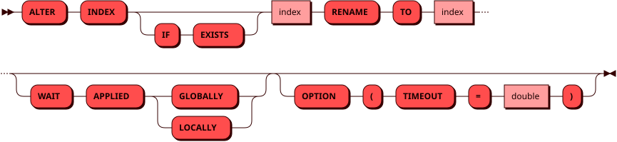

# ALTER INDEX

[DDL](ddl.md)-команда `ALTER INDEX` используется для изменения индекса.

## Синтаксис {: #syntax }



## Параметры {: #params }

* **INDEX** — имя индекса; соответствует правилам имен для всех
  [объектов](object.md) в кластере
* **IF EXISTS** — позволяет избежать ошибки в случае, если такого
  индекса в кластере нет
* **RENAME TO** — позволяет задать индексу новое имя

## Общие опции и параметры {: #common_options }

Для данной команды доступны следующие общие опции и параметры SQL:

* [TIMEOUT](common_options.md#timeout)
* [WAIT APPLIED](common_options.md#wait_applied)

## Примеры {: #examples }

```sql
ALTER INDEX name_year RENAME TO name_year_idx;
```

```sql
ALTER INDEX IF EXISTS name_year
RENAME TO name_year_idx
WAIT APPLIED GLOBALLY
OPTION (TIMEOUT = 3.0);
```
