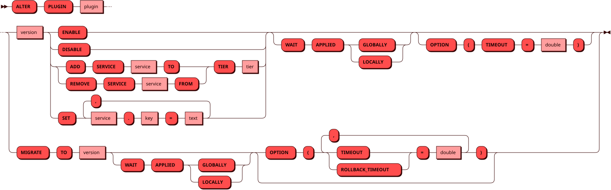

# ALTER PLUGIN

[DDL](ddl.md)-команда `ALTER PLUGIN` используется для изменения
конфигурации [плагина](../../overview/glossary.md#plugin).

## Синтаксис {: #syntax }



## Параметры {: #params }

* **ENABLE** — включение плагина.
* **DISABLE** — отключение плагина.
* **ADD SERVICE TO TIER** — добавление сервиса плагина к [тиру][tier].
* **REMOVE SERVICE FROM TIER** — удаление сервиса плагина из [тира][tier].
* **SET** — установка значения отдельных параметров сервиса в формате `<service_name.property_key> = ‘<value>’`.
* **MIGRATE TO** — объявление версии плагина и запуск [миграции]. Версия плагина указывается в формате semver.

## Общие опции и параметры {: #common_options }

Для данной команды доступны следующие общие опции и параметры SQL:

* [TIMEOUT](common_options.md#timeout)
* [ROLLBACK_TIMEOUT](common_options.md#rollback_timeout)
* [WAIT APPLIED](common_options.md#wait_applied)

!!! note "Примечание" 
    Указанное здесь значение опции TIMEOUT менее приоритетно,
    чем таймауты, заданные для отдельных команд внутри скрипта миграции. По этой
    причине мы не рекомендуем использовать явные таймауты в скриптах миграции (т.к.
    потом их нельзя уже переопределить). Если явных таймаутов нет и при этом
    времени, указанного в команде миграции, не хватило, то миграция завершится
    ошибкой и произойдет ее автоматический откат.

[tier]: ../../overview/glossary.md#tier
[миграции]: ../../overview/glossary.md#migration

## Требуемые привилегии {: #required_privileges }

Данная команда требует привилегии [Администратора
СУБД](../../admin/access_control.md#admin) (`admin`).

См. также:

- [Управление доступом — Таблица привилегий](../../admin/access_control.md#privileges_table)

## Примеры {: #examples }

```sql title="Запуск миграции"
ALTER PLUGIN weather_cache MIGRATE TO 0.1.0;
```

```sql title="Изменение параметра"
ALTER PLUGIN weather_cache 0.1.0 SET weather_service.openweather_timeout='7';
```
