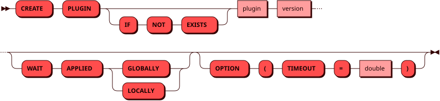

# CREATE PLUGIN

[DDL](ddl.md)-команда `CREATE PLUGIN` используется для регистрации
[плагина](../../overview/glossary.md#plugin) в кластере.

## Синтаксис {: #syntax }



## Параметры {: #params }

* **PLUGIN** — имя плагина. Соответствует правилам имен для всех
  [объектов](object.md) в кластере. Версия плагина указывается в формате
  semver
* **IF NOT EXISTS** — позволяет избежать ошибки в случае, если такой
  плагин в кластере уже есть

## Общие опции и параметры {: #common_options }

Для данной команды доступны следующие общие опции и параметры SQL:

* [TIMEOUT](common_options.md#timeout)
* [WAIT APPLIED](common_options.md#wait_applied)

## Требуемые привилегии {: #required_privileges }

Данная команда требует привилегии [Администратора
СУБД](../../admin/access_control.md#admin) (`admin`).

См. также:

- [Управление доступом — Таблица привилегий](../../admin/access_control.md#privileges_table)

## Примеры {: #examples }

```sql
CREATE PLUGIN weather_cache 0.1.0;
```
