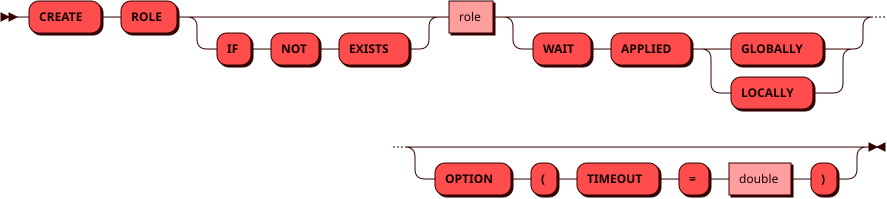

# CREATE ROLE

[DCL](dcl.md)-команда `CREATE ROLE` используется для создания новой
[роли](../../admin/access_control.md#roles).

## Синтаксис {: #syntax }



## Параметры {: #params }

* **ROLE** — имя роли. Соответствует правилам имен для всех
  [объектов](object.md) в кластере
* **IF NOT EXISTS** — позволяет избежать ошибки в случае, если такая
  роль в кластере уже есть

## Общие опции и параметры {: #common_options }

Для данной команды доступны следующие общие опции и параметры SQL:

* [TIMEOUT](common_options.md#timeout)
* [WAIT APPLIED](common_options.md#wait_applied)

## Требуемые привилегии {: #required_privileges }

Данная команда требует привилегии `CREATE ROLE`.

См. также:

- [Управление доступом — Таблица привилегий](../../admin/access_control.md#privileges_table)

## Примеры {: #examples }

```sql
CREATE ROLE toy OPTION (TIMEOUT = 3.0);
```
