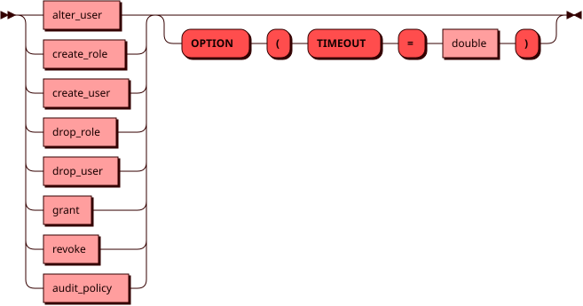

# Data Control Language

Data Control Language — команды языка SQL для управления доступом в
кластере (роли, пользователи или привилегии). К таким командам относятся
`ALTER`, `CREATE` и `DROP` применительно к объектам `USER` и `ROLE`,
команды `GRANT` и `REVOKE` для управления привилегиями, а также команда
`AUDIT POLICY` для управления политикой ведения журнала аудита.

## Синтаксис {: #syntax }

## Общие опции и параметры {: #common_options }

Для DCL-команд доступны следующие общие опции и параметры SQL:

* [TIMEOUT](common_options.md#timeout)
* [WAIT APPLIED](common_options.md#wait_applied)
