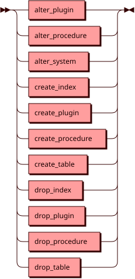

# Data Definition Language

Data Definition Language — команды языка SQL для изменения объектов в
кластере. К таким командам относятся `ALTER`, `CREATE`, `DROP`, `TRUNCATE`
применительно к объектам `INDEX`, `PLUGIN`, `PROCEDURE` и `TABLE`, а также
служебная команда `BACKUP`.

## Синтаксис {: #syntax }

## Ограничения {: #limitations }

Если кластер состоит из инстансов разных версий (например, различающихся
в минорной части версии), то DDL будет автоматически ограничен только
DROP-операциями.

## Параметры и опции {: #params }

Для DDL-запросов применяются следующие общие параметры и опции:

* **WAIT APPLIED** — при использовании этого параметра контроль
  пользователю будет возвращен только после того как данная операция
  будет применена либо во всем кластере (GLOBALLY), либо в рамках
  текущего инстанса (`LOCALLY`). По умолчанию используется поведение
  `GLOBALLY`. См. [подробнее](common_options.md#timeout).
* **TIMEOUT** — интервал времени, за который Picodata пытается выполнить
  указанное действие/изменение объекта в кластере. См.
  [подробнее](common_options.md#timeout).
* **ROLLBACK_TIMEOUT** — интервал времени, за который Picodata пытается
  выполнить откат миграции. Применяется только для [ALTER_PLUGIN]. См.
  [подробнее](common_options.md#rollback_timeout).

[ALTER_PLUGIN]: alter_plugin.md
