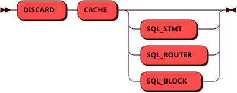

# DISCARD

Служебная команда `DISCARD` используется для очистки локальных кешей SQL
на инстансе, на котором она выполняется.

## Синтаксис {: #syntax }



## Параметры {: #params }

* **CACHE SQL_STMT** — очистка кеша подготовленных запросов, которые инстанс
  выполняет в роли узла хранения. Размер этого кеша задается параметрами
  [`sql_storage_cache_count_max`](../db_config.md#sql_storage_cache_count_max)
  и [`sql_storage_cache_size_max`](../db_config.md#sql_storage_cache_size_max).

* **CACHE SQL_ROUTER** — очистка кеша планов запросов на роутере.

* **CACHE SQL_BLOCK** — очистка кеша шаблонов [анонимных
  блоков](transactions.md).

* **CACHE** без уточнения — очистка всех перечисленных выше кешей.

## Требуемые привилегии {: #required_privileges }

Данная команда требует привилегии [Администратора
СУБД](../../admin/access_control.md#admin) (`admin`).

## Детали работы {: #details }

Запросы, которые выполнялись в момент очистки, завершаются штатно.

Команда возвращает количество записей, удаленных из кешей.

Удаленные записи учитываются в метриках
[`pico_storage_cache_statements_evicted_total`](../metrics.md#pico_storage_cache_statements_evicted_total)
и
[`pico_router_cache_statements_evicted_total`](../metrics.md#pico_router_cache_statements_evicted_total).

## Примеры {: #examples }

Очистка кеша подготовленных запросов:

```sql
DISCARD CACHE SQL_STMT;
```

Очистка всех кешей SQL на инстансе:

```sql
DISCARD CACHE;
```
