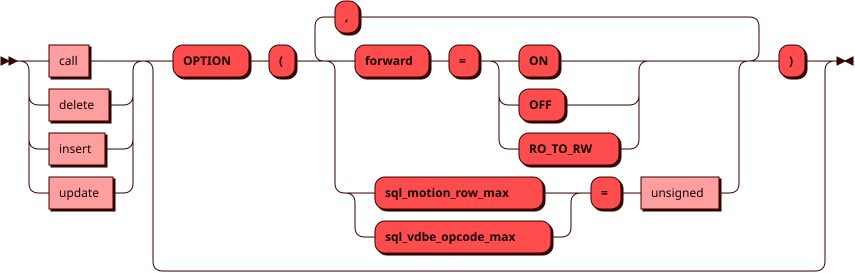

# Data Manipulation Language

Data Manipulation Language — команды языка SQL, изменяющие данные в
таблицах кластера. К ним относятся команды `CALL`, `DELETE`, `INSERT`,
`UPDATE`. Поддерживаются операции с шардированными, глобальными
и системными таблицами.

См. также:

- [Таблицы](../../overview/glossary.md#table)

## Синтаксис {: #syntax }

## Параметры {: #params }

* **SQL_VDBE_OPCODE_MAX** — ограничение на максимальное количество
  [инструкций ](https://www.sqlite.org/opcode.html) при исполнении
  локального плана ([VDBE](https://www.sqlite.org/vdbe.html)) на узле
  кластера.

* **SQL_MOTION_ROW_MAX** — ограничение на максимальное число строк в
  результирующей виртуальной таблице, собирающей результаты отдельных
  локальных запросов.

* **FORWARD** — дает возможность пользователям ограничивать количество пересылок
  по сети во время исполнения DQL- и DML-запросов. Так, если для исполнения
  запроса требуется больше пересылок, чем разрешено, то пользователь получит
  ошибку на этапе исполнения запроса. Подробнее с информацией об опции `FORWARD`
  можно ознакомиться в соответствующем [разделе](forward_option.md).
