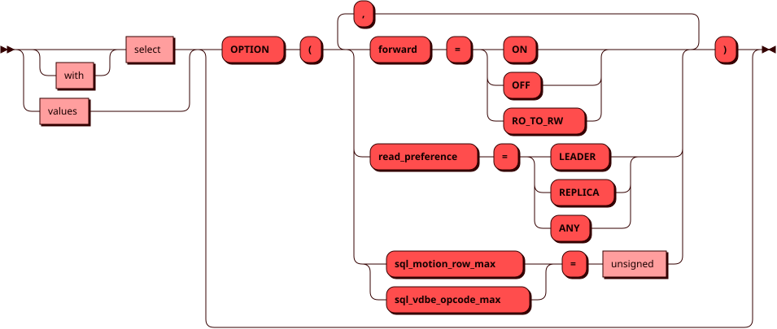

# Data Query Language

Data Query Language — команды языка SQL, читающие данные (как
сгенерированные, так и уже находящиеся в таблицах). Для чтения данных из
таблиц используется команда `SELECT`.

## Синтаксис {: #syntax }

## Общие опции и параметры {: #common_options }

Для DQL-запросов применяются следующие общие параметры и опции:

* [SQL_VDBE_OPCODE_MAX](common_options.md#vdbe)
* [SQL_MOTION_ROW_MAX](common_options.md#vdbe)
* [READ_PREFERENCE](common_options.md#read_preference)
* [FORWARD](common_options.md#forward)
