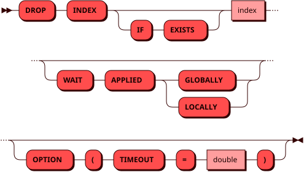

# DROP INDEX

[DDL](ddl.md)-команда `DROP INDEX` используется для удаления индекса.

## Синтаксис {: #syntax }



## Параметры {: #params }

* **INDEX** — имя индекса; соответствует правилам имен для всех
[объектов](object.md) в кластере
* **IF EXISTS** — позволяет избежать ошибки в случае, если такого
  индекса в кластере нет

## Общие опции и параметры {: #common_options }

Для данной команды доступны следующие общие опции и параметры SQL:

* [TIMEOUT](common_options.md#timeout)
* [WAIT APPLIED](common_options.md#wait_applied)

!!! warning "Ограничения"
    Выполнить `DROP INDEX` для первичного ключа невозможно.

## Требуемые привилегии {: #required_privileges }

Данная команда требует привилегии `DROP TABLE`.

См. также:

- [Управление доступом — Таблица привилегий](../../admin/access_control.md#privileges_table)

## Примеры {: #examples }

```sql
DROP INDEX name_year
OPTION (TIMEOUT = 3.0);
```

```sql
DROP INDEX name_year
WAIT APPLIED GLOBALLY
OPTION (TIMEOUT = 3.0);
```
