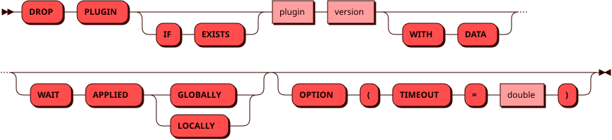

# DROP PLUGIN

[DCL](dcl.md)-команда `DROP PLUGIN` используется для удаления существующего
[плагина](../../overview/glossary.md#plugin) из кластера.

## Синтаксис {: #syntax }



## Параметры {: #params }

* **PLUGIN** — имя роли. Соответствует правилам имен для всех
  [объектов](object.md) в кластере
* **IF EXISTS** — позволяет избежать ошибки в случае, если такого
  плагина в кластере нет
* **WITH DATA** — удаление плагина вместе с его данными (записи в
  системных таблицах плюс выполнение команд из раздела `pico.DOWN` файла
  [миграций])

## Общие опции и параметры {: #common_options }

Для данной команды доступны следующие общие опции и параметры SQL:

* [TIMEOUT](common_options.md#timeout)
* [WAIT APPLIED](common_options.md#wait_applied)

[миграций]: ../../overview/glossary.md#migration

## Требуемые привилегии {: #required_privileges }

Данная команда требует привилегии [Администратора
СУБД](../../admin/access_control.md#admin) (`admin`).

См. также:

- [Управление доступом — Таблица привилегий](../../admin/access_control.md#privileges_table)

## Примеры {: #examples }

```sql
DROP PLUGIN weather_cache 0.1.0 WITH_DATA;
```
