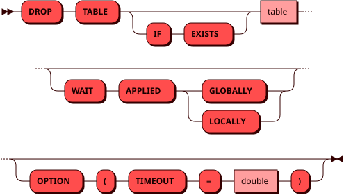

# DROP TABLE

[DDL](ddl.md)-команда `DROP TABLE` используется для удаления
существующей таблицы.

## Синтаксис {: #syntax }



## Параметры {: #params }

* **TABLE** — имя таблицы. Соответствует правилам имен для всех
  [объектов](object.md) в кластере
* **IF EXISTS** — позволяет избежать ошибки в случае, если такой
  таблицы в кластере нет

## Общие опции и параметры {: #common_options }

Для данной команды доступны следующие общие опции и параметры SQL:

* [TIMEOUT](common_options.md#timeout)
* [WAIT APPLIED](common_options.md#wait_applied)

## Требуемые привилегии {: #required_privileges }

Данная команда требует привилегии `DROP TABLE`.

См. также:

- [Управление доступом — Таблица привилегий](../../admin/access_control.md#privileges_table)

## Примеры {: #examples }

```sql
DROP TABLE warehouse
OPTION (TIMEOUT = 3.0);
```

```sql
DROP TABLE warehouse
WAIT APPLIED GLOBALLY
OPTION (TIMEOUT = 3.0);
```
