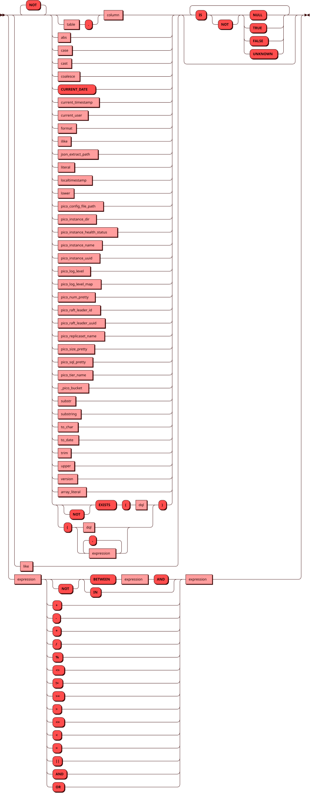
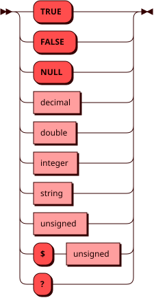

# FORMAT

Скалярная функция `FORMAT` подставляет значения в строку формата, как
функция `format` в PostgreSQL. Функция поддерживает спецификаторы
`%s`, `%I`, `%L` и `%%`.

## Синтаксис {: #syntax }


### Выражение {: #expression }

??? note "Диаграмма"
    

### Литерал {: #literal }

??? note "Диаграмма"
    

## Правила {: #rules }

* Каждый спецификатор `%s`, `%I` и `%L` берет следующее значение по
  порядку:
    * `%s` — значение как текст. `NULL` дает пустую строку.
    * `%I` — значение как идентификатор. Функция заключает его в двойные
      кавычки, если без кавычек парсер прочитает его иначе: например,
      имя с заглавными буквами, пробелом или ключевое слово. Значение
      `NULL` дает ошибку.
    * `%L` — значение как строковый литерал в одинарных кавычках.
      Одинарная кавычка внутри значения удваивается. `NULL` дает `NULL`
      без кавычек.
* `%%` дает один символ `%`.
* Значение любого типа функция приводит к тексту так же, как
  `CAST(значение AS TEXT)`. Значение, которое нельзя привести к тексту,
  например массив, дает ошибку.
* Лишние значения функция пропускает. Если значений меньше, чем
  спецификаторов, функция дает ошибку `too few arguments for format()`.
* Другие спецификаторы, а также номера аргументов (`%1$s`), ширина и
  флаги PostgreSQL не поддерживаются и дают ошибку.
* Если строка формата равна `NULL`, результат равен `NULL`.
* Результат имеет тип `TEXT`.

## Примеры {: #examples }

```sql
SELECT format('INSERT INTO %I VALUES (%s, %L)', 'My Table', 1, 'it''s');
```

??? note "Результат"
    ```shell
    +------------------------------------------------+
    | col_1                                          |
    +================================================+
    | "INSERT INTO \"My Table\" VALUES (1, 'it''s')" |
    +------------------------------------------------+
    (1 rows)
    ```
