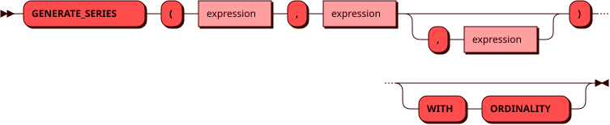

# GENERATE_SERIES

Табличная функция `GENERATE_SERIES` возвращает ряд чисел от начального
значения до конечного включительно с заданным шагом. По умолчанию шаг
равен `1`, отрицательный шаг дает убывающий ряд. Функция указывается в
предложении `FROM` как источник строк.

Числа ряда находятся в колонке `value`. Параметр `WITH ORDINALITY`
добавляет колонку `ordinality` с номером строки, начиная с `1`.

Если все аргументы имеют тип [INTEGER](../sql_types.md#integer), ряд имеет
тип `INTEGER`. Если хотя бы один аргумент имеет тип
[DECIMAL](../sql_types.md#decimal), ряд имеет тип `DECIMAL`. Аргументы типа
[DOUBLE](../sql_types.md#double) не поддерживаются, как и в PostgreSQL.

Ряд пустой, если начальное значение больше конечного при положительном
шаге или меньше при отрицательном, а также если хотя бы один аргумент
равен `NULL`. Нулевой шаг приводит к ошибке.

## Синтаксис {: #syntax }



## Использование в соединении {: #lateral }

Аргументы функции справа от [JOIN](join.md) могут ссылаться на колонки
источников слева от нее. Тогда ряд вычисляется для каждой строки левой
части, как для функции с `LATERAL` в PostgreSQL.

## Примеры {: #examples }

??? example "Подготовка тестового окружения"
    Примеры использования команд включают в себя запросы к [тестовым
    таблицам](../legend.md).

```sql title="Ряд целых чисел"
sql> SELECT * FROM generate_series(1, 3);
+-------+
| value |
+=======+
| 1     |
|-------|
| 2     |
|-------|
| 3     |
+-------+
(3 rows)
```

```sql title="Убывающий ряд с номерами строк"
sql> SELECT * FROM generate_series(10, 1, -4) WITH ORDINALITY;
+-------+------------+
| value | ordinality |
+====================+
| 10    | 1          |
|-------+------------|
| 6     | 2          |
|-------+------------|
| 2     | 3          |
+-------+------------+
(3 rows)
```

```sql title="Ряд с дробным шагом имеет тип DECIMAL"
sql> SELECT * FROM generate_series(1, 2, 0.5);
+-------+
| value |
+=======+
| 1     |
|-------|
| 1.5   |
|-------|
| 2     |
+-------+
(3 rows)
```

```sql title="Ряд от 1 до id для каждой строки таблицы items"
sql> SELECT name, g.value FROM items
     JOIN generate_series(1, items.id) g ON true
     WHERE items.id < 3 ORDER BY 1, 2;
+--------+-------+
| name   | value |
+================+
| bricks | 1     |
|--------+-------|
| panels | 1     |
|--------+-------|
| panels | 2     |
+--------+-------+
(3 rows)
```
