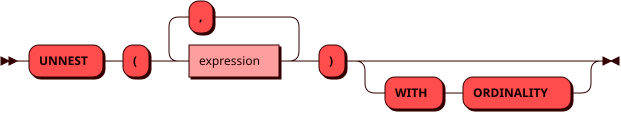

# UNNEST

Табличная функция `UNNEST` возвращает элементы [массива](../sql_types.md#array),
по одному в строке. Функция указывается в предложении `FROM` как источник
строк.

Элементы находятся в колонке `value`, ее тип совпадает с типом элементов
массива. Параметр `WITH ORDINALITY` добавляет колонку `ordinality` с
номером элемента, начиная с `1`.

У массивов в системных таблицах, например `_pico_table.format`, тип
элементов не задан. Колонку `value` такого массива можно выбрать, но для
сравнения и вычислений ее нужно явно привести к типу, например
`value::text = 'Online'`.

Если тип массива неизвестен — это `NULL` или параметр, тип которого не
задан, — массив считается массивом строк, и колонка получает тип `text`.

Если массив пустой или равен `NULL`, функция не возвращает строк.

## Несколько массивов {: #several-arrays }

Функция принимает до 127 массивов. С несколькими массивами она
возвращает элементы с одним номером из каждого массива в одной строке,
как в PostgreSQL. Элементы первого массива находятся в колонке `value_1`,
второго — в колонке `value_2` и так далее. Колонки `value` у такой
функции нет. Тип колонки совпадает с типом элементов ее массива.

Число строк равно длине самого длинного массива. Более короткий массив
дает `NULL` после своего последнего элемента, а массив `NULL` считается
пустым.

Параметр без типа, переданный отдельным аргументом, получает тип из
другого аргумента, где тип этого параметра указан: в
`unnest($1::int[], $1)` оба аргумента имеют тип `int[]`. Внутри
выражения, например `COALESCE($1, NULL)`, параметр тип из другого
аргумента не получает, и тип нужно указать явно: `COALESCE($1::int[], NULL)`.

## Синтаксис {: #syntax }



## Использование в соединении {: #lateral }

Аргумент функции справа от [JOIN](join.md) может ссылаться на колонки
источников слева от нее. Тогда массив разворачивается для каждой строки
левой части, как для функции с `LATERAL` в PostgreSQL.

## Примеры {: #examples }

??? example "Подготовка тестового окружения"
    Примеры использования команд включают в себя запросы к [тестовым
    таблицам](../legend.md). Последние два примера также используют
    таблицу `baskets`:

    ```sql
    CREATE TABLE baskets (
        id INTEGER NOT NULL,
        items INTEGER ARRAY,
        PRIMARY KEY (id))
    DISTRIBUTED BY (id);

    INSERT INTO baskets VALUES (1, ARRAY[1, 4]), (2, ARRAY[]), (3, NULL);
    ```

```sql title="Элементы массива с номерами"
sql> SELECT * FROM unnest(ARRAY['a', 'b']) WITH ORDINALITY;
+-------+------------+
| value | ordinality |
+====================+
| a     | 1          |
|-------+------------|
| b     | 2          |
+-------+------------+
(2 rows)
```

```sql title="Элементы двух массивов по позициям"
sql> SELECT * FROM unnest(ARRAY[1, 2, 3], ARRAY['a', 'b']);
+---------+---------+
| value_1 | value_2 |
+===================+
| 1       | a       |
|---------+---------|
| 2       | b       |
|---------+---------|
| 3       | nil     |
+---------+---------+
(3 rows)
```

```sql title="Названия товаров из массивов идентификаторов"
sql> SELECT baskets.id, items.name FROM baskets
     CROSS JOIN unnest(baskets.items) u
     JOIN items ON items.id = u.value
     ORDER BY 1, 2;
+----+--------+
| id | name   |
+=============+
| 1  | bars   |
|----+--------|
| 1  | bricks |
+----+--------+
(2 rows)
```

```sql title="LEFT JOIN сохраняет строки с пустым массивом и NULL"
sql> SELECT b.id, u.value, u.ordinality FROM baskets b
     LEFT JOIN unnest(b.items) WITH ORDINALITY u ON true
     ORDER BY 1, 3;
+----+-------+------------+
| id | value | ordinality |
+=========================+
| 1  | 1     | 1          |
|----+-------+------------|
| 1  | 4     | 2          |
|----+-------+------------|
| 2  | nil   | nil        |
|----+-------+------------|
| 3  | nil   | nil        |
+----+-------+------------+
(4 rows)
```
